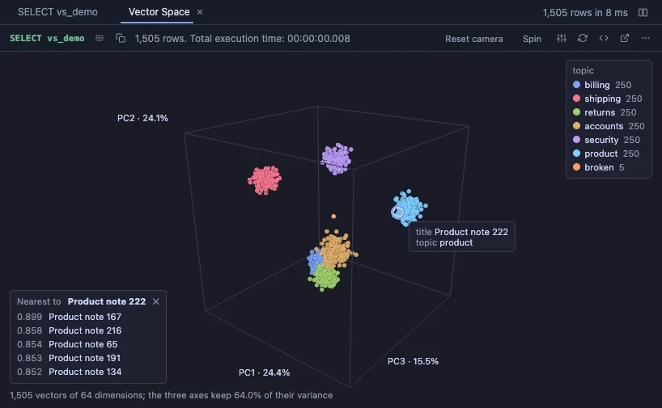
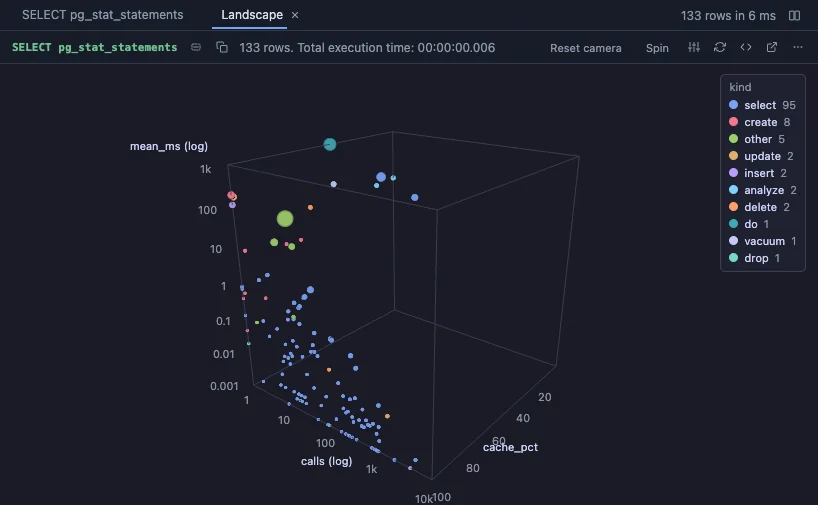
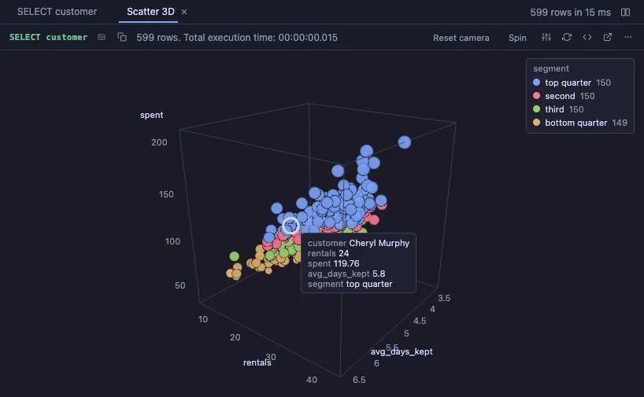
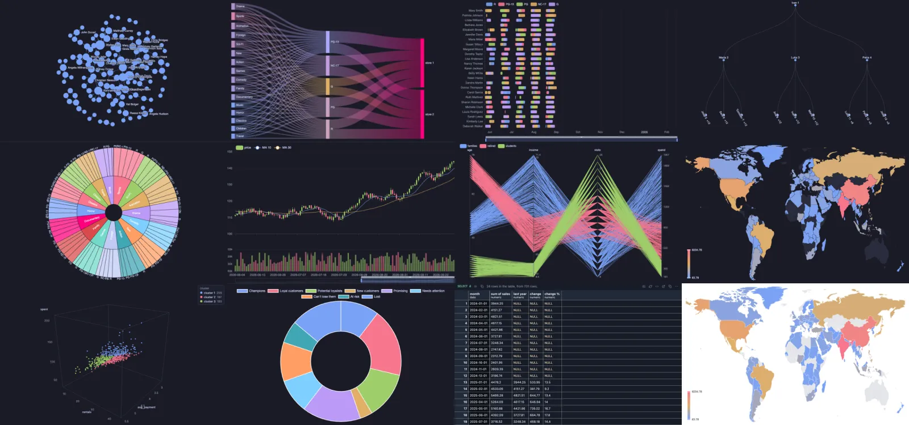

#  PlumeSQL

> Turn SQL into tools: a desktop IDE for PostgreSQL, where a SQL file
> can become a monitor, a dashboard or a button.

> [!NOTE]
> **PlumeSQL 0.27.0 is here**: a new look (calm neutral Dark and
> Light themes with one clear blue, tabs and splitters like VS Code's),
> hovers you can leave out per keyword, per kind of object or entirely,
> and a checkbox for each extension when you install several at once.
> [What's in it](changelog/free-v0.27.0/README.md).
>
> PlumeSQL is still in beta: new releases come often, and features can
> still change between them. The app updates itself. Something broken
> or missing? [Open an issue](https://github.com/hercstack/plumesql/issues),
> or use Report a Bug in the app.

[Download](https://github.com/hercstack/plumesql/releases) ·
[Videos](https://www.youtube.com/@plumesql) ·
[Extensions](extensions/) ·
[Discussions](https://github.com/hercstack/plumesql/discussions)

Here's a whole extension. It's one SQL file, a query and a few `@`
comments, and PlumeSQL turns it into a small app you run from the
Extensions tab or pin to the title bar. This one is a lock monitor. It
shows who is waiting on a lock and who is holding it:

```sql
-- @description Backends waiting on a lock, and the backend holding it
-- @refresh 5s
select w.pid as waiter, b.pid as blocker, w.query as "waiting query"
from pg_catalog.pg_stat_activity w
     join lateral pg_catalog.unnest(pg_catalog.pg_blocking_pids(w.pid)) as bp on true
     join pg_catalog.pg_stat_activity b on b.pid = bp;

-- @button terminate blocker
-- @confirm Terminate backend $blocker? Any transaction it holds is rolled back, which is what releases the lock.
select pg_catalog.pg_terminate_backend($blocker);
```

It refreshes every five seconds and puts a Terminate button on every
row, which asks before it acts:


That's a cut-down version of
[blocking-locks](extensions/Activity%20and%20Locks/blocking-locks/),
one of more than 200 extensions in this repo. Others draw charts and 3D
views, put your PostGIS data on a map, or add refactors for PostGIS,
pgvector and TimescaleDB. [More below](#extensions).

**Free, no account, for macOS, Windows and Linux.** The app is closed
source; the extensions and specifications in this repository are
[MIT](LICENSE).

## Why not the tool you already use?

Here's the short version. The rest of this page has the details.

- It's all in on PostgreSQL and nothing else, so it can use everything
  PostgreSQL has. [More on that below](#deep-on-postgresql).
- It's small: a 14 MB download, no Java. You add extensions for what
  you need, when you need them.
- Completion reads the query you're writing, CTEs and subqueries
  included, and writes whole joins from your foreign keys.
- [The lightbulb](#the-lightbulb) has more than thirty refactors built
  in, from fixing an ambiguous column to the index your query is
  missing. Extensions add their own, for window functions, statistics,
  PostGIS, pgvector and TimescaleDB.
- The grid takes millions of rows without slowing down. Freeze rows and
  columns like in a spreadsheet, filter, or compare two results side by
  side.
- You edit data right in the grid. Enums, jsonb and foreign keys each
  get the right control.
- There's a JavaScript console, and it reaches everything: your results,
  the open tab, the connection, the DDL snapshot.
- A few comments turn a query into a small app you can send to your
  team. It's still just a SQL file.
- The [extension gallery](#extensions) has a view for almost any result:
  charts, maps, 3D, pivots, KPI cards.

And you don't have to give anything up to try it. `plumesql .` opens the
folder you already work in.

## Deep on PostgreSQL

Most database tools support every database under the sun, and none of
them really well. PlumeSQL only does PostgreSQL, and goes deep on it.
It's built on PostgreSQL's own parser, catalogs and sessions:

- **An extension for almost everything.** Locks, waits, vacuum, bloat,
  replication, indexes, checkpoints, I/O, sequences close to overflow,
  ranges, network types, backups. We even have extensions for the
  PostgreSQL extensions: [PostGIS](extensions/PostGIS/),
  [TimescaleDB](extensions/TimescaleDB/),
  [pgvector](extensions/pgvector/), [Citus](extensions/Citus/),
  [pg_cron](extensions/pg_cron/), [pg_partman](extensions/pg_partman/)
  and `pg_stat_statements`. PlumeSQL sees what's installed on your
  server and recommends the ones that fit.
- **The PostgreSQL docs, right where you need them.** Hover a keyword
  and you get a link to its reference page, for your server's version.
  Every catalog, every builtin function and type, and every function an
  extension adds (contrib modules, PostGIS, Citus, TimescaleDB) has a
  Documentation entry that opens the real page inside PlumeSQL. Even
  catalog columns explain themselves, so you finally know what
  `relkind` means. Pages are cached, so they work offline too.
- **EXPLAIN that tells you what's wrong.** The
  [explain-plan](extensions/Performance/explain-plan/) extension draws
  the plan and points out what to look at first: the steps eating the
  time, estimates that are way off, sorts that spilled to disk.
  EXPLAIN ANALYZE on an INSERT, UPDATE or DELETE runs in a rollback, so
  nothing actually changes.
- **PL/pgSQL checked as you type.** Your function body is checked
  against the real server without creating anything, so you see a
  missing table before the function ever runs. You also get
  plpgsql_check-style warnings (unused variables, unreachable code, a
  missing RETURN) without installing plpgsql_check.
- **Safe on production.** Put `-- @readonly` in a script and PostgreSQL
  itself refuses any write. An UPDATE or DELETE without WHERE turns red
  before you run it, and COMMIT can show you what the transaction
  changed before it goes through. On a Production connection, anything
  that changes data asks first.
- **The tree sees your session.** The object tree and completion read
  through the editor's own session. Create a temp table, or a table in
  a transaction you haven't committed yet, and it's right there. Roll
  back and it's gone.

## The editor and the grid

### Completion that reads your statement

Completion runs on PostgreSQL's own parser, so it knows what your
statement defines, not just what's in the database. It keeps up even
while the statement is only half written.

- **Your query's own names.** A CTE shows up as a table in FROM and its
  columns follow its alias. A subquery's alias knows what the subquery
  selects, a function in FROM knows what it returns, and a CTE built on
  `select *` still knows the columns behind the star. Only what's
  visible at the cursor is offered.
- **Whole phrases from your foreign keys.** After a table in FROM it
  offers every related table as a complete join, ON included. Even the
  system catalogs join along their own keys. An INSERT gets its column
  list and VALUES with a placeholder of the right type for each column,
  ON CONFLICT gets the upsert, and a WHERE gets the EXISTS over the rows
  that reference the table.
- **The next word first.** After `select *` the list opens on FROM,
  after a join on ON, after a condition on AND, GROUP BY and ORDER BY.
  The alphabet comes second.
- **PL/pgSQL too.** Inside a function body it completes your parameters
  and variables with their types, a `%ROWTYPE` variable's columns, RAISE
  levels, exception names with their SQLSTATE, and every loop and block,
  written out for you.

### The lightbulb

The lightbulb beside each statement rewrites it for you. There are more
than thirty refactors, and you can switch off any you don't want. A few
of them:

- **Fixes.** An ambiguous column gets the table you pick when the server
  complains about it, a stray comma before FROM goes, and NOT IN turns
  into a NOT EXISTS that's safe with NULLs.
- **Rewrites.** Join a related table along its foreign key, expand `*`
  into columns, extract a subquery into a CTE or a value into a
  parameter, and inline it back.
- **Safety.** See the rows an UPDATE or DELETE would touch before you
  run it, add a WHERE on the primary key to one that has none, add
  RETURNING or an upsert.
- **From the results.** Once a query has run, the lightbulb reads what
  came back: a text column full of dates gets cast to date, the keys of
  a JSON column become columns, and a column of categories gets counted
  per value.
- **Indexes.** A column you filter on, in a big table no index starts
  with, gets the CREATE INDEX it's missing.

Extensions add their own refactors.
[Window functions](extensions/Calculations/window-refactors/) writes a
running total, a moving average, a rank or the top rows per group into
your query. [Statistics](extensions/Analysis/statistics-refactors/)
describes a number column, its correlation, trend, histogram and
outliers, all computed by PostgreSQL. When your query looks like it
could use one, the lightbulb offers to install it.

### The grid

- **Edit rows.** A result from one table is editable, primary key or
  not. Press F2 on a row and you get a form with the right control for
  each type: an enum picks from its labels, a foreign key is picked from
  the rows of the table it references, and jsonb opens in a full JSON
  editor. Every change is logged with an Undo, and a row someone else
  changed in the meantime is never overwritten.
- **Follow foreign keys.** A foreign key value is a link. Click it and
  the row it points at opens. Keep clicking to walk through your data,
  with Back and Forward to retrace your steps.

## Scripts that set themselves up

A SQL script can carry its own settings in plain comments. Open it and
it already knows where to run and how to show the result:

```sql
-- @connection reporting
-- @readonly

-- @inputs $1=2026-01-01
-- @extension echarts beside
select date_trunc('day', created_at) as day, count(*) as orders
from orders
where created_at >= $1
group by 1
order by 1;
```

- `@connection` pins the script to a connection, so it can't run on the
  wrong server by accident, and `@readonly` keeps it from writing at all.
  Another `@connection` line further down, and the rest of the script
  runs on that server: one script, several databases.
- `@inputs` fills in the query's parameters, so it runs without asking.
- `@extension` picks how the result is shown: a chart, a pivot, KPI
  cards, beside the grid or instead of it. `@inputs` can set up the
  view too.

There's more, like `@confirm-writes` and the file's own formatting
style. The editor completes annotations as you type, explains each one
on hover and lists them in the Outline. To any other tool it's still
just a SQL file. The full list is in
[ACTIONSPEC.md](docs/ACTIONSPEC.md).

## Who makes it

PlumeSQL is made by [Vedran Bilopavlović](https://github.com/vbilopav)
and [Kristijan Soldo](https://github.com/kristijansoldo).

Vedran has worked with databases for 30 years and wrote
[NpgsqlRest](https://github.com/NpgsqlRest/NpgsqlRest), which serves
PostgreSQL functions, tables and SQL files as a REST API. PlumeSQL's
comment annotations are the same idea as NpgsqlRest's
([ACTIONSPEC.md §14.1](docs/ACTIONSPEC.md#141-other-vocabularies)).

Nothing here locks you in: a tool is a plain SQL file you can read and
run anywhere, and its format is an MIT specification. Every query
extension in this repository runs on PostgreSQL 13 to 18, TimescaleDB
and Citus on each push:

[](https://github.com/hercstack/plumesql/actions/workflows/execute.yml)

## Install

Download from [Releases](https://github.com/hercstack/plumesql/releases):

| Platform | Package |
|---|---|
| macOS, Apple Silicon | `.dmg` |
| Windows | `.msi` or setup `.exe` |
| Linux | `.deb`, `.rpm` or `.AppImage` |

The app updates itself, and checks each update's signature before
installing it. What is new in each release is in
[`changelog/`](changelog/).

The macOS app is signed and notarized by Apple: it opens on the first
double click.

The Windows installer is not signed yet: if SmartScreen stops it, choose
More info and Run anyway.

### From the command line

The Welcome tab adds a `plumesql` command to your shell. Then:

```sh
plumesql .                         # this folder, in the desktop app
plumesql -browser .                # this folder, in a browser tab
plumesql postgres://user@host/db   # open and connect, like psql
plumesql --help                    # everything else
```

## What else it does

- **Connections found in your project.** `.env`, `appsettings.json`,
  docker-compose, Django, Prisma, Rails, Spring: nothing to type.
- **psql's commands in the editor.** `\d`, `\dt`, `\df`, `\sf` and
  `\conninfo` answer right under the line, and the Log's console speaks
  psql too.
- **Results of any size.** Millions of rows, kept whole on disk and
  scrolled smoothly. Freeze and filter columns, peek at a long value,
  compare two results side by side, and copy them as CSV, JSON or a
  Markdown table.
- **A console over your results.** JavaScript under the Log, with the
  last result, the open tab and the database at hand.
- **Your database as files.** The object browser is a DDL snapshot on
  disk, one file per object, to search and compare without a query.
- **Foreign data wrappers.** Wrappers, servers, user mappings and
  foreign tables are in the object tree and the snapshot, with the
  passwords left out. Right-click a server for a ready
  `IMPORT FOREIGN SCHEMA`, and completion knows your servers and the
  options `postgres_fdw`, `file_fdw` and `mysql_fdw` take.
- **PostgreSQL on your machine.** The System page lists the servers on
  your machine, installed or in Docker, and adds one to your connections
  in a click. No PostgreSQL yet? It starts a sample database or an empty
  server in Docker, or installs one for you. The client tools can run
  from Docker too, any version, nothing to install.
- **Terminals, as many as you like.** In the bottom panel or as a tab
  of their own. Each one shows what runs in it, and nothing gets
  stopped by accident.
- **In the desktop app, or in your browser.** The same PlumeSQL runs in
  a tab of the browser you already have: `plumesql -browser .`
- **Feels like VS Code.** Its editor, its shortcuts, its command palette,
  one title row with the menus on Windows, and Import from VS Code for
  your settings, theme and connections.

## Extensions

There are more than 200 of them, and we keep adding more. A few, as
they look:

<table>
  <tr>
    <td width="33%"><a href="extensions/Charts/city-3d/"></a><br /><b>City 3D</b>: rows as buildings</td>
    <td width="33%"><a href="extensions/PostGIS/postgis-map/"></a><br /><b>Map</b>: PostGIS on a real map</td>
    <td width="33%"><a href="extensions/pgvector/vector-space-3d/"></a><br /><b>Vector Space 3D</b>: your embeddings</td>
  </tr>
  <tr>
    <td><a href="extensions/Performance/query-landscape/"></a><br /><b>Query landscape</b>: the costly queries stand out</td>
    <td><a href="extensions/Storage%20and%20Maintenance/storage-city/"></a><br /><b>Storage city</b>: your tables by size</td>
    <td><a href="extensions/Charts/scatter-3d/"></a><br /><b>Scatter 3D</b>: three numbers at once</td>
  </tr>
</table>

And the newest, on real data:



From the top left: [Network graph](extensions/Charts/network-graph/),
[Sankey](extensions/Charts/sankey/),
[Timeline](extensions/Charts/timeline/),
[Tree](extensions/Charts/tree/),
[Sunburst](extensions/Charts/sunburst/),
[Candlestick](extensions/Charts/candlestick/),
[Parallel coordinates](extensions/Charts/parallel-coordinates/),
[World map](extensions/Charts/world-map/),
[Clusters](extensions/Analysis/clusters/) in Scatter 3D,
[RFM segments](extensions/Analysis/rfm/),
[Period over period](extensions/Analysis/period-over-period/) and the
world map again, in the light theme.

Some we use a lot:

- **Charts.** The usual ones (ECharts, Chart.js, Vega-Lite and a set of
  [statistical charts](extensions/Statistical%20Charts/)), plus
  [Scatter GL](extensions/Charts/scatter-gl/) for a million points and
  [SandDance](extensions/Charts/sanddance/) for when you have even
  more. For dashboards there are
  [KPI cards](extensions/Dashboards/kpi-cards/), gauges, funnels and
  treemaps.
- **3D.** [Scatter 3D](extensions/Charts/scatter-3d/),
  [3D bars](extensions/Charts/bars-3d/) and
  [City 3D](extensions/Charts/city-3d/) turn a query result into
  something you can spin around with the mouse.
  [Storage city](extensions/Storage%20and%20Maintenance/storage-city/)
  draws your database as a city, one building per table, and
  [Query landscape](extensions/Performance/query-landscape/) does the
  same for `pg_stat_statements`. The expensive queries stick out.
- **Maps.** If you use PostGIS, [Map](extensions/PostGIS/postgis-map/)
  puts your geometry on a real OpenStreetMap map. The
  [PostGIS](extensions/PostGIS/postgis/) extension makes geometry
  readable in the grid, with a little sketch of each shape.
- **Embeddings.** [Vector Space 3D](extensions/pgvector/vector-space-3d/)
  shows a pgvector column in 3D, so you can see the clusters and the
  outliers. Click a point to get its nearest neighbours.
- **Refactors.** Extensions can add their own refactors to the
  lightbulb. The [pgvector](extensions/pgvector/pgvector-refactors/) one
  writes the nearest neighbour query for you, and the HNSW index it
  needs. The [TimescaleDB](extensions/TimescaleDB/timescaledb-refactors/)
  one counts or averages a hypertable's rows per time bucket, and the
  [PostGIS](extensions/PostGIS/postgis-refactors/) one moves geometry to
  WGS 84 or shows it as GeoJSON.
- **DBA stuff.** [Locks](extensions/Activity%20and%20Locks/blocking-locks/),
  [slow queries](extensions/Performance/top-queries/),
  [table bloat](extensions/Storage%20and%20Maintenance/table-bloat/),
  [health check](extensions/Server%20and%20Security/health-check/),
  [server setup](extensions/Server%20and%20Security/server-setup/) for
  your machine's memory, cores and disks,
  [backup](extensions/Backup%20and%20Tools/backup/) and
  [restore](extensions/Backup%20and%20Tools/restore/).
- **Everyday stuff.** [Visual EXPLAIN](extensions/Performance/explain-plan/),
  [pivot](extensions/Reshape/pivot/),
  [profile](extensions/Analysis/profile/),
  [query to CSV](extensions/Backup%20and%20Tools/query-to-csv/) and
  [rows as SQL](extensions/Reshape/rows-as-sql/).

You install them from the Extensions tab, one by one or in packs like
[DBA essentials](extensions/Packs/dba-essentials/) or
[PostGIS essentials](extensions/Packs/postgis-essentials/). They're
just files, so you can read one before you install it, change it, or
send it to a colleague. There's no plugin SDK to learn. Pin the ones
you use to the top of the tab and run them from Go to Tab or File; what
was published since your last start waits at the top, marked New.

Can't find what you need? Write it. An extension can be a SQL file, a
command, or a bit of JavaScript that draws a result. Start with
[extensions/README.md](extensions/README.md). The annotation format is
in [ACTIONSPEC.md](docs/ACTIONSPEC.md) if you want the details. Publish
it to the Marketplace and anyone can install it.

## See it in action

- [PlumeSQL in 90 seconds](https://www.youtube.com/watch?v=HlLU1z-JeoY)
- [Refactorings: the lightbulb rewrites SQL for you](https://www.youtube.com/watch?v=-sZ1rtXzpt8)
- [Query extensions: SQL files with annotations](https://www.youtube.com/watch?v=f_ZE0SI1myU)
- [DBA tools as extensions](https://www.youtube.com/watch?v=erkLWykPNwQ)
- [A grid for millions of rows](https://www.youtube.com/watch?v=6KUaK5CGuvU)
- [EXPLAIN and the plan visualizer](https://www.youtube.com/watch?v=ukZQH5uEfOc)
- [Charts over your query results](https://www.youtube.com/watch?v=EnEd-aN30nU)

More, about a minute each:
[Connections and objects](https://www.youtube.com/playlist?list=PLaGGK16T-VQw) ·
[The SQL editor](https://www.youtube.com/playlist?list=PLSE-xanBhbd8) ·
[Data and the grid](https://www.youtube.com/playlist?list=PLT3-TpTaniTc) ·
[Annotations and extensions](https://www.youtube.com/playlist?list=PLOpBX3NpZSy0) ·
[PostgreSQL extensions](https://www.youtube.com/playlist?list=PLHw_hYKYYgq4) ·
[Workspace](https://www.youtube.com/playlist?list=PLaIRU3PzWLLA)

## Tech

- **Go server:** connections over the PostgreSQL wire protocol, DDL
  rendering, the vault. Localhost only, behind a token minted at launch.
- **Svelte 5 interface with Monaco**, the editor inside VS Code.
  PostgreSQL's real parser (libpg_query) and a tree-sitter grammar run
  in WebAssembly.
- **Tauri shell** with the system webview: no bundled browser, no Java.
- **The object browser is a DDL snapshot on disk**, so browsing costs
  the server nothing. Tested against PostgreSQL 13 to 18.

A 14 MB download (85 MB for the Linux AppImage), 37 MB installed, the
server ready about 40 ms after launch (M4 Pro MacBook).

## Privacy

No account, no telemetry. Your connections and data stay on your
machine. Passwords live in your project files or an encrypted vault, and
never reach the interface. PlumeSQL goes online only for updates and
release notes, the extension catalog with its download counts and
comments, the video list, the PostgreSQL documentation pages you open,
Open VSX when you browse its themes, and YouTube when you press play.
An extension's chart libraries and map tiles come only from hosts you
allow, and the System page lists every host PlumeSQL reaches. Signing in
to GitHub, to comment on extensions and releases, is optional.

## Help

- Questions: [Q&A in Discussions](https://github.com/hercstack/plumesql/discussions/categories/q-a)
- About an extension: its own thread under
  [Extensions](https://github.com/hercstack/plumesql/discussions/categories/extensions),
  where the comments from its page in the app also go
- About a release: its thread under
  [Announcements](https://github.com/hercstack/plumesql/discussions/categories/announcements),
  where the comments from its release notes in the app also go
- Bugs: [Issues](https://github.com/hercstack/plumesql/issues), or Report a Bug in the app
- Security: [SECURITY.md](SECURITY.md)

## License

Everything in this repository (extensions, specifications) is
[MIT](LICENSE). The PlumeSQL app is free to use and closed source; it
shows its terms on first run.
