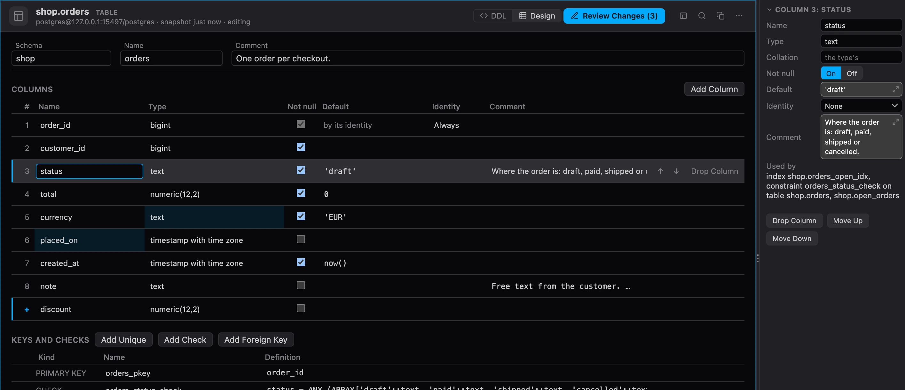
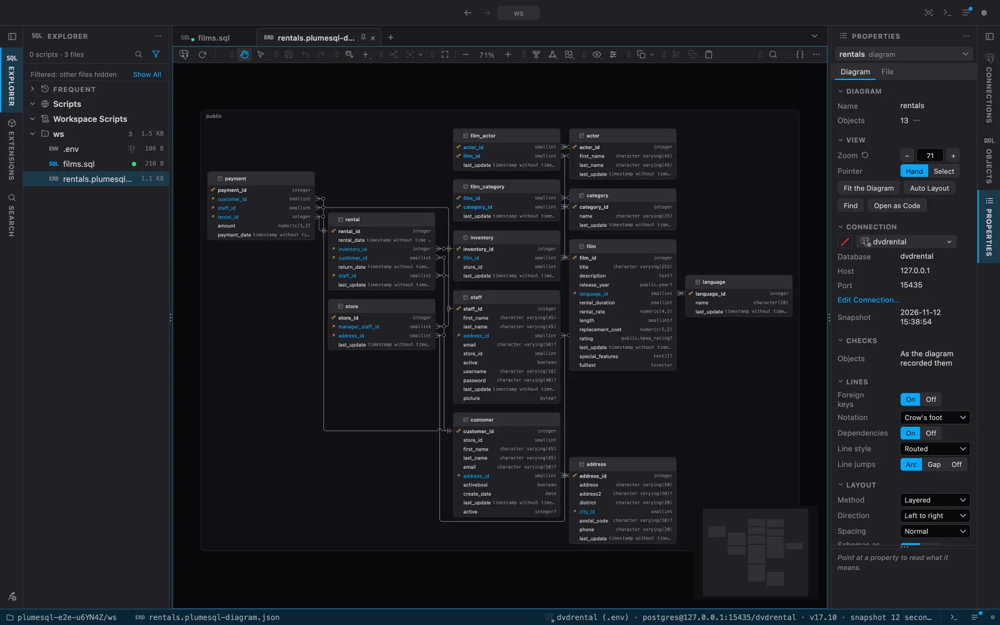
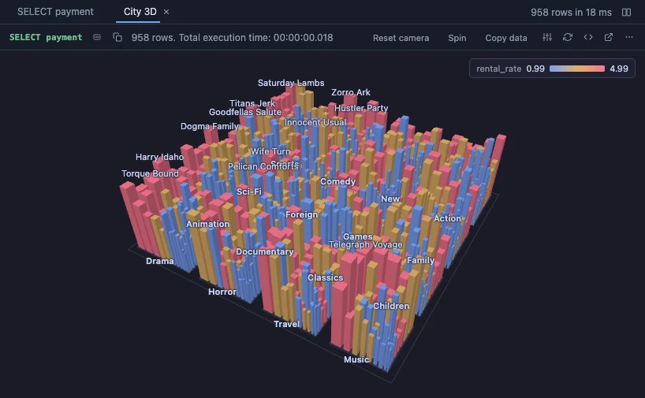
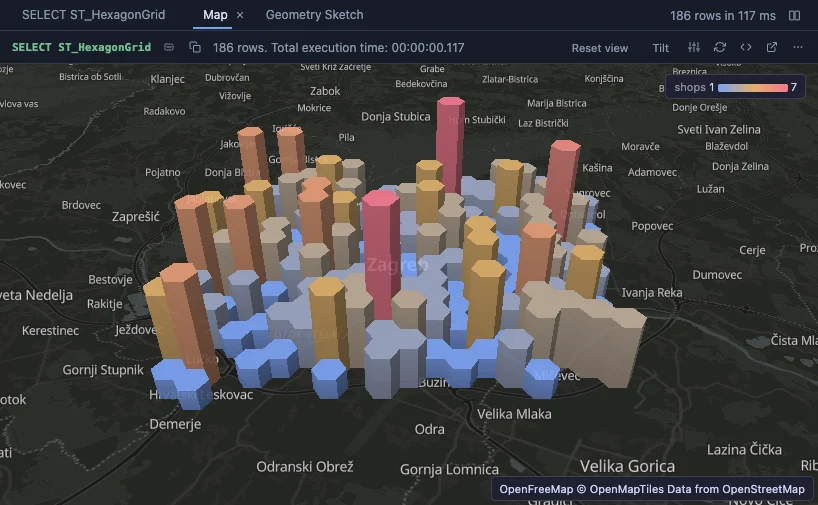
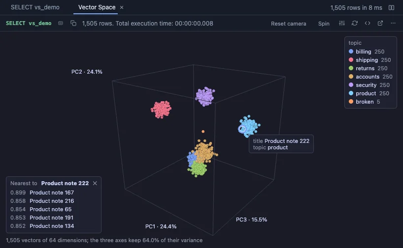
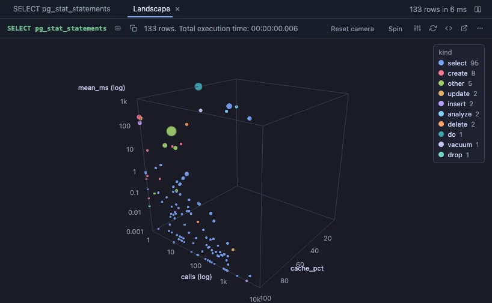
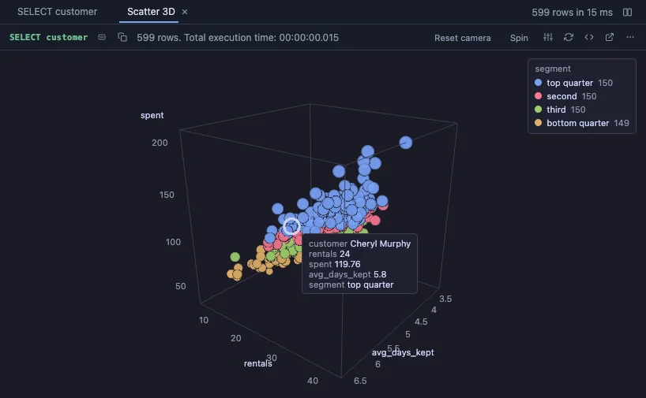
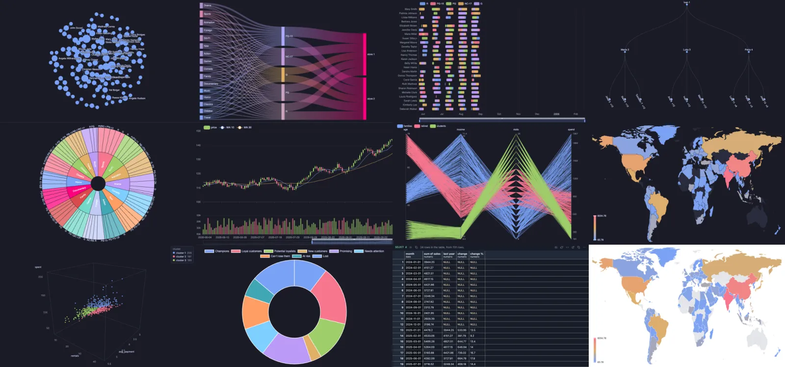

#  PlumeSQL

> A desktop IDE for PostgreSQL, and only PostgreSQL. It reads your SQL
> with PostgreSQL's own parser, has your server check it as you type,
> and turns a SQL file into a tool. Free, a 14 MB download, no account.

> [!NOTE]
> **PlumeSQL 0.32.0 is here**: edit a table in its Design, and the owner,
> grants and options of any object in Properties, every change gathered in
> one script you read before anything runs. Comments are Markdown
> everywhere, and a whole script, an extension or any file goes on a
> diagram. [What's in it](changelog/free-v0.32.0/README.md).
>
> PlumeSQL is in beta, with a new release about every week. The app
> updates itself, and features can still change between releases.
> Something broken or missing? [Open an issue](https://github.com/hercstack/plumesql/issues),
> or use Report a Bug in the app.

[Download](https://github.com/hercstack/plumesql/releases) ·
[Videos](https://www.youtube.com/@plumesql) ·
[Extensions](extensions/) ·
[Discussions](https://github.com/hercstack/plumesql/discussions)

## Why PlumeSQL, when you have DataGrip or pgAdmin?

PlumeSQL is built for one job: writing and running PostgreSQL every day.
Because it does nothing else, it can use everything PostgreSQL has.

- **The editor runs PostgreSQL's own parser.** Completion and checks read
  your statement the way the server will, CTEs, subqueries and half
  written statements included. Your server checks names and types as you
  type, without running anything, and a PL/pgSQL body is checked without
  creating the function. [More](#the-editor)
- **It sees your session.** Create a temp table, or a table in a
  transaction you haven't committed, and it's in the object tree and in
  completion at once. Roll back and it's gone. We found no other client
  that does this by default.
- **Nearly a hundred refactors.** [The lightbulb](#the-lightbulb) fixes
  an ambiguous column, turns a NOT IN that breaks on NULL into NOT EXISTS,
  writes the index a slow filter is missing and spreads a JSON column
  into columns. 36 are built in, the rest come in free extensions.
- **A SQL file becomes a tool.** A few comments turn a query into a
  monitor, a dashboard or a button you can send to your team. More than
  200 free [extensions](#extensions) are made this way: locks, bloat,
  EXPLAIN, charts, maps, PostGIS, pgvector, TimescaleDB.
- **Every change read before it runs.** Edit a table in its Design, or
  any object's owner and grants in Properties: it all goes into one
  script you read, and can change, run in one transaction when you say
  so. [More](#changing-the-database)
- **Safe on production.** `-- @readonly` makes PostgreSQL itself refuse
  writes, an UPDATE without WHERE turns red before it runs, and a
  Production connection asks before anything changes data and asks the
  server nothing while you type.
- **It works in your folder.** `plumesql .` opens the project you already
  have, finds its connections in `.env`, docker-compose, Django, Prisma,
  Rails or Spring, and keeps scripts, diagrams and extensions as plain
  files for git.
- **Feels like VS Code.** The same editor, shortcuts and command palette,
  and Import from VS Code for your settings, theme and connections.

At a glance, on macOS with Apple Silicon:

| | PlumeSQL Free | DataGrip | pgAdmin |
|---|---|---|---|
| Price | Free for all use | Free for non-commercial use; commercial from EUR 109 a year | Free, open source |
| Account | None | JetBrains Account | None |
| Telemetry | None | Mandatory on the free licence | None documented |
| Download | 14 MB | 1.03 GB | 235 MB |
| Installed | 38 MB | 2.6 GB | 726 MB |
| Databases | PostgreSQL | Many | PostgreSQL |
| Tree and completion see your temp and uncommitted tables | By default | With a single shared session switched on | No |

<sub>The other tools' prices, terms and sizes as read and measured on 14 October 2026.</sub>

### When your current tool is still the better choice

PlumeSQL is young. Keep what you have, or keep it beside PlumeSQL, if
you need:

- databases other than PostgreSQL;
- schema compare with migration scripts;
- a PL/pgSQL debugger or an AI assistant (both on the list below);
- query history, Git inside the app, or finding text in a result;
- an Intel Mac, or Windows or Linux on ARM: PlumeSQL runs on Apple
  Silicon Macs, Windows x64 and Linux x86_64.

Trying it costs nothing: `plumesql .` opens the folder you already work
in, and nothing in it changes unless you ask.

### In beta, a release a week, and what's next

PlumeSQL has been in public beta since 4 October 2026: more than fifteen
releases in its first six weeks, each installed by the app itself. What
we're most likely to build next, subject to change:

- a PL/pgSQL debugger
- functions and procedures in the procedural languages extensions add
  to PostgreSQL, such as PL/Python and PL/V8 (JavaScript), with the
  editor support PL/pgSQL has
- a test runner for your database
- documentation generated from your database
- a semantic layer that ties your tables to the business they describe

And AI built on it, not beside it: a knowledge graph that joins what
your data means to your business with the PostgreSQL documentation
PlumeSQL already carries. It will always be optional: if you want no AI,
you get none.

Tell us what you need in
[Discussions](https://github.com/hercstack/plumesql/discussions).

## A SQL file becomes a tool

Here's a whole extension. It's one SQL file, a query and a few `@`
comments, and PlumeSQL turns it into a small app you run from the
Extensions tab or pin to the title bar. This one is a lock monitor. It
shows who is waiting on a lock and who is holding it:

```sql
-- @description Backends waiting on a lock, and the backend holding it
-- @refresh 5s
select w.pid as waiter, b.pid as blocker, w.query as "waiting query"
from pg_catalog.pg_stat_activity w
     join lateral pg_catalog.unnest(pg_catalog.pg_blocking_pids(w.pid)) as bp on true
     join pg_catalog.pg_stat_activity b on b.pid = bp;

-- @button terminate blocker
-- @confirm Terminate backend $blocker? Any transaction it holds is rolled back, which is what releases the lock.
select pg_catalog.pg_terminate_backend($blocker);
```

It refreshes every five seconds and puts a Terminate button on every
row, which asks before it acts:


That's a cut-down version of
[blocking-locks](extensions/Activity%20and%20Locks/blocking-locks/),
one of more than 200 extensions in this repo. To any other tool it's
still just a SQL file. [More below](#extensions).

**Free, no account, for macOS, Windows and Linux.** The app is closed
source; the extensions and specifications in this repository are
[MIT](LICENSE).

## Deep on PostgreSQL

PlumeSQL is built on PostgreSQL's own parser, catalogs and sessions:

- **An extension for almost everything.** Locks, waits, vacuum, bloat,
  replication, indexes, checkpoints, I/O, sequences close to overflow,
  backups. There are extensions for the PostgreSQL extensions too:
  [PostGIS](extensions/PostGIS/), [TimescaleDB](extensions/TimescaleDB/),
  [pgvector](extensions/pgvector/), [Citus](extensions/Citus/),
  [pg_cron](extensions/pg_cron/), [pg_partman](extensions/pg_partman/)
  and `pg_stat_statements`. PlumeSQL sees what's installed on your
  server and recommends the ones that fit.
- **The PostgreSQL docs, right where you need them.** Hover a keyword,
  a clause, a type or a function and you get its own section of the
  reference, for your server's version, with an example. Every catalog,
  builtin and extension function opens its real page inside PlumeSQL,
  even catalog columns explain themselves, and the pages work offline.
- **EXPLAIN that tells you what's wrong.** The
  [explain-plan](extensions/Performance/explain-plan/) extension lays
  the plan out as cards and points out what to look at first: the steps
  eating the time, estimates that are way off, sorts that spilled to
  disk. EXPLAIN ANALYZE on a write runs in a rollback, so nothing changes.
- **PL/pgSQL checked as you type.** A function body is checked against
  the real server without creating anything, so you see a missing table
  before the function ever runs, with plpgsql_check style warnings
  (unused variables, unreachable code, a missing RETURN) and no
  plpgsql_check to install.
- **Safe on production.** Besides `@readonly` and the red UPDATE without
  WHERE, COMMIT can show you what the transaction changed before it goes
  through.

## The editor

### Completion that reads your statement

Completion knows what your statement defines, not just what's in the
database, and keeps up while the statement is only half written.

- **Your query's own names.** A CTE is a table in FROM and its columns
  follow its alias; a subquery's alias knows what it selects, a function
  in FROM knows what it returns. Only what's visible at the cursor is
  offered.
- **Whole phrases from your foreign keys.** After a table in FROM it
  offers every related table as a complete join, ON included. An INSERT
  gets its column list and VALUES, ON CONFLICT gets the upsert.
- **The next word first.** After `select *` the list opens on FROM,
  after a join on ON, after a condition on AND, GROUP BY and ORDER BY.
- **PL/pgSQL too.** Parameters and variables with their types, a
  `%ROWTYPE` variable's columns, exception names with their SQLSTATE,
  and every loop and block, written out for you.

### The lightbulb

The lightbulb beside each statement rewrites it for you. A few of the
refactors, and you can switch off any you don't want:

- **Fixes.** An ambiguous column gets the table you pick when the server
  complains, a stray comma before FROM goes, NOT IN turns into a NOT
  EXISTS that's safe with NULLs.
- **Rewrites.** Join a related table along its foreign key, expand `*`
  into columns, extract a subquery into a CTE or a value into a
  parameter, and inline it back.
- **Safety.** See the rows an UPDATE or DELETE would touch before you
  run it, add a WHERE on the primary key, add RETURNING or an upsert.
- **From the results.** A text column full of dates gets cast to date,
  the keys of a JSON column become columns, a column of categories gets
  counted per value.
- **Indexes.** A column you filter on, in a big table no index starts
  with, gets the CREATE INDEX it's missing.
- **From a selection.** Select columns and it finds their duplicates or
  profiles them; select statements and it wraps them in a transaction,
  one that rolls back so you can try them, or a DO block.

Extensions add their own:
[window functions](extensions/Calculations/window-refactors/) write a
running total or the top rows per group into your query, and
[statistics](extensions/Analysis/statistics-refactors/) describes a
number column, its trend and outliers, computed by PostgreSQL. When your
query looks like it could use one, the lightbulb offers to install it.

## The grid

- **Millions of rows.** Kept whole on disk and scrolled smoothly. Freeze
  rows and columns like in a spreadsheet, filter, peek at a long value,
  compare two results side by side.
- **Edit rows.** A query that reads one table is editable: with its key
  in the result, type over cells and Save writes it all in one transaction, or press F2 for a form
  where an enum picks from its labels, a foreign key from the rows it
  references, and jsonb opens in a JSON editor. Every change has an Undo,
  and a row someone else changed meanwhile is never overwritten.
- **Paste into a table.** Copy from Excel, Sheets or another result and
  paste. The format is detected, a decimal comma and a day-first date
  read as you meant them, and you see old and new values before anything
  is written. A CSV, TSV or JSON file dropped on the window goes into a
  new table, its columns named and typed for you.
- **Follow foreign keys.** A foreign key value is a link to the row it
  points at, with Back and Forward to retrace your steps.

## Changing the database

A table's tab has two faces: its DDL, and its **Design**, where the
columns, keys, checks, foreign keys and indexes are grids you edit where
they stand. A name, a type or an expression PostgreSQL wouldn't read is
flagged before anything runs. Move a column and the table is rebuilt in
the new order, its data, keys, views, triggers and grants kept. New Table
starts one the same way.



Properties edits the rest of any object: its owner, its grants, its
options, a function's security and settings, and its comment, written
in Markdown.

Nothing runs while you edit. Every change goes into one script per
connection, which you read, change if you like, and run in one
transaction with Run Changes. What may lose data or lock a big table
says so in the script, and Undo is right where you made the change.

## Diagrams

Pick objects from the object tree and they're laid out with their keys
and dependencies, schemas as frames. A diagram is a file beside your
scripts, shared through git, and each computer draws it from a
connection of its own.



Trace what a table is joined to, style cards and lines, add notes in
Markdown, and see what changed in the database since the diagram was
drawn. Queries, whole scripts and extensions go on the canvas too: a
SELECT shows its rows there, anything else runs when you ask, a change
confirmed first. Copy it as PNG, SVG or Mermaid.

## Scripts that set themselves up

A SQL script can carry its own settings in plain comments. Open it and
it already knows where to run and how to show the result:

```sql
-- @connection reporting
-- @readonly

-- @inputs $1=2026-01-01
-- @extension echarts beside
select date_trunc('day', created_at) as day, count(*) as orders
from orders
where created_at >= $1
group by 1
order by 1;
```

- `@connection` pins the script to a connection, so it can't run on the
  wrong server by accident, and `@readonly` keeps it from writing at all.
  Another `@connection` line further down, and the rest of the script
  runs on that server: one script, several databases.
- `@inputs` fills in the query's parameters, so it runs without asking.
- `@extension` picks how the result is shown: a chart, a pivot, KPI
  cards, beside the grid or instead of it.

The editor completes annotations as you type and explains each one on
hover. The full list is in [ACTIONSPEC.md](docs/ACTIONSPEC.md).

## Extensions

There are more than 200 of them, and we keep adding more. A few, as
they look:

<table>
  <tr>
    <td width="33%"><a href="extensions/Charts/city-3d/"></a><br /><b>City 3D</b>: rows as buildings</td>
    <td width="33%"><a href="extensions/PostGIS/postgis-map/"></a><br /><b>Map</b>: PostGIS on a real map</td>
    <td width="33%"><a href="extensions/pgvector/vector-space-3d/"></a><br /><b>Vector Space 3D</b>: your embeddings</td>
  </tr>
  <tr>
    <td><a href="extensions/Performance/query-landscape/"></a><br /><b>Query landscape</b>: the costly queries stand out</td>
    <td><a href="extensions/Storage%20and%20Maintenance/storage-city/"></a><br /><b>Storage city</b>: your tables by size</td>
    <td><a href="extensions/Charts/scatter-3d/"></a><br /><b>Scatter 3D</b>: three numbers at once</td>
  </tr>
</table>

And the newest, on real data:



From the top left: [Network graph](extensions/Charts/network-graph/),
[Sankey](extensions/Charts/sankey/),
[Timeline](extensions/Charts/timeline/),
[Tree](extensions/Charts/tree/),
[Sunburst](extensions/Charts/sunburst/),
[Candlestick](extensions/Charts/candlestick/),
[Parallel coordinates](extensions/Charts/parallel-coordinates/),
[World map](extensions/Charts/world-map/),
[Clusters](extensions/Analysis/clusters/) in Scatter 3D,
[RFM segments](extensions/Analysis/rfm/),
[Period over period](extensions/Analysis/period-over-period/) and the
world map again, in the light theme.

Some we use a lot:

- **Charts.** ECharts, Chart.js, Vega-Lite and a set of
  [statistical charts](extensions/Statistical%20Charts/), plus
  [Scatter GL](extensions/Charts/scatter-gl/) for a million points and
  [SandDance](extensions/Charts/sanddance/) for even more. For dashboards,
  [KPI cards](extensions/Dashboards/kpi-cards/), gauges, funnels and
  treemaps.
- **3D.** [Scatter 3D](extensions/Charts/scatter-3d/),
  [3D bars](extensions/Charts/bars-3d/) and
  [City 3D](extensions/Charts/city-3d/).
  [Storage city](extensions/Storage%20and%20Maintenance/storage-city/)
  draws your database as a city, one building per table, and
  [Query landscape](extensions/Performance/query-landscape/) does the
  same for `pg_stat_statements`.
- **PostGIS and pgvector.** [Map](extensions/PostGIS/postgis-map/) puts
  your geometry on OpenStreetMap, [PostGIS](extensions/PostGIS/postgis/)
  sketches each shape in the grid, and
  [Vector Space 3D](extensions/pgvector/vector-space-3d/) shows a
  pgvector column in 3D: click a point for its nearest neighbours.
- **Refactors.** [pgvector](extensions/pgvector/pgvector-refactors/)
  writes the nearest neighbour query and the HNSW index it needs,
  [TimescaleDB](extensions/TimescaleDB/timescaledb-refactors/) counts a
  hypertable's rows per time bucket, and
  [PostGIS](extensions/PostGIS/postgis-refactors/) moves geometry to
  WGS 84 or shows it as GeoJSON.
- **DBA stuff.** [Locks](extensions/Activity%20and%20Locks/blocking-locks/),
  [slow queries](extensions/Performance/top-queries/),
  [table bloat](extensions/Storage%20and%20Maintenance/table-bloat/),
  [health check](extensions/Server%20and%20Security/health-check/),
  [server setup](extensions/Server%20and%20Security/server-setup/) for
  your machine's memory, cores and disks,
  [backup](extensions/Backup%20and%20Tools/backup/) and
  [restore](extensions/Backup%20and%20Tools/restore/).
- **Everyday stuff.** [Visual EXPLAIN](extensions/Performance/explain-plan/),
  [pivot](extensions/Reshape/pivot/),
  [profile](extensions/Analysis/profile/),
  [query to CSV](extensions/Backup%20and%20Tools/query-to-csv/) and
  [rows as SQL](extensions/Reshape/rows-as-sql/).

You install them from the Extensions tab, one by one or in packs like
[DBA essentials](extensions/Packs/dba-essentials/) or
[PostGIS essentials](extensions/Packs/postgis-essentials/). They're
just files, so you can read one before you install it, change it, or
send it to a colleague. There's no plugin SDK to learn.

Can't find what you need? Write it. An extension can be a SQL file, a
command, or a bit of JavaScript that draws a result. Start with
[extensions/README.md](extensions/README.md), and publish it to the
Marketplace so anyone can install it.

## Install

Download from [Releases](https://github.com/hercstack/plumesql/releases):

| Platform | Package |
|---|---|
| macOS, Apple Silicon | `.dmg` |
| Windows | `.msi` or setup `.exe` |
| Linux | `.deb`, `.rpm` or `.AppImage` |

The app updates itself, and checks each update's signature before
installing it. What is new in each release is in
[`changelog/`](changelog/).

The macOS app is signed and notarized by Apple: it opens on the first
double click. The Windows installer is not signed yet: if SmartScreen
stops it, choose More info and Run anyway.

### From the command line

The Welcome tab adds a `plumesql` command to your shell. Then:

```sh
plumesql .                         # this folder, in the desktop app
plumesql -browser .                # this folder, in a browser tab
plumesql postgres://user@host/db   # open and connect, like psql
plumesql --help                    # everything else
```

## What else it does

- **psql's commands in the editor.** `\d`, `\dt`, `\df`, `\sf` and
  `\conninfo` answer right under the line, and the Log's console speaks
  psql too.
- **A console over your results.** JavaScript under the Log, with the
  last result, the open tab and the database at hand.
- **Your database as files.** The object browser is a DDL snapshot on
  disk, one file per object, to search and compare without a query.
- **Properties for whatever you work on.** A script's connection and
  session, a result's columns and selection with their counts and sums,
  a setting, a diagram, an object: all in one tab, to read and to change.
- **Foreign data wrappers.** Wrappers, servers, user mappings and
  foreign tables in the object tree, a ready `IMPORT FOREIGN SCHEMA`, and
  completion for the options `postgres_fdw`, `file_fdw` and `mysql_fdw`
  take.
- **PostgreSQL on your machine.** The System page lists the servers on
  your machine, installed or in Docker, and adds one to your connections
  in a click. No PostgreSQL yet? It starts a sample database in Docker,
  or installs a server for you.
- **Terminals, as many as you like.** In the bottom panel or as a tab
  of their own.
- **A theme of your own.** The Appearance tab shows the window as you
  change it; save it as a theme extension.
- **In the desktop app, or in your browser.** The same PlumeSQL runs in
  a tab of the browser you already have: `plumesql -browser .`

## See it in action

- [PlumeSQL in 90 seconds](https://www.youtube.com/watch?v=HlLU1z-JeoY)
- [Refactorings: the lightbulb rewrites SQL for you](https://www.youtube.com/watch?v=-sZ1rtXzpt8)
- [Query extensions: SQL files with annotations](https://www.youtube.com/watch?v=f_ZE0SI1myU)
- [DBA tools as extensions](https://www.youtube.com/watch?v=erkLWykPNwQ)
- [A grid for millions of rows](https://www.youtube.com/watch?v=6KUaK5CGuvU)
- [EXPLAIN and the plan visualizer](https://www.youtube.com/watch?v=ukZQH5uEfOc)
- [Charts over your query results](https://www.youtube.com/watch?v=EnEd-aN30nU)

More, about a minute each:
[Connections and objects](https://www.youtube.com/playlist?list=PLaGGK16T-VQw) ·
[The SQL editor](https://www.youtube.com/playlist?list=PLSE-xanBhbd8) ·
[Data and the grid](https://www.youtube.com/playlist?list=PLT3-TpTaniTc) ·
[Annotations and extensions](https://www.youtube.com/playlist?list=PLOpBX3NpZSy0) ·
[PostgreSQL extensions](https://www.youtube.com/playlist?list=PLHw_hYKYYgq4) ·
[Workspace](https://www.youtube.com/playlist?list=PLaIRU3PzWLLA)

## Who makes it

PlumeSQL is made by [Vedran Bilopavlović](https://github.com/vbilopav)
and [Kristijan Soldo](https://github.com/kristijansoldo).

Vedran has worked with databases for 30 years and wrote
[NpgsqlRest](https://github.com/NpgsqlRest/NpgsqlRest), which serves
PostgreSQL functions, tables and SQL files as a REST API. PlumeSQL's
comment annotations are the same idea as NpgsqlRest's
([ACTIONSPEC.md §14.1](docs/ACTIONSPEC.md#141-other-vocabularies)).

Nothing here locks you in: a tool is a plain SQL file you can read and
run anywhere, and its format is an MIT specification. Every query
extension in this repository runs on PostgreSQL 13 to 18, TimescaleDB
and Citus on each push:

[](https://github.com/hercstack/plumesql/actions/workflows/execute.yml)

## Tech

- **Go server:** connections over the PostgreSQL wire protocol, DDL
  rendering, the vault. Localhost only, behind a token minted at launch.
- **Svelte 5 interface with Monaco**, the editor inside VS Code.
  PostgreSQL's real parser (libpg_query) and a tree-sitter grammar run
  in WebAssembly.
- **Tauri shell** with the system webview: no bundled browser, no Java.
- **The object browser is a DDL snapshot on disk**, so browsing costs
  the server nothing. Tested against PostgreSQL 13 to 18.

A 14 MB download (about 90 MB for the Linux AppImage), 38 MB installed,
the server ready about 40 ms after launch (M4 Pro MacBook).

## Privacy

No account, no telemetry. Your connections and data stay on your
machine. Passwords live in your project files or an encrypted vault, and
never reach the interface. PlumeSQL goes online only for updates and
release notes, the extension catalog with its download counts and
comments, the video list, the PostgreSQL documentation pages you open,
Open VSX when you browse its themes, and YouTube when you press play.
An extension's chart libraries and map tiles come only from hosts you
allow, and the System page lists every host PlumeSQL reaches. Signing in
to GitHub, to comment on extensions and releases, is optional.

## Help

- Questions: [Q&A in Discussions](https://github.com/hercstack/plumesql/discussions/categories/q-a)
- About an extension: its own thread under
  [Extensions](https://github.com/hercstack/plumesql/discussions/categories/extensions),
  where the comments from its page in the app also go
- About a release: its thread under
  [Announcements](https://github.com/hercstack/plumesql/discussions/categories/announcements),
  where the comments from its release notes in the app also go
- Bugs: [Issues](https://github.com/hercstack/plumesql/issues), or Report a Bug in the app
- Security: [SECURITY.md](SECURITY.md)

## License

Everything in this repository (extensions, specifications) is
[MIT](LICENSE). The PlumeSQL app is free to use and closed source; it
shows its terms on first run.
