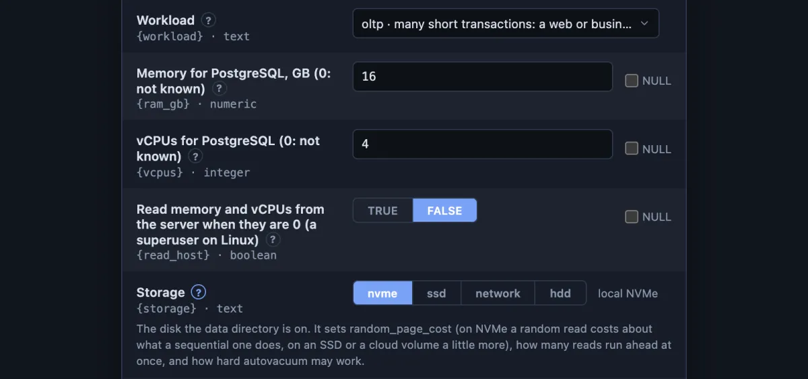
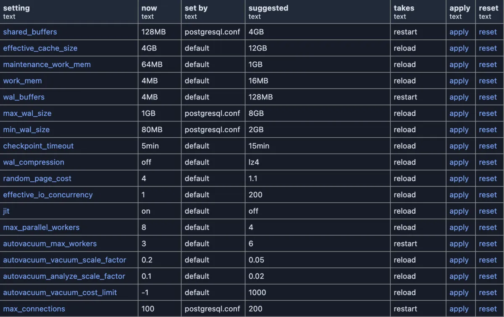

# PlumeSQL 0.25.0

Extension forms got friendlier: a choice is one click, a `?` explains
each field, and you change the answers and run again in one step. The
Extensions tab keeps the ones you use at the top and shows what is new.
The Run lens sits where you read the code, numbers line up, PlumeSQL
has a new logo, and the Mac download is notarized end to end.

## Highlights

- **Extension forms:** choices you click, a `?` beside every field, and
  **Change Inputs…** to run again with new answers.
- **Server setup:** a new extension that sets a server up for speed,
  insight, safety and security, one button per change.
- **Marketplace:** what was published since you last started PlumeSQL
  stands at the top of the Extensions tab, with a dot on the tab.
- **Extensions:** pin the ones you use to the top of the Extensions
  list, and run them from Go to Tab or File.
- **Editor:** Run, Explain and Select sit right above the SQL they run,
  under its comment.
- **Results:** numbers line up on the right, digit under digit.
- **macOS:** the DMG itself is notarized and stapled, not only the app
  inside it.

## Friendlier extension forms

### A choice is one click

When an extension asks you to pick one of a few values, the form now
shows them side by side, one click each, with what the chosen one means
beside it. A longer list is a drop-down, each value with its meaning.
You can no longer type something the extension does not know.

### A ? beside each field

A field that needs explaining has a `?` beside its label. Point at it
for a quick look, click it to keep the text open under the field.



### Change an extension's inputs and run again

An extension that asks for inputs has a new button beside Refresh,
**Change Inputs…**, with the sliders a chart's Configure View wears. It
opens the form with the answers of the last run, so you can change one
and run again without starting over.

## Set up a server

**[Server setup](https://github.com/hercstack/plumesql/tree/main/extensions/Server%20and%20Security/server-setup)**
needs this release. Tell it your machine's memory, vCPUs and disks and
what the server is for, and it lists what to change, each change with
its reason from the server's own numbers:



- **Nothing changes until you press a button.** Each one asks first and
  names exactly what it writes; a reload is a button of its own.
- **A script instead:** for Patroni, Kubernetes, Docker Compose, a
  cloud service or plain SQL, with a block that puts back what was
  there before.

## See what is new in the Marketplace

Extensions published since you last started PlumeSQL stand in a **New**
section at the top of the Extensions tab, and the tab wears a dot until
then. One you install keeps a **New** mark among the installed ones.

- **Nothing opens and nothing interrupts you.** The list waits in the
  tab until you look.
- **Mark as seen** on the section's head clears it, and so does the
  next start.
- The first start of this version only takes note of what is already
  there, so the list starts empty.

## Pin your extensions to the top

The extensions you reach for most can stay at hand. Point at one in the
Extensions list and click its pin, or right click it and choose
**Pin to Top**: it stands in a **Pinned** section at the top of the
list, in the order you pinned, with its own **Run** button.

- **Go to Tab or File** (⌘P on macOS, Ctrl+P elsewhere) lists them too:
  pick a query or command extension and it runs.
- Pins belong to your installation, the same in every workspace. An
  update keeps them; removing an extension drops its pin.
- **Unpin from Top** puts it back as it was.

## Easier to read

### The statement lens sits right above the code

Run, Explain, Select and the rest of the row above a statement used to
stand above its first line, the start of its comment. A long comment
and its annotations put them several lines away from the SELECT they
run. The row now sits under the comment and the annotations, directly
above the first line of code, the order VS Code uses: the comment, the
commands, the code. A statement with no comment keeps its row where it
was.

### Numbers line up in the results grid

Integer, numeric, real, double precision, oid and money columns align
right, their header with them, so the digits of a column line up as in
every spreadsheet. A column a formatting extension dresses keeps the
alignment the extension chose, and copies and exports are unchanged.

### An extension's results carry its name

The grid of a query extension, beside a chart or another view, was named
for the first words of the query inside it, such as "WITH SELECT
pg_catalog.pg_settings". It now carries the extension's name, and a
drill-down its step's name, as the header above it does.

## A notarized download

The Mac app has been signed and notarized since 0.24.1. Now the DMG
around it is notarized and carries Apple's ticket too, so macOS can
check the download itself, even without a network connection.

## For extension authors

### A choice among a few values

`@choices` gives an asked value its list right in the file, each value
with what it means:

```sql
-- @var storage "Storage", "nvme"
-- @choices storage nvme = local NVMe, ssd = a SATA or SAS SSD, network = a cloud volume, hdd = spinning disks
```

The form offers exactly these. Up to four short ones stand side by
side, one click each, like TRUE and FALSE; more of them are a drop-down
list, and the chosen one's meaning stands beside it. Nothing is asked of
the server, and the answer is always one of the values. A chart's
choice inputs, in its Configure View, are drawn the same way.

### A ? beside an input

`@help vcpus The cores PostgreSQL may use...` explains an input where
the form asks for it: its label grows a `?`, hovering shows the text and
a click opens it under the field. A chart's input descriptions, in its
Configure View, are shown the same way.

### A list setting from one button

`@inline <name> list` writes a value as a list of quoted values, the one
form `ALTER SYSTEM` stores as a list. Given one quoted value with commas
in it, such as `'timescaledb, pg_stat_statements'`, `ALTER SYSTEM`
stores a single library of that name and the server does not start
again; `list` writes `'timescaledb', 'pg_stat_statements'`. A value
without a comma comes out exactly as with `literal`, so a button that
sets any setting can use it, and a single value that must hold a comma
goes in double quotes. The
**[Server settings](https://github.com/hercstack/plumesql/tree/main/extensions/Server%20and%20Security/server-settings)**
extension's **set value** uses it from this release on, so setting
`shared_preload_libraries` there can no longer leave a server that does
not start.

## What changed

### A new logo

A feather with database rings replaces the old feather in a tile: the
app icon on every platform, the splash, the Welcome and About pages and
the empty editor.

## Fixed

- **Your temporary and uncommitted tables stay in the object tree.** The
  tree shows the session of the tab in front, but a background refresh,
  or a structure change made in another tab on the same connection,
  could drop that tab's temporary tables and the tables its open
  transaction created. They now stay, come back when you switch back to
  the tab (the uncommitted ones still marked), and leave with the tab
  when you close it.
- **A cancelled statement reports how long it ran.** Cancelling a long
  query left its statistics at "Total execution time: 00:00:00.000";
  it now shows the time the statement really ran.
- **A click beside an extension's form no longer closes it.** The form
  closed and the extension had to be run again; now it shakes and
  stays, and Cancel, Escape or the X close it.
- **An empty cell of a row button's column is no button.** It showed
  the button's question when you pointed at it, and Enter on it ran the
  button for that row. It now shows nothing and does nothing.

## Tell us what you think

Questions and ideas go to
[Discussions](https://github.com/hercstack/plumesql/discussions), bugs to
[Issues](https://github.com/hercstack/plumesql/issues) or Report a Bug in
the app's menu. The video tour is on
[YouTube](https://www.youtube.com/@plumesql).
