# PlumeSQL 0.26.0

Faster queries from the lightbulb: the
**[Performance refactors](https://github.com/hercstack/plumesql/tree/main/extensions/Performance/performance-refactors)**
extension fixes four common reasons PostgreSQL works much harder than it
has to. Every rewrite returns the same rows as before and is offered only
where it helps. Two of the four need this release.

## Highlights

- **Faster queries in one click:** install Performance refactors from
  the Marketplace, and the lightbulb rewrites a condition an index
  cannot read, a deep OFFSET, a function PostgreSQL calls for every row,
  and a constraint that would hold every write to a big table.
- **Scripts run statement by statement:** no hidden transaction around a
  script any more; the only one is the one you write.
- **Run All above a script:** one click runs every statement of a
  script, another selects it all.
- **Charts copy as a picture:** a camera in every chart's header puts it
  on the clipboard, ready to paste.

## Faster queries from the lightbulb

Install **Performance refactors** from the Extensions tab (category
Performance). The first two rewrites work on 0.25.0 already; declaring a
function STABLE and adding a constraint NOT VALID need this release.

All numbers below were measured on PostgreSQL 17, on a table of 3
million rows (30 million for the constraint), three runs each.

### Compare the indexed column itself

Wrapping an indexed column in a cast or a function hides it from the
index, so PostgreSQL reads every row:

```sql
-- before: 57 ms, every row read
select count(*) from events where created_at::date = '2025-06-01';

-- after: 0.27 ms, through the index on created_at
select count(*) from events where created_at >= '2025-06-01' and created_at < '2025-06-02';
```

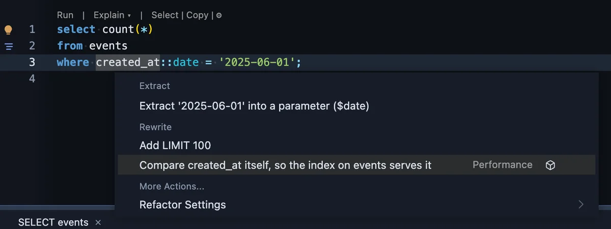

The same goes for `date(col)`, `date_trunc('month', col) = '2025-06-01'`,
`extract(year from col) = 2025`, `coalesce(col, 0) = 123` and
`col + 1 = 124` (24 to 27 ms before, 0.03 to 0.05 ms after for the last two). It is
offered when an index of the table starts with the column.

### Page by the last key instead of OFFSET

OFFSET reads every row before the page and throws them away, so each
page is slower than the one before:

```sql
-- before: 77 to 88 ms for page 40,001
select * from events order by id limit 50 offset 2000000;

-- after: 0.04 ms, whichever page
select * from events where id > $last_id order by id limit 50;
```

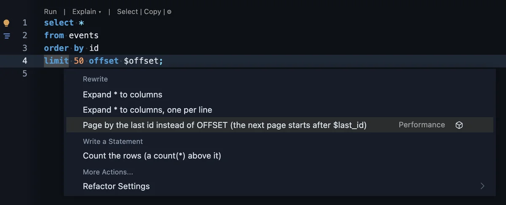

Your code passes the last `id` of the previous page instead of a page
number. It is offered when the query orders by a unique key with an
index and its OFFSET is a parameter or 10,000 and more.

### Declare the function STABLE

A PL/pgSQL function that does not say otherwise is VOLATILE: PostgreSQL
calls it again for every row and cannot use an index for it. When the
function only reads, one word fixes that:

```sql
-- before: 356 to 403 ms
create function user_of(x int) returns int language plpgsql as $$ begin return x; end $$;
select count(*) from events where user_id = user_of(123);

-- after: 0.033 to 0.036 ms
create function user_of(x int) returns int language plpgsql stable as $$ begin return x; end $$;
```

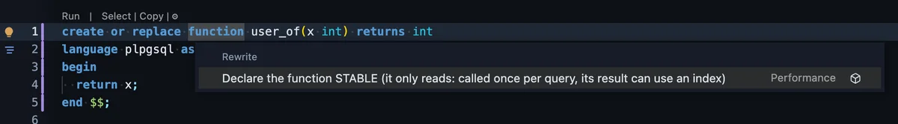

PlumeSQL reads the body with PostgreSQL's own parser and offers it only
when the function writes nothing, runs no dynamic SQL and calls nothing
that is itself VOLATILE.

### Add a constraint without stopping writes

Adding a foreign key or a CHECK holds every write to the table until
all of its rows are checked. Added NOT VALID, the constraint is in place
at once, and VALIDATE checks the rows while writes go on:

```sql
-- before: writes to orders wait the whole 1.6 s
alter table orders add foreign key (customer_id) references customers (id);

-- after: 1 ms, then the check runs while an INSERT takes 1.1 ms
alter table orders add constraint orders_customer_id_fkey foreign key (customer_id) references customers (id) not valid;
alter table orders validate constraint orders_customer_id_fkey;
```

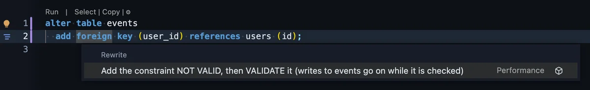

It is offered for a table of a million rows and more; the Refactors
settings change that.

## Run All above a script

A script of two or more statements now has its own row above the first
line: **Run All (24 statements)** runs every statement in turn, and
**Select All** selects the whole script. Run All asks first wherever a run
would (a Production connection, for one).

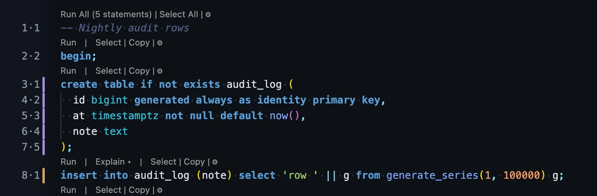

- When the first statement starts on line 1, the two stand at the head of
  its own row of commands.
- The cog at the end of the row switches it off and on (**File Lens**),
  and so does the command palette's Toggle editor setting.
- The command palette also has **Run All Statements**.

## What changed

### Scripts run statement by statement

PlumeSQL used to send a whole script to PostgreSQL in one request, and
PostgreSQL wrapped it in a transaction of its own. Now every statement
runs on its own, as psql runs a file:

- The only transaction is the one you write: a `VACUUM` after your
  `COMMIT` runs, where it used to fail as "inside a transaction block".
- A statement that fails no longer undoes the ones before it.
- Every statement has its own time in Messages, where each used to read
  0 ms.

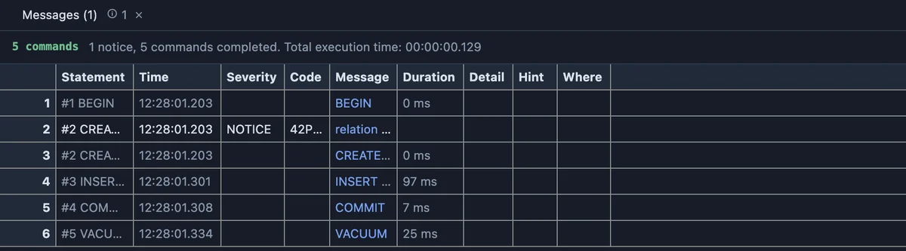

### An extension's offers say whose they are

An extension's offer in the lightbulb now names its extension at the
right of its row (Performance in the pictures above), before the cube
that opens its page. In a narrow window the cube alone stays, and its
tooltip names the extension.

### A chart copies as an image from its header

A chart, a map or any other view that draws now has a camera in its
header: one click and the picture is on the clipboard, ready to paste.
The view's menu (the dots, or a right click on the chart) has Copy as
Image and Copy as SVG.

The header reads like the data tab's now: the copy icon copies the
chart's data (the numbers it draws, as CSV; its tooltip says what), the
camera copies the picture, and Open in tab is always the last button
before the dots.

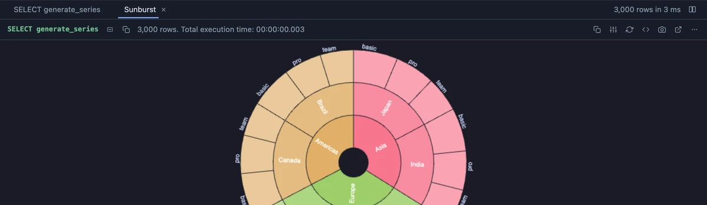

### A written statement opens as an unsaved script

When the lightbulb writes a statement in a new tab (Count the rows, with
the Refactors set to a new tab, or an extension's offer), the tab is now
an unsaved script named after the offer, the way the object tree's Script
opens one: Save asks where to keep it and under which name, and closing
it asks first.

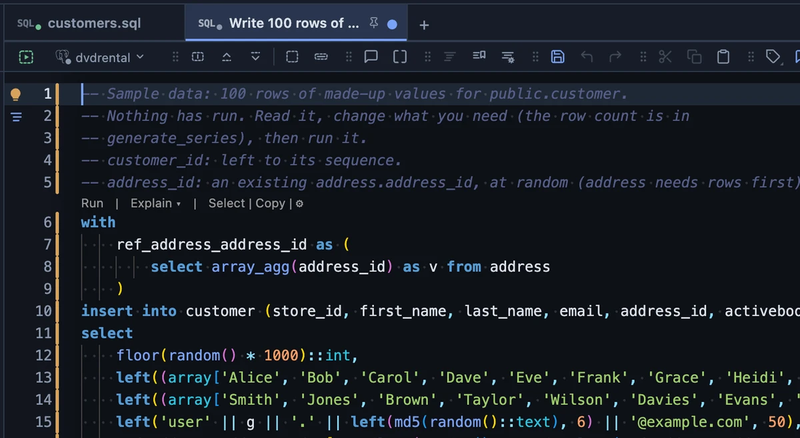

### An extension's item in the lens opens a menu

Clicking an extension's name in the row of commands above a statement
(`⧉ bar-chart ▾`) no longer jumps to the extension's page. A small menu
opens under it instead: why the extension applies to this statement,
**Go to Annotation** (the `-- @extension` line that names it),
**Open Extension Page** and **Don't Show in the Lens**. A click by
mistake is one Escape away.

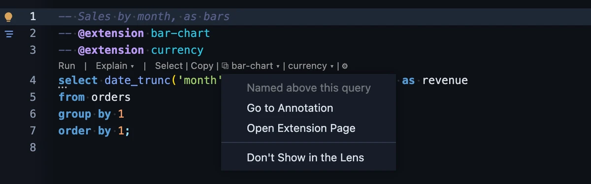

- **Don't Show in the Lens** keeps the extension out of the row; it still
  works on the query, and the Log's **Show again** brings it back.
- With many extensions on one query, the lens cog's **Extensions in the
  Lens** shows them as one item, **Extensions (3)**, each a submenu of
  the same choices; a query with just one keeps its name. The same menu
  shows a hidden extension again.

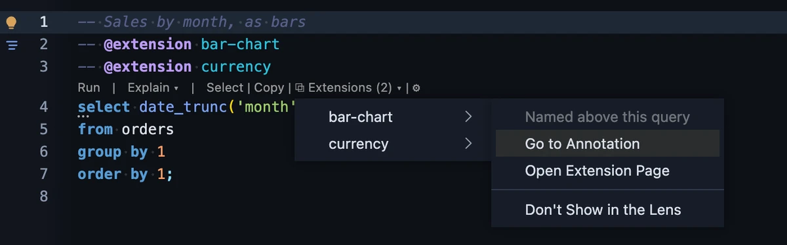

## For extension authors

### More of the statement for a refactor

A refactor extension is now handed:

- `statement.routine` on a CREATE FUNCTION or PROCEDURE: its language,
  declared volatility, return type, where its LANGUAGE clause is, and
  what PostgreSQL's own parser reads in its body (whether it writes, runs
  dynamic SQL, ends a transaction or locks rows, and every function it
  calls with that function's volatility).
- An ALTER TABLE's table in `statement.tables`, with its row estimate
  and its constraints' names.
- `notNull` on a column, and `ctx.paramStyle`, how the user writes a run
  parameter (`$name` or `:name`).
- How a column takes its value: `identity` (`always` or `by default`),
  `generated` (`stored` or `virtual`) and its `default` expression, so a
  refactor that writes an INSERT can leave out what the table fills
  itself.

The [refactor API](https://github.com/hercstack/plumesql/blob/main/docs/GRIDJSSPEC.md)
has the details.

## Fixed

- **Select All selects text, never the window.** Pressing Cmd+A (Ctrl+A)
  right after opening a script from the Explorer highlighted the editor's
  margin and the rest of the window while the script stayed unselected.
  It now selects the script's whole text, a field's text in a field and a
  page's own text on a page like Settings.

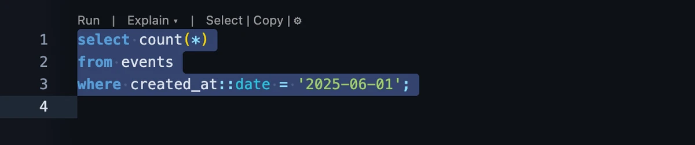

## Tell us what you think

Questions and ideas go to
[Discussions](https://github.com/hercstack/plumesql/discussions), bugs to
[Issues](https://github.com/hercstack/plumesql/issues) or Report a Bug in
the app's menu. The video tour is on
[YouTube](https://www.youtube.com/@plumesql).
