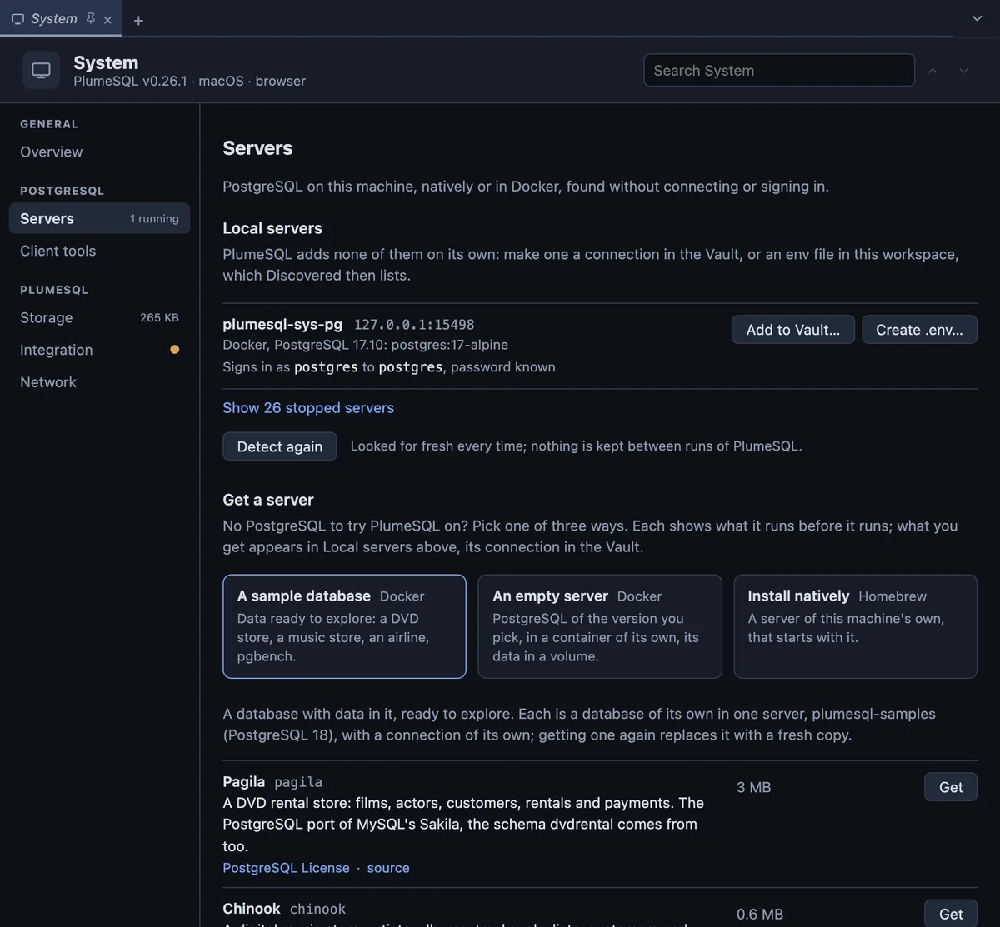
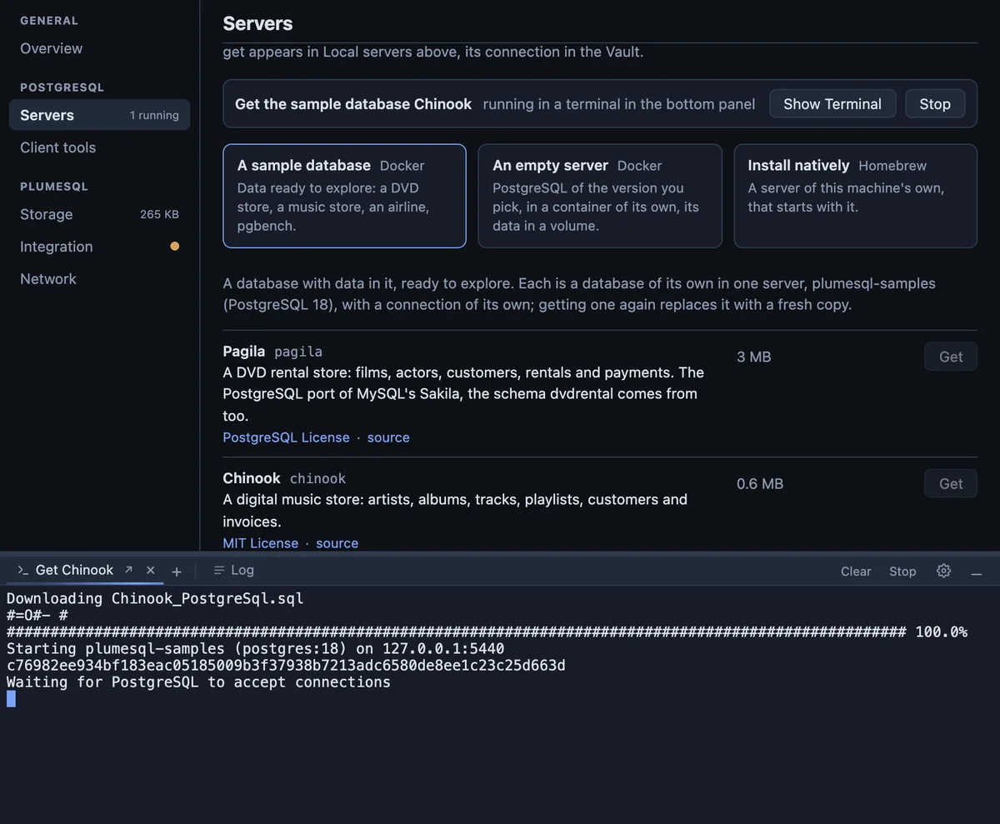
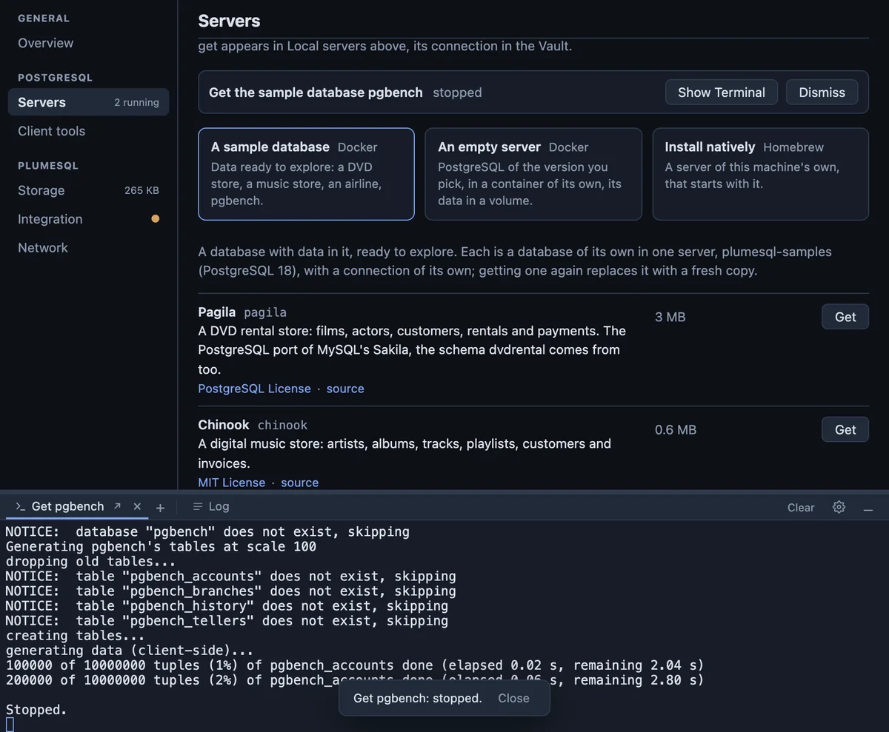
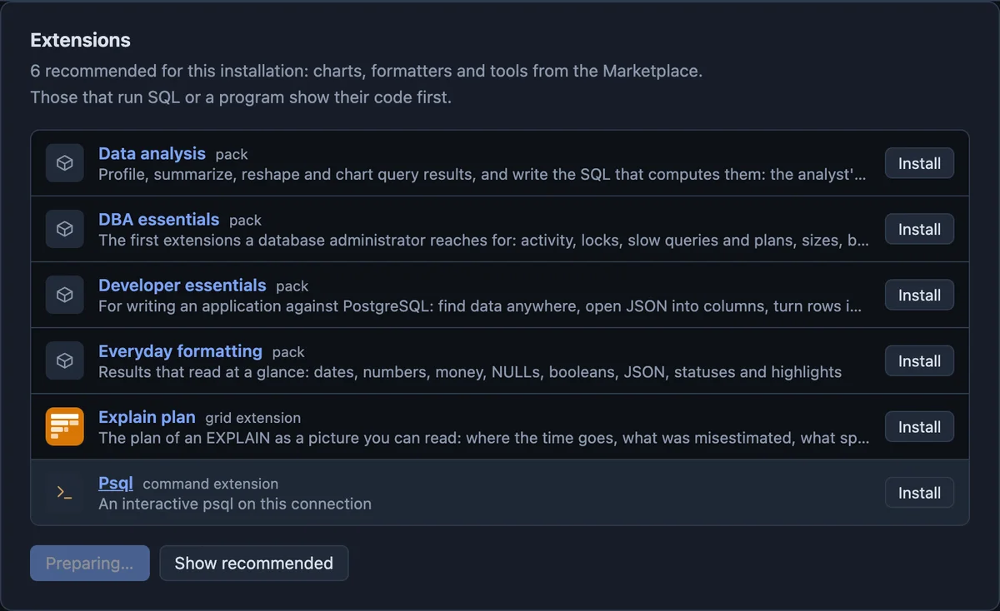
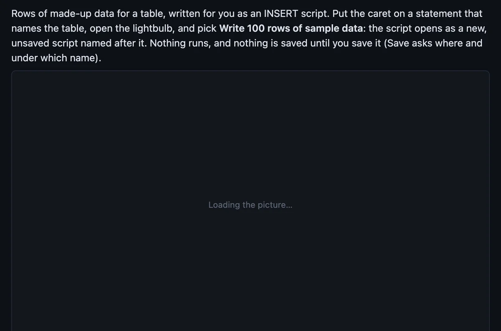

# PlumeSQL 0.26.1

Nothing runs out of sight any more, the Marketplace stops making you
wait for GitHub, and the System page is easy to find your way around.

## Highlights

- **A clearer System page:** an overview of how everything stands, then
  one topic at a time: servers, client tools, storage, integration,
  network.
- **Get a server runs in a terminal tab:** watch a sample database or a
  new server being set up, answer it if it asks, stop it if you want to.
- **Stop means stop:** the script ends where it is, and so does what it
  started inside the container.
- **A faster Marketplace:** extension pages, their code and Install
  recommended read from a local copy instead of waiting on GitHub file
  after file.
- **Pictures hold their place:** a README's pictures and the release
  notes' show a box while they load, instead of an empty page.

## A clearer System page

The System page was one long scroll of nine sections. It now opens on an
**Overview** and shows one topic at a time, picked on the left:

- **Overview:** the version and its update, then a tile for each part
  saying how it stands: servers running, client tools ready, Docker,
  storage, integration and network. A tile opens its part, and what
  wants a look is marked, there and on the left.
- **Servers:** the servers on this machine, and under them the three ways
  to get one, as cards; only the one you pick shows its choices.
- **Client tools:** which tools each of your servers runs with, what is
  on this machine (the Docker images folded behind one line) and how to
  get more.
- **Storage:** what PlumeSQL keeps, your data and the caches apart, with
  their totals; the empty rows are folded away.
- **Integration** (the command line and the file browser) and
  **Network**.

Nothing changed in what the page can do: every row, button and setting is
still there, in its topic. The search box still searches the whole page,
and a link that meant one part (Get client tools from a connection, Get a
Server from Welcome) opens its topic right at it.

## Getting a server, in plain sight

### The script runs in a terminal tab of its own

**System > Get a server** used to run its script in a small terminal
inside the page, below the forms. On a smaller screen it was out of
sight, so the install looked like it happened in the background, and
there was no way to stop it.

Now the script opens a tab in the bottom panel, named after what it
does (**Get Chinook**, **Create pg18**), and shows it at once:

- Watch it there: the download, the server starting, the restore.
- Type into it if a step asks something.
- The tab wears the running sweep while the script works, and its
  header has **Stop** where a shell has Restart.
- When the script ends, the terminal says how, with a **Close**.

The System page keeps a status line instead, right above the ways to get
a server: what runs, how it stands (running, done, stopped, did not
finish), **Show Terminal** and **Stop**.

### Stop ends the script and what it started

Stop asks first, then ends the script where it is. Closing the tab
while the script runs asks the same question.

A restore runs inside the container, and stopping only the script would
leave it running there. So Stop ends that restore too, and the terminal
keeps everything the script printed, ending with **Stopped.** A stop is
your choice, so the Log calls it stopped, not failed.

### Remove shows its script

**Remove…** on a server PlumeSQL started removed the container in the
background. Now its question shows the script that removes the
container and its data, and the script runs in a terminal tab like Get
a server's.

## A faster Marketplace

Every extension page, every bit of code a question shows and every
Install recommended used to fetch its files from GitHub one after
another. On a slow connection, the Install recommended question took a
minute or two to appear.

### Read ahead, kept locally

After the extensions catalog loads, PlumeSQL reads every extension's
details, code and README into a local copy, and the first pictures you
would look at too. The status bar's dot says so while it works. Opening
an extension's page, reading its code or installing it then reads from
that copy.

Files are kept by their content, so a Marketplace update only fetches
what actually changed. On a metered connection, **Settings > Extensions
> Read ahead** turns it off.

### Install recommended asks at once

The question lists every extension in the set, the code of those that
run something and everything they bring along. Finding what they bring
along took one request per extension, one after another: for the 56
recommended extensions, 10 seconds on a fast connection and minutes on a
slow one. It is now one request, read in parallel: 0.2 seconds. While
the set is read, the button says **Preparing…**

## Pictures that hold their place

A README's pictures and the release notes' appeared out of nowhere,
pushing the text down as they arrived. Now each one has a box where it
will be, saying **Loading the picture…**, until it is in; if one cannot
be loaded, its description stands in its place. A README or release
notes still on their way show a few lines and what is being read.

The release notes' pictures now load side by side instead of one after
another. When an update is found, its notes and pictures are read ahead,
so after the update they open at once.

## Fixed

- **A command typed into the terminal for you lands in the right
  place.** Open in Integrated Terminal and the install commands on the
  System page could type their line again into a terminal opened later,
  or into a program already running. The line now goes once, into a
  free terminal, and a new one opens when every terminal is busy.

## Tell us what you think

Questions and ideas go to
[Discussions](https://github.com/hercstack/plumesql/discussions), bugs to
[Issues](https://github.com/hercstack/plumesql/issues) or Report a Bug in
the app's menu. The video tour is on
[YouTube](https://www.youtube.com/@plumesql).
