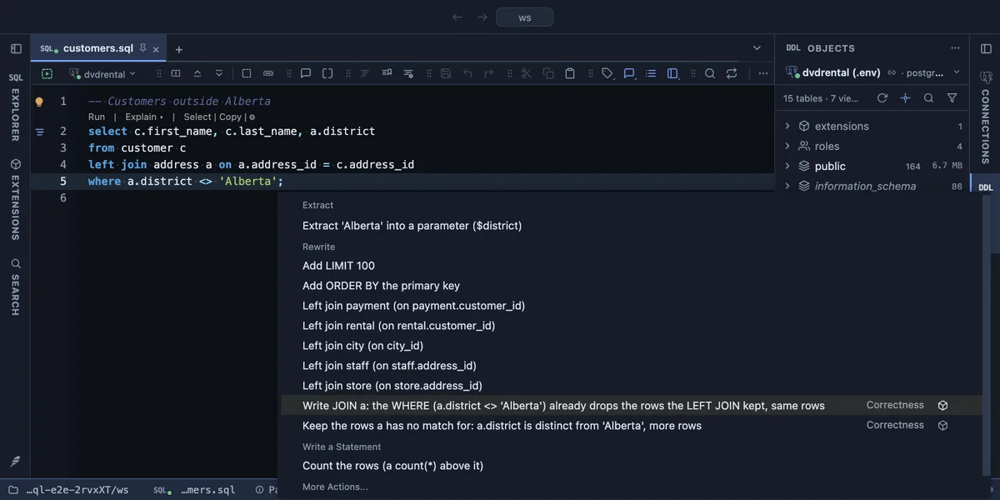
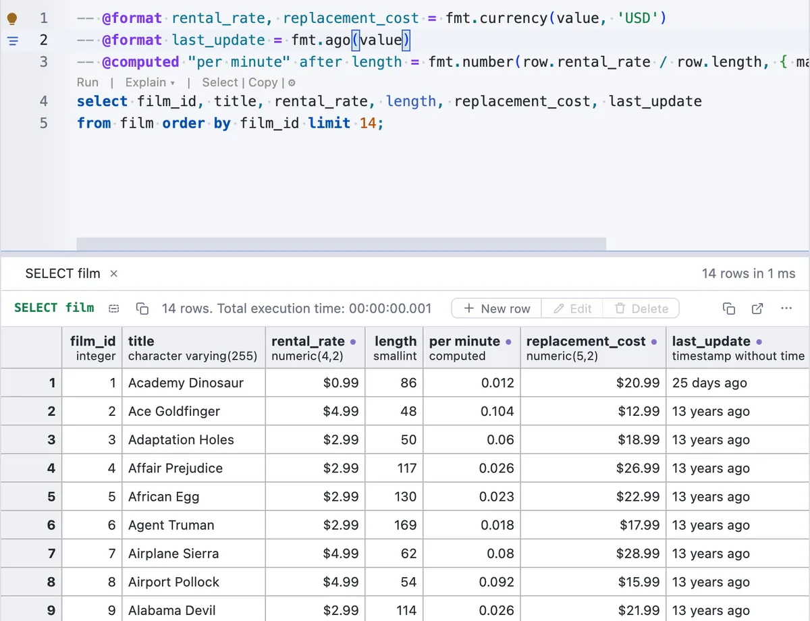
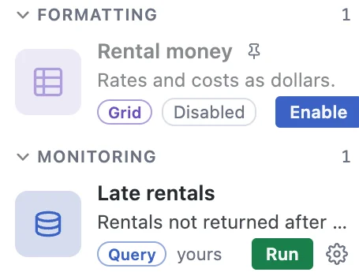
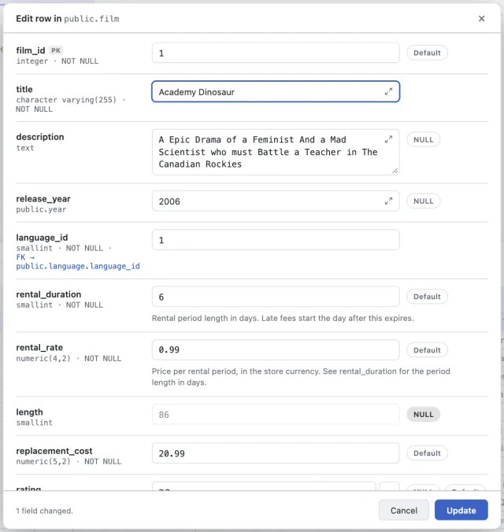
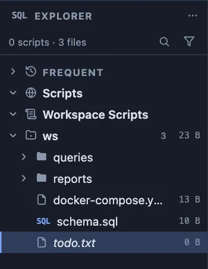

# PlumeSQL 0.26.2

## Highlights

- **Queries that return what you meant:** the lightbulb catches a LEFT
  JOIN the WHERE undoes, `= NULL`, `count(*)` over a LEFT JOIN, a BETWEEN
  that loses its last day and AND with OR without parentheses, with the
  free [Correctness refactors](https://github.com/hercstack/plumesql/tree/main/extensions/Correctness/correctness-refactors)
  from the Marketplace.
- **Format a result from the script itself:** a `-- @format` line above
  a query formats a column, a `-- @computed` line adds one, and the
  grid's Format menu writes them for you.
- **Switch an extension off** without uninstalling it, and back on.
- **Extension pages read the way GitHub shows them**, and a narrow
  Extensions pane keeps its buttons in sight.

## Queries that return what you meant

Some queries run without an error and still return something other than
you meant. [Correctness refactors](https://github.com/hercstack/plumesql/tree/main/extensions/Correctness/correctness-refactors),
a free extension in the Marketplace's new Correctness category, spots
five of them and offers the fix in the lightbulb (⌘. or Ctrl+.). Each
offer says whether it keeps the same rows or changes them.



- **A LEFT JOIN the WHERE undoes.** `left join departments d ... where
  d.name <> 'HR'` drops every employee without a department, so it is a
  JOIN in disguise: write it as one, or keep those employees with
  `is distinct from`.
- **`= NULL`**, which is never true, becomes `is null`.
- **`count(*)` over a LEFT JOIN** counts a customer without orders as 1;
  counting the orders' key counts 0.
- **BETWEEN on a timestamp** stops at midnight of its last day:
  `between '2005-07-01' and '2005-07-31'` left out 679 of July's 6,709
  rentals in the sample database. The end becomes the next day.
- **AND and OR without parentheses:** write the grouping PostgreSQL
  reads, or the other one.

The extension needs this version, which hands it what PostgreSQL's own
parser reads in your query.

## Format a result from the script itself

A line above a query now formats its result, with no extension to make
or save:

```sql
-- @format rental_rate, replacement_cost = fmt.currency(value, 'USD')
-- @format last_update = fmt.ago(value)
-- @computed "per minute" after length = fmt.number(row.rental_rate / row.length, { maximumFractionDigits: 3 })
select film_id, title, rental_rate, length, replacement_cost, last_update
from film order by film_id limit 14;
```



- **`-- @format`** formats a column, or every column of a type with
  `column(timestamp)`. **`-- @computed`** adds a column, at the start, at
  the end, or after or before a column. In the file's header, a line
  shapes every result in the file.
- **The grid writes them.** Format, Format all columns of a type and Add
  Computed Column in the grid's menu put the line above the query, and
  the grid changes at once. Picking another format for the same column
  changes its line, and one undo takes it back.
- **Short helpers:** `fmt.number`, `fmt.currency`, `fmt.percent`,
  `fmt.date`, `fmt.ago`, `fmt.yesNo`, `fmt.upper`, `fmt.lower`,
  `fmt.tag` and `fmt.dimNull`. Each leaves NULL as NULL.
- **Help while you write:** the formula is coloured as JavaScript and
  gets JavaScript's own completion: `value.` offers a string's methods,
  `row.` the query's columns. Hover says what each name holds, and a
  column the result does not have or a method that does not exist is
  underlined on the spot.
- **More room when you need it:** the lightbulb (⌘. or Ctrl+.) opens the
  formula in a tab of its own with full JavaScript help. **Move to an
  extension…** turns the lines into an extension of your own, after
  asking for its name, so other scripts can use the same formats.

## Switch an extension off without uninstalling it

**Disable** in an extension's row menu, or on its page, switches it off:
it stays installed, or stays among your own, and nothing of it loads.
Its formats and charts stop applying, its refactors leave the
lightbulb, its themes leave the picker, and a query or command extension
loses its Run and its button. **Enable** brings it all back. A disabled
extension is dimmed in the list with a Disabled label, and a script line
that names it says so, with Enable one click away.



## A calmer row form

The form that edits a row is one quiet surface now: no striped rows, no
coloured band, a faint line between fields, each column's description
under its box, and NULL and Default as small switches beside it. The
form that asks for a query's parameters looks the same.

A field opened in a tab of its own keeps what the form offers: an array
one element per line with the same Lines switch, and the NULL and
Default switches in the tab's header.



## For extension authors

### A query's joins and conditions

A refactor extension now gets what PostgreSQL's parser reads in a
SELECT: `statement.query.joins` (each join's kind, the table and alias
joined, the words that join it, ON or USING), `statement.query.where`
(the WHERE as an expression tree: each term's kind, operator, operands,
columns and constants, where it is written and whether it has
parentheses of its own) and each select item's `expr`. No SQL parser of
your own needed.

### Formatting helpers in every formula

A rule's formula now reaches `ctx.fmt`, the same helpers a script's
`-- @format` line has: `ctx.fmt.number(value)`, `ctx.fmt.currency(value,
'EUR')`, `ctx.fmt.ago(value)` and the rest, each leaving NULL as NULL.
The [grid extension format](https://github.com/hercstack/plumesql/blob/main/docs/GRIDJSSPEC.md)
lists them.

## Fixed

- **A formatted result opened in its own tab shows its formatting.** A
  result opened with Open in tab could keep the columns an extension
  formats blank for good; they now fill in as they do in the script.
- **A new extension asks for its name first.** Formatting a column of a
  result that has no script (one opened in its own tab) used to open an
  unsaved extension that asked for its name twice when saved. Now the
  name comes first, the extension is made at once, and its editor says
  which results it applies to.
- **What you make in the Explorer shows there.** A new file whose kind
  the Explorer's filter hides (a `.txt` while Other files are off, say)
  no longer vanishes the moment you name it: a file you create, rename,
  paste or drop in the Explorer shows whatever the filter says, until
  you hide its kind again. And a new file, folder or script flashes for
  a moment where it landed, so it is found at a glance.



- **A server found on this machine connects to its own database.** A
  Docker container started without a database name, and filled
  afterwards (dvdrental restored into a plain postgres image), became a
  connection to its empty `postgres` database from System's Add to
  Vault or Create .env. Both now read the server's databases and use its
  own; the others are listed in the connection's description, and Open
  Database opens any of them.
- **Rows are edited only where the row is known for sure.** A report
  that leaves the table's key out (films with their rental counts,
  without `film_id`) offered Edit anyway, searched the table for a
  matching row and claimed the result had no primary key. Now New row,
  Edit and Delete appear when the result includes its table's key, or,
  for a table that has no key, when it shows all its columns, as before.
  Any other result is read only. To edit from a report, add the key
  (such as `f.film_id`) to its select list.
- **Only a SQL file behaves like one.** An empty `.txt` or `.json` no
  longer asks you to "Write SQL and press F5", and a `.pgsql` or `.psql`
  file keeps its SQL colours without a Run lens that could not run it.
- **A narrow Extensions pane keeps its buttons in sight.** Turn On under
  Open VSX Themes, Install all and the section counts no longer slip off
  the pane's edge: the text beside them shortens instead.
- **Extension pages read the way GitHub shows them.** Links written as
  references (`[PowerShell][]` with its address further down) are links,
  the addresses are no longer shown as text, badges no longer leave
  `[](...)` behind, keys like <kbd>F8</kbd> look like keys, and notes
  such as `> [!IMPORTANT]` get their title.

## Tell us what you think

Questions and ideas go to
[Discussions](https://github.com/hercstack/plumesql/discussions), bugs to
[Issues](https://github.com/hercstack/plumesql/issues) or Report a Bug in
the app's menu. The video tour is on
[YouTube](https://www.youtube.com/@plumesql).
