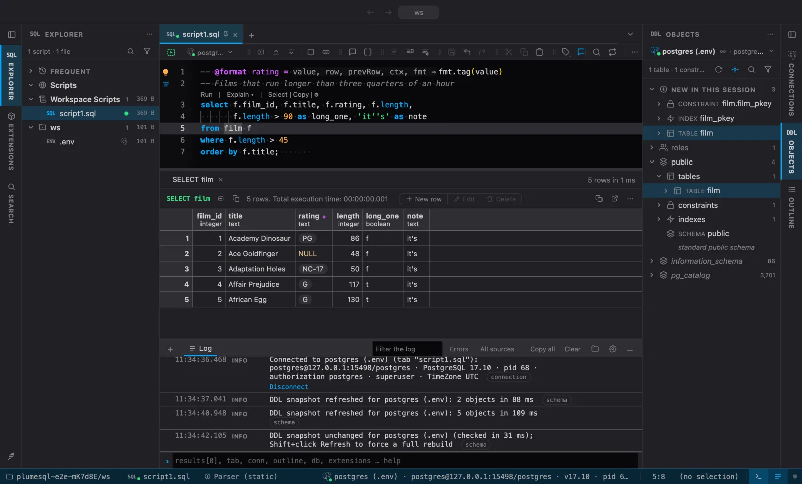
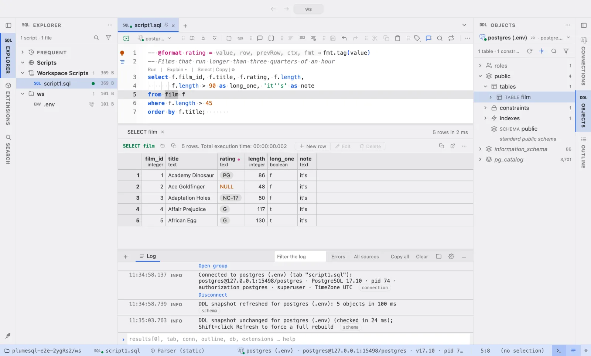
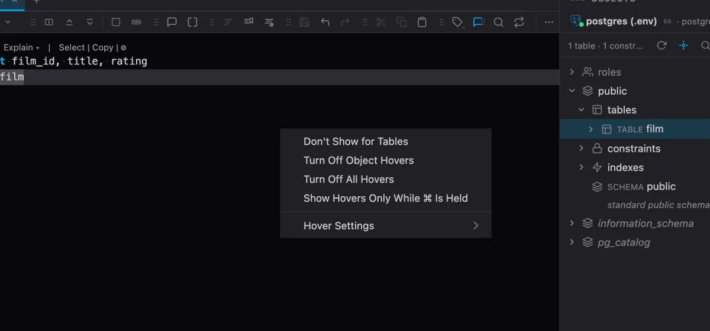
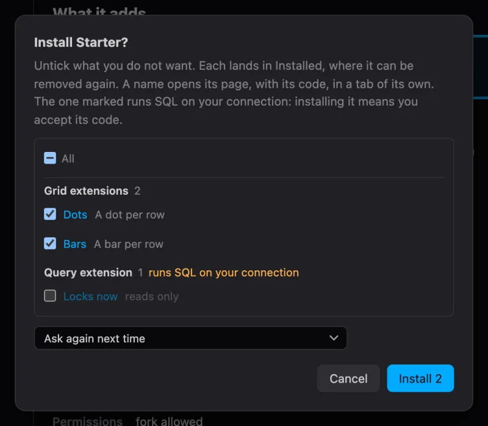

# PlumeSQL 0.27.0

## Highlights

- **A new look:** the Dark and Light themes are calm neutral greys with
  one clear blue accent.
- **Hovers that know their way out:** a hover's eye icon leaves out
  just SELECT, just tables or every hover, or shows hovers only while a
  key is held; an object's hover shows the object in the Objects tree.
- **Install only what you pick:** installing a pack or the recommended
  extensions lists each one with a checkbox.
- **A clearer sign of a new version**, and a calmer results header.

## A new look

The built-in Dark and Light themes are new: neutral greys with no tint, a
near-black editor in Dark and a white one in Light, grey panels around
it, and one clear blue for what matters. Keywords take that blue, strings
are green, numbers amber and types violet.

The palette comes from the Plain variants of
[Monochromator](https://codeberg.org/beem/monochromator), a VS Code theme
by Josias Beem, used under its MIT license. Thank you!

If you liked the blue-slate look PlumeSQL had until now, it is still
here: install **PlumeSQL Classic** from the Extensions tab and pick
**Classic Dark** or **Classic Light** in Select Color Theme.

## Hovers that know their way out

Every hover on SQL now ends its links with a small eye icon. Its menu
lets you leave out just what bothers you:

- **Don't Show for SELECT**: no more hovers on the keywords of SELECT
  statements, while ALTER TABLE or MERGE keep theirs. The same works for
  an operator family, such as the JSON operators.
- **Don't Show for Tables** (or Columns, Functions, and so on): no
  hovers on that kind of object, on any connection, while the other
  kinds keep theirs.
- **Turn Off Object Hovers**, or **Turn Off Keyword and Operator
  Hovers**, and **Turn Off All Hovers**.
- **Show Hovers Only While ⌘ Is Held** (Ctrl on Windows and Linux):
  nothing pops up as the pointer moves, and holding the key shows the
  hover, as VS Code's `onKeyboardModifier` does.

Each change is written to your settings, and the Log says what was left
out or turned off, with **Show again** or **Turn back on** beside it.

An object's hover also has **Reveal in Objects Tree**: the Objects tab
opens on the table, view or routine, its folders unfolded, the same as
the Outline's Reveal in Objects Tree. A column's hover reveals its table.

## Install only what you pick

Installing several extensions at once (a pack's Install all, Install
recommended, a set the Log suggests) still asks first, listing every
extension by kind. Now each has a checkbox, all ticked to begin with,
and an **All** box above them. Untick what you do not want: the button
counts what stays ticked, and a dependency is listed only while
something ticked needs it. What you left out stays available, and the
pack's Install all offers it next time.

## Smaller things

- **Licenses.** The About page has a Licenses card: whose work PlumeSQL
  is built with, and the full third-party notices on request.
- **Tabs like VS Code's.** The open tab is a card with softly rounded
  top corners that joins the editor under it; the others sit quietly on
  the strip.
- **Splitters like VS Code's.** The handles between panes are a slim
  band with a three-dot grip in the middle, and they turn grey, not blue,
  under the pointer. A double-click on any of them folds the pane it
  sizes down to its header (a sidebar to its strip, the results to their
  tabs), and another brings it back at the size it had; on the Log and
  terminal panel it closes the panel, which its status bar button opens
  again at the height it had.
- **The feather wears a gear.** The button in the bottom left corner,
  where the settings, the theme and About are, shows a small gear at the
  feather's foot, so it is easier to find.
- **The update badge reads as one.** When a new version is ready, the
  feather in the corner wears a larger badge with an up arrow instead
  of a small dot.
- **No filter button on a column header's hover.** Moving the pointer
  over a header no longer adds a filter button to the name and shakes
  the header row. Filtering starts from the column's menu; a filtered
  column wears the funnel, which edits its filter.

## Fixed

- **Closing the last terminal keeps the Log.** Closing the last terminal
  in the bottom panel closed the whole panel; the Log stays open now.
- **3D charts copy as an image.** The camera on Flythrough 3D, 3D Bars,
  Scatter 3D, City 3D and Vector Space 3D wrote an error to the Log
  instead of copying the picture. It copies now.
- **A new terminal shows and takes the keys.** The + beside the
  terminals opens the new one and puts the cursor in it, even when the
  Log was showing. Their tabs no longer fade away as you add more: the
  Log's buttons fold into the ⋯ menu first.
- **The splitter above the results follows the pointer.** With the Log
  or a terminal open below, dragging the splitter between the editor and
  its results made it jump away from the pointer, up to the results'
  header. It stays where you hold it now.
- **The line around the focused pane runs all the way.** The blue edge
  that marks the pane your keys go to was cut where a section heading,
  such as Installed in the Extensions pane, reached the edge.
- **Turning hovers off turns them off.** With the Hovers switch in the
  editor's toolbar off, hovers still showed as the pointer rested. Off
  is off now.
- **macOS: no dark spots beside the window buttons.** On some Macs
  three small dark spots showed beside the red, yellow and green
  buttons. They are gone.

## Tell us what you think

Questions and ideas go to
[Discussions](https://github.com/hercstack/plumesql/discussions), bugs to
[Issues](https://github.com/hercstack/plumesql/issues) or Report a Bug in
the app's menu. The video tour is on
[YouTube](https://www.youtube.com/@plumesql).
