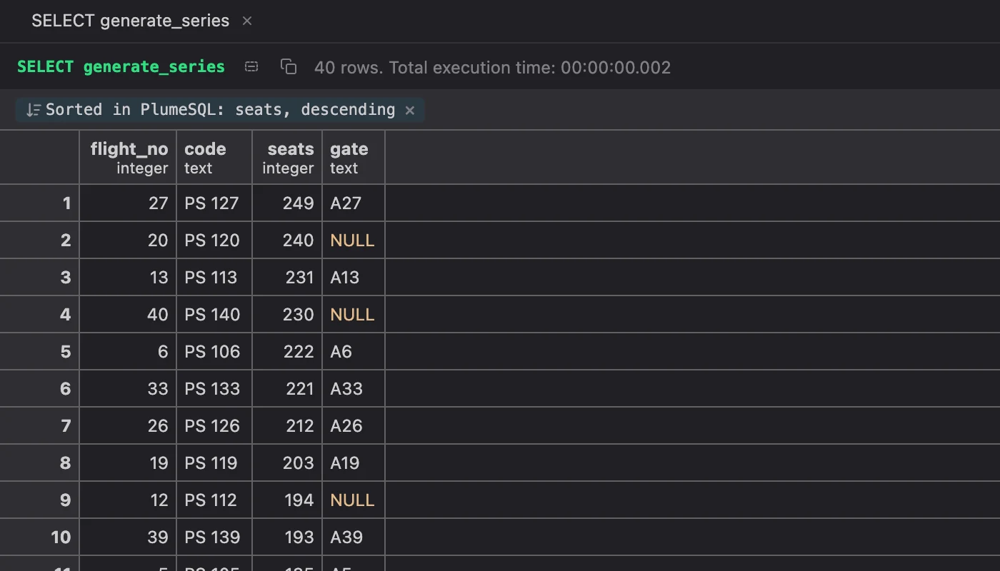
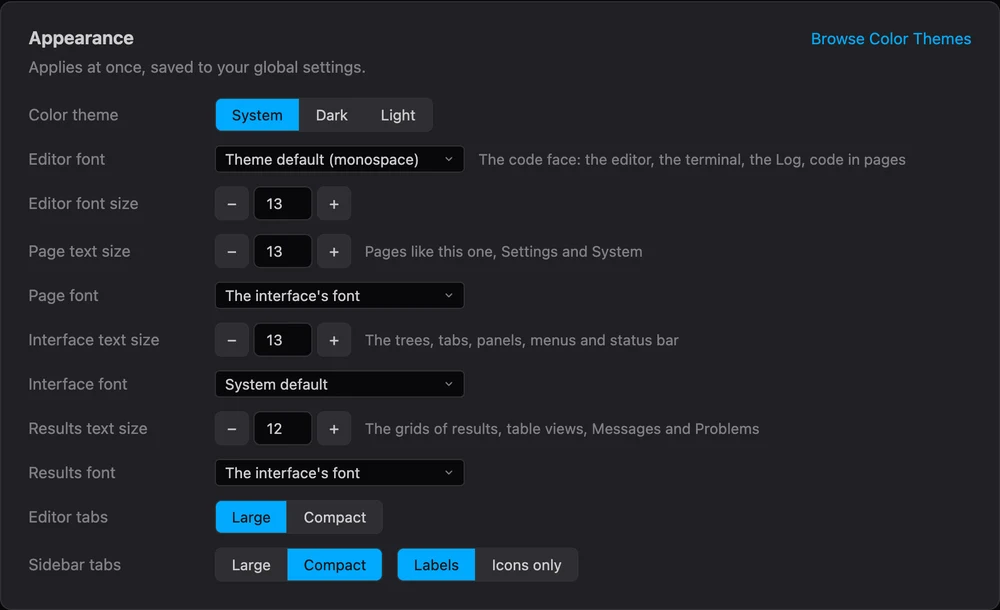
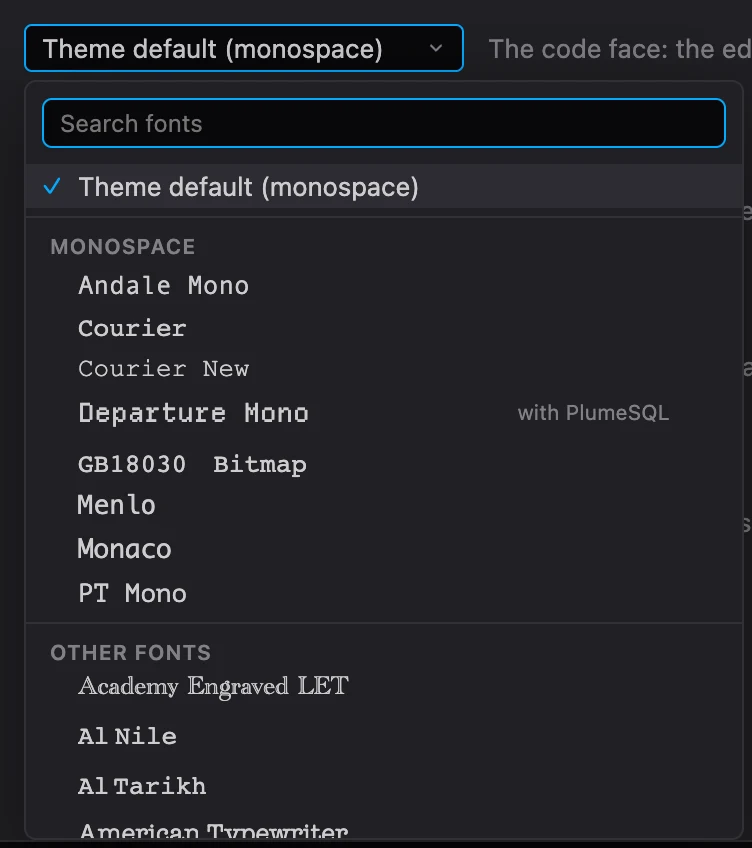
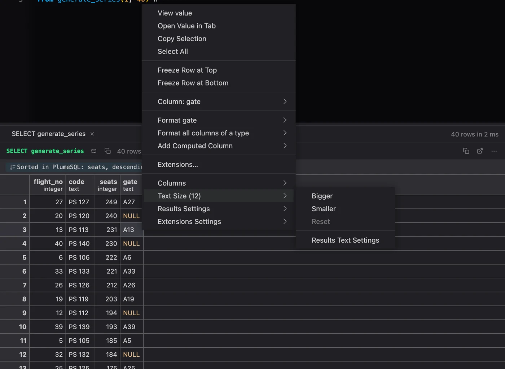
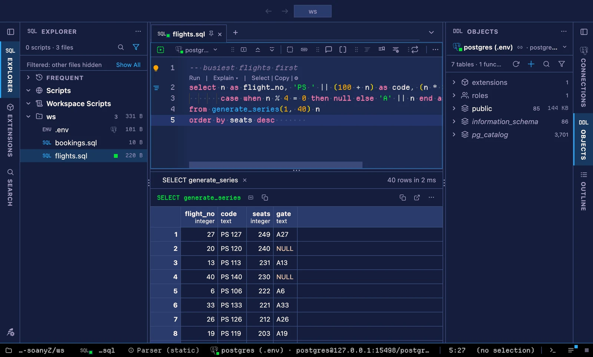
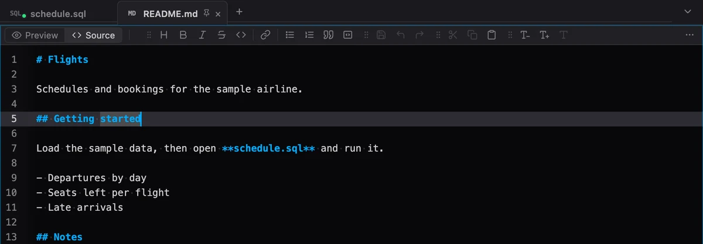
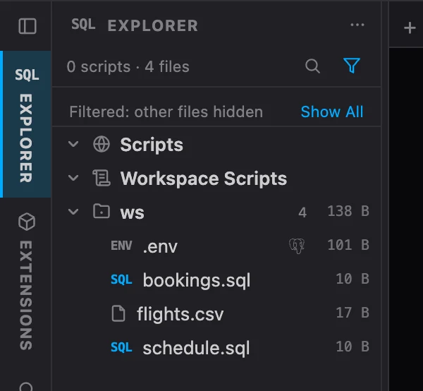

# PlumeSQL 0.28.0

## Highlights

- **Sort a result** from a column's menu: over the whole result, without
  running the query again.
- **A font and a size for each part of the window:** the interface, the
  pages, the results and the code, each picked from the fonts you have.
- **Pixel themes:** a theme can bring its own fonts, square corners and
  hard shadows. Try the five [Retro](https://github.com/hercstack/plumesql/tree/main/extensions/Themes/retro) themes.
- **Markdown files** switch between Preview and Source in one place, with
  a toolbar to write them.
- **`plumesql notes.sql` opens the file**, and the Explorer says when its
  filter hides something.

## Sort a result

Right click a column's header and pick **Sort Ascending** or **Sort
Descending**; **Clear Sort** puts the server's order back. The same three
are in the Column submenu of a cell's menu.

- The whole result is sorted, not only the rows in view, and the query
  does not run again.
- Numbers sort as numbers and text by its letters, case ignored first.
  NULLs come last ascending and first descending, as PostgreSQL puts them.
- The bar above the grid says the order is PlumeSQL's own. Click it to
  reverse the order, or its × to clear it.
- Filters and the sort work together. Save As and copy take the sorted
  rows, and a kept result keeps its sort.
- Results of up to a million rows sort. Above that the menu shows the
  sort unavailable and says why, so a huge result never stalls the app.

## Fonts and sizes

### Each part of the window, its own font and size

The **interface** (trees, tabs, panels, menus, dialogs, the status bar)
has its own text size, from 11 to 16, and its own font. **Pages** like
Settings, System and Welcome have their own font beside their text size.
The **editor's font** is now the code face everywhere code is drawn: the
terminal, the Log's console and code in a page take it too.

All of them are in **Welcome**'s Appearance card, beside the theme and the
editor's size. Zoom still scales everything at once.

The menus, the command palette and the hover cards follow the interface's
font and size too.

### Pick a font from the ones you have

Every font setting opens a picker with the fonts installed on your
computer, each name drawn in its own face. The monospaced fonts come
first, and a search narrows the list. Star a favorite with the ☆ (or
⌘Enter, Ctrl+Enter on Windows and Linux) and it leads every font picker.

A name no installed font has can still be typed and used as written.

### The results' own font and text size

Results, table views, Messages and Problems have their own font (the
interface's by default) and text size, from 9 to 20. The rows and
columns grow and shrink with it.

**Text Size** in a grid's right click and in a result's ⋯ menu steps it.
So do **Results Text Size: Bigger** and **Smaller** in the command
palette, and the Results text size on Welcome.

## Pixel themes

A color theme can now name its fonts, ask for square corners and hard
shadows, and draw text without smoothing. PlumeSQL carries two pixel
fonts for them, **Departure Mono** and **Pixelify Sans**, so a theme that
names them looks the same on every computer. The font pickers offer them
too, marked "with PlumeSQL".

Install **[Retro](https://github.com/hercstack/plumesql/tree/main/extensions/Themes/retro)**
from the Extensions tab for five of them: Phosphor Green, Phosphor Amber,
Breadbin 64, Handheld and Fantasy Console.

- A font you picked yourself stays yours: a theme's fonts only fill what
  you left at its default.
- A theme's preview card draws its fonts and its shape, and **New Theme
  from Current Colors** keeps them.
- Writing your own? The theme file's new `fonts` and `shape` fields are in
  [THEMES.md](https://github.com/hercstack/plumesql/blob/main/docs/THEMES.md).

## Files

### Markdown: Preview and Source, and tools to write it

A Markdown file shows a **Preview** and **Source** switch in the same
place on both faces. Each file opens the way you last left it; one you
never switched opens as the `markdown.openAs` setting says (Preview by
default).

The Source toolbar starts with a Markdown group: heading (a level deeper
with each click), bold, italic, strikethrough, inline code, link,
bulleted and numbered lists, quote and code block. Each click is one undo
step, and a second click takes the formatting off.

### The Explorer says when it filters

A strip above the tree names what the filter hides, with **Show All**
beside it. Show All Files (also in the pane's menu and the palette) lists
every file and leaves your filter as it was; **Filter Again** puts it
back. The choice is kept per workspace.

The funnel lights whenever the filter hides something, the default filter
included, and goes out while every file shows.

### Open a file from the command line

`plumesql notes.sql` opens the file in a tab, the file itself, so saving
writes it back, as `code notes.sql` does. It used to open it as a
workspace directory. This works through the installed desktop app and in
a browser.

Dropping a file on the desktop app's window opens it the same way. A
browser cannot share where a dropped file lives, so it opens a copy and
says so.

## Fixed

- **An unfocused editor's selection and the lenses take the theme's
  colors.** The selection left in an editor without the focus was a fixed
  grey band, and the lenses above a statement (Run, Explain ...) a fixed
  grey that nearly vanished on a light colored theme. Both come from the
  theme now.
- **Lighter shadows in the light theme.** The row form, the run inputs
  and a value's peek cast heavy shadows in the light theme. They take the
  theme's shadow now, like every other floating window.

## Tell us what you think

Questions and ideas go to
[Discussions](https://github.com/hercstack/plumesql/discussions), bugs to
[Issues](https://github.com/hercstack/plumesql/issues) or Report a Bug in
the app's menu. The video tour is on
[YouTube](https://www.youtube.com/@plumesql).
