# PlumeSQL 0.29.0

Write a join by walking a foreign key, catch the mistakes that run
without an error before you run them, and compare any two files,
objects, schemas or results side by side.

## Highlights

- **Join through a foreign key:** type a dot after a key column, pick a
  column of the table it points to, and the join is written for you.
- **Where is it used:** Shift+F12 on a table or a column shows every place
  your scripts use it, Shift+Alt+F12 lists them in the Search tab.
- **Rename with F2:** an alias or a CTE everywhere the query reads it,
  and on a table or a column its `ALTER ... RENAME` in a new script to
  run; once it ran, the scripts that still use the old name are one click
  from updated, and the lightbulb gives every table an alias in one step.
- **Completion that knows what comes next:** after a table its joins and
  alias, after a column its comparisons, after `create`, `alter table t`
  or `grant` the words they take, and the list opens on its own.
- **Mistakes caught before you run:** joins that repeat rows, a
  forgotten comma and comparisons NULL defeats are warned about, each
  with its fix or quieted where it is meant (`-- @allow`), and the fix
  PostgreSQL's own error settles is one click away.
- **Compare two files, objects or schemas** side by side, and compared
  results show where they differ, however deep in the rows.
- **The Objects tree:** Browse Data and Open DDL on every row, a click
  that knows what it is clicking, and scripts that name their
  parameters and pick a foreign key from its table.
- **Extensions read the server's settings:** Explain plan says which
  `SET` keeps a spill in memory, new extensions show what your session
  changed and when autovacuum comes, and a schema change gets a lock wait
  with an end.
- **[Explain plan](https://github.com/hercstack/plumesql/tree/main/extensions/Performance/explain-plan)
  draws the plan as a diagram**, and
  **[Desktop 95](https://github.com/hercstack/plumesql/tree/main/extensions/Themes/desktop-95)**
  brings three themes drawn in relief.
- **FROM-first queries (experimental):** write `from customer select
  first_name` and the columns are offered as you type; the editor writes
  it as SQL when you run it.

## Write joins faster

### Join through a foreign key

In a SELECT, put a dot after a foreign key column, as if the key were the
row it points to:

```sql
select r.rental_id, r.rental_date, r.customer_id.
from rental r
```

The list offers the columns of `customer`, and the side panel shows the
join that comes with each.

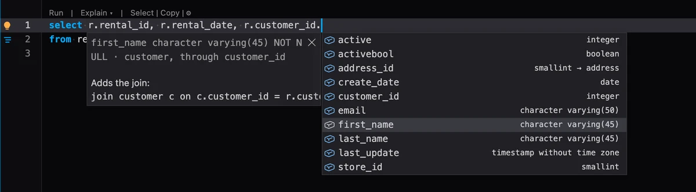

Pick `first_name`, and PlumeSQL writes it and adds the join in one step
(one undo, too):

```sql
select r.rental_id, r.rental_date, c.first_name
from rental r
join customer c on c.customer_id = r.customer_id
```

The path goes on as far as the keys do: `r.customer_id.address_id.city`
adds a join per step. The column alone works too, when one table of the
query has it as a key: `select address, city_id.` from `address` offers
the columns of `city`.

The join is written so the query returns the same rows as before:

- a key that cannot be NULL gets a `JOIN`: every row has its customer;
- a key that can be NULL gets a `LEFT JOIN`, so the rows without one stay;
- once a step is a `LEFT JOIN`, every step after it is one too.

If the query already joins that table over the same key, its alias is
used, with no second join. Anything else you want (another join type, a
condition of your own) you change in the text, like any SQL. The alias
follows your Refactors setting, and **Settings > Refactors > Join through
a foreign key column** turns it off.

When you type `r.`, a key column shows where it leads on its row, such
as `→ customer`, so you can see which columns a dot can follow.

### USING completes its key

Prefer `USING`? A join written with `USING (customer_id)` is recognized
too: a key path reuses it instead of joining the table again. And when
you write the join yourself, `join customer c using ` offers
`(customer_id)` right away: the key is known.

### Rewrite a join as USING, or as ON

Open the lightbulb (Ctrl+. or Cmd+.) on a query whose join is on one
shared column:

```sql
join customer c on c.customer_id = r.customer_id
-- Rewrite join customer as USING (customer_id):
join customer c using (customer_id)
```

and on a `USING` join, **Rewrite join customer as ON** goes back. With
the caret in a join, that join is offered; anywhere else in the query,
every join that can be rewritten. It is offered only where the two read
the same: when just one table left of the join has the column (with two,
`USING` would fail), and when the query does not select a bare `*`
(`USING` merges the two columns into one). Going back to `ON`, a column
the query reads without a table name gets the right one, so it does not
turn ambiguous.

## Where is it used, and rename it

### Where is it used?

**Shift+F12** on a table, a column, a function, a type or a schema shows
every place your SQL scripts use it, right under the line: this script,
the workspace's files and your scripts, read the way PostgreSQL reads them
(`c.first_name` through its alias counts, another table's `first_name`
does not). A double click opens the script at that place.

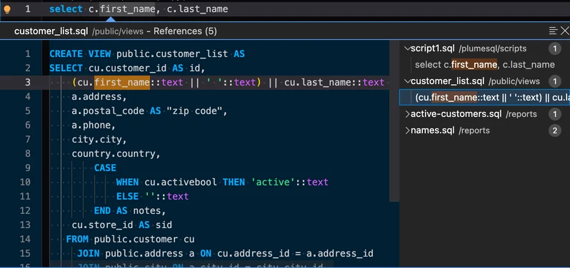

**Shift+Alt+F12** (Find All References, also in the editor's right-click
menu, as the list button beside the peek's X and on a row of the Objects
tab) lists the same places in the Search tab, to work through them one by
one. Its new **References** switch, beside Aa, ab and .*, takes a name
instead of text (`customer.first_name`), completed as you type.

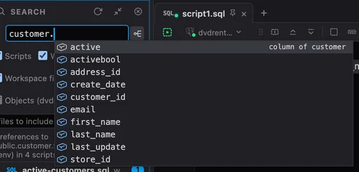

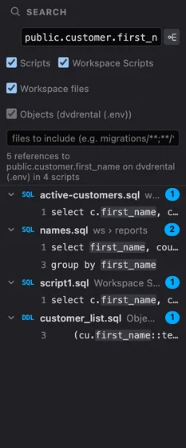

- Inside functions too: a SQL function's statements, a PL/pgSQL
  function's body, a DO block.
- What in the database uses it: views, functions, triggers and constraints,
  read from the Objects snapshot.
- Types as well: `'G'::mpaa_rating`, a column's type.
- Where it is defined counts too: a column in its table's `CREATE TABLE`,
  an index or a key on it, a function's own `CREATE FUNCTION`, the trigger
  that runs it.

### Rename an alias with F2

Put the caret on an alias, where it is written or on any `c.` that reads
it, and press **F2**: the new name is written everywhere the query reads
it, in one edit that one undo takes back.

- A **CTE's name** renames the same way, with every `from` and every
  qualifier that names it.
- An inner query that names its own `c` keeps it, and a string or a
  comment is never touched.
- A name the query already uses is refused at the caret, and a keyword
  as the new name is quoted for you.
- **Shift+F12** lists the places first.

### F2 on a table writes its rename

F2 on a table, a column, a function or any other object of the
database changes nothing in your query: the rename opens in a new
unsaved script, on the same connection, for you to read and run.

```sql
select c.first_name from customer c;
-- F2 on first_name, type given_name, Enter:
alter table public.customer
    rename column first_name to given_name;
```

- A column is found through its table or its alias, a function brings
  every overload (run the one you mean), and a schema, a type, an index,
  a trigger or a constraint rename the same way.
- Nothing runs until you run it. A line above the `ALTER` says how many
  places in your scripts use the name, for after the run.
- PostgreSQL's own objects are not offered.
- Right-click says it too: **Rename Column first_name**, **Rename Alias
  c**, only where there is something to rename.

### Your scripts follow the rename

Once the `ALTER ... RENAME` has run (and been committed, in a
transaction), the Log opens and says which of your scripts still use the
old name, with **Update usages** beside it (**Settings > Log > New
decision** can make it a notification or a pulse instead):

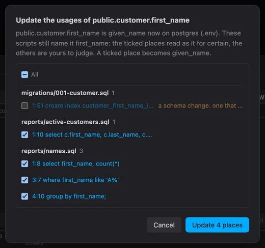

- Every place is listed under its script. The ones that surely mean the
  renamed column or table are ticked: `c.first_name` through the alias,
  `first_name` where that table is the one with the column, an INSERT's
  column list.
- The others wait unticked, each with its reason: a `CREATE INDEX` an old
  migration ran with, a column two tables share, a script that runs on
  another connection.
- Another table's column of the same name, a string and a comment are
  never touched.
- A function's body is listed unticked: the function keeps what it was
  created with until you create it again.
- A renamed type follows in its casts; a function that has overloads is
  told apart by how many arguments a call passes.
- **Update** writes the ticked places: an open script in its editor (one
  undo takes it back), a closed file on disk.

### Aliases in one step

The new
[Readability refactors](https://github.com/hercstack/plumesql/tree/main/extensions/Formatting/readability-refactors)
extension gives a query's tables their aliases from the lightbulb:
**Add aliases to every table** names each one (`customer c`,
`address a`) and rewrites every `customer.` and `address.` to it, and
**Add the alias c to customer** does it for one table.


It needs 0.29.0, which tells an extension where each table and each
qualifier is written.

```extensions
readability-refactors
```

## Completion that knows what comes next

### What follows a table

Type a space after a table in FROM or JOIN, and the list opens with what
can follow it, never another table (that comes after a comma):

- the joins its foreign keys make, with the condition written:
  `join address a on a.address_id = c.address_id`;
- its alias, `c` for `customer` (your Refactors alias style), and `as`;
- `where`, `join`, `left join`, `group by`, `order by`, `limit`, then every
  other join (`inner`, `right`, `full`, `cross`, `natural`, `lateral`) and
  the rest (`offset`, `fetch first`, `for update`, `union` ...), each a
  few letters away: `cr` finds `cross join`.

A join half written finishes too: after `left ` come `join`, `outer
join` and `join lateral`. After a JOIN's table its `on` condition from
the key leads, with `using (...)`.

### The words a statement takes

Where SQL decides the next word, the list starts with it, instead of
every table in the database:

- `create ` offers `table`, `view`, `index`, `materialized view`,
  `function` ...; `create index on ` the tables, then `(` and the index
  methods; a column definition its constraints (`primary key`, `not
  null`, `default`, `references` ...);
- `alter table customer ` offers `add column`, `drop column`, `alter
  column`, `rename column` ..., and after `drop column` or `alter column`
  the table's own columns;
- `drop `, `truncate`, `grant` and `revoke`, `comment on`, `explain`,
  `vacuum`, `begin`, `insert`, `with x as `, a window's `over (` ... each
  offers its own words;
- `update customer ` offers `set` and its alias, `delete from customer `
  `where`, `using` and `returning`.

### After a column, its comparisons

Once a phrase is complete, the space opens the list with what can follow
it: after `where c.email ` the comparisons (`=`, `is null`, `in`, `like`,
`between` ...), after `where c.active = 1 ` `and`, `or` and the clauses
still to come, after `limit 10 ` `offset`, after `select first_name `
`from` and `as`, after a list's comma the next column. After `exists `
come the subqueries your foreign keys make. Typing an operator closes
the list again.

The list also opens with ⌃Space, and on a Mac with ⌘I or ⌥Esc (⌃Space
often switches the keyboard's input source there).

## Mistakes caught before you run

### Joins that may repeat rows

This query runs, and it is wrong:

```sql
select c.customer_id, count(r.rental_id) as rentals, sum(p.amount) as paid
from customer c
left join rental r on r.customer_id = c.customer_id
left join payment p on p.customer_id = c.customer_id
group by c.customer_id;
```

Customer 1 has 32 rentals and paid 118.68. The query says 1024 and
3797.76: every rental is repeated once per payment, and every payment
once per rental.

PlumeSQL now reads every join against the keys of its tables, the idea
the Key Joins proposal (accepted by the SQL standard's working group in
October 2026) makes a guarantee of. A join on a unique key of the joined
table (its primary key, a unique index) keeps every row before it exactly
once. Any other join may repeat them:

- a quiet dotted hint under such a join says so on hover ("This join may
  repeat rows: each customer row once per matching rental row"), and the
  Problems tab lists it as a muted **HINT** row that never counts as a
  problem. A customer joined to their rentals is often what you mean, so
  it stays quiet;
- a **warning**, in the Problems tab too, where it is most likely a
  mistake: a `sum`, `avg`, `count` of a column or `string_agg` over a
  table whose rows a join repeats, and two one-to-many joins multiplying
  each other, as above.


The fix is usually to aggregate each child in a subquery first. Only
what can be proven is said: a view, a subquery or a condition other than
equalities is left unread. **Settings > Editor > Joins that may repeat
rows** chooses all, the hints only, the warnings only, or off.

### A missing comma

In

```sql
select
    first_name
    last_name,
    email
from customer;
```

`last_name` is no column: it is a name PostgreSQL gives `first_name`,
and the query runs with one column fewer. PlumeSQL now warns where an
alias written without `AS` looks like a forgotten comma (it stands on
the next line, or it names another column of the same table) and the
quick fix inserts the comma, or writes the `AS` when the alias is
meant. `c.first_name c.last_name`, which the server refuses with a
syntax error, gets **Insert ','** too. **Settings > Editor > Flag
aliases that read like a missing comma** turns it off.

### NULL traps

`where return_date = null` returns nothing, ever: a comparison with NULL
is never true. PlumeSQL now warns about it and offers **Use IS NULL**.
The same for the classic: `NOT IN (select ...)` over a column that can
hold NULL returns no rows the moment one comes, and the warning's Quick
Fix rewrites it as `NOT EXISTS`. Two columns that can both be NULL
compared with `<>` miss the rows where one is NULL; the fix writes
`IS DISTINCT FROM`. And `a = b` over two such columns, where two NULLs
never match, gets a quiet hint whose fix writes `IS NOT DISTINCT FROM`.
Which columns can hold NULL comes from your database's own definitions,
so a `NOT NULL` column never raises a warning. **Settings > Editor >
Comparisons NULL defeats** chooses all, the hints only, the warnings
only, or off. Where your session has `transform_null_equals` on, `= NULL`
does read as IS NULL there, and the warning becomes a quiet note that
says so.

### Quiet a check where it is wrong

A customer joined to their rentals is often exactly what you mean. Each
hint and warning of these checks offers, after its fixes, in the Quick
Fix and in the Problems row's menu:

- **Hide in This Statement**: gone for you, until the statement changes
  (the Log has Restore);
- **Allow join-repeats in This Query**: writes `-- @allow join-repeats`
  above the query, so everyone who reads the file sees it is meant;
- **Allow join-repeats in This File**: the same line in the file's header;
- the check's settings, for the workspace or everywhere.

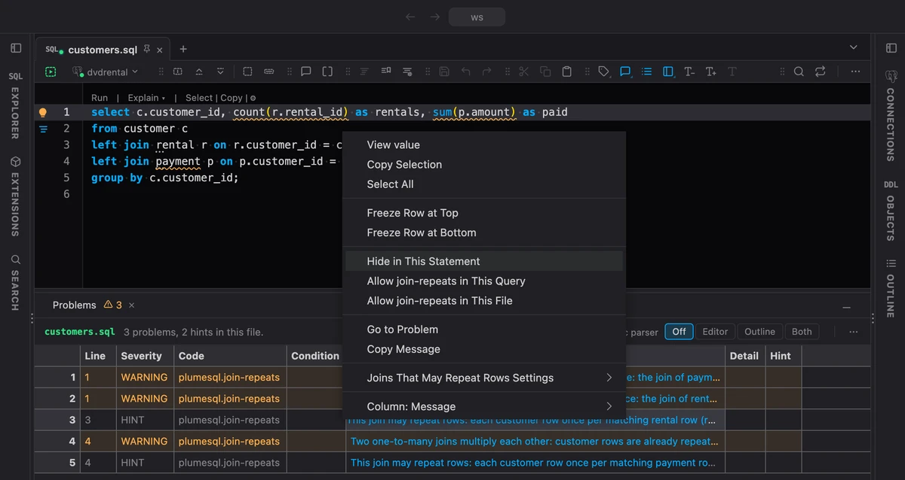

```sql
-- @allow join-repeats
select c.first_name, r.rental_date
from customer c
join rental r on r.customer_id = c.customer_id;
```

The checks are `join-repeats`, `null-comparison`, `missing-comma`,
`missing-semicolon` and `setting`, the Code column of the Problems tab shows them, and
the editor completes them after `-- @allow `.

### Fix it from the Problems tab

Every warning above, and every fix below, is in the **Problems** tab
too: a **Fix** column next to the line, where one click applies it, and
the row's right click menu lists every fix. The quiet hints are there as
well, as muted **HINT** rows: listed with their fixes, never counted as
problems.


### Quick fixes from what PostgreSQL says

Hover a problem and pick **Quick Fix**, or open the lightbulb, and the
fix the server's own words settle is one click away:

- "must appear in the GROUP BY clause": **Add c.customer_id to GROUP
  BY**, or the whole `GROUP BY` when the query has none;
- "Perhaps you meant to reference the column "c.customer_id"" (or the
  table alias): **Change to c.customer_id**;
- a `CREATE` of something that already exists: **Add IF NOT EXISTS**, or
  `CREATE OR REPLACE` for a view or a function;
- a `DROP` of something that does not: **Add IF EXISTS**;
- "cannot change return type of existing function": the `DROP FUNCTION`
  the server asks for, written above;
- "column is of type integer but expression is of type text": **Cast to
  integer**;
- a table named twice in a query: an alias for the second one.

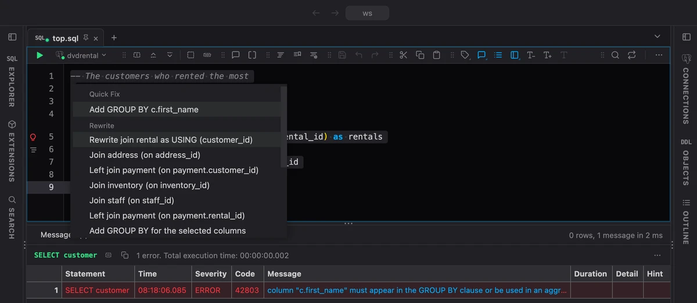

A hover over a problem is short now: the problem, and its Quick Fix
right under it.

### SET knows the server's parameters

Type `SET ` and the editor offers `SESSION`, `LOCAL`, `TIME ZONE` and
every parameter your server lets a session change, each with its type,
its unit and what it does. After the name come `TO` and `=`, and after
them the parameter's own values (`notice`, `warning` ... for
`client_min_messages`, `on` and `off` for a switch) and `DEFAULT`.

```sql
SET work_mem TO '64MB';
SET LOCAL statement_timeout = '5s';
SHOW client_min_messages;
```

`RESET`, `SHOW`, `ALTER SYSTEM SET`, `ALTER ROLE ... SET` and the name
inside `set_config('...')` and `current_setting('...')` complete the same
way, and a hover on a parameter's name shows its two values first: the
current one in this tab's session (`64MB, changed from the default`, read
again after every `SET` or `RESET` you run) and the default `RESET` gives
(`4MB`), then its documentation. A
misspelled one (`SET wrok_mem`) is a warning whose quick fix writes the
right name, and so is one a session cannot change (`SET shared_buffers`
takes a server restart).

A `SET` holds for your session only, and the Log says so after the run,
with the two answers as buttons: **RESET** puts the session back, and
**ALTER SYSTEM SET** writes the value for every new session and reloads
the configuration so it counts.

`ALTER SYSTEM` only writes `postgresql.auto.conf`, so one that no
`pg_reload_conf()` follows in the script is a warning, with a quick fix
that adds the reload; a parameter the server reads only at start says it
takes a restart instead. Run it that way anyway and the Log says what the
server now holds but has not read yet, with **Reload configuration** one
click away. A `SET` that a session cannot apply has a quick
fix that writes it as `ALTER SYSTEM SET`. The hover on a `SET`'s parameter
runs **ALTER SYSTEM SET and reload**, which keeps that value for every
new session, and **RESET** while your session still holds it; the hover
on an `ALTER SYSTEM`'s runs the reload. The results you are looking at
stay where they are.

The list is your server's own, extensions' parameters included, read
together with the Objects tree's snapshot and kept with it, so it works
before you connect and never asks the server while you type.

### A misspelled annotation says so

A plain SQL file reads an unknown `-- @name` as an ordinary comment, so
`-- @fromat upper` did nothing and said nothing. Now a name one slip from
a real one wears a dotted hint naming it, and **Change to @format** is
its quick fix. Other tools' words, such as NpgsqlRest's annotations or
`@param` and `@todo`, are left alone.

## Compare anything side by side

### Compare two files, objects or schemas

Right-click a file in the Explorer, an object or a schema in the Objects
tree, or any tab, and pick **Select for Compare**. The middle of the
title bar says what waits, with the tab you are on as the other side in
one click, and Cancel. The row and its tab wear a small mark, and
**Esc** ends it from anywhere.

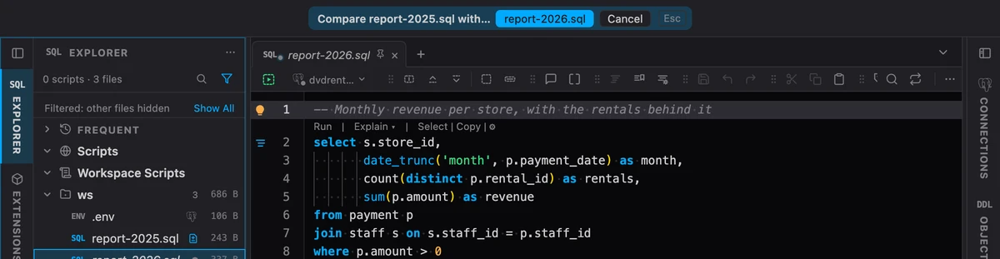

Then right-click the other one and pick **Compare with Selected**. With
two files selected in the Explorer, **Compare Selected** does it at once.

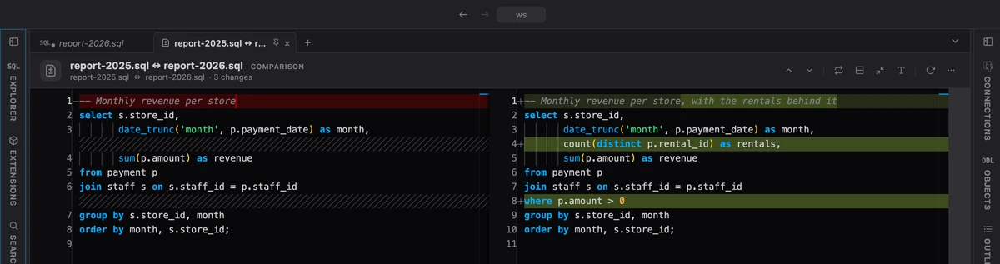

The two open side by side in a tab of their own, the changes marked. A
file open in a tab is compared as it is in the tab, unsaved edits and
all, and the comparison follows as you type. An object compares its
DDL, and a schema or a folder of the tree its whole document, so the
same table or the same schema on two servers is two clicks apart.

**Alt+F5** and **Shift+Alt+F5** step through the changes, as in VS Code.
The header switches to one inline text, folds away the unchanged lines,
swaps the sides and opens either side at the line you are on.

### Compared results show where they differ

Results compared side by side (**Compare With** in a result's menu) now
show where they differ as you scroll: a cell that is not the same as the
cell beside it turns amber on both sides, and rows only the longer result
has are tinted. The bar above them names the first difference, or says
the two are identical, and **Alt+F5** and **Shift+Alt+F5** jump to the
next and the previous one, however deep in the rows it is.

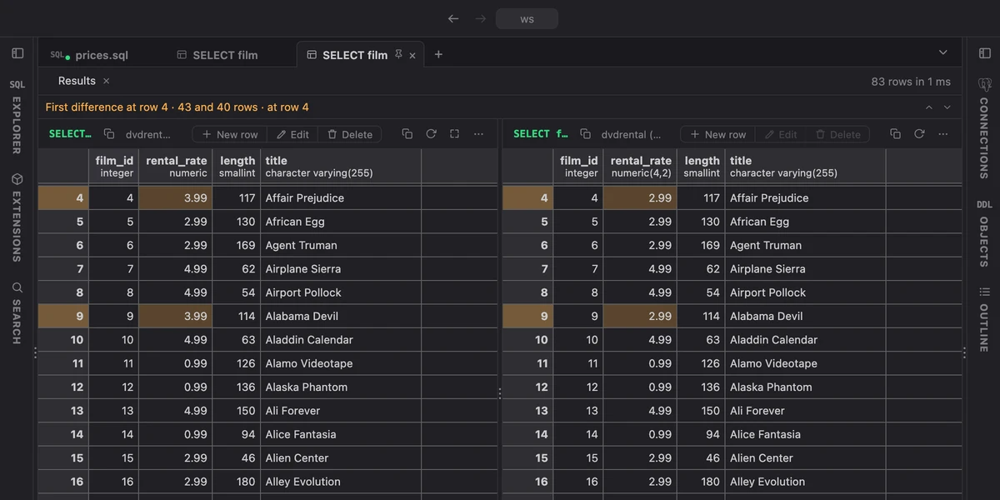

The rows pair by their position, so give both queries the same
`ORDER BY`.

## The Objects tree

### Browse Data and Open DDL on an object's row

Hover a table in the Objects tree and two small buttons on the right
open its rows or its DDL, each in a tab of its own; every other object
gets Open DDL.

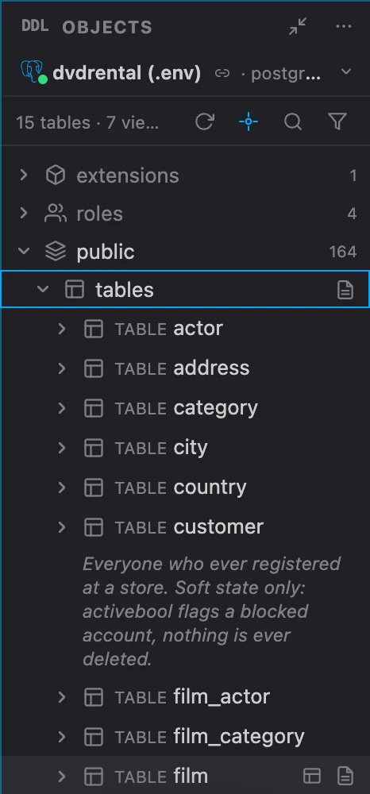

### A click knows what it is clicking

Tables and views have their own On Click (Browse Data, Open DDL or
Nothing), every other object its own (Open DDL or Nothing), so a
function no longer offers Browse Data. The arrow keys browse a table too
once you stop on it, so gliding past fifty tables runs nothing; on
Production connections they show the DDL and run nothing at all.

### Generated scripts name their parameters

A script the Objects tree writes still uses PostgreSQL's own `$1` and
`$2`, and a `-- @var` line above names each one, so the run form asks for
**Customer id** and **Effective date**, not `$1` and `$2`. A column's
comment is the field's help.

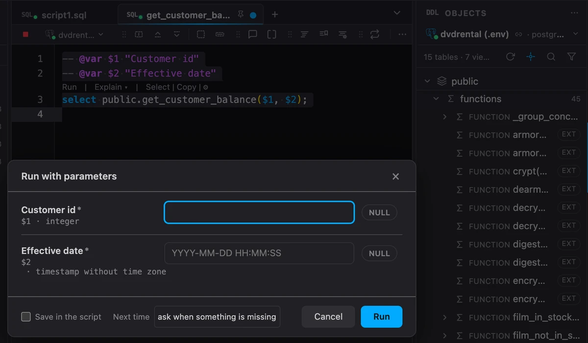

**Extract value into a parameter** keeps the value it took out as the
field's default.

### Pick a value from a table

`-- @pick` takes a table now, beside a query, written the way a foreign
key's `REFERENCES` names it:

```sql
-- @var $3 "Customer id"
-- @pick $3 public.customer (customer_id)
```

The scripts the Objects tree writes carry the line on their own: every
foreign key column of an insert, an update or a merge picks from the
table it references, and the key of the row an update or a delete
changes picks from the table itself.

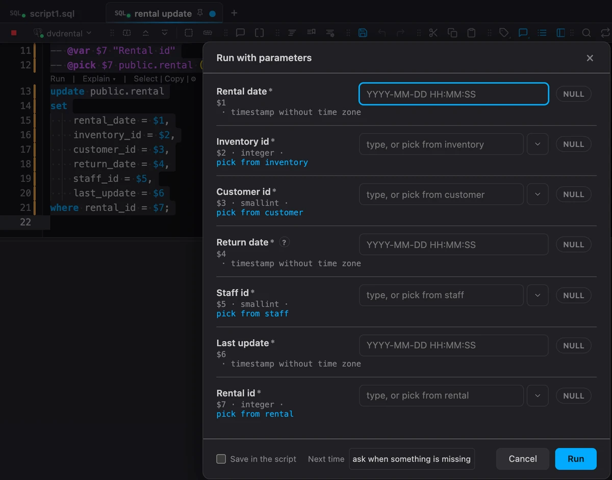

The pick button beside the field opens the table in the same picker the
row editor uses for a foreign key: every column, its filters and sort,
and a missing row can be added right there. Select a row, click
**Select**, and the form comes back with the value and everything you
typed.

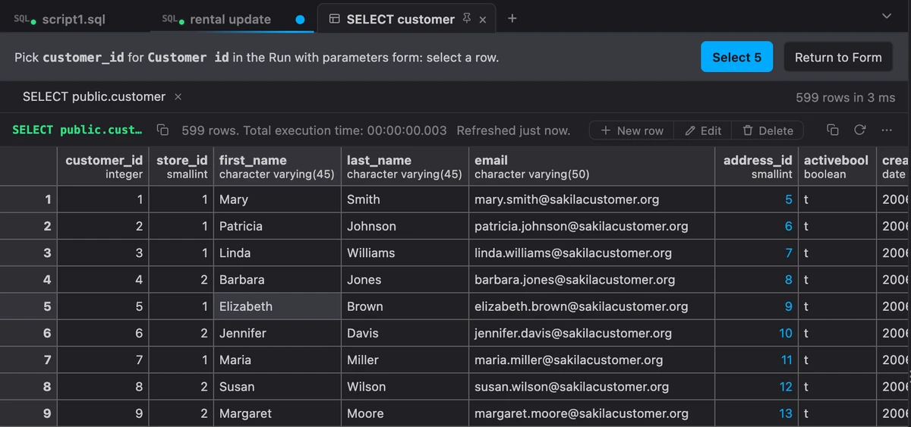

Leave the column out (`-- @pick $3 customer`) and the table's primary
key is used. No `-- @var` is needed either: `-- @pick $1 address
(address_id)` right above `select $1;` is enough, and the field is named
`$1` until a `@var` gives it a label. The same holds for `@choices` and
`@help`. The editor completes the line: the parameters right after
`@pick`, then the tables, each with its key (type a schema and a dot for
that schema's tables), then a table's columns inside the parentheses. Problems warns about a table or a column the
connection does not have.

### Dates and times from a picker

A date, a timestamp or a time no longer has to be typed. In the form that
asks for a script's parameters, and in the row editor, such a field has a
calendar button beside it (**Alt+↓** in the field):

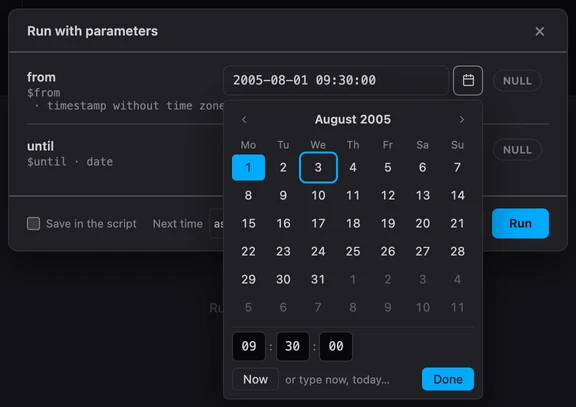

- Pick a day, set the hours, minutes and seconds, or press **Now** or
  **Today**. The field shows the value as it will be sent,
  `2005-08-01 09:30:00`.
- From the keyboard: the arrows move a day or a week, **PageUp** and
  **PageDown** a month (with **Shift** a year), **Enter** chooses, and
  **Esc** puts back what the field held.
- The field stays yours to type in, and PostgreSQL's own words work in
  it: `today`, `now`, `tomorrow`, `infinity`. The empty field says so.
- A value that cannot be the field's type gets a red edge as you type,
  and hovering the field says why: `not a timestamp`, `not a whole
  number`, `not valid JSON`. The run is never held for it; the server has
  the last word.
- The form brings back your last answers only where the type is the same,
  so a value you gave another query's text parameter stays out of a
  timestamp field.

### Parameter lines, completed and checked

Type `-- @var ` above a statement and the editor offers its parameters
that have no line yet, each with a label taken from the column it stands
for: above `where customer_id = $1` it writes `-- @var $1 "Customer id"`,
the label selected so you can type over it. After `-- @pick `,
`-- @choices ` and `-- @help ` it offers the statement's parameters,
declared or not.

And a line that does nothing now says so. A `@choices` with a single
value or a second list for the same field used to be skipped in silence;
each is a warning in Problems now, underlined where it stands.

## Extensions and themes

### Explain plan draws a diagram

The [Explain plan](https://github.com/hercstack/plumesql/tree/main/extensions/Performance/explain-plan)
extension draws the plan as a **diagram**: every step a card under the
step that uses its rows, with what it took itself, the rows it returned
and how far the estimate was off. The bar along a card's foot is its own
share, the line up to its parent is as thick as the rows it passes, and
the selected card's way to the result is lit.

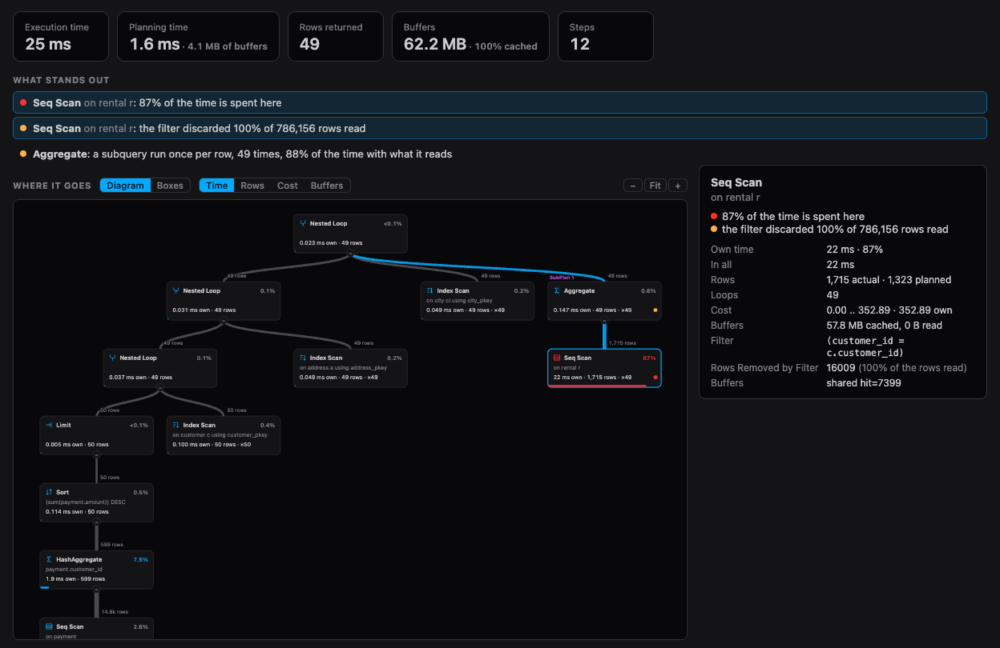

- **What stands out** names a join or a sort by its condition or key, so
  two Hash Joins are told apart, and finds a subquery run once per row
  and a step the planner was told to avoid (PostgreSQL 17).
- The summary shows what `SETTINGS`, triggers and `SERIALIZE` add, and
  what planning read.
- **Steps** has a search: a table, an index or anything in a condition.
- **Time**, **Rows**, **Cost** and **Buffers** stay one click apart, and
  one the plan cannot give says which EXPLAIN option brings it.
- Zoom, fit and drag the diagram, or walk it with the arrow keys. The
  boxes are still there, one click away.

It updates from the Extensions tab, on earlier versions of PlumeSQL too.

### Extensions read the server's settings

An extension now reads the server's configuration parameters, the values
your session runs with (a `SET` earlier in the script counts), and each
one that does tells you something it could not before:


- **[Explain plan](https://github.com/hercstack/plumesql/tree/main/extensions/Performance/explain-plan)**
  puts the memory a spill had beside it (`work_mem`), the server's
  limits beside a Gather short of workers, the share JIT took and the
  planner's switches that were off, and under each the change its numbers
  point at, a statement to copy: the `work_mem` that keeps it in memory,
  `RESET` for a switch, `jit = off` for a query too short for it.
- **[Settings explorer](https://github.com/hercstack/plumesql/tree/main/extensions/Server%20and%20Security/settings-explorer)**
  (new) turns `SHOW ALL` into what your session changed, each with its
  `RESET`, and what the server sets apart from the built-in values.
- **[Autovacuum forecast](https://github.com/hercstack/plumesql/tree/main/extensions/Storage%20and%20Maintenance/autovacuum-forecast)**
  (new) shows, on `pg_stat_user_tables`, how near each table is to its
  next autovacuum and autoanalyze by your server's thresholds.
- **[Migration safety](https://github.com/hercstack/plumesql/tree/main/extensions/Objects/migration-safety)**
  (new) writes a `lock_timeout` above an `ALTER TABLE` or a `CREATE
  INDEX`, so a change waiting for its lock never queues the table behind
  it, and more memory for an index build.
- **pgvector refactors** say when a `LIMIT` asks for more rows than an
  HNSW index looks at (`hnsw.ef_search`), **correctness refactors** write
  a date like `'01/02/2026'` the way your `DateStyle` reads it, **duration**
  reads an interval in any `IntervalStyle`, **currency** shows a `money`
  column in the server's own currency, the time charts read dates in any
  `DateStyle`, and the activity chart shows the server's `max_connections`.

Nothing that can hold a secret (a standby's connection string, an
archive command) is ever handed to an extension, and the install review
says which ones read the settings. The extensions you already have keep
installing on an earlier PlumeSQL, without what the settings add; the
three new ones need 0.29.0.

Install the new ones and update the ones you have, right here:

```extensions
explain-plan
settings-explorer
autovacuum-forecast
migration-safety
pgvector-refactors
correctness-refactors
duration
currency
activity-chart
bytea
profile
```

### Desktop 95, three new themes

Desktops of three eras, in
[Desktop 95](https://github.com/hercstack/plumesql/tree/main/extensions/Themes/desktop-95).
**Desktop 95** draws the grey nineties in relief: raised buttons, sunken
fields, the editor's tabs a taskbar whose active button is pressed in,
checkered scroll bars, a results grid with raised headers and row numbers
over white cells, and a form designer's code colors.

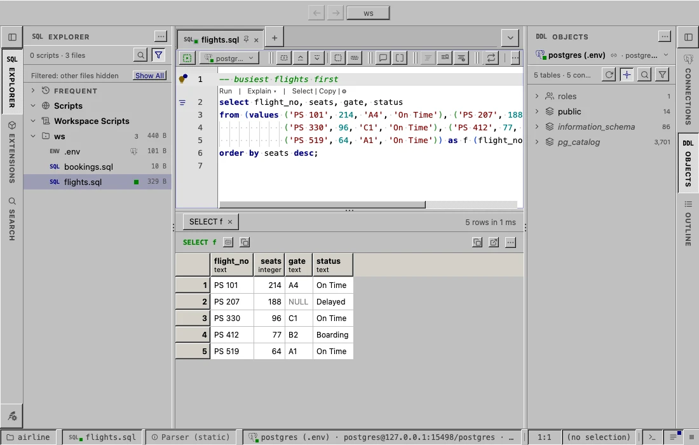

**Studio Classic** is a database studio of the next decade, its beige in
soft relief, blue keywords, red strings and magenta functions in Courier
New and a pale yellow status bar; **Studio Modern** the same studio
today, flat and light blue. Themes can now draw the window's controls in
relief; these are the first to use it.

[Retro](https://github.com/hercstack/plumesql/tree/main/extensions/Themes/retro)
has three more themes too: Phosphor Blue, Breadbin 64 Ready and Blue IDE.

```extensions
desktop-95
```

### The Extensions tab by category

The Extensions tab can now list the extensions by category instead of by
where they stand. Click the new button in the tab's header (or **Group
By > Category** in its ⋯ menu): every category is a section of its own,
from Activity and Locks and Performance down to Themes and Extension
Authoring, in the order of who they are for. Pinned and Updates stay on
top.

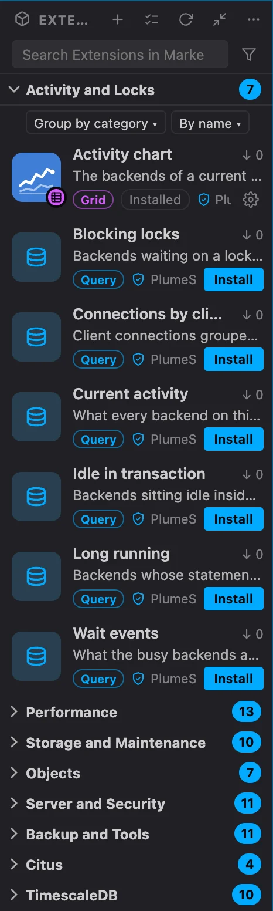

- Each row says where it stands: **Installed**, **Yours** for one of
  your own, **New**, the version an update brings, and why it is
  recommended.
- The first time, the first category opens and the rest fold, so you see
  them all at a glance. The heading of the category you are reading stays
  at the top as you scroll.
- The funnel's **Status** rows narrow the list, to what you have
  installed for example, still by category.
- The same button takes you back to the sections by status. The choice
  is a setting, **Settings > Extensions > Group the Extensions list by**.
- A copy button beside an extension's name, on the row under the mouse,
  copies its id, the name `-- @extension` lines use.

### An extension's refactors under its name

The more refactor extensions you install, the longer the lightbulb's
list. Now an extension with three or more offers for a statement is one
row under its name, with how many it has: **Window function (7)**,
**Statistics (4)**. The rest of the list stays as short as it was.

![The lightbulb on a query over customer, rental and payment: Rewrite lists Add LIMIT 100, the USING rewrites and the joins, then one row Window function (7) with its cube and a chevron; Write a Statement lists Count the rows and Statistics (4); More Actions ends with Search Refactor Extensions and Refactor Settings. Window function is under the mouse, and its submenu beside it lists Running total of rentals, Moving average of rentals over 7 rows, Change of rentals from the previous row, rentals as a percent of the total, Rank by rentals, Quartile of rentals and Row numbers by customer_id](media/refactor-groups.webp)

Point at the row and its refactors open beside it, as Refactor
Settings opens its scopes (the right arrow or Enter opens them from the
keyboard); one of them applies as ever. The cube on the row still opens
the extension's page.

- The editor's right click menu does the same: under **Refactorings**,
  the extension's name opens a submenu with its refactors.
- One or two offers of an extension stay in the list itself.
- **More Actions > Search Refactor Extensions**, in the lightbulb and in
  the menu, shows the Extensions tab with the refactor extensions alone,
  to find more.
- To list every offer as before, set **Settings > Refactors > Group an
  extension's offers** to off.

### Extensions from the annotation list

Type `-- @piv` and the list offers **@extension pivot** beside the
annotations, so attaching an extension no longer starts with typing the
keyword.

## Settings, files and connections

### A script without a connection takes the one you click

Open a script that has no connection yet and click a connection in the
Connections tree: the script takes it (it connects on its first run), and
the click shows its objects as before. To move the open script onto a
connection from the tree any time, right-click the connection and pick
**Assign to** your script.

### Settings you can read

Every setting on the Settings page now says what it does in a sentence
or two, then each of its values on a line of its own with what it
shows, then the fine print. Descriptions that no longer matched what a
setting does were corrected on the way.

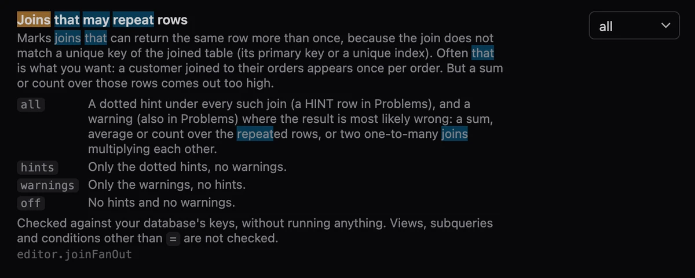

- **The map goes a level deeper.** The category you are reading lists
  its subsections under it on the left (Editor's Run, Text, Display,
  Hovers ...), the one on screen lit, and a click takes you there.
  Keyboard, Files and Objects are in subsections now, Refactors lists
  its groups (Quick Fix, Extract, Inline ...), and a small category
  lists its settings.
- **Favorite fonts** lists your favorites, each in its own face, and
  **Add font** opens the same font picker every font setting has.
- **Update extensions automatically**, once Update grid extensions
  automatically: refactor and theme extensions update too.

### Markdown side by side

A Markdown file's switch has a third face, **Split**: the text on the
left to edit, the document on the right, redrawn as you type and
scrolling with the text both ways.

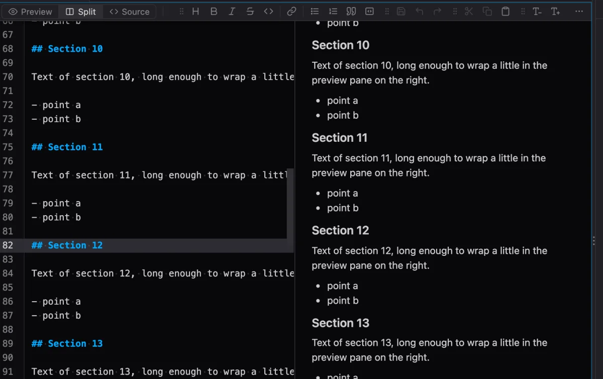

A double click on a part of the rendered document opens the source at
that line: from Preview it switches to Source, in Split it puts the
cursor there. **Settings > Files > Markdown files open as** can open
every file on Split.

### New File and New Folder from the Explorer's empty area

A right click below the rows offers them first, in the workspace folder,
as in VS Code.


### Release notes you can act on

A setting these notes talk about is drawn as its card: what it does and
its own switch, so you can turn it on right here (FROM-first queries
below has one), with **Open in Settings** beside it. A list of
extensions shows where each one stands, with **Install** and **Update**,
and **Install all** or **Update all** for the whole list (Extensions and
themes above has two). On GitHub the same lines read as plain lists.
## Experimental: FROM-first queries

### FROM first, SELECT after

Turn on **Settings > Experimental > FROM-first queries** and write a query
in the order it runs:

```sql
from customer c
join rental r on r.customer_id = c.customer_id
where c.active = 1
select c.first_name, count(*)
group by c.first_name
```


Because the FROM comes first, the list after `select ` already knows the
columns, and a dot after a key column joins through it as anywhere else.
While you write, the statement is not marked as an error. When you type
its `;`, run it or explain it, the editor writes it in SQL's order (one
undo gives your order back), so the server only ever sees SQL. `from
customer` alone becomes `select * from customer`.

It works wherever a query stands: subqueries at any depth, the bodies of
a WITH, each branch of a UNION, and the query of an INSERT, a CREATE VIEW
or an EXPLAIN. PostgreSQL has no query that starts with FROM, so nothing
you write today changes meaning. It is off until you turn it on; tell us
how it feels. Turn it on right here:

```setting
editor.fromFirst
```

## What changed

### A DDL view's statistics are in its header

An object's statistics stood as a comment block above its DDL. They are a
line in the view's header now, under its name, and the hover shows them
all:

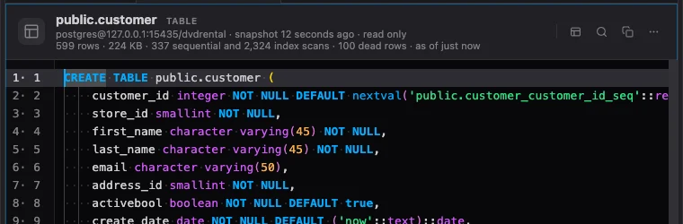

The DDL below is exactly what the server rendered: its line 1 is line 1,
a search result or a reference lands where it is, and a copy is the DDL
alone. **Settings > Objects > Statistics** still chooses which numbers show.

### `-- @inputs` reads like SQL

Run `select public._group_concat($1, $2);`, fill in the values and tick
**Save in the script**: the line above it reads `-- @inputs $1='a', $2='b'`,
the parameters as the query writes them and the values as SQL literals,
where it used to read `1=a, 2=b`. psql's `:since` is saved as `:since=`
and `{tag}` as `{tag}=`, and each field's tooltip names its key.

The values follow SQL's rules:

- `'text'` is a string, `''` a quote inside it, and commas, `=` and
  spaces inside are fine: `$1='it''s, here'`.
- A number or `true` stays as it is: `$2=42`.
- `NULL` is no value: the parameter is sent as NULL, and the form's NULL
  switch saves it that way. `'NULL'` is the text.
- `E'line1\nline2'` is a value with a line break, kept on its line.

Hover a key or press Ctrl+Space after `$1=` and the editor says the same.
Lines you saved before still work, and saving over one tidies it to the
new form.

### The window's modes say so in the title bar

Previewing a theme used to be said in the status bar. It is said in the
middle of the title bar now, in the same bar as a comparison that waits
for its other side, each with its buttons and Cancel. **Esc** ends them
from anywhere.

### The Markdown switch stays put

The Preview and Source switch stood at the left of the toolbar on the
source and at the right of a header on the preview, so it jumped with
every switch. Every face now has the same toolbar, with the switch in
the same place.

### The editor's gutter ends on a hairline

The gutter faded into the editor over its right half, which left the
fold arrows and the lightbulb on a smear between two colors. It keeps
one shade now, parted from the code by a thin line, in every theme.

### Warnings read as warnings in the light theme

The light theme's warning color was an orange that beside the red read
as a second error. It is a golden amber now, in the Problems tab, the
badges and everywhere else, and the editor's squiggles take the theme's
own colors, so a theme recolors them too. The command palette's rows
take the theme's text color as well.

### The Extensions tab comes back online by itself

Started without the network, the Extensions tab stayed offline (Install
and Update off) until a restart. It now tries again on its own, and at
once when the network returns.

### Select Color Theme ends a page's Preview

A theme still previewed from its page stood over the picker, so moving
through the list repainted nothing. The preview now ends as the picker
opens, and the theme that was previewed leads the list.

### The Problems tab says why a note is a note

When a query uses a table or function that an earlier statement of the
same script creates, the server has not got it yet, so the parser's
check fails, though the run will work. PlumeSQL shows that as a muted
note, not an error, and now says so plainly: a **Note** column beside
the line reads "created on line 132". Click it to jump to that line; the
row's right click menu has **Go to Line 132, Where It Is Created** too.

### More of what a script makes is recognized

A schema, a procedure, a table made by `SELECT ... INTO` and a column
added by `ALTER TABLE ... ADD COLUMN` were shown as errors when a later
statement used them. They are notes now, like a created table or
function.

### Profile keeps the column names in view

In [Profile](https://github.com/hercstack/plumesql/tree/main/extensions/Analysis/profile),
the column names stay at the left while you scroll sideways through the
rest.

## Fixed

- **A number or a date left empty is NULL.** In the form that asks for a
  script's parameters, an empty `$2` of `$2::int` was sent as an empty
  text, which PostgreSQL refuses. An empty field (or one holding spaces
  alone) of a number, a date or time, a UUID or JSON now means NULL: its
  NULL switch shows lit while the box is empty, and goes out as soon as
  you type. A text field still sends what you typed, the empty string
  included. The row editor does the same.
- **psql's `:"name"` is no error while you type.** The run turns it into
  a name (`select 1 as :"col"`), but the editor underlined it as an error.
  It reads as it runs now.
- **A search result in an object's DDL is selected where it is.** With
  Objects ticked in the Search tab, a match in an object's DDL opened the
  object with a wrong piece of text selected, a few lines above the match,
  as many as the statistics on top took. It lands on the match now.
- **Typing a bare `with` breaks nothing.** A statement that was only
  `with`, still being typed, raised an error from the Inline the CTE
  refactor; it now waits for a CTE.
- **An explained statement is still found in the editor.** After
  Explain, the result's name said the text had changed since and
  selected nothing, because what ran had EXPLAIN in front of it. It
  selects the statement again, and its messages keep their lines.
- **A view nobody can see is not called hung.** A Plan or a chart in a
  tab in the background, or in a window covered by another, was reported
  in the Log as not finishing after 90 seconds. Only the time it could
  draw counts now.
- **A tree keeps its place.** A click on a pinned folder heading at the
  top of the Explorer or the Objects tree jumped to the start of the
  tree instead of that folder, and opening an object could throw the
  tree back to its top. Both stay where they are now.
- **An extension's functions have their scripts.** Script and Copy
  Script now work on functions an extension brought, too.
- **Tabs on Multiple Rows sit on their lines.** With several rows of
  tabs, each row drifted a little further from the line under it, so
  the active tab crossed it. The rows and their lines now line up, for
  small tabs too.
- **Get a server with the terminal off.** It started its script anyway,
  where you could not see it, and no connection came of it. Its buttons
  now stand disabled and say the terminal is off.
- **Check availability automatically, per connection.** With the global
  setting off (the default), a connection or group set to On in its
  editor was checked only when saved. It is now checked at startup, when
  you come back to the window and on the interval.
- **Hiding PostgreSQL's catalogs.** The PostgreSQL system and Information
  schema groups of a connection's Snapshot settings left `pg_catalog` and
  `information_schema` in the Objects tab. They leave it now, and the
  editor's completion and hovers still know them.
- **Problems show as a file opens.** A missing semicolon, a missing
  comma and a NULL trap were found only after the first edit when the
  file opened before the editor's parser had loaded. They show at once
  now.
- **Use on a theme an update adds.** On an extension's page, Use on a
  theme that only a newer version of the extension has did nothing. It
  now updates the extension first, then switches to the theme.
- **The lines above a query belong to that query alone.** A script can
  hold the same query twice, say a copy pasted further down to try a
  different extension on it. The `-- @extension`, `-- @inputs`, `-- @ask`,
  `-- @noask`, `-- @var`, `-- @format` and `-- @computed` lines above one
  copy also reached the other: run the copy with no lines above it and it
  opened the same view, with the same answers and formats. Each query now
  reads only its own lines, and the file's header still reaches every
  query, as before.

  ```sql
  -- This one runs as a plain grid.
  select '{"rentals": []}'::jsonb as doc;

  -- This one opens as a table.
  -- @extension json-to-rows open
  -- @inputs column=doc, path=rentals
  select '{"rentals": []}'::jsonb as doc;
  ```

- **What a result writes into the script lands above its own query.**
  **Save in the script**, **For this query**, **Beside the Grid**, the
  run form's **Next time** and a format or computed column added from the
  grid wrote their line above the FIRST query with the same text, not the
  one the result came from, and **Move to an extension** took the other
  copy's lines along. They now work on the query you ran.

## Tell us what you think

Questions and ideas go to
[Discussions](https://github.com/hercstack/plumesql/discussions), bugs to
[Issues](https://github.com/hercstack/plumesql/issues) or Report a Bug in
the app's menu. The video tour is on
[YouTube](https://www.youtube.com/@plumesql).
