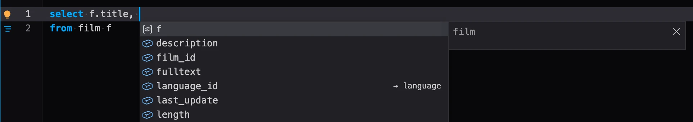
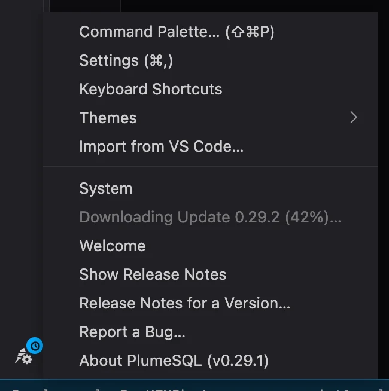
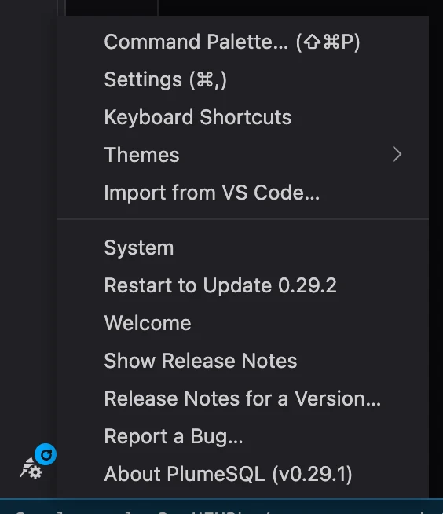

# PlumeSQL 0.29.1

Completion that reads your query in any order you write it, a script
that offers only what it uses, and updates that wait for your restart.

## Highlights

- **Write the FROM first:** the SELECT above it or in front of it gets
  the columns of its tables.
- **Fewer words that do not fit:** an expression is offered what an
  expression can hold, and a statement's first word what a statement
  starts with.
- **Scripts without semicolons:** each statement completes on its own.
- **Updates on your time:** the download runs in the background, and
  PlumeSQL restarts only when you say so.

## Completion

### The FROM written first

Write `from film`, go back above it and type `select`: a space opens the
list on the columns of `film`, the way it does after `where`. Typing right
in front of a word (`select t|from film`) keeps working too, and picking
a column puts a space before `from`.

### The words that fit

A select item, a condition or a value in `set` used to list every word
PostgreSQL knows beside your columns: `table`, `tablespace`, `temporary`.
Now it lists the words an expression can hold (`null`, `case`, `exists`,
`distinct` ...), `then` and `else` only inside a `case`, and `partition by`
inside `over (`.

The first word of a statement is offered the words a statement begins
with, `select`, `with`, `insert`, `update` and `delete` first, instead of
your tables and functions.

### Scripts without semicolons

In a script that runs its statements together without `;`, the first
letters of a new statement below a blank line offered nothing, and a
query could be offered the columns of the statement next to it. Each
statement now completes on its own.

## What changed

### Updates download in the background and wait for your restart

**Download Update** (in the Log, the app menu or the System page) fetches
the new version in the background, and the app menu's badge shows a clock
meanwhile. Nothing restarts. Once it is in, the badge turns into a restart
arrow and **Restart to Update** waits in the Log and the app menu. If you
never press it, the update installs when you close PlumeSQL, and the next
start is the new version.

### A script offers only the annotations it uses

`-- @file` and `-- @dir` ask for a path in an extension. A script sends
its SQL to the server, where a path on your computer means nothing, so a
script no longer offers or reads them. An annotation that only an
extension reads (`@dir`, `@refresh`, `@button`) now says so with a dotted
hint in a script, with **Remove the line** as its quick fix.

## Fixed

- **A space after `select` shows the columns.** It kept a template
  standing in the list (insert … select) instead of opening the columns,
  even with the FROM written.

## Tell us what you think

Questions and ideas go to
[Discussions](https://github.com/hercstack/plumesql/discussions), bugs to
[Issues](https://github.com/hercstack/plumesql/issues) or Report a Bug in
the app's menu. The video tour is on
[YouTube](https://www.youtube.com/@plumesql).
