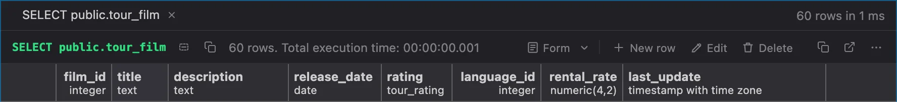

# PlumeSQL 0.30.0

A LEFT JOIN that quietly turns into a JOIN is caught, and PlumeSQL now
opens in your theme from the very first frame.

## Highlights

- **A LEFT JOIN its WHERE undoes:** a warning on the condition, and one
  click moves it where it keeps the rows you meant.
- **No more flash on start:** the window opens in the theme you chose,
  not in the default one for a moment first.

## A LEFT JOIN its WHERE undoes

One of the most common mistakes in SQL, and it gives no error:

```sql
select c.customer_id, c.last_name, p.amount
from customer c
left join payment p on p.customer_id = c.customer_id
where p.amount > 5;
```

The LEFT JOIN keeps every customer, a customer without such a payment
with every `p` column NULL. Then the WHERE runs, `NULL > 5` is never true,
and those customers are gone again: the query returns exactly what a plain
JOIN would.

The editor now marks such a condition with a warning, also in Problems,
and the lightbulb (⌘. or Ctrl+.) offers the fix:

- **Move p.amount > 5 into the LEFT JOIN's ON:** `left join payment p on
  p.customer_id = c.customer_id and p.amount > 5` keeps every customer,
  with their payments over 5 when they have any. Most often what was
  meant.
- **Change LEFT JOIN p to JOIN:** the same rows it returns now, but the
  query says so.
- **Write ... IS DISTINCT FROM ...**, for a `<>`: `d.name is distinct
  from 'HR'` keeps the rows without a match too.

What lets a NULL through on purpose is left alone: `where p.payment_id is
null` (the customers without a payment), `is distinct from`, `coalesce`,
a condition inside OR. It reads your query with PostgreSQL's own parser
and sends nothing to the server.

```setting
editor.flagLeftJoinUndone
```

## Your theme from the first frame

With a theme other than the default, every start used to show the default
theme for a moment, the desktop app's splash in dark, before your own
theme took over. A short but jarring flash.

PlumeSQL now keeps the look of the theme it showed last and paints it
before anything else: the desktop app's splash while the app starts, then
the window itself. Your settings still decide, so a theme you change takes
effect as before, and the next start opens in it.

This works for the built-in Dark and Light and for every theme extension
from the Marketplace.

## What changed

### Quick fixes say what they write

The rewrite of a SQL function's string body now reads **Rewrite the body
as SQL-standard RETURN a + b** and **Rewrite the body as SQL-standard
BEGIN ATOMIC ... END**: `RETURN a + b` is the SQL-standard body of a
`LANGUAGE sql` function, not PL/pgSQL's RETURN, and the title now says so.
Concatenate the selected columns names each form and what it does with a
NULL (`concat_ws` skips it, `||` gives NULL), and the LEFT JOIN fixes say
which rows each one keeps.

### New row, Edit and Delete beside the other actions

Above the rows of a table you can edit, **New row**, **Edit** and
**Delete** were an outlined group in the middle of the bar, the only
control with a border there. They are now flat like the copy and save
buttons and stand on the right beside them: the left of the bar tells what
ran, the right holds what you can do. In a narrow pane they keep their
icons.



## Tell us what you think

Questions and ideas go to
[Discussions](https://github.com/hercstack/plumesql/discussions), bugs to
[Issues](https://github.com/hercstack/plumesql/issues) or Report a Bug in
the app's menu. The video tour is on
[YouTube](https://www.youtube.com/@plumesql).
