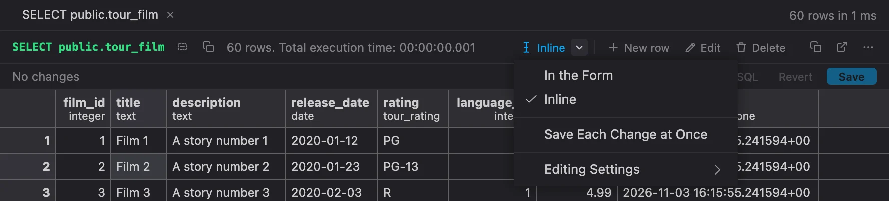
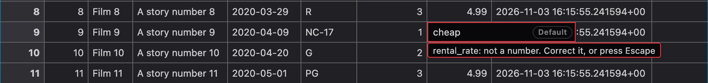
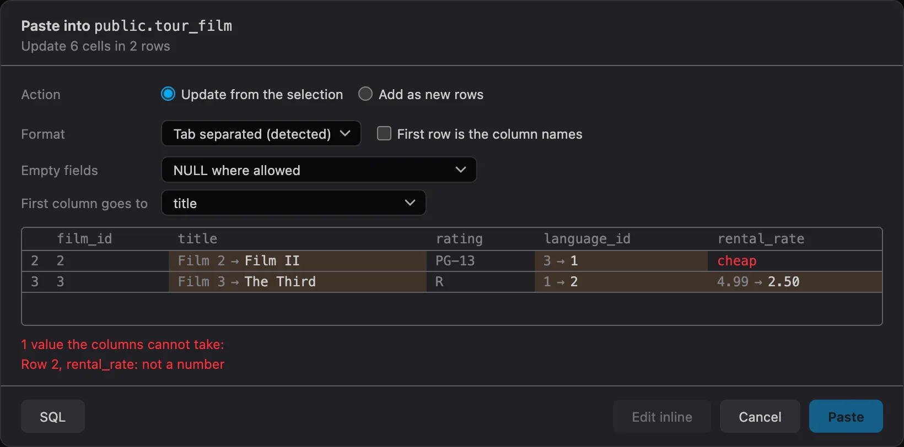
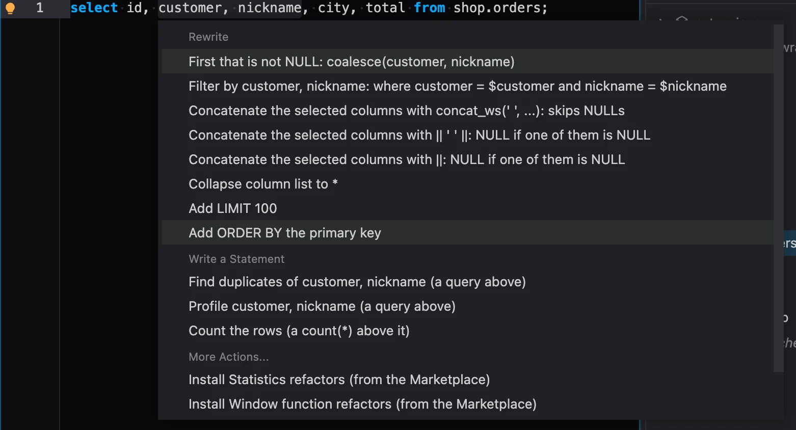
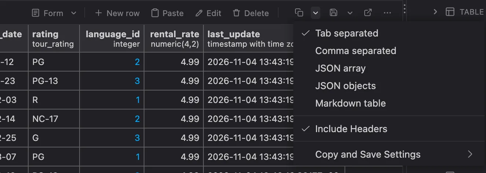

# PlumeSQL 0.30.0

Edit a table's rows right in the results grid, as in a spreadsheet, and
paste rows into it from one, or make a table of what you copied or of a file
you drop on the window. A LEFT JOIN that quietly turns into a JOIN is
caught, the row editor shows the SQL it runs, and PlumeSQL now opens in your
theme from the very first frame.

## Highlights

- **Inline editing:** change cells, add and delete rows in the grid,
  then save it all in one transaction. Or keep the form: you choose the
  default.
- **Paste into a table:** copy from Excel, a result or JSON, press ⌘V, see
  what will change, then confirm. Update cells or add new rows.
- **Paste or drop a file as a table:** rows from Excel, or a CSV, TSV or JSON
  file, into a temporary table in a few clicks, its columns named and typed
  for you.
- **Select, and the lightbulb offers more:** selected columns can be checked for
  duplicates, profiled, merged or filtered on; selected statements can go in a
  transaction, one rolled back to try them, or a DO block. A blue dot says when.
- **A LEFT JOIN its WHERE undoes:** a warning on the condition, and one
  click moves it where it keeps the rows you meant.
- **The SQL of a row edit:** the form shows the UPDATE or INSERT it will
  run, to read, copy or open as a script.
- **No more flash on start:** the window opens in the theme you chose,
  not in the default one for a moment first.

## Edit rows right in the grid

The rows of a table can now be edited where they stand, in the results
grid, as in a spreadsheet. The row form stays, and you decide which of the
two you want.


**One click to switch.** Above the rows of a table you can edit, the edit
buttons start with the mode: **Form** or **Inline**. A click switches to
the other. Its arrow holds the Edit Mode menu.



**Edit as in a spreadsheet:**

- Type over a cell, or press Enter, F2 or double-click to edit it in place.
- Enter commits and moves down, Tab moves right, Escape cancels.
- ⌘Z or Ctrl+Z takes back the last change.
- The cell's menu has Set NULL, Set DEFAULT and Revert Cell.
- An enum's labels, a date's picker and a foreign key's table are one
  Alt+Down away, as in the form.

**Nothing is written until Save.** A changed cell turns amber and the bar
above the grid counts it. **New row** opens a row at the top, a value it
still needs in red. **Delete** strikes a row through. **Save** (or ⌘Enter,
Ctrl+Enter in the grid) writes it all in one transaction, all or nothing,
and **Revert** takes it back. **SQL** shows the script Save runs, to copy
or open as a script.

**Safe when someone else edits too.** Every row is checked from the moment
you start editing. A Save that meets a row someone changed meanwhile
writes nothing, and the row is marked.

**A value the column refuses never gets in.** A word in a number, a month
13, an enum label with the wrong case: the cell stays open and says why.



**Or save each change at once.** With **Save Each Change at Once** in the
Edit Mode menu, a cell is written as you finish it, a new row when you
leave it, a deleted row once you confirm. On a connection whose production
guard asks before data changes, everything still waits for Save.

**From the form too.** **Edit inline** in the row form switches the tab to
Inline and brings what you typed there along.

Inline editing needs the table's primary key or a unique key among the
result's columns. Without one, the form edits the rows as before.

### Choose your default

The Edit Mode menu changes one tab. These settings decide how every tab
starts: in the form or inline, and when inline changes are written. To set
them for one workspace only, use **Editing Settings** in the same menu.

```setting
results.editMode
results.inlineSave
```

## Paste into a table

Copy rows from Excel, Sheets or a PlumeSQL result, click a cell of a table's
results and press ⌘V or Ctrl+V. **Paste** on the bar above the grid does the
same. Nothing changes until you have seen what the paste will do.


**You choose what it does.** With a selection, **Update from the selection**
comes first and **Add as new rows** is one click away:

- A block lands from the selection's first cell, right and down.
- One value over a range fills the range.
- Rows past the end of the result become new rows, unless you untick it.

**The format is detected.** Tab separated (what a spreadsheet copies), comma
separated, semicolon separated (what a spreadsheet saves as CSV where the comma
is the decimal mark), JSON and Markdown tables. If the guess is wrong, pick
another in the dialog.

**A spreadsheet's numbers and dates read.** `1.234,56` becomes `1234.56` in a
number's column and `31.12.2026.` becomes `2026-12-31` in a date's. The decimal
mark and the date order are detected from the values, and the dialog shows them
for you to change, for that one paste or in the settings for all of them. A text
column keeps what you copied.

**Each value finds its column:**

- JSON objects go by name.
- Everything else goes by position, from the column you pick in **First column
  goes to**.
- A first row of column names is recognized, and then the values go by those
  names, in any order.
- A generated column takes no value: it is skipped, and the dialog says so.

**An empty field is NULL** where the column allows it, so a copied NULL comes
back as NULL. In a NOT NULL column, it is the empty string where the type has
one.

**What cannot be written holds the button.** A value the column refuses shows
red with the reason, and **Paste** waits until it is put right.



**When it is written follows the Edit Mode:**

- **Form:** **Paste** writes it all in one transaction, all or nothing, and one
  **Undo** in the Log takes the whole paste back. **Edit inline** in the dialog
  makes it pending instead.
- **Inline:** **Add as Pending Changes** writes nothing until Save, and one ⌘Z
  or Ctrl+Z takes the whole paste back. New rows wait at the end of the result,
  in the order you copied them.
- **Save Each Change at Once:** **Paste and Save** writes it all in one
  transaction.

**SQL** in the dialog shows the statements, to copy or open as a script. A row
someone changed since the dialog read it refuses the whole paste, and nothing
is written.

Paste works where editing does: a query that reads one table, with its key in
the result. A table with no key takes new rows only. One paste holds up to
10,000 rows. For rows that belong in a table of their own, **Paste as Table** at
the foot of the dialog takes the same text there.

```setting
results.pasteFormat
results.pasteHeaders
results.pasteEmpty
results.pasteDecimal
results.pasteDates
results.pasteMaxRows
```

## Paste or drop a file as a table

Rows from Excel often need a table of their own, for a moment or for good.
**PlumeSQL: Paste as Table** in the palette, or **Paste as Table** in the SQL
editor's menu, takes what you copied there, with no result needed.


**A temporary table by default,** the one you most often want. It is made in the
tab you are in, so your script goes on querying it, and it goes when the session
does. Or choose another:

- **New table** stays, in the schema you pick, with an id column as its primary
  key if you want one, so its rows can be edited in the grid.
- **Unlogged table** stays and is quick to fill: it is not written to the WAL, is
  emptied after a crash and is not replicated.
- **Existing table** adds the rows to a table that is there, through the Paste
  dialog, with one Undo.

**Names and types are read for you.** A first row of names becomes the columns,
`Ime i prezime` as `ime_i_prezime` and `Šifra` as `sifra`. Each column gets the
narrowest type every value fits, and a number with a leading zero, such as `007`,
stays text. Change any of them: a type some value cannot take holds **Create** and
says which value.

**All or nothing.** **Create** makes the table and writes its rows in one
transaction, then shows them in the tab. **SQL** shows the statements, to copy or
open as a script.

The Objects tree has it too: **Paste as New Table** on a schema's folder and
**Paste Rows** on a table. Both start where you asked, with no question about it.

### Drop a file on the window

Drop one CSV, TSV or JSON file on the window and the same dialog opens instead of
a tab, the table named after the file. **Open the File** opens it after all.


- A `.txt` counts when it shows two columns over two lines.
- A JSON file counts when it holds rows, so a settings file still opens.
- A `.sql` file, or several files at once, open as they always did.
- On a connection you cannot write to, or with none, the file opens and the Log
  says why it was not offered.

**The letters come out right.** A spreadsheet's plain CSV is often not UTF-8. When
a file is not, the dialog guesses its encoding from your system's language and
shows **Encoding**, so `pocinčani` can be put right before anything is written.

**From the keyboard too.** **PlumeSQL: Import File as Table** in the palette picks
a file for the same dialog. Asked for by name, it opens the dialog whatever the
file looks like.

A file holds up to 8 MiB and the 10,000 rows of a paste.

## A LEFT JOIN its WHERE undoes

One of the most common mistakes in SQL, and it gives no error:

```sql
select c.customer_id, c.last_name, p.amount
from customer c
left join payment p on p.customer_id = c.customer_id
where p.amount > 5;
```

The LEFT JOIN keeps every customer, a customer without such a payment
with every `p` column NULL. Then the WHERE runs, `NULL > 5` is never true,
and those customers are gone again: the query returns exactly what a plain
JOIN would.

The editor now marks such a condition with a warning, also in Problems,
and the lightbulb (⌘. or Ctrl+.) offers the fix:

- **Move p.amount > 5 into the LEFT JOIN's ON:** `left join payment p on
  p.customer_id = c.customer_id and p.amount > 5` keeps every customer,
  with their payments over 5 when they have any. Most often what was
  meant.
- **Change LEFT JOIN p to JOIN:** the same rows it returns now, but the
  query says so.
- **Write ... IS DISTINCT FROM ...**, for a `<>`: `d.name is distinct
  from 'HR'` keeps the rows without a match too.

What lets a NULL through on purpose is left alone: `where p.payment_id is
null` (the customers without a payment), `is distinct from`, `coalesce`,
a condition inside OR. It reads your query with PostgreSQL's own parser
and sends nothing to the server.

```setting
editor.flagLeftJoinUndone
```

## The SQL of a row edit

In the form that edits or inserts a row, **SQL** at the bottom shows the
statement **Update** or **Insert** will run, and it follows as you type.
**Copy** puts it on the clipboard. **Open as Script** opens it in a new
script on the same connection, where it runs only when you run it.


An update keeps the check PlumeSQL makes on every edit:
`xmin::text = '...'` makes it change nothing if someone changed the row
after the form read it, so a copied statement is as safe as the button.
Untick **Concurrency check** to leave it out of the SQL. **Update** itself
always checks, and the Log records each edit the same way, check included.

## Your theme from the first frame

With a theme other than the default, every start used to show the default
theme for a moment, the desktop app's splash in dark, before your own
theme took over. A short but jarring flash.

PlumeSQL now keeps the look of the theme it showed last and paints it
before anything else: the desktop app's splash while the app starts, then
the window itself. Your settings still decide, so a theme you change takes
effect as before, and the next start opens in it.

This works for the built-in Dark and Light and for every theme extension
from the Marketplace.

## What changed

### Quick fixes say what they write

The rewrite of a SQL function's string body now reads **Rewrite the body
as SQL-standard RETURN a + b** and **Rewrite the body as SQL-standard
BEGIN ATOMIC ... END**: `RETURN a + b` is the SQL-standard body of a
`LANGUAGE sql` function, not PL/pgSQL's RETURN, and the title now says so.
Concatenate the selected columns names each form and what it does with a
NULL (`concat_ws` skips it, `||` gives NULL), and the LEFT JOIN fixes say
which rows each one keeps.

### Surround the selected statements

Select two or more statements, at least one that is no SELECT, and the lightbulb
offers what you would type around them:

- **Wrap in a transaction:** `begin;` above them and `commit;` below.
- **Try it and roll back:** `begin;` above and `rollback;` below, to see what they do
  and keep nothing. If a statement fails, the run stops there: nothing is kept, the
  tab reads **transaction failed**, and `rollback` is yours to run.
- **Wrap in a DO block:** `do $$ begin ... end; $$;`.

They are not offered around a statement that opens or closes a transaction itself or
refuses to run in one, such as `VACUUM`. The DO block is also left out for a `SELECT`,
a `RETURNING` or a parameter, none of which can run in it.

### Select columns, and the lightbulb offers what comes next

Select one or more columns in a query's select list:



- **Find duplicates of a, b:** the values that repeat, with how many times, as a query
  reading yours, above it or in a new tab.
- **Profile a, b:** for each column its rows, values, NULLs, distinct values, smallest
  and largest, the same way.
- **First that is not NULL:** two or more neighbouring columns become
  `coalesce(a, b) as a_or_b`. Different kinds of type read as text.
- **Filter by a:** `where a = $a` in your query, the run asking for the value. For one
  column also **is NULL** and **is not NULL**.

Nothing of this stands in the list until you select, and each has its switch in the
Refactors settings. A refactor extension can read what is selected too, through
`statement.selection`.

### Concatenate columns of any type

Select two or more neighbouring columns in a select list and the lightbulb offers to
make them one. It used to offer that for text columns alone, so a number or a date
among them showed nothing. **concat_ws** takes them as they are, and the **||** forms
cast what is not text: `id::text || ' ' || first_name`.

### The lightbulb's dot tells when a selection brings something

Selecting those columns, or anything else that brings an option to the list, now
puts the blue dot on the lightbulb, the same dot a run's new refactors bring, with
what is new in its tooltip. It stays while the selection does, and opening the list
clears it.

### Remove an unused variable

The warning on a PL/pgSQL variable nothing uses now comes with a Quick Fix (⌘. or
Ctrl+.): **Remove unused variable v_note**. The declaration goes, with its comment,
and the DECLARE too when it was the last. If its default calls something, the title
says so, since that call would no longer run.

### A refused edit leaves its line in the Log

When the server refuses a row edit, a duplicate key for example, the form
shows its error where you are looking and stays open for you to fix it.
The Log now records it as well, with the statement that was tried, so a
failed write leaves a trace like a successful one. The entry arrives
already dismissed: you read it in the form, so the Log does not open for
it.

### New row, Edit and Delete beside the other actions

Above the rows of a table you can edit, **New row**, **Edit** and
**Delete** were an outlined group in the middle of the bar, the only
control with a border there. They are now flat like the copy and save
buttons and stand on the right beside them, after the edit mode: the left
of the bar tells what ran, the right holds what you can do. In a narrow
pane they keep their icons.


### Copy and Save have an arrow

Choosing the format used to take the result's ... menu. **Copy** and **Save**
above the rows now each have an arrow, as the edit mode has: it holds the
format, whether it starts with the column names, and the settings behind them.
A click on the button itself copies or saves as before, and its tooltip names
the format. A line now sets them apart from the edit buttons.



### A cell's tooltip only where it adds something

Hovering a cell used to repeat its value in a tooltip, even a `1` shown in
full. The tooltip now appears only where the cell cuts the value off or shows
it as something else, a formatted number for example. NULL has none.

### Arrows scroll over whole rows and columns

With whole rows selected in a result wider than its pane, ←, →, Home and End
now scroll sideways and the selection stays. With whole columns selected, ↑,
↓, PageUp and PageDown scroll. With everything selected, all of them do. The
other direction still moves to a cell, and so does a range of cells, as in a
spreadsheet.

### Only a query that reads one table edits its rows

A result used to be editable whenever its columns came from one table,
even from a join: `select f.* from film f join film_actor fa ...` shows a
film once for each of its actors. Editing one copy left the others showing
the old value.

Now a result is editable, in the form and inline alike, only when its
query reads one table alone: no join, no UNION, DISTINCT or GROUP BY, no
set-returning function such as `unnest` in the select list, no subquery or
CTE in FROM. Where it is not, the edit buttons do not show, and **Paste** in
a cell's menu says why. To edit the films of that join, read the table alone
and filter with a subquery, which stays free:

```sql
select f.*
from film f
where exists (select 1 from film_actor fa where fa.film_id = f.film_id and fa.actor_id = 1);
```

### A foreign key field has a pick button

In the row form, a foreign key's box now has a pick button beside it, like
an action form's pick. It opens the table the key references to pick the
value from.

### The Objects tree follows a result grid too

With Follow the editor on, clicking into a script's result grid lights
the table its rows come from in the Objects tab, the way the editor's
cursor lights the object it stands on. Back in the editor, the tree
follows the cursor again.

### The editor's settings in four categories

The Editor settings had grown to 74 in one list. They are now four
categories:

- **Editor:** text, display, running and comparing.
- **Assistance:** completion, hovers and inlay hints.
- **Toolbar and Lenses:** the lenses, the gutter buttons, the lightbulb
  and the toolbar.
- **Checks:** every check the Problems tab shows, the parser's included.
  It takes over Parser, also in the connection and group editors.

Every link into these settings opens where the setting now lives, and the
keys are the same, so nothing you set is lost.

### A calmer Search pane

The Search pane's results read more easily, above all in a narrow pane:

- **No indentation in front of a match:** the line starts with its code,
  so the match and what follows it stay in sight.
- **No workspace name on every file:** a file of the workspace shows only
  its folder, and nothing at the top level. Scripts, Workspace Scripts and
  Objects keep their names.
- **Quieter counts:** a file's number of matches is a plain number, the
  way the trees count, not a colored badge.
- **References counted as what they are:** "in 20 scripts and 14
  objects", where the objects' DDL used to count as scripts.

## Fixed

- **Enter at the end of a formula ends the line.** In a `-- @computed` or
  `-- @format` line a list stayed open over the formula's punctuation, so Enter
  after `row.email.split('@')[1]` wrote `value` into it. A list now opens at the
  formula's start, on a name being typed and after a dot, and no longer covers a
  function's signature.
- **`split(` shows the overload you mean.** It opened on one taking a
  `{ [Symbol.split](...) }` object, and so did `replace`, `match` and `search`. The
  plain one comes first now, in a formula and in the extension editors.
- **A computed column as wide as what it makes.** A formula extended after a pause
  kept the width of its first values and read `Marko Vuk...`. The same goes for a
  format.
- **A computed column's menu can format it.** **Format** in its menu has every
  template, as a real column has.
- **`row.` lists what a `-- @computed` line can read:** not the column being
  written, nor those after it, which are not there yet. Reading one of them is now
  marked in the line, like a typo.
- **No "No suggestions." on an annotation line.** It showed while you named a new
  column, and under any annotation's text with nothing to offer.
- **The hover of `value` in a `-- @computed` line reads `row.<column>`,** where the
  column's name was missing.
- **The Objects tree follows a cursor that has not moved.** With Follow the editor
  on, a script opened with its cursor on a table lit nothing in the tree until the
  cursor moved, most of all at a start, where the database's objects arrive later
  than the cursor. The tree now catches up as soon as they do, and scrolls to the
  object if it is out of sight.
- **Paste in the editor asks nothing on macOS.** The Paste button of the editor's
  toolbar, its right click menu and the terminal's menu put up a small system
  Paste popup, and dismissing it left an error in the Log. They now paste at
  once, as ⌘V does.
- **A click on a scrollbar keeps the selection.** Pressing a results grid's
  scrollbar counted as a click on empty space and dropped what you had
  selected.
- **A range from a frozen row selects what you dragged over.** A selection
  dragged from a row frozen at the top into the rows below took every row
  whose number fell between the two ends, often far more than you saw. It
  now takes the rows between them as shown, and Copy keeps that order.
- **The row form checks a domain as its type.** A column of a domain over
  a number, a `year` for example, took a word in the form, and only the
  server refused it on Update. The form now marks it at once, as it does
  for a plain number.
- **Search matches wear the editor's find colors.** The Search pane, the
  Log's filter and a page's find marked their matches in a color of their
  own. They now use the editor's find colors, your theme's included, and
  the file a search result opens shows its matches in them while the
  Search pane is open, the one you clicked as the current match.

## Tell us what you think

Questions and ideas go to
[Discussions](https://github.com/hercstack/plumesql/discussions), bugs to
[Issues](https://github.com/hercstack/plumesql/issues) or Report a Bug in
the app's menu. The video tour is on
[YouTube](https://www.youtube.com/@plumesql).
