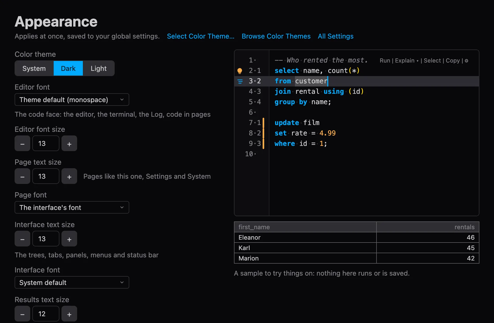
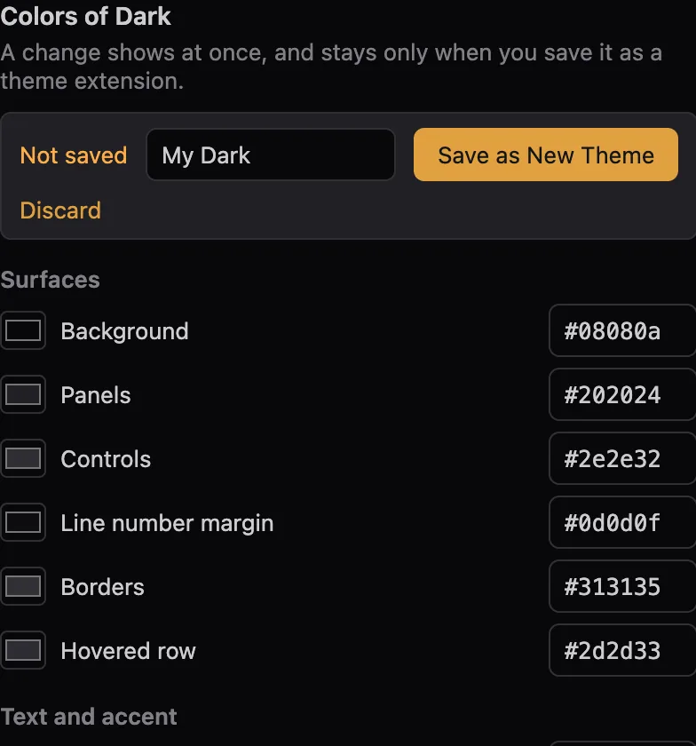
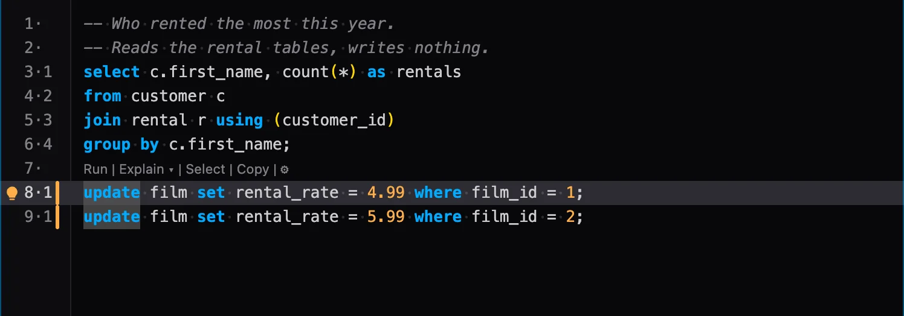
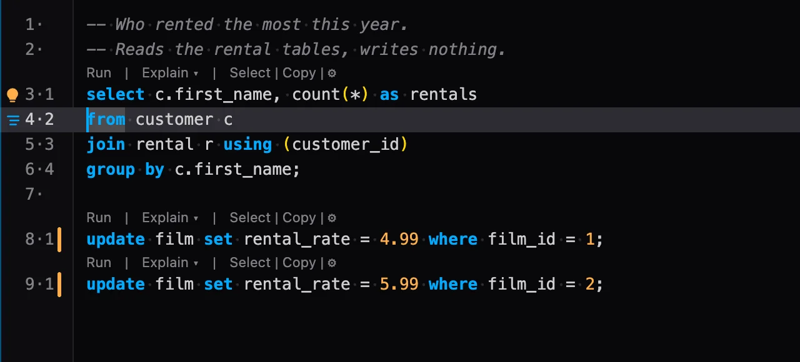
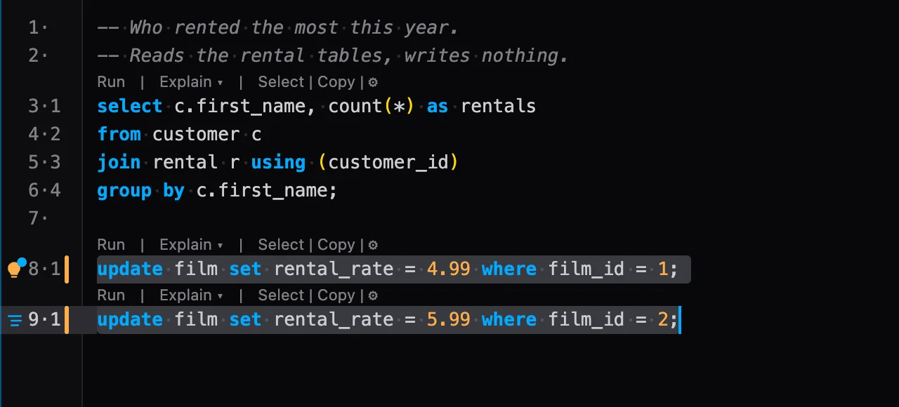

# PlumeSQL 0.31.0

See what the window will look like as you change it, on a new Appearance tab. A long
script no longer has to repeat its commands above every statement, and the buttons
beside a statement now stand on its code and work with what you selected.

## Highlights

- **Appearance, with a live preview:** the theme, the fonts, the sizes and the
  editor's looks in one tab, beside a real editor that changes as you do.
- **Make a theme of your own:** change any color, see the whole window follow, and save
  it as a theme extension.
- **Fewer rows in a long script:** show a statement's commands only at the cursor
  and under the mouse. They take no line, so your code never moves.
- **Buttons on your code:** the lightbulb and Format start on a statement's first
  line of code, not on the comment above it.
- **Run, Format and Explain follow your selection:** mark part of a statement, or
  several statements, and that is what they act on.
- **Line numbers that match PostgreSQL:** a statement's own numbers now count from
  its code, as `LINE n` in an error does.

## Appearance, with a live preview

One tab for how the window looks, and the real thing beside it: the app's own editor on
a sample you can try things on, and a few rows of results. Change the theme, a font, a
size, where a statement's commands show or the line numbers, and see it at once.



Open it from the command palette (`PlumeSQL: Appearance`), the View menu, or Settings'
Appearance section. Settings stays the complete list; these are the same settings. Welcome
keeps the theme and the editor's font and size, with a link here for the rest.

### Make a theme of your own

Every color of the theme has a row there too. Change one and the whole window follows
at once, and nothing is kept until you say so:



**Save as New Theme** makes it a theme extension in My Extensions and switches to it, to
use, change further or publish. On a theme of your own, **Save to** updates it. Open Its
File is the road to the terminal's colors, the faces and the shape.

## The buttons beside a statement

### Choose where a statement's commands show

The row above each statement (Run, Explain, Select, Copy) repeats many times over in a
long script. You can now keep the commands to where you are working:



They stand in the empty line or comment right above the statement, or after its first
line when there is neither, and take no line of their own, so your code does not move
as they come and go. Where they do not fit, a small ⋯ stands in for them, and they
open when the mouse goes to it.

```setting
editor.statementLensShow
```

The same choice is on the Lens button in the editor's toolbar and on the Appearance tab.

### They stand on your code

A comment above a statement pushed the lightbulb and Format up onto the comment,
away from the code they work on. A long comment could push them out of sight. They
now start on the statement's first line of code, right under Run and Explain.



A one-line statement has room for one button, now with or without a comment above
it.

### They act on what you selected

While a selection touches a statement, its buttons and the row of commands above it
work with the selection:

- **Run** runs what is selected, as ⌘Enter does, and the selection stays.
- **Format** formats every statement the selection touches.
- **Explain** explains the selection when it is one statement, such as a subquery
  you marked. For a word, or for several statements, it explains its own statement:
  EXPLAIN covers one statement, and whatever came after it would really run.
- **The lightbulb** lists what the selection offers, as it already did.

Select and Copy still take the whole statement. A button's tooltip says which you
get.

### A selection across statements keeps them close

Select across statements and the buttons move to the first line of your selection.
Before, they ended up on the last statement, far from where you started. You get the
three that can work on all of it: the lightbulb, Run and Format.



## Fixed

- **Welcome's fonts and sizes work in a workspace that sets its own.** Changing the
  editor's font or size, or going back to the default, snapped straight back to what the
  workspace had. A change now goes where it takes effect, and the row says when the
  workspace sets it, with Use global beside it.
- **The Welcome tab wears the feather**, not a play triangle.
- **A statement's line numbers match PostgreSQL's.** The second number in `3·1`
  counted from the comment above a statement. It now counts from the first line of
  code, which is what runs, so it matches `LINE n` in PostgreSQL's errors. The
  comment's lines have no statement number.

## Tell us what you think

Questions and ideas go to
[Discussions](https://github.com/hercstack/plumesql/discussions), bugs to
[Issues](https://github.com/hercstack/plumesql/issues) or Report a Bug in
the app's menu. The video tour is on
[YouTube](https://www.youtube.com/@plumesql).
