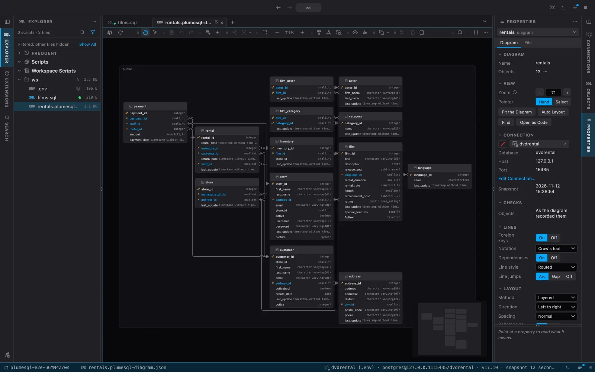
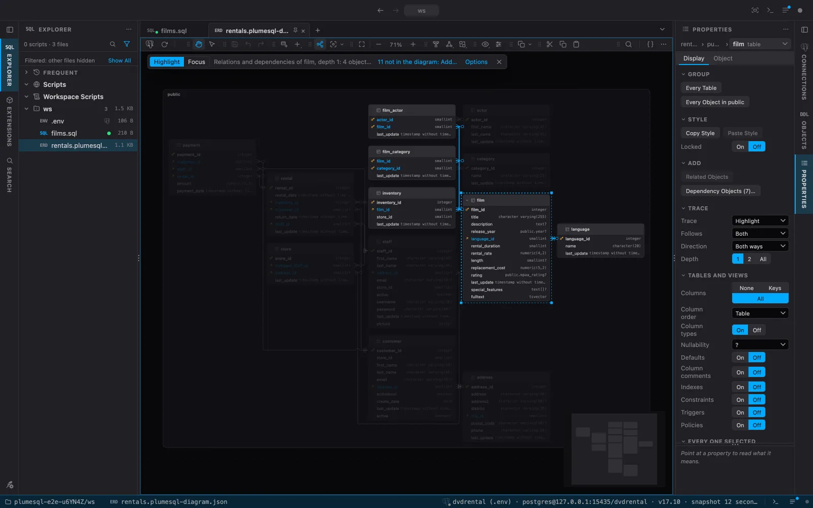
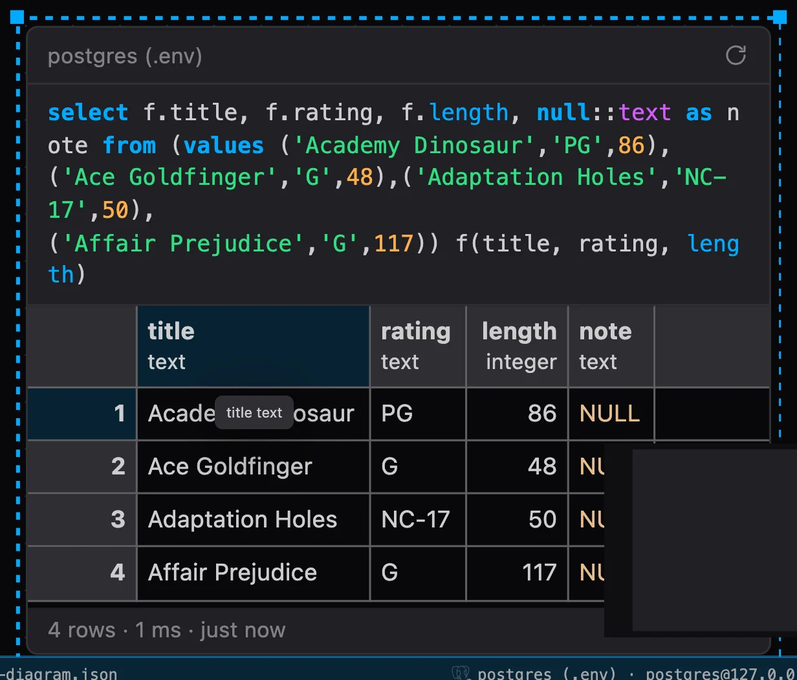
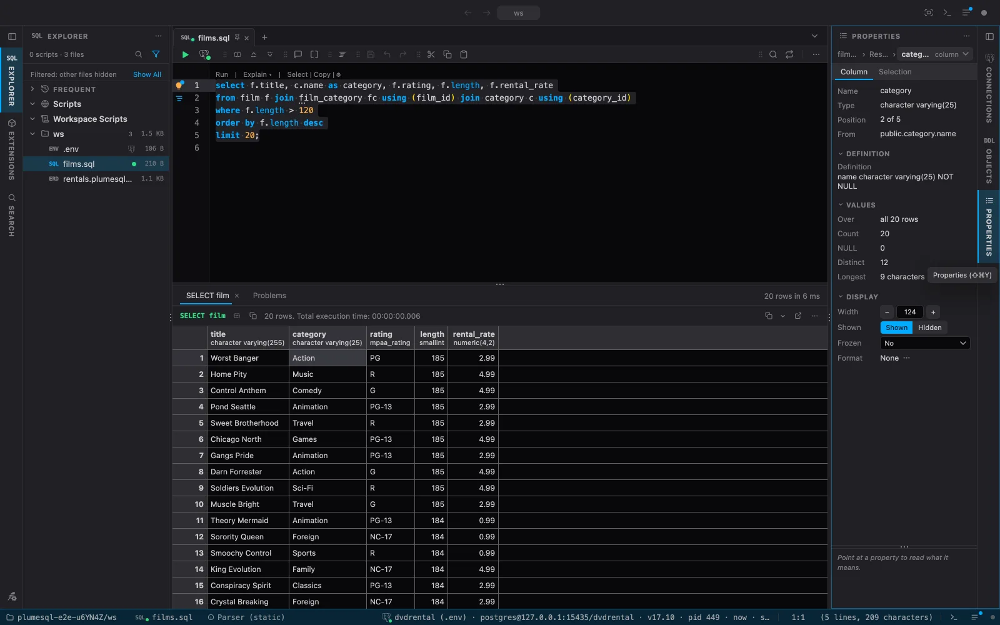
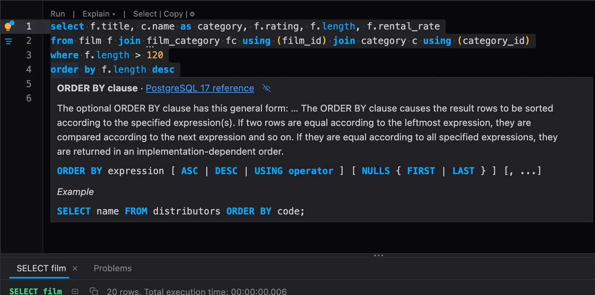
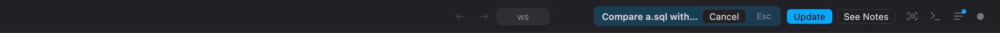
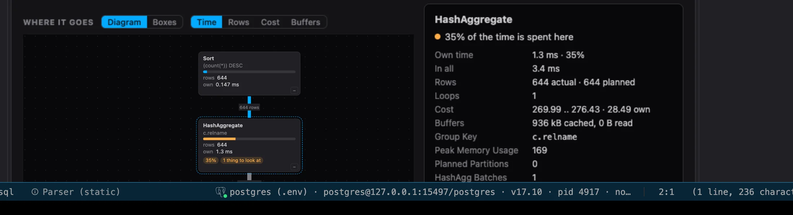

# PlumeSQL 0.31.0

Draw your database. Diagrams show the tables, views, routines and types you choose
and how they are joined, in a file you can keep beside your scripts and share through
git. The Outline tab becomes Properties, which says what the active tab is about and
lets you change it, and a new Appearance tab shows the window as you change it.

## Highlights

- **Database diagrams:** add objects from the object tree, lay them out, trace what an
  object is joined to, style the cards and lines, add notes, and copy or save the
  diagram as PNG, SVG or Mermaid.
- **Results on a diagram:** put a result, a chart or a grid, on a diagram beside your
  tables, and refresh it when you choose.
- **Properties:** the Outline tab now follows the active tab: a script's connection and
  session, a result's columns and selection, a setting, a diagram, an object's DDL.
- **Appearance, with a live preview:** the theme, the fonts, the sizes and the
  editor's looks in one tab, beside a sample of the window that changes as you do.
- **Make a theme of your own:** change any color, see the whole window follow, and save
  it as a theme extension.
- **Fewer rows in a long script:** show a statement's commands only at the cursor
  and under the mouse. They take no line, so your code never moves.
- **Run, Format and Explain follow your selection:** mark part of a statement, or
  several statements, and that is what they act on.
- **More of the PostgreSQL reference in the editor:** a clause, a type and a builtin
  function have their own page, with no connection needed.
- **A title bar that says what is going on:** Zen Mode, the terminal, the Log and the
  activity dot at its right end, and beside them a preview, a comparison or an update
  on its way.
- **An extensions toolbar:** the buttons of your query and command extensions in one
  row under the title bar, arranged as you like.
- **Extensions can draw graphs on PlumeSQL's own canvas:**
  [Explain plan](https://github.com/hercstack/plumesql/tree/main/extensions/Performance/explain-plan)
  now lays out its plan the way database diagrams are laid out.

## Database diagrams

### Draw your database

A diagram shows the objects of one database and how they are joined: foreign keys
column to column, dependencies dashed, each schema a frame around its objects. Every
kind of object can stand in it: tables and views with their columns and keys,
functions with their signature, enums, composite types and domains with their values.



To start one, right-click any row or folder of the object tree, a connection, or the
Objects pane's menu and choose **Add to Diagram…**: pick one of the connection's
diagrams, or type a name for a new one. From a schema or a whole connection, a dialog
asks which objects, starting on the tables, views, routines and types of your own
schemas. You can also drag rows from the object tree onto the canvas.

A card's right click adds what it is joined to: **Add Related Objects** (its foreign
keys, both ways) and **Add Dependency Objects**, each a list to uncheck what you do not
want. **Reveal in Diagram** in the object tree goes the other way: it opens the diagram
and selects the object there.

### Keep it beside your scripts

A diagram is a file, `<name>.plumesql-diagram.json`, anywhere you like, in the workspace
or in Scripts, and in source control too. It names the connection it was made on, and a
connection found in a file of the repository, such as its `.env`, by that file's path.
Each computer draws it from a connection of its own, chosen as a script's is, without the
file changing; one without that connection is offered its own that look like it, a click
away.

A diagram never connects by itself. It draws what the connection's snapshot last read,
the status bar says how fresh that is, and **Refresh** reads it again. Where the database
differs from what the diagram recorded, the cards say so: a column added, changed or gone,
an object that is not there. **Accept Changes** records the database as it is now.

### Work on the canvas

The toolbar starts with the connection and Refresh, then the pointer tools: **Hand** (H),
where a drag moves the canvas, and **Select** (V), where a drag draws a box that selects
what it touches. Space held moves the canvas under either, and the wheel zooms around the
pointer.

- **Undo and Redo** for every change, on the canvas or in Properties: ⌘Z and ⇧⌘Z.
- **Cut, copy and paste** with ⌘X, ⌘C and ⌘V: objects, their look, their notes and the
  lines between them, into the same diagram or another one.
- **The keyboard walks it:** the arrows go to the nearest card, Alt and the arrows move
  it, `[` and `]` show less or more of it, Enter opens its DDL, Delete takes it out of
  the diagram (the database is untouched), and Find goes from object to object.
- **Browse Data** on a table's or a view's card opens its rows.

### Lay it out

**Auto Layout** places everything by the method you choose: Layered, Tree, Organic,
Radial or Grid, in any of four directions, Compact to Wider apart. A dragged card keeps
its place in the file. Dragging lines a card up with the ones around it, a thin line
showing what it met, as in draw.io; hold Alt (Option) to drag freely. **Snap to Grid**
and **Show Grid** place cards on a grid, **Align** lines up or spreads the selected ones,
**Lock** (⌘L) keeps a card where it stands, and **Bring to Front** and **Send to Back**
(⌘] and ⌘[, with Shift to the end) choose what stands over what.

Drag a card's edges and corners to size it, fold it to its header with the chevron, or
choose what it shows from its right click's **Show**: its columns in table order or keys
first, their types (**Short types** writes int, varchar(50), timestamptz), NULL and NOT
NULL, defaults, indexes and constraints, a view's query or a function's body colored as
the editor colors SQL. **Hide Column** takes one column out.

### Trace what an object is joined to

Select an object and press **T**: what it is joined to stands out and everything else
fades. **Shift+T** shows only what the trace reaches. Choose foreign keys, dependencies or
both, which way and how far, and click another object to walk the diagram one object at a
time. A strip over the canvas offers to add what the trace reaches beyond the diagram, and
Escape ends it.



### Make it look your way

Every card, line, frame and note has a look in Properties: fill, text and border colors, a
band of color, the header's color and title, the text size, corners and opacity. Set it
for one card, or for a whole group, every table, every object in a schema or every object,
and the cards added later take it too. **Copy Style** and **Paste Style** (⌥⌘C, ⌥⌘V) give
one card's look to others.

A line is chosen with a click and has its own page: its stroke, curve, color and width,
and for a foreign key a label read from the database (its name, its columns, what it does
on delete). Drag its segments and points to route it your way, as in draw.io. Where two
lines cross, one hops the other with a small arc.

### Notes, texts and areas

**Add Note** (N) puts your own words in Markdown on the diagram, never in the database. A
note attached to a card, a line or another note follows it when it moves. **Add Text**
writes a title or a label with no paper under it, and **Add Area** draws a named box
behind the cards to group them as you see them ("Billing"), moved with everything in it.

### Copy and save it

**Copy Diagram** and **Save Diagram** give what the canvas shows, at any zoom, as a sharp
PNG, an SVG that scales, or Mermaid's `erDiagram` text for a Markdown file (Save in the
desktop app). The canvas's right click copies or saves the selection alone.

### Results on a diagram

A diagram can hold more than tables. Open a result's menu, or a chart's, and choose
**Add to Diagram…**: what you see goes on the diagram, the chart drawn by the same
extension, the grid with the same formatting, and the query and its connection go with it.



Nothing runs by itself. **Refresh** on a card, ⌘Enter, or **Refresh Queries** for the whole
diagram asks again, read only, on a connection opened for it and closed after. Only a
`SELECT` runs, and PostgreSQL itself refuses anything that would write. A double click on a
card opens the script the query came from, with the statement selected: change it there and
refresh, and the card follows. Click the connection's name on a card to run it somewhere
else.

### Diagrams settings

Settings has a Diagrams category. How you work with every diagram:

```setting
diagrams.wheel
diagrams.selectionMotion
diagrams.kindColors
diagrams.guides
diagrams.snapGrid
diagrams.addLimit
diagrams.toolbarButtons
```

What a trace follows, how far, and how faint the rest is:

```setting
diagrams.traceFollows
diagrams.traceDepth
diagrams.traceFade
```

How a diagram is copied and saved, and how long a query on it may run:

```setting
diagrams.copyFormat
diagrams.saveFormat
diagrams.imageScale
diagrams.imageBackground
diagrams.queryTimeout
```

How a new diagram looks. This is written into its file when it is made, so a diagram
pulled from git looks the same on every computer:

```setting
diagrams.notation
diagrams.lines
diagrams.lineJumps
diagrams.layout
diagrams.direction
diagrams.layoutSpacing
diagrams.groupSchemas
diagrams.background
diagrams.dependencies
diagrams.minimap
diagrams.tableColumns
diagrams.routineSignature
diagrams.typeValues
```

## Properties

### Properties follows what you work on

The Outline tab is now **Properties**, and it follows the active tab. A script has three
pages: its Outline as before; Script, with the file, the connection (pick any color for it
right there) and the session, with Commit and Rollback while a transaction is open; and
Editor, the editor's settings for this file alone, the workspace or every workspace. A
diagram, an object's DDL with its statistics, a connection's `.env` file, the connection and
group editors and an extension's page each have pages of their own.

Each page is a grid of names and values, with a small control where a value changes. The
arrows walk it, any fact copies from its right click, and a panel under it says what the
property under the mouse means:

```setting
outline.descriptions
```

### Properties on a result

Select a column, a range or a cell in a result, and Properties says where its values come
from (the table's column, its key, its indexes) and counts them over every row: NULLs,
distinct values, the longest, and for numbers the sum, average, min and max. It sets the
column's width, hides, freezes and formats it. With nothing selected it says the statement,
the run and whether the rows can be edited, and why not. The status bar reads a selection
of several cells as a spreadsheet does: Average, Count and Sum.



### Settings in Properties

On the Settings page, select a row and Properties shows that setting whole: its value and
where it comes from, the other scope's value and the default, what every value means, and
a control to change or reset it right there.

## Appearance, with a live preview

One tab for how the window looks, and the real thing beside it: the app's own editor on
a sample you can try things on, and a few rows of results. **Basic** has the theme, fonts
and sizes, the tabs, the sidebars and the editor's manners; change one and see it at once.


Open it from the command palette (`PlumeSQL: Appearance`), the View menu, or Settings'
Appearance section. Settings stays the complete list; these are the same settings. Welcome
keeps the theme and the editor's font and size, with a link here for the rest.

### Make a theme of your own

In the **Theme Editor**, click a part of the sample window and Properties shows its colors;
click beside the window for the theme itself. Change one and the whole window follows at
once, and nothing is kept until you say so:


**Save as New Theme** makes it a theme extension in My Extensions and switches to it, to
use, change further or publish. On a theme of your own, **Save to** updates it. Open Its
File is the road to the terminal's colors, the faces and the shape.

The title bar, the tabs, the sidebars, the toolbar, the editor, the results grid, the
bottom panel and the menus can now each have colors of their own. Every theme looks as it
did until it names them.

## The buttons beside a statement

### Choose where a statement's commands show

The row above each statement (Run, Explain, Select, Copy) repeats many times over in a
long script. You can now keep the commands to where you are working:


They stand in the empty line or comment right above the statement, or after its first
line when there is neither, and take no line of their own, so your code does not move
as they come and go. Where they do not fit, a small ⋯ stands in for them, and they
open when the mouse goes to it.

```setting
editor.statementLensShow
```

The same choice is on the Lens button in the editor's toolbar and on the Appearance tab.

### They stand on your code

A comment above a statement pushed the lightbulb and Format up onto the comment,
away from the code they work on. A long comment could push them out of sight. They
now start on the statement's first line of code, right under Run and Explain.


A one-line statement has room for one button, now with or without a comment above
it.

### They act on what you selected

While a selection touches a statement, its buttons and the row of commands above it
work with the selection:

- **Run** runs what is selected, as ⌘Enter does, and the selection stays.
- **Format** formats every statement the selection touches.
- **Explain** explains the selection when it is one statement, such as a subquery
  you marked. For a word, or for several statements, it explains its own statement:
  EXPLAIN covers one statement, and whatever came after it would really run.
- **The lightbulb** lists what the selection offers, as it already did.

Select and Copy still take the whole statement. A button's tooltip says which you
get.

### A selection across statements keeps them close

Select across statements and the buttons move to the first line of your selection.
Before, they ended up on the last statement, far from where you started. You get the
three that can work on all of it: the lightbulb, Run and Format.


## The PostgreSQL reference in the editor

Hover a clause and you get its own section of the command's page: WHERE, GROUP BY,
ORDER BY, ON CONFLICT, CREATE TABLE's PARTITION BY, REFERENCES, GENERATED and the rest.



- **A type** where a type stands (`::numeric`, `CAST(a AS int)`, a column's type) has its
  page, the short names too: int, bool, timestamptz.
- **A builtin function** has its card with no connection: every signature, what it does and
  an example, and its parameter hints while you type it (`date_trunc(` shows its three).
- **A word** such as COALESCE, CASE, EXISTS, LATERAL or FILTER answers its own section, no
  longer the whole SELECT page, and F12 opens the reference there.
- **An error condition** (`unique_violation`, `SQLSTATE '23505'`) says its code and class.
- **A word newer than your server** (MERGE on 14, JSON_TABLE on 16) says which PostgreSQL
  brought it, which is why the server refuses it.

## The title bar and the extensions toolbar

### Zen Mode and the buttons at its end

Zen Mode, the terminal, the Log and the activity dot now stand at the title bar's right
end, where VS Code keeps its layout buttons. **Zen Mode** (⌘K Z) hides both sidebars and
the panel in one press and brings them back in the next. Right-click the title bar to
choose which buttons stand there, VS Code's sidebar and panel toggles and the Layout menu
among them.

```setting
window.titleButtons
keyboard.zenMode
```

### What the app is in

Beside them the title bar says what the app is in: a theme being previewed, a comparison
waiting for its second side, or an update (Downloading, then **Update**, with **See Notes**).



### The extensions toolbar

The buttons of your query and command extensions, which stood scattered over the title
bar, the side strips and the status bar, now share one row under the title bar, the
active tab's own extensions after them. Drag a button to move it, right-click it for
separators, the toolbar's left or right side, or to pin it to the editor toolbar or a
result's header. The editor toolbar's and a result header's buttons stay where they are.

```setting
window.extensionsToolbar
window.extensionsToolbarLabels
window.extensionsToolbarLayout
```

## Graphs drawn by PlumeSQL

An extension can now hand PlumeSQL a graph, and PlumeSQL draws it on the canvas its
database diagrams use: laid out for you, with pan, zoom, the arrow keys and folding.
[Explain plan](https://github.com/hercstack/plumesql/tree/main/extensions/Performance/explain-plan)
is the first to use it:



```extensions
explain-plan
```

## What changed

### The connection beside Run wears its mark alone

The editor toolbar shows the elephant in the connection's color, with its session dot and
a chip while a transaction is open. The name and url are in its tooltip and on the status
bar. A connection that asks before a statement changes something, as the Production
group's does, keeps its name there.

### The editor toolbar is lighter

The toolbar keeps what acts on the text. Its View buttons (hints, hovers, lens, gutter and
the font size) and the formatter's options are on the Properties tab's Editor page now,
and the toolbar's menu leads there with **Editor Properties**. The arrow keys walk the
toolbar's buttons.

### Try is gone from grid extensions

An extension's page no longer offers **Try**. Install it instead: you are asked first, and
**Uninstall** or **Disable** undoes it in one click.

### Third-party notices as a table of contents

About's third-party notices list the works PlumeSQL takes from and the packages grouped by
license. A row opens its license, and a word in the box finds a package.

## Fixed

- **An SSH key path starting with `~`** was taken literally and the tunnel failed with "no
  such file or directory". A leading `~` is now your home directory, as `ssh` reads it.
- **Copy as Image in the macOS app.** A chart's Copy as Image was refused with "The request
  is not allowed by the user agent". It now reaches the clipboard.
- **Welcome's fonts and sizes work in a workspace that sets its own.** Changing the
  editor's font or size, or going back to the default, snapped straight back to what the
  workspace had. A change now goes where it takes effect, and the row says when the
  workspace sets it, with Use global beside it.
- **A statement's line numbers match PostgreSQL's.** The second number in `3·1`
  counted from the comment above a statement. It now counts from the first line of
  code, which is what runs, so it matches `LINE n` in PostgreSQL's errors.
- **The list of sections beside a page** (Settings, System, an extension's page, the
  release notes) no longer squeezes its entries together when the page is short.
- **Dragging a tab** marks where it lands with a straight line between the tabs, as VS Code
  does.
- **The Welcome tab wears the feather**, not a play triangle.

## Tell us what you think

Questions and ideas go to
[Discussions](https://github.com/hercstack/plumesql/discussions), bugs to
[Issues](https://github.com/hercstack/plumesql/issues) or Report a Bug in
the app's menu. The video tour is on
[YouTube](https://www.youtube.com/@plumesql).
