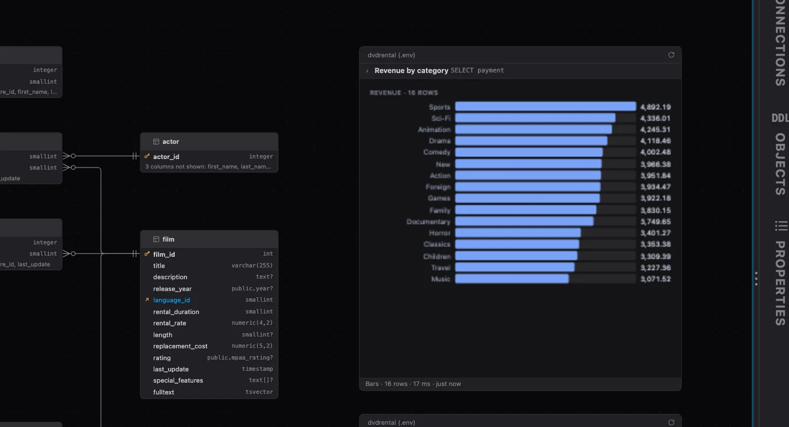

# PlumeSQL 0.31.1

A query on a diagram is titled by its comment, and the PostgreSQL reference in the editor
reads right for JOIN and for the functions written the SQL standard's way.

## Highlights

- **Query cards titled by their comment:** `-- Revenue by category` above a query names its
  card on a diagram, and its Rows change without a Refresh.
- **The reference reads right:** JOIN's hover says what a joined table is, and substring,
  trim or JSON_QUERY show their own signatures and examples.

## What changed

### A query card is titled by its comment

Write a comment above the SQL of a query on a diagram and its first line becomes the card's
title, with the statement's name quieter beside it:

Annotations such as `-- @extension ...` are left out, and a query without a comment keeps its
statement's name alone. Properties says the title too.

### More rows on a card without a Refresh

Raise a query card's Rows in Properties and the rows show at once: a card keeps up to 100 rows,
whatever it shows, and the line under it says how many it shows of how many ("13 of 16"). A
Refresh still brings the rows you see first, and keeps the rest only when they come quickly, so
a slow query takes no longer than before.

## Fixed

- **JOIN's reference starts at the beginning.** The hover on JOIN (and INNER, CROSS, NATURAL,
  OUTER) opened in the middle of the section, at "This latter equivalence does not hold
  exactly…", and showed a table of sample rows as its example. It now says what a joined
  table is, and its example is a query.
- **substring, trim and the SQL/JSON functions show their own reference.** Their hover showed
  the title of the table listing them and an example from somewhere else in it, sometimes an
  error message. It now shows the function's signatures, what it does and its own examples,
  as every other builtin function does. This covers position, overlay, JSON_OBJECT,
  JSON_ARRAY, JSON_EXISTS, JSON_VALUE, JSON_QUERY, JSON_OBJECTAGG and JSON_ARRAYAGG too.
- **No Disconnect for a tab that is not connected.** The connection picker offered Disconnect
  even with no connection chosen. It now offers it only when there is something to
  disconnect, and ends with New connection… so an empty list always has a way forward.

## Tell us what you think

Questions and ideas go to
[Discussions](https://github.com/hercstack/plumesql/discussions), bugs to
[Issues](https://github.com/hercstack/plumesql/issues) or Report a Bug in
the app's menu. The video tour is on
[YouTube](https://www.youtube.com/@plumesql).
