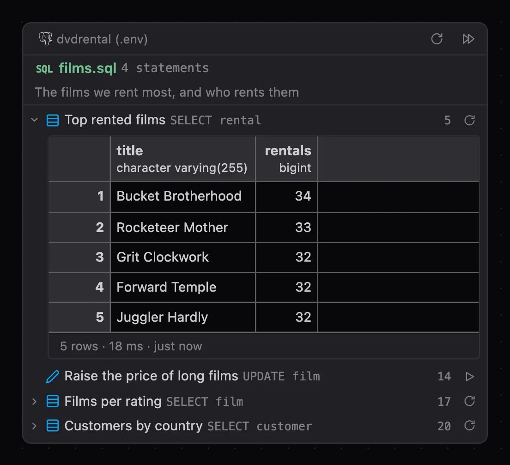
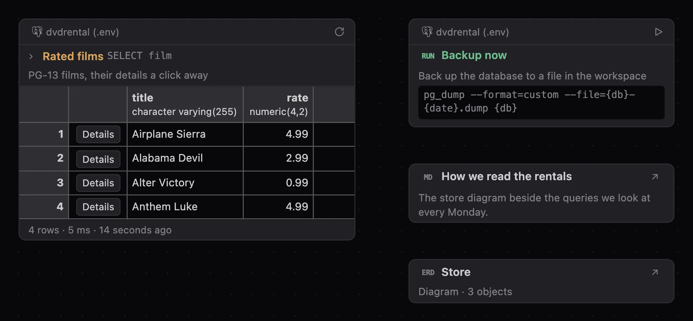
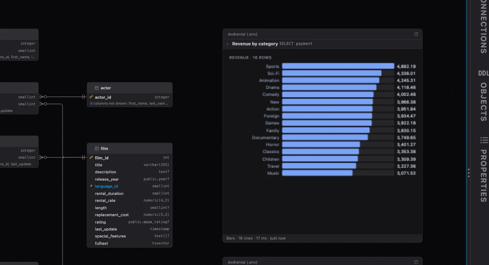

# PlumeSQL 0.32.0

A result now says when you changed its query since it ran, a script unfolds into its statements
in the Explorer, a whole script goes on a diagram and a query card there runs any statement, the
Objects tab always shows your script's database, and the PostgreSQL reference in the editor
reads right for JOIN and for the functions written the SQL standard's way.

## Highlights

- **Results that say when the query changed:** an **Edited** mark on the result, with **Run**
  beside it.
- **A script's statements in the Explorer:** unfold a SQL file and click the statement you want.
- **Objects always shows your script's database:** no pin any more, and a click in Connections
  asks before it moves a script to another connection.
- **Scripts, extensions and files on a diagram:** a whole `.sql` file as a card of its
  statements, a query extension with its buttons and drill-downs, a command, a link to a
  document or another diagram.
- **Query cards that run anything:** a query card follows its script, runs any statement and
  asks its parameters, and `-- Revenue by category` above a query names its card.
- **The reference reads right:** JOIN's hover says what a joined table is, and substring,
  trim or JSON_QUERY show their own signatures and examples.
- **A true Zen Mode:** ⌘K Z gives the file you are in the whole window.

## Results

### A result says when its query changed

Change a query after running it and the result's header says **Edited**, with **Run** beside it
to run the query as it stands now. Moving the text around or adding a comment does not count;
a real change does. The rows stay as they were until you run it again.

## Explorer

### A script's statements, one click away

A SQL file of two or more statements now has a chevron in the Explorer. Unfold it and every
statement is a row of its own, named as in the Outline, with the line it starts on:

Click a statement and the file opens with it selected, while the keyboard stays in the Explorer,
so the arrow keys keep walking the statements. Enter or a double click puts you in the editor on
it. Only the statements show: what is inside one stays the Outline's.

Right click a statement to select, run or copy it. **Run Statement** opens the file and runs just
that statement, as the Outline's does.

While you work in a file you have unfolded, the statement your cursor is in is highlighted and
kept in view as you move, the way the Outline follows it.

A file you have open follows your edits before you save them. The Explorer remembers which files
you unfolded, and **Statements** in its menu turns the rows off.

### Statement icons that say what a statement does

The icons beside the statements, in the Outline and under a script in the Explorer, were
redrawn. A SELECT no longer wears a magnifier, which looked like a search: it shows a result's
rows. INSERT, DELETE and TRUNCATE are rows added, taken away and emptied, EXPLAIN is a plan's
tree, and BEGIN, COMMIT, ROLLBACK and SAVEPOINT each have their own: a flag, a check, an undo
and a bookmark.

## Diagrams

### A script on a diagram

Put a whole script on a diagram: **Add to Diagram…** on a `.sql` file in the Explorer, or drag
the file onto a diagram. The card lists the script's statements as the Explorer does, each with
its comment's first line, under the file's name in its `@color` and its `@description`.

Click a SELECT and its rows show under it; its refresh mark asks again. A statement that changes
the database has a play mark that runs it, and asks first every time, as everything a diagram
runs does; what the server said ("UPDATE 1") stands beside it. **Run Script** opens the script
and runs all of it there, the way Run All does, in one session with its transactions as you wrote
them, and the rows on the card then show what the run gave. Right-click a statement to open it in
the script or to put it on a card of its own.

The card is drawn from the script as it is now, so what you write there shows at once. When the
file is gone, the card says so and the diagram's checks count it.

### A statement from the Explorer on a diagram

Unfold a script in the Explorer and its statement rows have **Add to Diagram…** too, or drag one
onto a diagram: the statement becomes a query card from that script, with its comment and its
annotations on notes beside it.

### Extensions, commands and any file on a diagram

**Add to Diagram…** on a query or command extension in the Extensions tab, or on any file in the
Explorer, puts it on a diagram as a card of its kind; dragging a file onto a diagram does the
same.

A query extension's card runs like a query card, with everything its annotations say: where it
runs, its parameters, the columns it hides, its row buttons right in the card's grid, a drill-down
with **← Back**, the question it asks before a run, and its timer, which starts once you refresh
the card yourself and runs only while the diagram is in front. A command's card starts the
command in a terminal tab, as it starts from everywhere else, and asks first. Any other file is a
card that opens it: a Markdown document shows its first heading and lines, and another diagram's
card takes you to that diagram.

### A query card is titled by its comment

Write a comment above the SQL of a query on a diagram and its first line becomes the card's
title, with the statement's name quieter beside it:

Annotations such as `-- @extension ...` are left out, and a query without a comment keeps its
statement's name alone. Properties says the title too.

### The rest of the comment, and the annotations, as notes

When the comment above a query says more than its first line, Add to Diagram… puts the rest on a
sticky note beside the card. A sentence that runs on from the first line goes on the note whole.
The query's annotations go on a second, gray note under it, in plain words: what each one means,
and whether the card does it too. The view `@extension` names, `@inputs`, the `@format` and
`@computed` formulas and what the script says of its parameters work on the card as well; a
`@hide` or `@refresh` stays with the script, and the note says so.

Both notes are yours: edit them, restyle them or delete what you do not need. A Refresh never
touches them. **Add Comment as Note** and **Add Annotations as Note**, on the card's right click
and in Properties, make them again.

### A query card runs any statement, a change asked first

A query card on a diagram now holds an INSERT, UPDATE, DELETE, a CREATE or ALTER, a CALL or a
DO, not only a SELECT. A SELECT refreshes as before, read only. Anything else runs on **Run**,
the play mark where Refresh was, and asks first, every time: a diagram is easy to click, may come
from someone else, and shows no transaction. The question says what the statement changes, in red
when an UPDATE or DELETE has no WHERE, and that Undo on the diagram does not undo the database.

The card then shows what the server said it did ("UPDATE 12") and the rows a RETURNING gives, the
Log keeps the run with its SQL, and a CREATE or ALTER refreshes the connection's objects, so the
tables on the diagram follow at once. A connection set to block such changes blocks them here too,
and a script marked `@readonly` never runs one. BEGIN, SET and the other statements of a session
stay with their script.

A statement with run parameters (`$1`, `:name`) goes on a diagram too, answered as your script
answers it in the editor. An `-- @inputs` line answers without asking, `-- @ask` asks on every
run and `-- @noask` never asks. Otherwise the parameters are asked on the card's first run, with
the prompts and choices your script declares, and kept, so a Refresh runs again without asking.
The card shows the values it runs with, and **Parameters…** on it asks again.

A card from a script with `-- @connection` sections runs where its section says, and follows the
line when you change it.

The card's grid follows its script's formulas too: a `-- @format` or `-- @computed` line above
the statement, or in the script's header, shapes the card as it shapes the results.

### A query card follows its script, and says when it differs

A query card from a script is drawn from the script as it is now, the way a table's card is drawn
from the database. It follows its statement there, also when you rewrite it through Edit Query,
and never picks up another query that only stands where it stood.

When you change the statement in the script, the card says so at once: "Changed in cards.sql
since it last ran.", with an amber dot before its title. Refresh runs it as it is now; **Accept
Changes** records it without running.

When the statement is deleted, the card is missing: "Not in cards.sql any more.", with **Detach**
beside it, and nothing runs, not even its old copy, so a statement you deleted never runs from a
diagram. Detach makes the SQL the card's own, edited and run on the card. It is also in the card's
right click and in Properties.

Changed and missing cards count in the diagram's checks on the toolbar beside the tables
("1 changed · 2 missing"), whose menu accepts, selects or removes them.

### More rows on a card without a Refresh

Raise a query card's Rows in Properties and the rows show at once: a card keeps up to 100 rows,
whatever it shows, and the line under it says how many it shows of how many ("13 of 16"). A
Refresh still brings the rows you see first, and keeps the rest only when they come quickly, so
a slow query takes no longer than before.

## What changed

### The Objects tab always shows your script's connection

The Objects tab can no longer stand on another database than the script you are in, so the
tree and the editor's completion, hover and Go to Definition always answer from the same one.
The header's Automatic and the connection's Pin Object Browser Here are gone.

Exploring a database before you write anything still works the way other clients teach it: with
no script open, click a connection in Connections and its objects show at once, and New Script
then opens on it. With a script on another connection, the click asks first:

If the script has an open transaction, the question says that assigning another connection rolls
it back. The arrow keys in Connections never ask. A click on the connection in the Objects header
now opens the script's own connection picker, the one beside Run.

The crosshair in the Objects header, which lights and reveals the object under the editor's
cursor, is now called **Follow the Cursor**, in its tooltip, the pane's menu and Settings.

### A script's connection in its color in the Explorer

A script's mark after its name in the Explorer is now its connection's elephant, in the
connection's color, with the dot at its corner saying whether it is connected:

A connection without a color shows a plain elephant. The color says which connection, the dot
how it is, so a red Production connection never looks like one that does not answer. A query
card on a diagram wears the same elephant before its connection's name.

### Errors and decisions from the Log button

Point at the Log button and what this session logged since you last looked shows in the corner,
or its last entry when there is nothing new; before the session has logged anything, nothing
shows. The cards stay while you point at the button, and while the pointer is on a card, so you
can reach its fix or its X.

When something went wrong, the Log button carries a red count of the errors you have not seen.
Point at the count and the errors show in the corner, each with its own fix and **Dismiss**; click
the count and they are all dismissed, without opening the Log. A click anywhere else on the
button opens the Log as before.

Decisions that wait for you, such as **Update usages** after a rename or **Reconnect** after you
changed a connection, now have an amber count of their own. Click it and they show in the
corner the same way, ready to answer.

A right click on the button has the Log's own menu: open it, show or dismiss the errors, open
it on its errors alone (every other entry filtered out), show or set aside the decisions, Copy
All, Clear and Log Settings. The same commands are in the command
palette under PlumeSQL.

### A true Zen Mode

⌘K Z (Ctrl+K Z on Windows and Linux) now does what it does in VS Code: the file you are in gets
the whole window, with no tabs, toolbars, sidebars, bottom panel or status bar. A script's
results stay with it. The same keys or Escape twice bring everything back, and Zen Mode is also
in the Layout menu, the command palette and a button of its own at the left of the title bar's
buttons.

What Zen Mode used to do, both sidebars and the bottom panel hidden at once, is now **Hide
Sidebars and Panel**: the same title bar button as before, in the Layout menu and the command
palette, and back as they were on the next press. It has no shortcut by default; you can give
it one in the keyboard settings.

## Fixed

- **A script with `-- @connection` sections keeps its own connection.** After you ran a
  statement of a section that names another database, the script reopened on that database, so
  the statements above the first section failed there. It now reopens on its own connection.
- **A path in Properties stays where you scroll it.** On a script's page, the file's path shows
  its end. Scrolled back to read its start, it jumped to the end again as soon as the page took in
  something arriving later, such as the connection's details. It now stays where you left it.
- **A table view on a diagram shows its table.** A query card drawn by a view that computes rows,
  such as JSON rows, pivot or transpose, stayed empty while its footer counted the rows. The
  card now lists those rows in the app's own grid, as the results pane does.
- **A table added to a diagram of queries shows.** Add to Diagram… on a table, into a diagram
  holding only query cards or notes, put the table under them, where nothing showed it. It now
  stands right of everything on the diagram. Adding something the diagram already holds chooses
  it there and brings it into sight, moving it out from under a note or a card, and the Log
  says so. A diagram with no connection yet is offered too, and takes the connection of what
  you add to it.
- **Rename selects the name, not its extension.** Renaming a file in the Explorer chooses its
  name with the extension left out, also for PlumeSQL's own two-dot extensions: `Queries` of
  `Queries.plumesql-diagram.json`, `demo` of `demo.plumesql.sql`.
- **JOIN's reference starts at the beginning.** The hover on JOIN (and INNER, CROSS, NATURAL,
  OUTER) opened in the middle of the section, at "This latter equivalence does not hold
  exactly…", and showed a table of sample rows as its example. It now says what a joined
  table is, and its example is a query.
- **substring, trim and the SQL/JSON functions show their own reference.** Their hover showed
  the title of the table listing them and an example from somewhere else in it, sometimes an
  error message. It now shows the function's signatures, what it does and its own examples,
  as every other builtin function does. This covers position, overlay, JSON_OBJECT,
  JSON_ARRAY, JSON_EXISTS, JSON_VALUE, JSON_QUERY, JSON_OBJECTAGG and JSON_ARRAYAGG too.
- **Query cards stay sharp.** A query card whose rows scroll (its SQL unfolded, or the card
  made smaller) looked blurred, in the app and in Chrome. Its rows now scroll as before, with
  the wheel, the trackpad or by dragging the bar, and the card stays sharp.
- **The dynamic parser checks again when the server was busy.** A check the server could not
  take at that moment waited for your next keystroke; it now tries again on its own.
- **No Disconnect for a tab that is not connected.** The connection picker offered Disconnect
  even with no connection chosen. It now offers it only when there is something to
  disconnect, and ends with New connection… so an empty list always has a way forward.

## Tell us what you think

Questions and ideas go to
[Discussions](https://github.com/hercstack/plumesql/discussions), bugs to
[Issues](https://github.com/hercstack/plumesql/issues) or Report a Bug in
the app's menu. The video tour is on
[YouTube](https://www.youtube.com/@plumesql).
