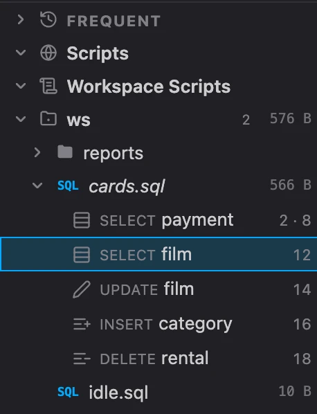
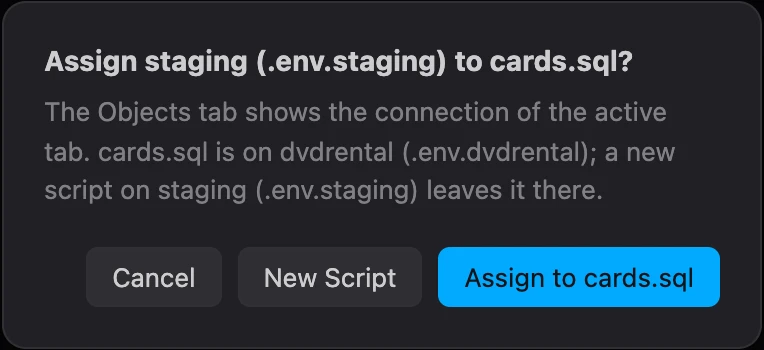
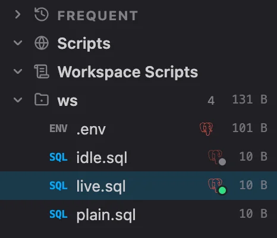

# PlumeSQL 0.32.0

A result now says when you changed its query since it ran, a script unfolds into its statements
in the Explorer, a query on a diagram is titled by its comment, and the PostgreSQL reference in
the editor reads right for JOIN and for the functions written the SQL standard's way.

## Highlights

- **Results that say when the query changed:** an **Edited** mark on the result, with **Run**
  beside it.
- **A script's statements in the Explorer:** unfold a SQL file and click the statement you want.
- **Query cards titled by their comment:** `-- Revenue by category` above a query names its
  card on a diagram, and its Rows change without a Refresh.
- **The reference reads right:** JOIN's hover says what a joined table is, and substring,
  trim or JSON_QUERY show their own signatures and examples.
- **A true Zen Mode:** ⌘K Z gives the file you are in the whole window.

## Results

### A result says when its query changed

Change a query after running it and the result's header says **Edited**, with **Run** beside it
to run the query as it stands now. Moving the text around or adding a comment does not count;
a real change does. The rows stay as they were until you run it again.

## Explorer

### A script's statements, one click away

A SQL file of two or more statements now has a chevron in the Explorer. Unfold it and every
statement is a row of its own, named as in the Outline, with the line it starts on:

Click a statement and the file opens with it selected, while the keyboard stays in the Explorer,
so the arrow keys keep walking the statements. Enter or a double click puts you in the editor on
it. Only the statements show: what is inside one stays the Outline's.

Right click a statement to select, run or copy it. **Run Statement** opens the file and runs just
that statement, as the Outline's does.

While you work in a file you have unfolded, the statement your cursor is in is highlighted and
kept in view as you move, the way the Outline follows it.

### Statement icons that say what a statement does

The icons beside the statements, in the Outline and under a script in the Explorer, were
redrawn. A SELECT no longer wears a magnifier, which looked like a search: it shows a result's
rows. INSERT, DELETE and TRUNCATE are rows added, taken away and emptied, EXPLAIN is a plan's
tree, and BEGIN, COMMIT, ROLLBACK and SAVEPOINT each have their own: a flag, a check, an undo
and a bookmark.

A file you have open follows your edits before you save them. The Explorer remembers which files
you unfolded, and **Statements** in its menu turns the rows off.

## What changed

### The Objects tab always shows your script's connection

The Objects tab can no longer stand on another database than the script you are in, so the
tree and the editor's completion, hover and Go to Definition always answer from the same one.
The header's Automatic and the connection's Pin Object Browser Here are gone.

Exploring a database before you write anything still works the way other clients teach it: with
no script open, click a connection in Connections and its objects show at once, and New Script
then opens on it. With a script on another connection, the click asks first:

If the script has an open transaction, the question says that assigning another connection rolls
it back. The arrow keys in Connections never ask. A click on the connection in the Objects header
now opens the script's own connection picker, the one beside Run.

### A script's connection in its color in the Explorer

A script's mark after its name in the Explorer is now its connection's elephant, in the
connection's color, with the dot at its corner saying whether it is connected:

A connection without a color shows a plain elephant. The color says which connection, the dot
how it is, so a red Production connection never looks like one that does not answer. A query
card on a diagram wears the same elephant before its connection's name.

### A query card is titled by its comment

Write a comment above the SQL of a query on a diagram and its first line becomes the card's
title, with the statement's name quieter beside it:

Annotations such as `-- @extension ...` are left out, and a query without a comment keeps its
statement's name alone. Properties says the title too.

### When the script no longer has the query

A query card from a script follows its statement there, also when you rewrite it through Edit
Query. When the statement is deleted, the card no longer picks up whatever query stands nearby:
it keeps its own SQL and says "Not in cards.sql any more: its own copy runs.", with **Detach**
beside it. Detach makes the SQL the card's own, edited on the card. It is also in the card's
right click and in Properties.

### More rows on a card without a Refresh

Raise a query card's Rows in Properties and the rows show at once: a card keeps up to 100 rows,
whatever it shows, and the line under it says how many it shows of how many ("13 of 16"). A
Refresh still brings the rows you see first, and keeps the rest only when they come quickly, so
a slow query takes no longer than before.

### Errors and decisions from the Log button

Point at the Log button and what this session logged since you last looked shows in the corner,
or its last entry when there is nothing new; before the session has logged anything, nothing
shows. The cards stay while you point at the button, and while the pointer is on a card, so you
can reach its fix or its X.

When something went wrong, the Log button carries a red count of the errors you have not seen.
Point at the count and the errors show in the corner, each with its own fix and **Dismiss**; click
the count and they are all dismissed, without opening the Log. A click anywhere else on the
button opens the Log as before.

Decisions that wait for you, such as **Update usages** after a rename or **Reconnect** after you
changed a connection, now have an amber count of their own. Click it and they show in the
corner the same way, ready to answer.

A right click on the button has the Log's own menu: open it, show or dismiss the errors, open
it on its errors alone (every other entry filtered out), show or set aside the decisions, Copy
All, Clear and Log Settings. The same commands are in the command
palette under PlumeSQL.

### A true Zen Mode

⌘K Z (Ctrl+K Z on Windows and Linux) now does what it does in VS Code: the file you are in gets
the whole window, with no tabs, toolbars, sidebars, bottom panel or status bar. A script's
results stay with it. The same keys or Escape twice bring everything back, and Zen Mode is also
in the Layout menu, the command palette and a button of its own at the left of the title bar's
buttons.

What Zen Mode used to do, both sidebars and the bottom panel hidden at once, is now **Hide
Sidebars and Panel**: the same title bar button as before, in the Layout menu and the command
palette, and back as they were on the next press. It has no shortcut by default; you can give
it one in the keyboard settings.

## Fixed

- **JOIN's reference starts at the beginning.** The hover on JOIN (and INNER, CROSS, NATURAL,
  OUTER) opened in the middle of the section, at "This latter equivalence does not hold
  exactly…", and showed a table of sample rows as its example. It now says what a joined
  table is, and its example is a query.
- **substring, trim and the SQL/JSON functions show their own reference.** Their hover showed
  the title of the table listing them and an example from somewhere else in it, sometimes an
  error message. It now shows the function's signatures, what it does and its own examples,
  as every other builtin function does. This covers position, overlay, JSON_OBJECT,
  JSON_ARRAY, JSON_EXISTS, JSON_VALUE, JSON_QUERY, JSON_OBJECTAGG and JSON_ARRAYAGG too.
- **Query cards stay sharp.** A query card whose rows scroll (its SQL unfolded, or the card
  made smaller) looked blurred, in the app and in Chrome. Its rows now scroll as before, with
  the wheel, the trackpad or by dragging the bar, and the card stays sharp.
- **The dynamic parser checks again when the server was busy.** A check the server could not
  take at that moment waited for your next keystroke; it now tries again on its own.
- **No Disconnect for a tab that is not connected.** The connection picker offered Disconnect
  even with no connection chosen. It now offers it only when there is something to
  disconnect, and ends with New connection… so an empty list always has a way forward.

## Tell us what you think

Questions and ideas go to
[Discussions](https://github.com/hercstack/plumesql/discussions), bugs to
[Issues](https://github.com/hercstack/plumesql/issues) or Report a Bug in
the app's menu. The video tour is on
[YouTube](https://www.youtube.com/@plumesql).
