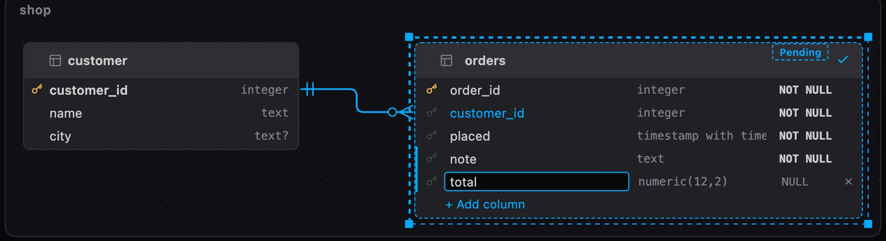
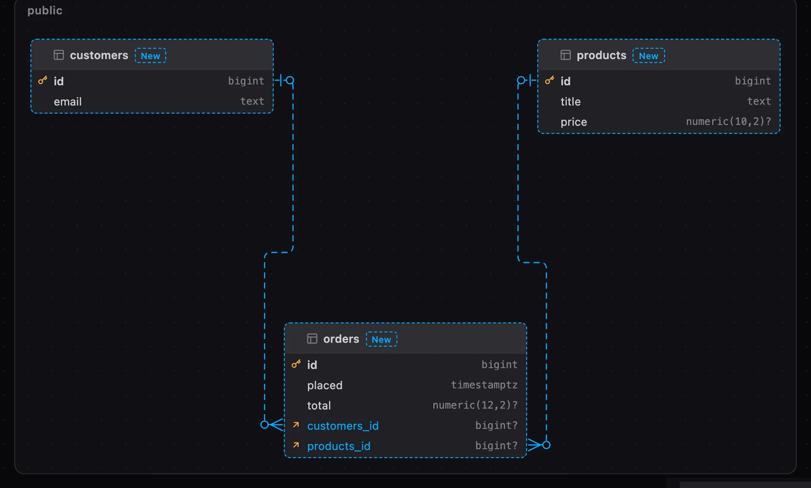
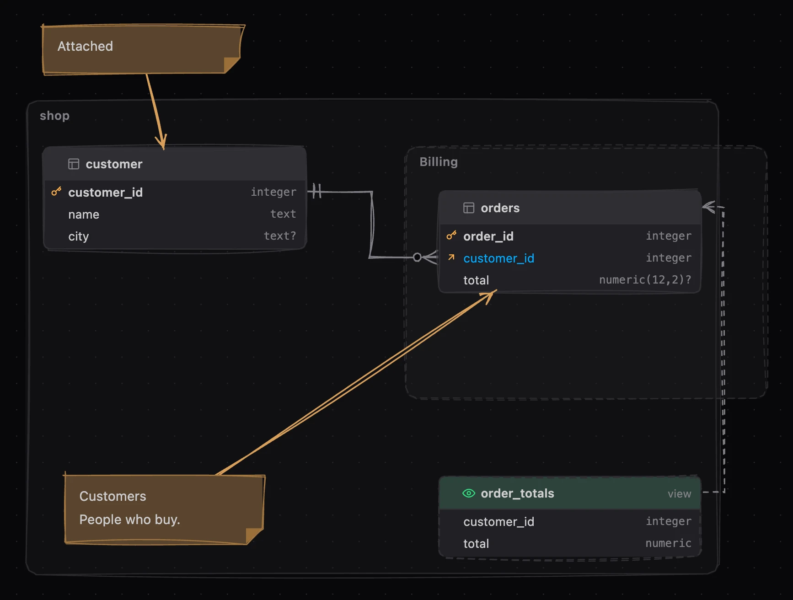
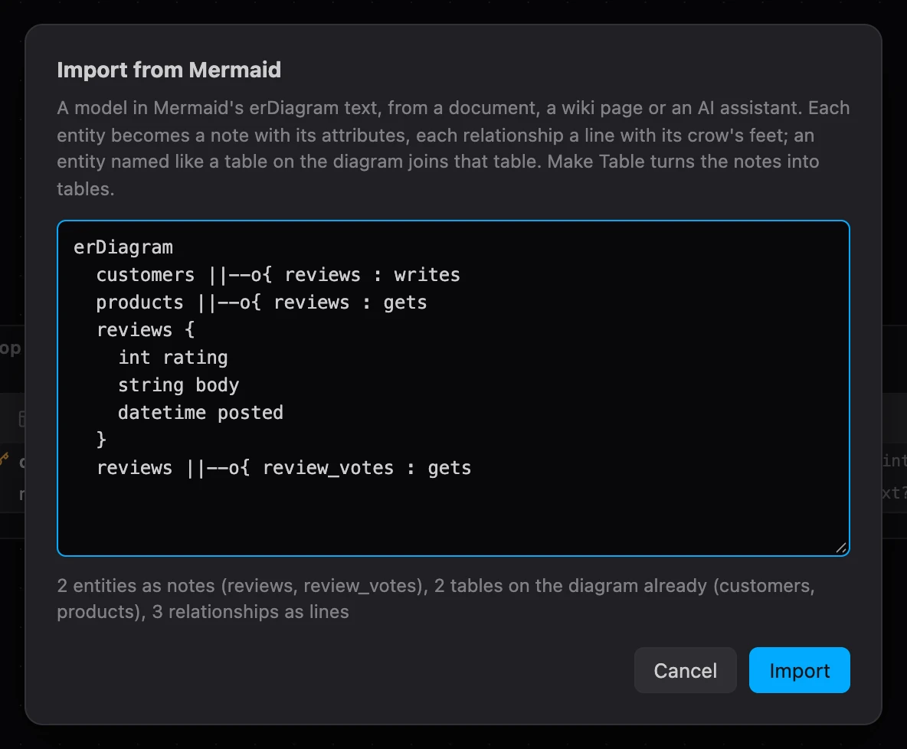
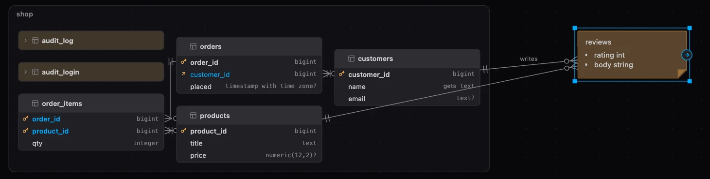

# PlumeSQL 0.33.0

## Highlights

- **Edit tables on the diagram:** double-click a table's card and change its columns right
  there, without leaving the diagram, and draw its foreign keys to other tables.
- **Sketch the model with notes:** draw arrows between notes on a diagram, then make them tables
  in one step, and a new table a note again.
- **A sketch style for diagrams:** the whole diagram drawn as by hand, as draw.io's sketch style
  draws it.
- **Lines of your own on a diagram:** join any two tables, notes or areas with a line, for what
  the database does not say, styled and labeled your way.
- **From a logical model to tables:** crow's foot marks on the lines between notes, logical types,
  and Make Table turns the model into tables, join tables included.
- **Diagrams in the console:** ask a diagram questions and change it with a line of
  JavaScript in the Log's console: what drifted from the database, every audit table greyed,
  the tables a schema has that the diagram leaves out added, a data dictionary in Markdown.
- **A model from Mermaid:** Import from Mermaid (or just paste) Mermaid's erDiagram text on a
  diagram, and its entities become notes and its relationships lines with crow's feet, ready to
  make tables.
- **DDL, laid out your way:** a function's parameters one per line, a table's columns lined up,
  and none of what PostgreSQL would assume anyway, each rule a setting of its own.
- **Properties from a right click:** a table, a schema or a file shows its properties from
  its menu.
- **A shorter right click in Objects:** an object's menu in groups, eighteen entries instead of
  twenty-seven.
- **More in the status bar:** how your last run went, and the session's search_path, one click
  from putting another schema first.

## Diagrams

### Edit a table on its card

Designing on a diagram no longer sends you to another tab. Double-click a table's card, or
press Enter with it chosen, and the card opens for editing: every column with its name, its
type, `NOT NULL` or `NULL` and its place in the primary key (the key), all changed in place.
**+ Add column** adds one, the × beside a column drops it (struck through, with **Keep** to
change your mind), and the table's name in the header renames it.



The type comes from a list of PostgreSQL's types and your database's own: click the field,
or type to narrow it. A type nothing knows is marked in red.

Enter writes a field and goes down to the next column, Escape puts it back, and a second
Escape or the ✓ in the header ends the editing. Properties shows everything else about the
column you are on: its default, identity, collation and comment.

Every change waits in the Changes script, as changes from the table's Design do: nothing
reaches the database until you review it and run it. A new table made on the diagram, with
**New Table Here…**, opens for editing on its card at once.

A new table lives only in your pending changes and on its card, so deleting its card from the
diagram discards the table too. Undo on the diagram brings both back.

### Draw a foreign key

While a table is open for editing on its card, every column has a small arrow, its foreign
key. Drag it to another table and the column references that table's primary key. The line
follows your pointer, and the table under it says what the key would reference, or why it
can't (a table with no one-column key is outlined in red). Drop it on a unique column of the
other table to reference that column instead, or on another column of the same card for a
key to the table itself; Escape lets go without drawing anything.


**+ Reference**, beside **+ Add column**, makes the column for you: drag it to `product` and
`orders` gets a `product_id` of the same type as the key, with its foreign key. Clicking the
arrow (or pressing Enter on it) lists the diagram's tables instead, and takes a key away
again. The new key is drawn at once, as a pending line, and waits in the Changes script with
the rest; ON DELETE and the other options are in Properties. Until it is created, the line is
the key: delete the line (or choose **Remove Foreign Key** on it) and the key goes too.

### Sketch with notes, then make tables

A model often starts as a sketch: a box for each thing, an arrow between the ones that belong
together. Draw it with notes. A chosen note has a small arrow handle on its right edge: drag it
to another note (or to a table's card), and the note points there. A note can have as many
arrows as it needs; **Draw Line To…** on its right click lists the diagram's notes and objects
instead, and a chosen arrow goes with Delete. These arrows are lines of your own (below), so
everything a line can do, they do.


When the sketch is ready, choose the notes and pick **Make Tables** on their right click. Each
note becomes a table not created yet, its card where the note stood:

- the note's first line is the table's name (`Customer orders` becomes `customer_orders`),
- each item of its list is a column, written as in CREATE TABLE: `- email text not null`,
  `- total numeric(12,2) default 0`, `- placed timestamptz not null default now()` (a column
  with no type is `text`),
- the rest of the note's words become the table's comment,
- each arrow becomes a foreign key to the table it points to, in a new column such as
  `customers_id`.



As with every change made on the diagram, nothing reaches the database until you review the
Changes script and run it. Changed your mind? **Make Note** on a new table writes it back as a
note, its keys as arrows, and the diagram's Undo goes back either way.

### Sketch style

Turn on **Sketch** on the Diagram page in Properties and the whole diagram is drawn as by hand:
the tables' borders, the lines with their crow's feet and arrows, the notes, the areas and the
schema frames. Any of them can say otherwise on its own page, or for its group (every table,
every foreign key line, a schema), so you can sketch the draft and keep what is settled crisp.
**Roughness** beside it chooses the hand: Light, Normal or Strong.



A drawing never trembles: each element is drawn the same way every time, however you pan or
zoom. The words, the fills and the fonts stay as they are, and Copy as SVG or PNG takes the
drawing with it.

### Lines of your own

Not every relationship is a foreign key. Many databases declare few or none, and a diagram
often needs to say more: this view feeds that report, these two tables are matched by a code.
Now you can draw it. **Draw Line To…** on the right click of a table, a note or an area joins it
to another one; a chosen note's arrow handle does the same by dragging.


A line always belongs to the two things it joins. Drag one of its ends onto another table, note
or area and it moves there; delete a note and its lines go with it. In between, it is yours to
shape:

- **Straight, Curved, Step or Smooth**, with waypoints you drag out of it, exactly as on a
  foreign key line: drag a step's segment aside and the line goes around the table in its way.
- **A mark at each end:** an arrow, an open arrow, a dot, a crow's foot or a bar.
- **A label of your words:** double-click the line (or press Enter) and type; drag the label
  anywhere along it.
- **Its color, width, stroke and sketch**, all on its own page in Properties, and **Reverse**
  turns it round.

A line that has collected too many bends? **Reset Line**, on its right click and its page,
gives it back as a new one is drawn in one step: its look, its waypoints and its sides. It
works on foreign key lines too. And a note's line to what it is attached to is now a line like
any other, Step and Smooth included.

### From a logical model to tables

A sketch says what the things are. A logical model also says how many: a customer places zero
or many orders, every order belongs to exactly one customer. Now a line between notes can say
that too, in crow's foot notation: pick **Start** and **End** on its right click or its page in
Properties (one, exactly one, zero or one, many, one or many, zero or many).


**Make Table** reads the marks:

- The foreign key goes on the **many** side, whichever way you drew the line.
- **Exactly one** on the other end makes the key NOT NULL; zero or one leaves it optional.
- **Many on both ends** makes a join table between the two (`order_product`), with a key to
  each and both as its primary key.
- **One on both ends** makes the key UNIQUE.

Attributes can stay logical too: write `- total currency` or `- placed datetime` and the table
gets `numeric(12,2)` and `timestamptz`; an attribute with no type at all gets `text`. The list
of logical types is yours to change in Settings.


### Keys named your way

A new table's key is now named for the table in the singular: `customer_id` for customers,
`category_id` for categories, and a column that references it is named the same. Prefer `id`,
or `customers_id`? Settings ▸ Objects ▸ Editing tables has it, along with the key's type (`bigint`
or `integer`), `GENERATED ALWAYS` or `BY DEFAULT`, what a new foreign key does ON DELETE, and the
type of a column you gave none. New Table, Make Table and the foreign keys you draw on a diagram
all follow them.

### A model from Mermaid

A model often starts as text: in a document, a wiki page, or an answer from an AI assistant,
written in Mermaid's `erDiagram`. Choose **Insert ▸ Import from Mermaid…** on a diagram's toolbar
(or on its right click): the model you copied is already in (chosen, so pasting something else
replaces it), and before anything happens the dialog says what it will make. Copied a whole README? Fine: the model is read out of its
```` ```mermaid ```` block. Or skip the dialog and just **Paste** on the diagram (⌘V).



Each entity becomes a note with its attributes, each relationship a line with its crow's feet
and its words, and an entity named like a table already on the diagram joins that table's
card instead. Then **Make Table**, as with any notes.

```
erDiagram
  customers ||--o{ reviews : writes
  products ||--o{ reviews : gets
  reviews {
    int rating
    string body
  }
```



### Diagrams in the console

The Log's console line now knows the diagram on screen as `diagram`. What the mouse does one
card at a time, a line does over the whole diagram:

- `diagram.cards` prints every card as a table; `diagram.checks` lists the ones that differ from
  the database, and what changed.
- `Object.values(db.shop).filter(t => t.type === 'table' && !diagram.cards[t.name])` asks what
  the diagram leaves out, and `diagram.add(...$_)` adds it.
- `diagram.cards.filter(c => c.name.startsWith('audit_')).look({ collapsed: true })` folds every
  audit table; `diagram.lines.filter(l => l.kind === 'dep').hide()` hides the dependency lines.
- `diagram.import(text)` reads a Mermaid model in, `diagram.notes.makeTables()` makes it tables,
  `diagram.link(a, b, { from: 'zeroMany', to: 'oneOnly' })` draws a line with its marks.
- `diagram.mermaid` writes the diagram back as Mermaid, and `diagram.dictionary` as a data
  dictionary in Markdown: each table's comment and its columns with their types, keys,
  references and comments, ready for a wiki or a ticket.

Every change is the diagram's own gesture, one step of its Undo (`diagram.undo()` too). Type
`help.diagram` for the rest.


## Properties

### Properties from a right click

Right-click an object or a schema in Objects, or a file in the Explorer, and choose
**Properties**: PlumeSQL opens it as a click would and shows the Properties tab beside it, even
when you had switched the tab off. A schema's Properties are the schema's own, its comment
ready to edit. From Objects, Properties opens below the tree, so the row you asked about stays
in sight, and the × in its header closes it there. When Properties already shows it, the menu leaves the entry
out, and the same goes for a diagram's Display, Line or Note Properties and for Editor
Properties.

## Status bar

### The last run, and the search_path

The status bar now says how the script's last run went, in the words of the results: `245
rows in 18 ms · 2m ago`, **Failed** in red, a counter while it runs. A click brings the results
back into sight, a failed run's messages first, even when you folded them away.

Beside it stands the session's `search_path`, where names written without a schema are looked
up. Click it to put one of your schemas first, write the list yourself or reset it to the
server's default: each is a `SET` on the tab's own session, as if you had typed it.

They use only the room the status bar has free: on a narrower window they step aside,
`search_path` first, and nothing else moves for them.

The connection stands out now too: on a field of its own, in its color when it has one, its
name first and in full strength, with a chevron that says it is a picker. The session's pid and
age moved into its tooltip.

## DDL, laid out your way

The DDL in the Objects tab is now written to be read. A function's or a procedure's parameters
stand one per line, then `RETURNS`, each label (`IMMUTABLE`, `SECURITY DEFINER`, `SET ...`) on a
line of its own and `LANGUAGE` last. Its body is never touched.


A table's columns line up, the names, the types and the rest each in a column of their own. And
what PostgreSQL writes but would assume anyway is left out: a parameter's `IN`, a default's cast
to its own type (`DEFAULT 'new'`, not `DEFAULT 'new'::text`), `nextval`'s `::regclass`, an
identity column's sequence options while they are the defaults, an index's `USING btree`.


Every rule is a setting in **Settings ▸ Snapshot**, and each can be set apart for a group of
connections or for one connection in its editor:

| Setting | Default | The other way |
|---|---|---|
| DDL lists | parameters one per line | on one line |
| Routine clauses | each on its own line | after the parameters |
| Short form | on | everything as PostgreSQL writes it |
| Align columns | on | off |
| DDL indent | four spaces | two spaces, or a tab |
| Foreign keys | in the table | after it, as `ALTER TABLE ... ADD CONSTRAINT`, the way `pg_dump` writes them |
| CREATE OR REPLACE | off | views, functions, procedures and aggregates written `CREATE OR REPLACE` |

DDL keyword case, the setting that writes keywords in lower case, now applies to a function's head
too. However you set them, the DDL is the same object: we replay it into an empty database on
PostgreSQL 13 to 18 and check it reads back exactly as it was.

## What changed

### A shorter right click in Objects

An object's menu was long. It now reads in groups: open it, work with it, take it somewhere,
then the tree's own entries.

- **Diagram** holds Add to Diagram… and Reveal in Diagram….
- **Data** holds Copy As, Export and Paste Rows….
- **Copy** holds the scripts to the clipboard too, under its Script.
- **Clicks** holds On Click and On Double-Click, in every tree.
- A table's comment is edited in **Properties**, now on the same menu. A column's row still
  has Edit Comment…, and the DDL view's header the form with every comment of the table.

### A query for a diagram is written in a script

A query card's SQL used to be typed on the card itself, with no completion, no checks and no
formatting. A query is now written where the editor helps: a diagram's **Insert ▸ Query…**
and **Add Query Here…** open a new script on the diagram's connection. Write the query, run
it, and **Add to Diagram…** lists that diagram first, so one Enter puts the card there (where
you asked, for Add Query Here).

A card from a script is edited in its script, as before. A card of its own (detached, or made
on the canvas by an earlier version) keeps its SQL as it is and still runs it: a double click
or **Open as Script** opens the SQL in a new script, to be written again and added back.

### A selection on a diagram is a solid outline

A table not created yet is drawn with a dashed blue border, and a selected one was marked by a
dashed blue outline too, its dashes walking. With the motion off they looked the same. Now:

- **A selection is a solid outline** with a square handle at each corner, around a table, a
  note, an area or a schema's frame.
- **A selected line is drawn wider**, with its handles as before.
- **Dashed blue means only one thing:** a table, a column or a foreign key not in the database
  yet. A new table that is selected shows both, its dashed border and the solid outline.

The setting that stopped the walking dashes is gone, with nothing left to move.

## Fixed

- **Types offered after RETURNS.** Writing a CREATE FUNCTION, the completion after `RETURNS`
  (and after a parameter's name) offered functions. It offers types now, `void`, `trigger`,
  `record`, `setof` and `table (...)` among them.

- **Paste on a diagram after a copy elsewhere.** Once you had copied a table that was on the
  diagram already, Paste stayed disabled, even after you copied something else since. Any other
  copy now lets Paste try again.

- **Fit the Diagram takes in every table.** After the diagram changed while zoomed in (a new
  table made, say), Fit the Diagram left out the tables out of sight, and a fit that had waited
  for them could take the view back much later. Every table is fitted now, at once.

- **Pick a column's type from a list.** In the desktop app the type fields of a table's Design
  and of Properties showed no list of types, and took any word as a type. Every such field now
  shows its own list (click it, or start typing to narrow it), and a type neither PostgreSQL nor
  your database knows is marked at once.
- **No lines between a diagram card's rows.** In the desktop app, thin lines in the accent
  color could run between the rows of a card with pending changes (or with changes since the
  diagram recorded it), darker or lighter depending on the zoom. They are gone. A new table's
  rows are no longer marked one by one either: its dashed border and New flag say it is new.
- **What you type stays as you typed it.** In the desktop app on macOS, writing a note's words on
  a diagram offered the system's autocorrect and capitalized the first word. Every field now
  takes plain text, a note's words and the fields a result view draws included: no autocorrect,
  no capitals, no smart quotes or dashes, no text replacement, no spell check.
- **A new column takes its keys with it.** Removing a column that was not created yet left its
  foreign key (or another key on it) behind, and the Changes script failed on a column that was
  gone. They go with the column now.
- **A list opens while a diagram's note is being edited.** In the desktop app, choosing a
  card's connection while a note's words were open for editing showed no list and logged
  "Quick input service needs a focused editor to work." The list opens now.
- **Compact tabs sit on the strip.** With compact tabs, a thin line showed under the active
  tab. It joins the editor below now, as a large tab does.
- **No empty errors in the Log.** A harmless note of the browser ("ResizeObserver loop completed
  with undelivered notifications") showed as an error with "undefined" under it. It no longer
  shows, and no error says "undefined" for want of anything else to say.
- **The problems count in the status bar closes Problems too.** A click on "2 problems, 1
  hint" opened the Problems tab, but nothing closed it there. It is a switch now: pressed while
  Problems is open, and a second click hides it.
- **Drag a note onto any card.** A note dragged onto a table's card attached to it with its
  arrow, but not onto a query card, a script card or another note. Every card takes it now,
  the note drawn over the card rather than hidden under it, and a query or a script card
  dragged onto a table attaches as a note does.

## Tell us what you think

Questions and ideas go to
[Discussions](https://github.com/hercstack/plumesql/discussions), bugs to
[Issues](https://github.com/hercstack/plumesql/issues) or Report a Bug in
the app's menu. The video tour is on
[YouTube](https://www.youtube.com/@plumesql).
