# PlumeSQL 0.33.0

## Highlights

- **Functions in JavaScript and Python:** a PL/V8 or PL/Python function is edited the way a
  PL/pgSQL one is: drawn in its own language, completed, checked, navigated and outlined, and the
  SQL inside its queries completes your tables and columns. A query's rows and a trigger's `NEW`
  complete their columns in all three languages, PL/pgSQL included, and a column the row does not
  have is caught before the function runs.
- **New, from the object tree:** a table, a view, a function, a trigger function and more, made
  from a right click on any row or from the + in the tree's header.
- **A table's Design reads what you write in it:** defaults, checks and index keys complete the
  table's columns, and a column the table does not have is caught before anything runs.
- **PostgreSQL 19:** released on 19 November and supported here, tested the same way as every
  release since 13.
- **Comments, written on the diagram:** every card shows its object's comment as Markdown, a
  click on a chosen card's comment edits it right there, and a long one says how much it leaves
  out. Comments are the
  knowledge of your database, for people and for the tools that read it.
- **Edit tables on the diagram:** double-click a table's card and change its columns right
  there, without leaving the diagram, and draw its foreign keys to other tables.
- **Sketch the model with notes:** draw arrows between notes on a diagram, then make them tables
  in one step, and a new table a note again.
- **A sketch style for diagrams:** the whole diagram drawn as by hand, as draw.io's sketch style
  draws it.
- **Lines of your own on a diagram:** join any two tables, notes or areas with a line, for what
  the database does not say, styled and labeled your way.
- **From a logical model to tables:** crow's foot marks on the lines between notes, logical types,
  and Make Table turns the model into tables, join tables included.
- **Diagrams in the console:** ask a diagram questions and change it with a line of
  JavaScript in the Log's console: what drifted from the database, every audit table greyed,
  the tables a schema has that the diagram leaves out added, a data dictionary in Markdown.
- **A model from Mermaid:** Import from Mermaid (or just paste) Mermaid's erDiagram text on a
  diagram, and its entities become notes and its relationships lines with crow's feet, ready to
  make tables.
- **Functions and procedures in a script of their own:** Edit Function opens a function's code
  ready to change, and any script with one `CREATE FUNCTION` is one too: it says before the run
  what PostgreSQL will do with a changed signature, writes a call and a test for it, and its
  properties, comment and grants in Properties are written into it.
- **DDL, laid out your way:** a function's parameters one per line, a table's columns lined up,
  and none of what PostgreSQL would assume anyway, each rule a setting of its own.
- **Properties from a right click:** a table, a schema or a file shows its properties from
  its menu.
- **A shorter right click in Objects:** an object's menu in groups, eighteen entries instead of
  twenty-seven.
- **Everything for a statement in its right click:** run it, explain it, select, copy and
  format it, the same as its lens and its gutter buttons, even with both switched off, and the
  menu says which statement and which word it acts on.
- **More in the status bar:** how your last run went, and the session's search_path, one click
  from putting another schema first.
- **Commit and Rollback in the toolbar:** while a transaction is open, its end is one click
  beside the connection.
- **A query plan tied to its query:** the Explain plan extension marks in your query what a step
  reads, chooses the step the caret is on, says where a wrong estimate starts and offers the
  statistics or the index that fixes it, read from your own tables.
- **A Database Dictionary:** a Markdown document of your database, kept up to date by PlumeSQL
  and readable on GitHub, where the team writes what every table, column and function is for,
  and those words go to the database as comments.
- **Diagram and Dictionary menus:** both have a menu of their own in the menu bar, and every
  item is in the Command Palette too.

## Diagrams

### Edit a table on its card

Designing on a diagram no longer sends you to another tab. Double-click a table's card, or
press Enter with it chosen, and the card opens for editing: every column with its name, its
type, `NOT NULL` or `NULL` and its place in the primary key (the key), all changed in place.
**+ Add column** adds one, the × beside a column drops it (struck through, with **Keep** to
change your mind), and the table's name in the header renames it.


The type comes from a list of PostgreSQL's types and your database's own: click the field,
or type to narrow it. A type nothing knows is marked in red.

Enter writes a field and goes down to the next column, Escape puts it back, and a second
Escape or the ✓ in the header ends the editing. Properties shows everything else about the
column you are on: its default, identity, collation and comment.

Every change waits in the Changes script, as changes from the table's Design do: nothing
reaches the database until you review it and run it. A new table made on the diagram, with
**New Table Here…**, opens for editing on its card at once.

A new table lives only in your pending changes and on its card, so deleting its card from the
diagram discards the table too. Undo on the diagram brings both back.

### Draw a foreign key

While a table is open for editing on its card, every column has a small arrow, its foreign
key. Drag it to another table and the column references that table's primary key. The line
follows your pointer, and the table under it says what the key would reference, or why it
can't (a table with no one-column key is outlined in red). Drop it on a unique column of the
other table to reference that column instead, or on another column of the same card for a
key to the table itself; Escape lets go without drawing anything.

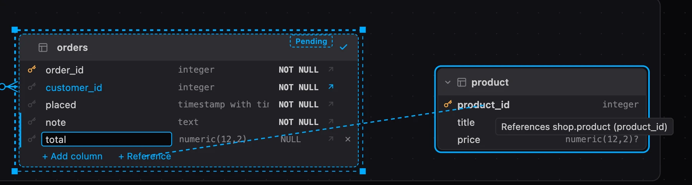

**+ Reference**, beside **+ Add column**, makes the column for you: drag it to `product` and
`orders` gets a `product_id` of the same type as the key, with its foreign key. Clicking the
arrow (or pressing Enter on it) lists the diagram's tables instead, and takes a key away
again. The new key is drawn at once, as a pending line, and waits in the Changes script with
the rest; ON DELETE and the other options are in Properties. Until it is created, the line is
the key: delete the line (or choose **Remove Foreign Key** on it) and the key goes too.

### Sketch with notes, then make tables

A model often starts as a sketch: a box for each thing, an arrow between the ones that belong
together. Draw it with notes. A chosen note has a small arrow handle on its right edge: drag it
to another note (or to a table's card), and the note points there. A note can have as many
arrows as it needs; **Draw Line To…** on its right click lists the diagram's notes and objects
instead, and a chosen arrow goes with Delete. These arrows are lines of your own (below), so
everything a line can do, they do.

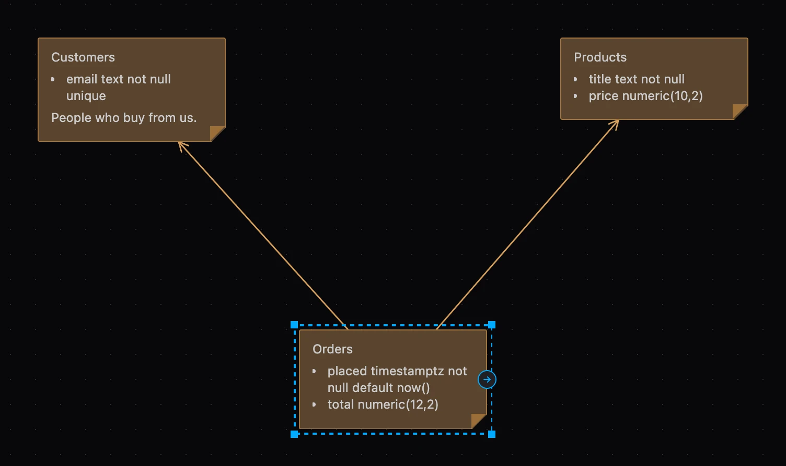

When the sketch is ready, choose the notes and pick **Make Tables** on their right click. Each
note becomes a table not created yet, its card where the note stood:

- the note's first line is the table's name (`Customer orders` becomes `customer_orders`),
- each item of its list is a column, written as in CREATE TABLE: `- email text not null`,
  `- total numeric(12,2) default 0`, `- placed timestamptz not null default now()` (a column
  with no type is `text`),
- the rest of the note's words become the table's comment,
- each arrow becomes a foreign key to the table it points to, in a new column such as
  `customers_id`.


As with every change made on the diagram, nothing reaches the database until you review the
Changes script and run it. Changed your mind? **Make Note** on a new table writes it back as a
note, its keys as arrows, and the diagram's Undo goes back either way.

### Sketch style

Turn on **Sketch** on the Diagram page in Properties and the whole diagram is drawn as by hand:
the tables' borders, the lines with their crow's feet and arrows, the notes, the areas and the
schema frames. Any of them can say otherwise on its own page, or for its group (every table,
every foreign key line, a schema), so you can sketch the draft and keep what is settled crisp.
**Roughness** beside it chooses the hand: Light, Normal or Strong.


A drawing never trembles: each element is drawn the same way every time, however you pan or
zoom. The words, the fills and the fonts stay as they are, and Copy as SVG or PNG takes the
drawing with it.

### Lines of your own

Not every relationship is a foreign key. Many databases declare few or none, and a diagram
often needs to say more: this view feeds that report, these two tables are matched by a code.
Now you can draw it. **Draw Line To…** on the right click of a table, a note or an area joins it
to another one; a chosen note's arrow handle does the same by dragging.


A line always belongs to the two things it joins. Drag one of its ends onto another table, note
or area and it moves there; delete a note and its lines go with it. In between, it is yours to
shape:

- **Straight, Curved, Step or Smooth**, with waypoints you drag out of it, exactly as on a
  foreign key line: drag a step's segment aside and the line goes around the table in its way.
- **A mark at each end:** an arrow, an open arrow, a dot, a crow's foot or a bar.
- **A label of your words:** double-click the line (or press Enter) and type; drag the label
  anywhere along it.
- **Its color, width, stroke and sketch**, all on its own page in Properties, and **Reverse**
  turns it round.

A line that has collected too many bends? **Reset Line**, on its right click and its page,
gives it back as a new one is drawn in one step: its look, its waypoints and its sides. It
works on foreign key lines too. And a note's line to what it is attached to is now a line like
any other, Step and Smooth included.

### From a logical model to tables

A sketch says what the things are. A logical model also says how many: a customer places zero
or many orders, every order belongs to exactly one customer. Now a line between notes can say
that too, in crow's foot notation: pick **Start** and **End** on its right click or its page in
Properties (one, exactly one, zero or one, many, one or many, zero or many).


**Make Table** reads the marks:

- The foreign key goes on the **many** side, whichever way you drew the line.
- **Exactly one** on the other end makes the key NOT NULL; zero or one leaves it optional.
- **Many on both ends** makes a join table between the two (`order_product`), with a key to
  each and both as its primary key.
- **One on both ends** makes the key UNIQUE.

Attributes can stay logical too: write `- total currency` or `- placed datetime` and the table
gets `numeric(12,2)` and `timestamptz`; an attribute with no type at all gets `text`. The list
of logical types is yours to change in Settings.


### Keys named your way

A new table's key is now named for the table in the singular: `customer_id` for customers,
`category_id` for categories, and a column that references it is named the same. Prefer `id`,
or `customers_id`? Settings ▸ Objects ▸ Editing tables has it, along with the key's type (`bigint`
or `integer`), `GENERATED ALWAYS` or `BY DEFAULT`, what a new foreign key does ON DELETE, and the
type of a column you gave none. New Table, Make Table and the foreign keys you draw on a diagram
all follow them.

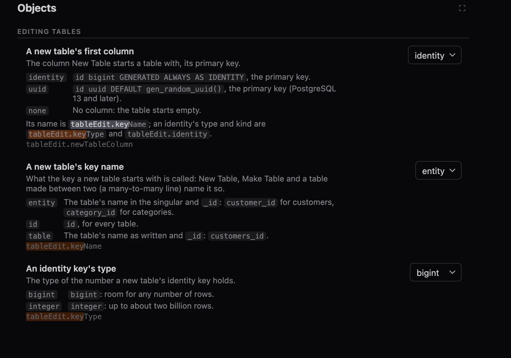

### A model from Mermaid

A model often starts as text: in a document, a wiki page, or an answer from an AI assistant,
written in Mermaid's `erDiagram`. Choose **Insert ▸ Import from Mermaid…** on a diagram's toolbar
(or on its right click): the model you copied is already in (chosen, so pasting something else
replaces it), and before anything happens the dialog says what it will make. Copied a whole README? Fine: the model is read out of its
```` ```mermaid ```` block. Or skip the dialog and just **Paste** on the diagram (⌘V).


Each entity becomes a note with its attributes, each relationship a line with its crow's feet
and its words, and an entity named like a table already on the diagram joins that table's
card instead. Then **Make Table**, as with any notes.

```
erDiagram
  customers ||--o{ reviews : writes
  products ||--o{ reviews : gets
  reviews {
    int rating
    string body
  }
```


### Diagrams in the console

The Log's console line now knows the diagram on screen as `diagram`. What the mouse does one
card at a time, a line does over the whole diagram:

- `diagram.cards` prints every card as a table; `diagram.checks` lists the ones that differ from
  the database, and what changed.
- `Object.values(db.shop).filter(t => t.type === 'table' && !diagram.cards[t.name])` asks what
  the diagram leaves out, and `diagram.add(...$_)` adds it.
- `diagram.cards.filter(c => c.name.startsWith('audit_')).look({ collapsed: true })` folds every
  audit table; `diagram.lines.filter(l => l.kind === 'dep').hide()` hides the dependency lines.
- `diagram.import(text)` reads a Mermaid model in, `diagram.notes.makeTables()` makes it tables,
  `diagram.link(a, b, { from: 'zeroMany', to: 'oneOnly' })` draws a line with its marks.
- `diagram.mermaid` writes the diagram back as Mermaid, and `diagram.dictionary` as a data
  dictionary in Markdown: each table's comment and its columns with their types, keys,
  references and comments, ready for a wiki or a ticket.

Every change is the diagram's own gesture, one step of its Undo (`diagram.undo()` too). Type
`help.diagram` for the rest.

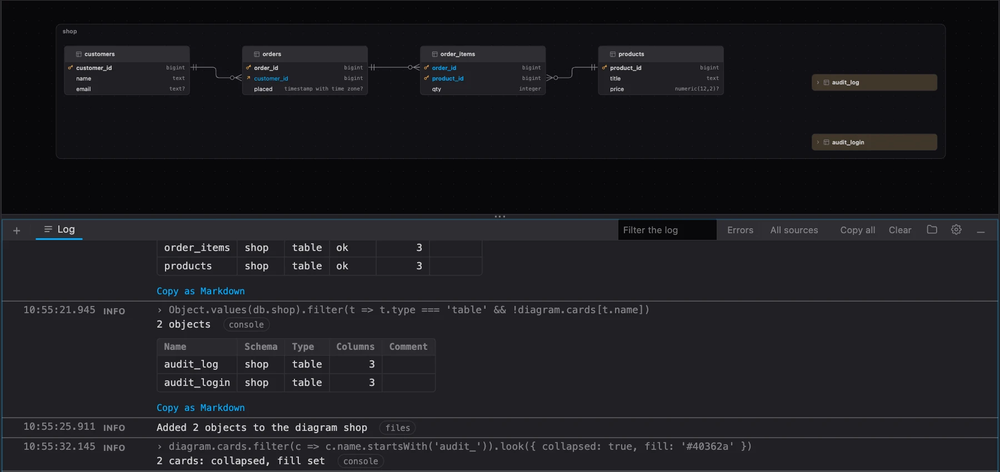

## Properties

### Properties from a right click

Right-click an object or a schema in Objects, or a file in the Explorer, and choose
**Properties**: PlumeSQL opens it as a click would and shows the Properties tab beside it, even
when you had switched the tab off. A schema's Properties are the schema's own, its comment
ready to edit. From Objects, Properties opens below the tree, so the row you asked about stays
in sight, and the × in its header closes it there. When Properties already shows it, the menu leaves the entry
out, and the same goes for a diagram's Display, Line or Note Properties and for Editor
Properties.

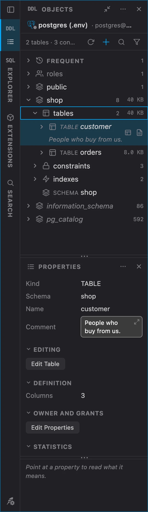

## Status bar

### The last run, and the search_path

The status bar now says how the script's last run went, in the words of the results: `245
rows in 18 ms · 2m ago`, **Failed** in red, a counter while it runs. A click brings the results
back into sight, a failed run's messages first, even when you folded them away.

Beside it stands the session's `search_path`, where names written without a schema are looked
up. Click it to put one of your schemas first, write the list yourself or reset it to the
server's default: each is a `SET` on the tab's own session, as if you had typed it.

They use only the room the status bar has free: on a narrower window they step aside,
`search_path` first, and nothing else moves for them.

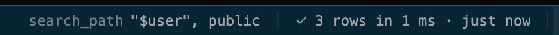

The connection stands out now too: on a field of its own, in its color when it has one, its
name first and in full strength, with a chevron that says it is a picker. The session's pid and
age moved into its tooltip.

## Commit and Rollback in the toolbar

### The open transaction's end, beside the connection

When a script opens a transaction, the editor toolbar already marked it with an amber **tx**.
Now **Commit** and **Rollback** stand right beside it, for as long as the transaction is open,
and go when it ends:


They run exactly `COMMIT` and `ROLLBACK` on the script's session, as if you had typed them, and
the results stay as they are. Their tooltips say what you are about to end: the rows changed,
the schema changes, how long the transaction has been open. Commit still asks first on a
connection set to confirm a commit.

Once a statement fails inside the transaction, nothing but a rollback can run on that session,
so only **Rollback** stays, in red:

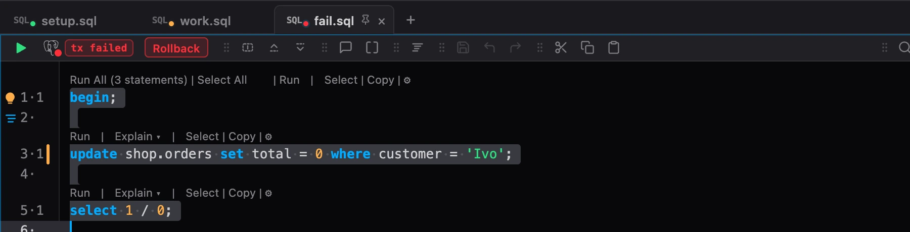

The connection's right click and the command palette (**Commit Transaction**, **Rollback
Transaction**) have them too.

## Functions and procedures

### Edit Function

Right-click a function or a procedure in Objects and choose **Edit Function** (or **Edit
Procedure**; it is also a button on its row under the pointer, beside Open DDL, on its DDL tab,
its card on a diagram, its Properties and in the command palette). Its code opens in a new script: its `CREATE OR REPLACE` as the database has it, laid
out as the DDL is, with everything the SQL editor does inside the body.

It is not the only way in. Any script with one `CREATE FUNCTION` or `CREATE PROCEDURE` is a
function's script, a file of your repository opened from the Explorer as much as a script Edit
Function opened. A script with two of them is a script like any other.

A function's script has a toolbar of its own: which function it makes and on which connection,
then:

- **Add Call**: a call of the function, written into the script below it.
- **Add Test**: a check written into the script, run each time you apply it.
- **Compare with Database**: your `CREATE` beside the function as the database has it now
  (your calls and tests are not part of it). Written another way (lowercase, `$$` for
  `$function$`, `AS` on a line of its own), the same function shows no difference: only what
  changes something is marked.
- **Open DDL**: the function's DDL, as the database has it.

The same are in the editor's right click, under Function.

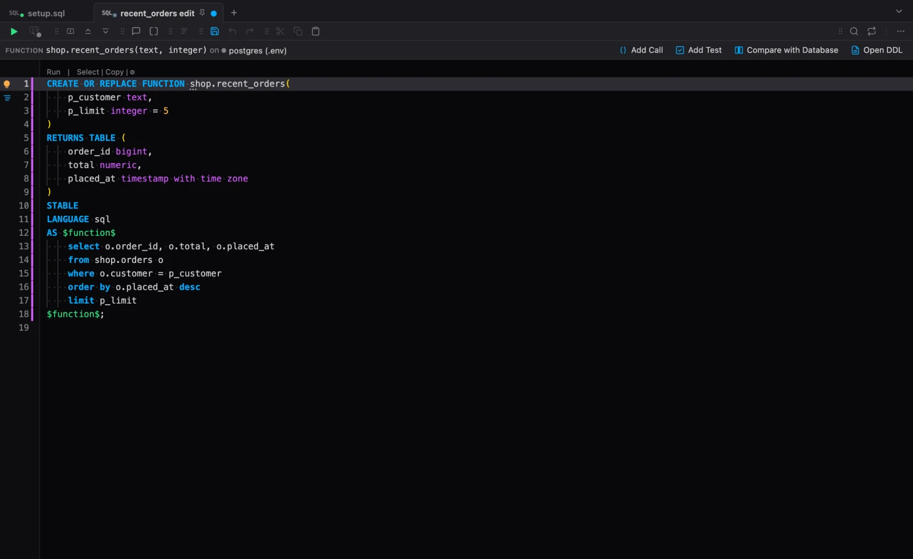

**Run** runs the whole script, the `CREATE OR REPLACE` and your call and tests below it. Once the
script has seen the function (Edit Function opened it, or you ran the script), Run first checks
that nobody changed it in the database since; if someone did, you choose to replace their change
or to compare.

Switch the script to another connection and it reads the function there: Compare with Database
and Open DDL show that database's, and say so when it has no such function yet (the script's
first run creates it).

### The signature, before you run

Rename a parameter, change the result type or remove a default, and PostgreSQL refuses to
replace the function. The script says so as you type, in PostgreSQL's terms: a replace, a second
function beside the old one, or a refusal. The function's name in the script is underlined, and
its Quick Fix (⌘.), like the button at the end of the script's toolbar, is **Write DROP and
CREATE**: it writes the way out into the script, the function's owner, grants and comment put
back, for you to read and run.


### Add Call

**Add Call** writes a call of the function right below its `CREATE`, in the same script: its
arguments are asked in a form when you run it, each by its parameter's name, a default already
filled in. Each Add Call writes another, after the calls the script has: a function has more
than one case to try, and a call you do not want is yours to delete. What it wrote scrolls into
view.

When the function's body writes (an `INSERT`, an `UPDATE`, DDL), the call is written between
`BEGIN` and `ROLLBACK`: you see what it returns, and nothing it wrote is kept. A procedure that
commits itself cannot run inside a transaction, and its comment says so. It is all SQL in your
script: take the two lines away, or write your own around the whole script, as you like.


### Add Test

A call is for now; a test is for every change after it. **Add Test** writes a test at the end of
your script (inside a `BEGIN` and `ROLLBACK` you wrote around it), so each time you apply the function the test runs right after it and fails loudly
if the function no longer returns what you expect. It is a `DO` block that calls the function
and `ASSERT`s on what it returns, shaped by its result:

- **a value** into a variable of its type,
- **rows** into a temp table, counted, and one row found by its key,
- **a record** field by field, a procedure's OUT parameters the same way.

Every value you expect is a `null` to fill in, so the test fails until it says something; the
first one is selected for you to type over. Each Add Test writes another, one per case, and
scrolls it into view. Run runs it after the `CREATE`, the way you would write it yourself.

Its `ARRANGE` starts from the tables the function's body works with, read from the database when
you click: a row to insert for each, as a comment with sample values for the columns a row has
to say, parents before the tables that point at them. Uncomment the rows your test needs, and
with them `set constraints all deferred`, so a row stands without the rows its foreign keys point
at. A foreign key that is not `DEFERRABLE` gets a commented `ALTER ... DEFERRABLE` for the test
alone. The test ends with a `rollback` inside its block: running when the function writes, a
comment to uncomment with your rows when it only reads, so a test that passes leaves nothing
behind, the `ALTER` included. A test that fails leaves nothing either.

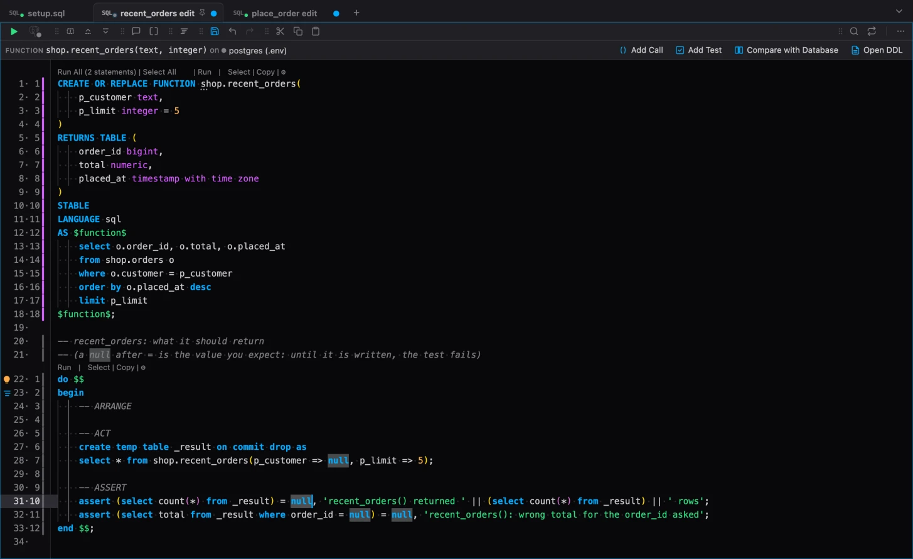

### Its properties, written into the script

The function's page of Properties, beside its script, has what its DDL tab edits: Volatility,
Parallel, Null input, Cost and Rows, Security, Leakproof and the settings it runs with, with
the same checks (a body that only reads offers **Mark as Stable**), and its comment, owner and
grants. They read what your script says, and a change is written into the script, never
pending and never run: Volatility turns `VOLATILE` into `STABLE` in the `CREATE`, a cost
writes `COST 5` before the body, and the comment, the owner and the grants, which no `CREATE`
says, become `COMMENT ON`, `ALTER ... OWNER TO`, `GRANT` and `REVOKE` right below it. Each
change is one undo in the editor, and your Run applies it all. A field that differs from what
the database has offers the way back to it.

Changes still pending from the function's DDL tab are listed at the top of the page, with
**Take into the Script**, so one property never has two versions waiting in two places. And a
run now also asks when the function's owner, grants or comment were changed in the database
since the script saw it, not only its code.


### Their language, in the object tree

Every function and procedure in Objects now says what it is written in: `plpgsql`, `sql`,
`plv8`, at the end of its row, where the languages line up in a column. If you would rather read
it first, **Show Language** puts it before the kind: `PLPGSQL FUNCTION cancel_order(bigint,
text)`.

And if the language matters more to you than whether it is a function or a procedure, **Group
Routines by Language** gives each language a folder of its own (`plpgsql routines`, `sql
routines`), functions and procedures together, each row still saying which it is. Both are in
the Objects tab's menu and in a functions or procedures folder's right click.

Some languages you never read in the tree: a database's `c` and `internal` functions, its own
built-in ones and extensions' compiled code, run to thousands, so they are now left out by
default. The **Object filter** window lists the languages, each with how many routines it has:
check one to show it, uncheck one to hide its functions and procedures in every schema. A
routine's right click offers the same under Hide, and **Show all** brings everything back. Only
the tree leaves them out: completion, hover and Go to Definition still know them.

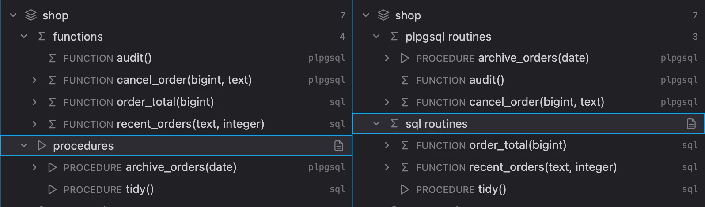

## Comments on the diagram

An object's comment says what it is: what a table holds, what a column means. That knowledge
belongs in the database, where people and the tools that read it find it, and the diagram is
where you see the model it describes. Now it is written there too.

### Shown on every card, as Markdown

Each card shows its object's comment by default, as Markdown (headings, bold, lists, code), in
a block of its own above the columns, so formatted words are never mistaken for a column. A
schema's frame can say how many of its objects are documented.


### Edited where you read it

Click the comment of a chosen card to edit it on the card (⌘Enter keeps it, Escape takes it
back; the first click on a card chooses it); an object
without one shows **Add a comment…** in its place. Its corner opens it in the Markdown editor
instead, with the rendered text beside it, and a card's right click has **Edit Comment…**, a
column's row **Edit Comment of** the column. Every edit is a pending change, like any other:
nothing reaches the database until you run it. **Show Comment as Note** puts a comment on the
canvas to rework, and a note on an object has **Save as Comment**.


### Long comments, never cut without a word

A card shows four lines of a comment by default; when there is more, it says so (**+9 lines**),
and a click on it shows the whole comment beside the card. Show ▸ **Comment Length** chooses
how much a card shows: Summary (the first paragraph), 4 lines, 8 lines or the whole. Write a
one-line summary first and the details after a blank line, and Summary reads like a docstring.
The canvas's own right click has **Show** for what every card of the diagram shows.

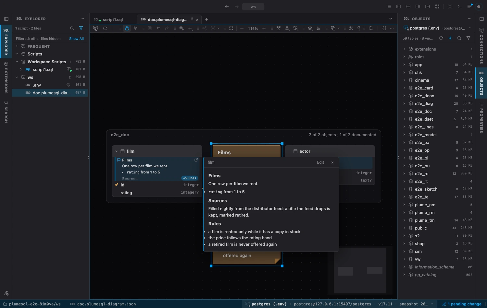

### Run a small change without opening the script

The pending changes' right click in the status bar has **Run Changes…**: the script that will
run is shown whole in its question, so a change as small as a comment needs no tab opened.


## Functions in JavaScript and Python

PostgreSQL runs functions written in JavaScript (PL/V8) and in Python (PL/Python), and now the
editor knows them as well as it knows PL/pgSQL. Write `LANGUAGE plv8` or `LANGUAGE plpython3u`,
before the body or after it, and the body is drawn in its own language, with the SQL help
stepping aside inside it.

Such a function is three languages deep: the SQL around it, the body's JavaScript or Python, and
the SQL its queries run. Each has a ground of its own, so they read apart at a glance: the body's
lines a faint shade, the SQL inside its query strings a deeper one, the same wherever the cursor
is.

### The SQL inside, completed from your database

A query a body runs (`plv8.execute('...')`, `plpy.execute("...")`, and their `prepare` and
`cursor`) is SQL again: drawn as SQL inside the JavaScript or Python string, its tables, columns
and functions completed from the connection, its objects hovered with Browse data and Open DDL,
as in any script.


### Checked as you type, and by the server

- A syntax error, in JavaScript or in Python, is a warning where it stands. Python's indentation
  is read exactly as PostgreSQL's Python reads it: a body indented as a whole is fine, an indent
  no block opens is not.
- A query's syntax is checked by PostgreSQL's own parser as you type; with the dynamic parser on,
  the server checks it too, and a missing table or column is said where it stands, in its words.
- A misspelled `plv8.exeute` is a warning, and so is a variable or a parameter you never read,
  with a Quick Fix that removes it.
- What the body does counts: a declared IMMUTABLE that reads a table, or a STABLE that calls
  `Math.random()` or `datetime.now()`, is a warning, with the word that body is.
- A function in a language its connection does not have (`LANGUAGE plv8` on a server without
  the plv8 extension) is a warning on the language before you run it, with a Quick Fix that
  writes `CREATE EXTENSION IF NOT EXISTS plv8;` above it for you to run. It follows the tab's
  connection, and each connection section of a script.
- A language name one letter off a real one, such as `plpython3` (PL/Python is `plpython3u` on
  every server), is a warning whatever the connection, with a Quick Fix to the name you meant,
  **Change to plpython3u**. Until then its body is drawn as the plain string PostgreSQL would
  take it for.

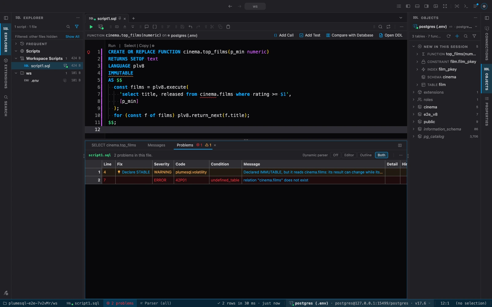

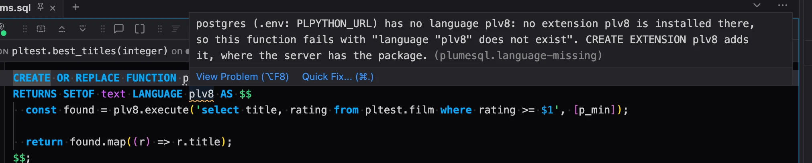

### Help in both languages

- **PL/V8** gets JavaScript's own help: completion of `plv8.execute`, `plv8.prepare`,
  `plv8.elog` and the rest of the API, the parameters typed from their SQL types (`integer` is a
  number, `bigint` a BigInt, `text` a string), a trigger's `NEW`, `OLD` and `TG_*`, hovers and
  signature help, and nothing of a browser's.
- **PL/Python** gets the `plpy` module after `plpy.` with each function's signature, the whole
  standard library after `import` and a module's names after `from ... import`, a trigger's `TD`
  keys, the parameters with their Python types (`numeric` is a Decimal), and the names the body
  defines. After a dot it lists what the object has: a string's methods, a module's names,
  `plpy.execute`'s result and its rows, a plan, a cursor.
- **PL/Python hovers and signatures** come from Python itself: `json.dumps(` shows the
  signature and the first line of the documentation Python reports for it, and so do a result's
  `nrows()`, a string's `split` and the builtins. The parameter you are writing is marked, by its
  name when you name it (`indent=2` marks `indent`).


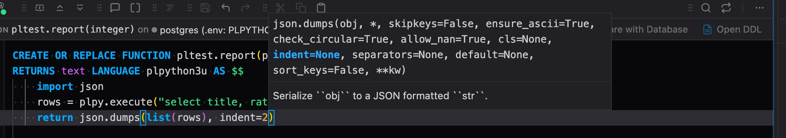

### The rows a body meets, in every language

A body knows the rows it works with, and completes their columns after a dot:

- **A query's rows.** `const found = plv8.execute('select title, rating from film ...')` and
  `found[0].` lists `title` and `rating`; in PL/Python the rows of `plpy.execute("...")` complete
  their keys, `rows[0]['` or a loop's `row['`. The columns are what the query gives, read from
  your database.
- **A trigger's row.** In a trigger function `NEW.` and `OLD.` (`TD['new']` in PL/Python) list the
  columns of the table the trigger is on, found in a `CREATE TRIGGER` in the same script or in the
  database. Before any trigger uses the function, the hover on `NEW` says how its columns become
  known.
- **PL/pgSQL too.** A record filled by `FOR r IN SELECT ...` or `SELECT ... INTO r`, and `NEW` and
  `OLD`, complete their columns and hover with their types.

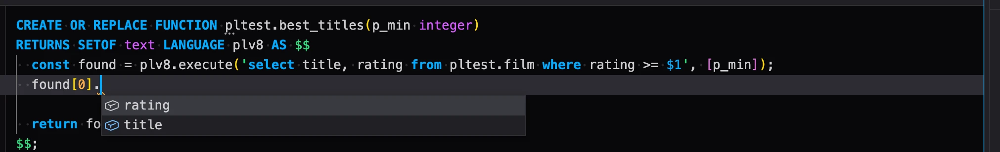

And a column the row does not have is caught as you type, in each language's own terms:
`NEW.titel` in PL/pgSQL is PostgreSQL's own `record "new" has no field "titel"`, which it would
only say when the trigger fires; in PL/V8 it would be `undefined` with no error at all, and in
PL/Python a `KeyError`. Each comes with a Quick Fix to the nearest column, **Change to title**.

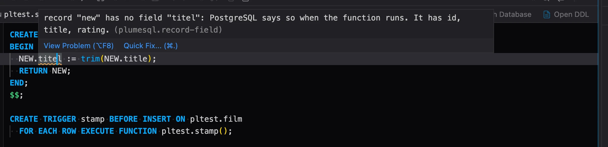

### Navigate, rename, outline

Go to Definition, Find References and Rename (F2) work on a body's own names, a parameter
renamed in the function's head too. Go to Definition on what the language gives the body opens its
declarations read-only, as VS Code does: `plv8.execute` or `NOTICE` in PL/V8's, `map` or
`JSON.parse` in JavaScript's standard library, `plpy.execute` or a result's `nrows()` in plpy's
description, drawn as Python. Both languages fold by their own structure, and the Outline
shows such a function as it shows a PL/pgSQL one: its parameters, its inner functions, the
queries it runs by their kind, its messages and its returns. Edit Function, Add Call, Add Test
and the function's Properties work as for any function, and Format Document leaves the body as
you wrote it.


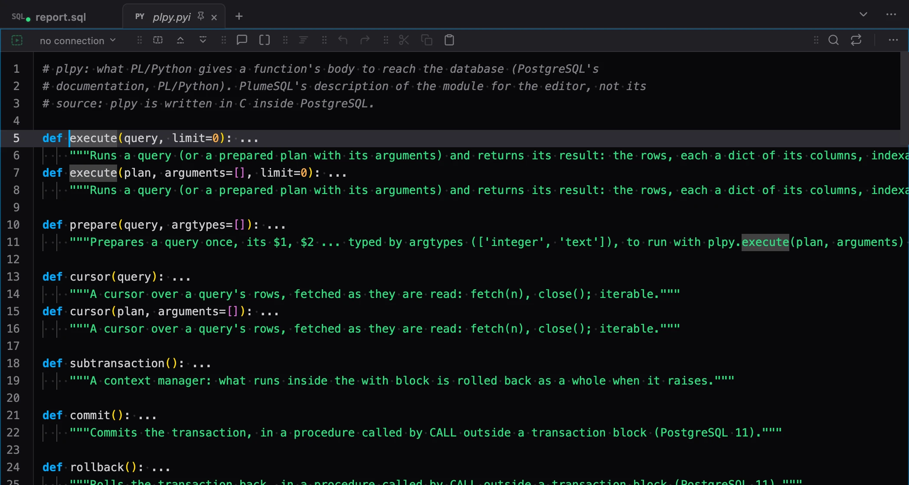

### A server with PL/Python, to try it on

Few servers have PL/Python installed, so System's **Get a server** makes one: tick **With
PL/Python** beside the empty server's version, name and port, and once the server answers, its
script installs PL/Python in the container and creates the extension in its `postgres`
database. Both are lines of the script you read before it runs, like the rest of it.

## DDL, laid out your way

The DDL in the Objects tab is now written to be read. A function's or a procedure's parameters
stand one per line, then `RETURNS`, each label (`IMMUTABLE`, `SECURITY DEFINER`, `SET ...`) on a
line of its own and `LANGUAGE` last. Its body is never touched.


A table's columns line up, the names, the types and the rest each in a column of their own. And
what PostgreSQL writes but would assume anyway is left out: a parameter's `IN`, a default's cast
to its own type (`DEFAULT 'new'`, not `DEFAULT 'new'::text`), `nextval`'s `::regclass`, an
identity column's sequence options while they are the defaults, an index's `USING btree`. A
function's body is delimited by `$$` where PostgreSQL writes `$function$`, in Edit Function too;
a body that holds `$$` itself keeps PostgreSQL's delimiter, and the body is never touched.

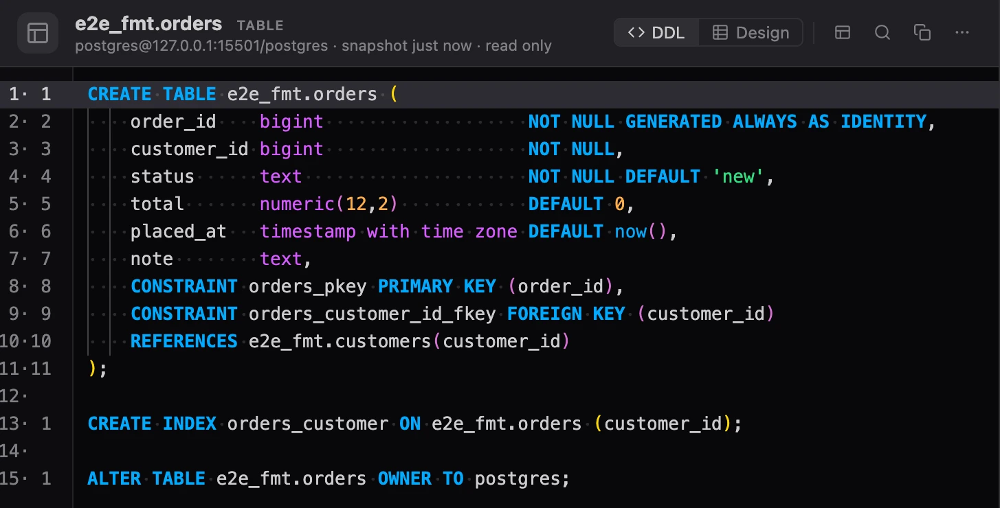

Every rule is a setting in **Settings ▸ Snapshot**, and each can be set apart for a group of
connections or for one connection in its editor:

| Setting | Default | The other way |
|---|---|---|
| DDL lists | parameters one per line | on one line |
| Routine clauses | each on its own line | after the parameters |
| Short form | on | everything as PostgreSQL writes it |
| Align columns | on | off |
| DDL indent | four spaces | two spaces, or a tab |
| Foreign keys | in the table | after it, as `ALTER TABLE ... ADD CONSTRAINT`, the way `pg_dump` writes them |
| CREATE OR REPLACE | off | views, functions, procedures and aggregates written `CREATE OR REPLACE` |

DDL keyword case, the setting that writes keywords in lower case, now applies to a function's head
too. However you set them, the DDL is the same object: we replay it into an empty database on
PostgreSQL 13 to 19 and check it reads back exactly as it was.

## New objects from the object tree

The object tree could open, edit and drop everything, and make only a table, from one row you
had to know. Now every row has **New**, and so does a **+** in the tree's header: Table…, View…,
Function…, Procedure…, Sequence…, Enum Type…, Schema…, Extension…. The row's own kind comes
first, and what you make goes into the schema you clicked in.

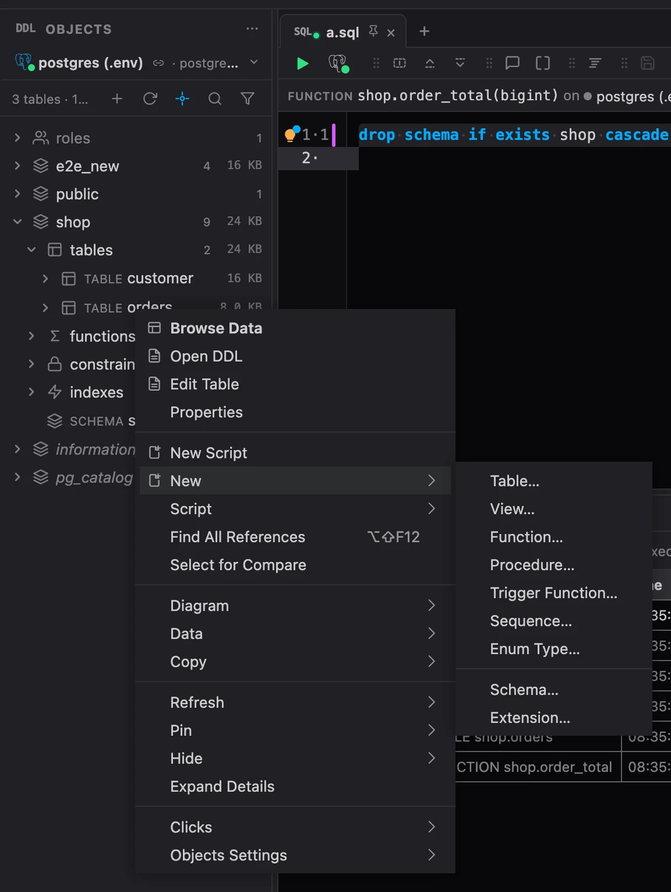

- **A table** opens in its Design, as before: nothing is created until you run its script.
- **A function or a procedure** asks its name and its language, from the languages your
  connection has (PL/pgSQL and SQL, and PL/V8 or PL/Python where they are installed), and writes
  the `CREATE OR REPLACE` into a new script with the cursor in its body. From there it has
  everything a function script has: Add Call, Add Test, its Properties.
- **A trigger function**, on a table's row, comes with its trigger on that table in the same
  script, so `NEW.` completes the table's columns from the first keystroke.
- **A view** on a table's row starts with that table's columns, one per line.
- **An extension** is chosen from a list of what your server can install and this database does
  not have yet, each with its version and what it is.

Everything but a table is a script you read and run yourself: PlumeSQL writes it and stops. The
Command Palette has **New Object…**, **New Table…** and **New Function…** too.

What you made and have not run yet is one set of **pending changes**, the new table and the new
scripts together. Review Changes lists them all, and Run Changes creates them in one
transaction, everything or nothing:

- **Only what makes the object is taken from its script:** its `CREATE`, a trigger function's
  trigger, the comment and grants you set in Properties. A call or a test you added to try it
  stays in the script.
- **Each is made after what it needs.** A new enum comes before the new table that uses it, a
  function a column's `DEFAULT` calls before that table, a function before the view that calls
  it, whatever their names. When two objects need each other in a circle, the script says so
  before you run it.
- **Run one on its own** and it leaves the pending changes; its script stays open either way.

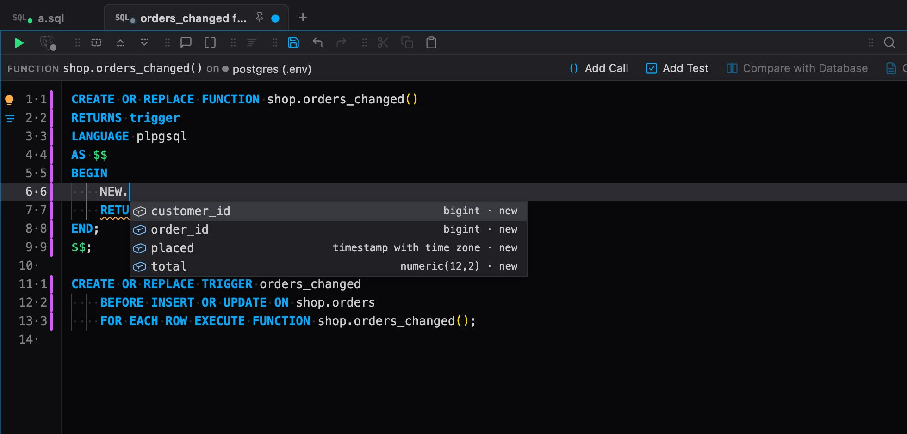

## The table Design reads its expressions

A default, a check, an index's keys and its `WHERE` were plain text fields: `price > 0` on a
table with no `price` went all the way to the server to be refused. Now the Design reads them.

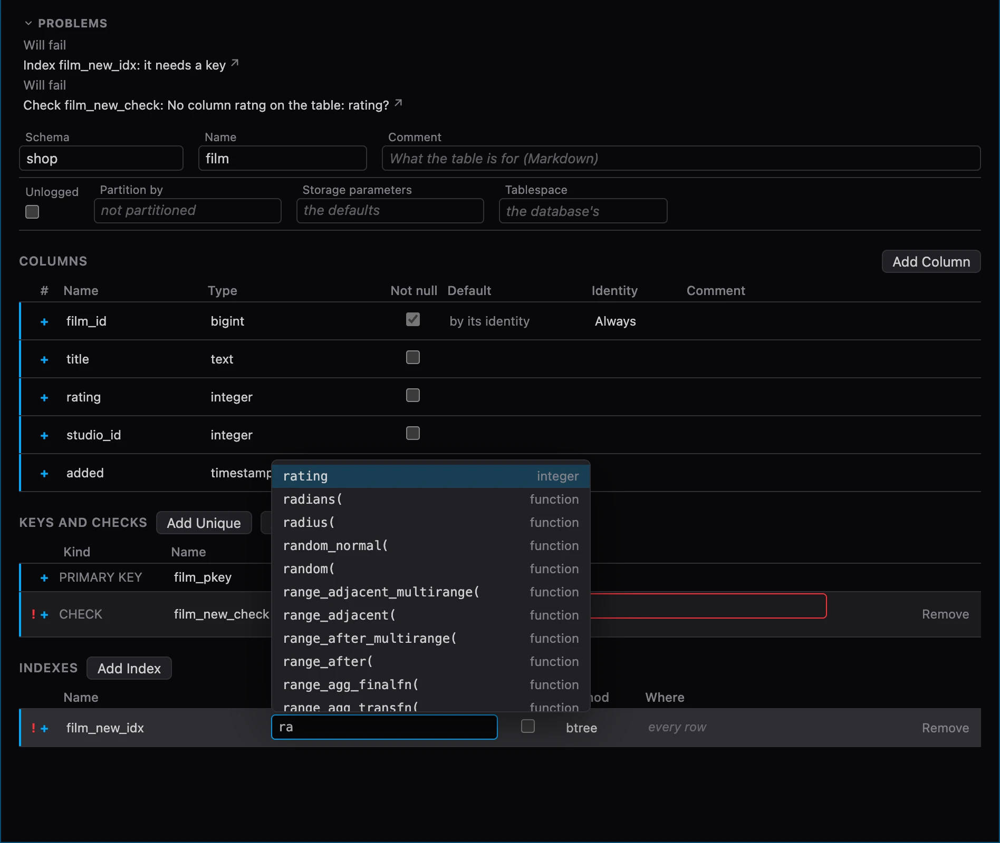

- **A word list as you type.** The table's columns with their types, what a type usually
  defaults to (`now()` for a timestamp, `gen_random_uuid()` for a uuid, `false` and `true`),
  and your database's functions. `Ctrl+Space` shows everything.
- **A column the table does not have is caught at once**, with the nearest one it has: `No
  column ratng on the table: rating?`. It is said beside the field and in Problems, and Run
  Changes waits until it is answered. **Go to it** on a problem puts the cursor in its field.
- **Rename a column** and the checks and indexes you wrote here follow it.
- **⤢ opens a field in a tab:** a default, a check or a `WHERE` as SQL, a comment as Markdown
  with its rendered face.
- **Advice, where you edit:** a foreign key no index begins with (PostgreSQL makes none), with
  **Add Index**; an index another one already covers; a btree index on a `jsonb` or array
  column, where `gin` is what searches inside it.
- **What a change risks is marked on its row:** a ▲ where it loses data, may fail on the data,
  or locks and rewrites the table.
- **Several columns at once:** paste a list (a line each, name then type) and they are added;
  `⇧⌥↓` makes a column again under it; a column's number drags it, and picks several with `⌘`
  or `Ctrl` and `Shift` to drop together.
- **A new table can be made** Unlogged, partitioned, with storage parameters and a tablespace,
  and its Type list knows the new enums that wait in the pending changes.

## PostgreSQL 19

PostgreSQL 19 came out on 19 November 2026, and PlumeSQL supports it: 13 to 19 now. The object
tree, the DDL of every object and the table editor are tested on a real PostgreSQL 19 the same
way as on every other release, replaying each object's DDL and checking it reads back exactly
as it was.

- **The editor knows 19's words** when your server is a 19: `REPACK`, `WAIT FOR LSN`,
  `IGNORE NULLS` and `RESPECT NULLS` in window functions, the `oid8` and `regdatabase` types
  and the new functions, and `REPACK` and `WAIT` open their pages of the PostgreSQL 19
  reference. On an older server they stay plain words, as that server would read them.
- **19's new objects in the DDL:** a publication `FOR ALL SEQUENCES`, one `FOR ALL TABLES
  EXCEPT (TABLE ...)`, and a foreign data wrapper's `CONNECTION` function.
- **Backups of a 19 server:** System offers the PostgreSQL 19 client tools and finds the ones
  you have. A `pg_dump` older than the server refuses it, so a 19 server needs 19's.
- **A 19 server of your own:** Get a server's empty server offers PostgreSQL 19, with PL/Python
  if you like.
- **REPACK where it helps:** the warning on `VACUUM FULL` and `CLUSTER`, which lock the table
  while they rewrite it, names `REPACK (CONCURRENTLY)` on a 19 server, which does not.
- **The extensions run on 19:** every query extension in the Marketplace is executed on
  PostgreSQL 19 too, and the plan viewer reads 19's plans.

One thing is still on its way: the copy of PostgreSQL's own parser inside the editor is 18's
until its 19 build is published. On a 19 server that costs the new statements a little
precision in completion, never a false error: your server judges the syntax, as always.

## A query plan tied to its query

An extension that shows a result can now read the statement the result came from: its tables
as your database knows them, with their indexes and their statistics, and where the query
names each one. It can mark a part of the query in the editor and hear where your caret is.
[Explain plan](https://github.com/hercstack/plumesql/tree/main/extensions/Performance/explain-plan)
uses all of it:

- **A step marks what it reads.** Choose a step of the plan, and the editor marks the table it
  reads and every column read through its alias. Put the caret on a table of the query, or on
  one of those columns, and the plan chooses the step that reads it.
- **A wrong estimate is said where it starts.** One bad guess low in a plan is wrong again in
  every step built on it. The plan says it once, at the step where it begins, and how many
  steps above carry it.
- **Why, and what fixes it.** Two conditions on columns that go together, estimated as if they
  were independent, or a condition on an expression PostgreSQL keeps no statistics on: said,
  with the `CREATE STATISTICS` that fixes it. A scan that reads a whole table to keep a little
  of it gets the `CREATE INDEX` that would serve its filter, unless such an index is already
  there. Nothing runs: you copy the statement and run it yourself.
- **The picture first.** The run fits in a line, what stands out is a row per step, and the
  plan fills what is left of the pane, opening on the step that matters most. A step's rows
  read as the plan counts them, `60.0k = 3 × 20.0k loops`, and its detail shows what its filter
  kept and what came from disk.

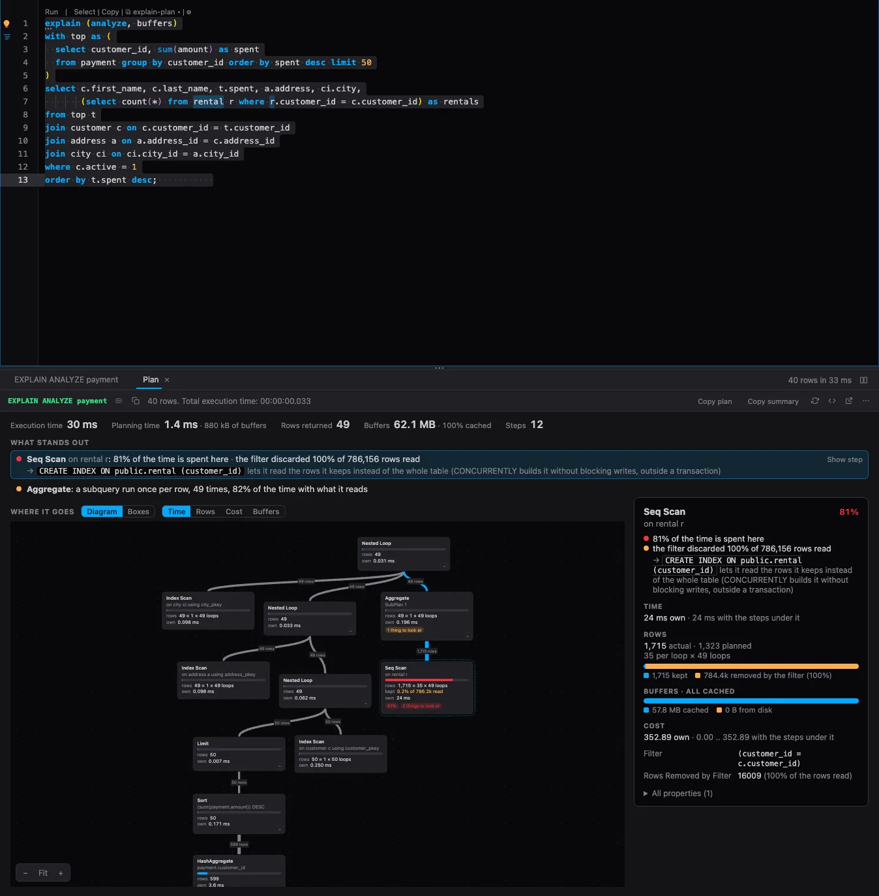

```extensions
explain-plan
```

## A Database Dictionary

What a table is for, why a column can be empty, which function the nightly job calls: that
knowledge usually lives in people's heads. A Database Dictionary gathers it in one Markdown file
beside your code, of one connection, that PlumeSQL keeps up to date and GitHub shows as a page.

- **Made from a right click, like a diagram.** Add to Dictionary… stands beside Add to Diagram…
  on a connection, a schema, a folder of tables or views, and a single table or function. Pick
  one of the connection's dictionaries and what you clicked joins it, or type a path for a new
  one (`docs/database/<database>.md` is proposed) that holds just that. Leave Out of Dictionary
  takes it out again.
- **Choose what it holds like you filter Objects.** Its Properties page has the Object
  filter's tree: every schema opens into its tables, views, functions, procedures, types and
  sequences, and a check means it is in the dictionary. Objects you added one by one or left out
  are listed below it, one click from undoing, and Add Object… brings in one more by name.
- **Everything about each object.** A header that opens with what the database is for, the
  database's own comment, written right there in the document like any other comment, then its
  extensions and how much of it is documented; a table of contents; the relationships as a
  Mermaid diagram, which GitHub draws, every table a card with its name (and, if you like, its
  key); and for every table its comment, its columns with their types, defaults and keys, every
  foreign key linked to the column it points at, what refers to it, its checks, indexes,
  triggers and policies, and how big it is. Views, functions, procedures, enums and domains have
  theirs.
- **A link to every column.** Each column has its own anchor, so a URL can point at it, and a
  link in a review or an issue opens the document right there.
- **Write in it, and the database gets it.** Click a table's, a column's or a function's comment
  right in the preview and write: it waits in the pending changes as `COMMENT ON`, and runs when
  you run the changes. A note a diagram attaches to a table is in the document too, and what you
  write there goes back to the diagram.
- **Your team writes in it too, with or without PlumeSQL.** It is plain Markdown: a teammate
  writes a comment on GitHub or in any editor, and when you pull, PlumeSQL keeps their words and
  takes them into your pending changes. The Log names every comment it took, and quotes what
  your database said before, so nothing changes without you seeing it. Two people who write the
  same comment and both commit get a merge conflict, and PlumeSQL leaves such a file alone until
  it is resolved, and says so.
- **Always current, and quiet in git.** When the database changes, a comment waits, a
  diagram is saved, or you come back to PlumeSQL after a pull, the document is written again, only in the parts PlumeSQL keeps: your own
  text around them is never touched, and a file that did not change is not written. It holds
  only what your team shares, nothing of one computer's server or connection, so your
  teammates' updates do not rewrite it. Sizes are said in ranges, and only a gesture of yours
  writes them anew, so another computer's data never changes the file.
- **A strip over it.** Whose dictionary it is, when it was updated, how much is documented,
  what waits to run. There is no update button: it follows the database on its own, and
  Refresh in the Objects tab reads the database again when you want it now.
- **Statistics you choose.** Under each table its rows, size, scans and the day it was last
  read; switch on what is written into it, how much each index is used, how often a function
  is called, vacuum and analyze. The header says the day they were collected and since when
  the server counts, and a table nobody read says `not read since 2026-09-14`.
- **Nothing read behind your back.** Statistics are collected only when you press Collect
  Statistics, never on their own and never with anything else, so on a production server every read
  is one you asked for by name.
- **Tables that fit the page.** A table's columns read as Column, Type and Comment: the key
  beside the name (a foreign key an arrow to the column it points to), `not null` and the
  default with the type, one line a row, so GitHub shows the whole table and your comments get
  the room. A column's name is its link. Each fact can have a column of its own, go under the
  name or go away, in Properties under Columns.
- **Shaped your way.** Properties says how every part reads: the contents as an overview table
  with what each table is for, undocumented objects left out, sections by kind or by name,
  shorter headings, long column tables folded, a view's SQL under it, the diagram left to right
  or one per schema, and which diagrams' notes it carries, each a checkbox.
- **A right click that knows where you are.** On a column: edit its comment, copy its name or a
  link to it. On a table: Browse Data, Open DDL, Edit Table and the rest of its menu in Objects,
  in the same words. Then the dictionary's own: Collect Statistics, Review Changes, Markdown.
- **Search it.** The strip has the search every page has: type, and every place is marked,
  with 1 of N and the arrows. ⌘F in the dictionary goes there.
- **Its Markdown says what is yours.** The parts PlumeSQL writes are shaded, and the strip says
  so. Your own text and the comments are kept; an edit in a shaded part is not, and the Log
  says where it was.
- **Its page in Properties.** What it holds, what it shows in sections (Statistics,
  Relationships), when its objects were read and its
  statistics collected, and its connection at the end, in the connection's color, as a script's
  page shows it. An object's right click leaves it out of the dictionary or puts it back.
- **Shared with the team.** The document itself says it is a dictionary and what it holds, so
  a teammate's checkout knows it at once: it wears a book in the Explorer before it is opened,
  and when they have one connection to that database, Bind to it is one click.
- **A menu of its own.** The Dictionary menu in the menu bar has everything for the dictionary
  in front, and so does the Command Palette. Diagrams got their own Diagram menu too, with the
  toolbar's actions by name.
- **It reads like a document.** It opens as it reads, with only what your team writes marked as
  editable, an empty comment inviting yours; a longer one opens in a tab from the field's corner,
  as Markdown rendered beside it. One Markdown button on its strip shows the source, and the
  relationships open as a PlumeSQL diagram of those tables.

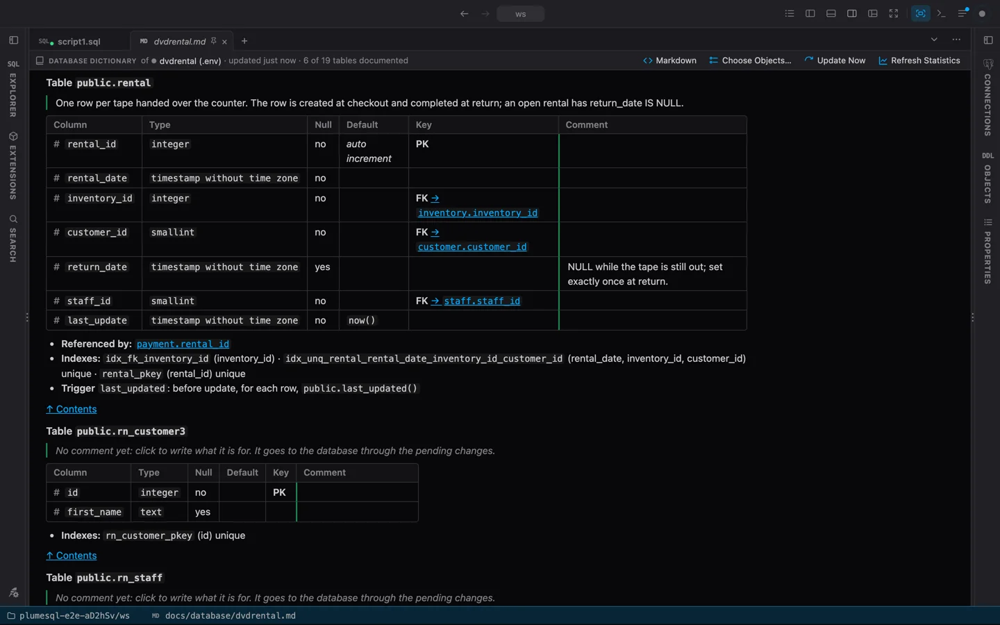

## What changed

### Markdown files in the Explorer

`.md` files are a kind of their own in the Explorer's filter, Markdown documents, and show by
default like your SQL scripts and diagrams: a Database Dictionary or a README is there without
Show All.

### File marks in one row, each color one meaning

Every file's mark stands in a slot of the same width, so the names in a folder line up. JSON
wears `{}`, CSV and TSV files their own marks, a pg_dump archive a box, and a diagram a picture
of two cards and a line where it read ERD. A query or command extension your team keeps in the
workspace wears the feather in its flavor's color, as search results already showed it.

The colors say one thing each: the accent for what talks to the database (a SQL script, a query
extension, a Database Dictionary's book, a diagram), green for what runs a program, violet for
what shapes the grid, and everything else quiet. The same marks are on the tabs and in search
results. Under a file icon theme a dictionary, a diagram and an extension keep their own marks,
which no theme knows.

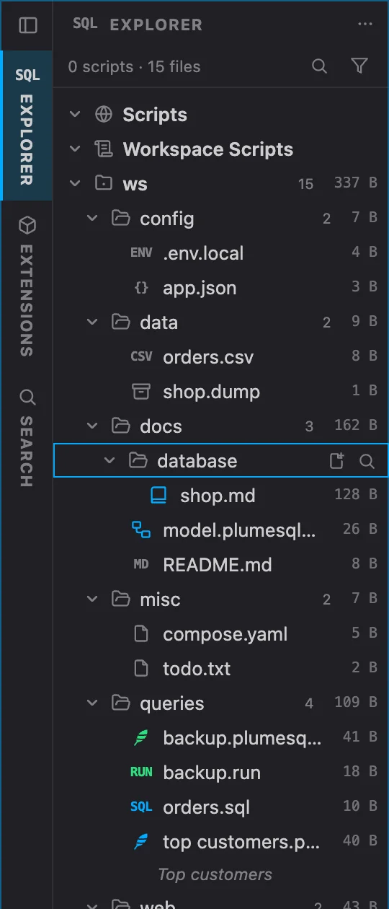

### A shorter right click in Objects

An object's menu was long. It now reads in groups: open it, work with it, take it somewhere,
then the tree's own entries.

- **Diagram** holds Add to Diagram… and Reveal in Diagram….
- **Data** holds Copy As, Export and Paste Rows….
- **Copy** holds the scripts to the clipboard too, under its Script.
- **Clicks** holds On Click and On Double-Click, in every tree.
- A table's comment is edited in **Properties**, now on the same menu. A column's row still
  has Edit Comment…, and the DDL view's header the form with every comment of the table.

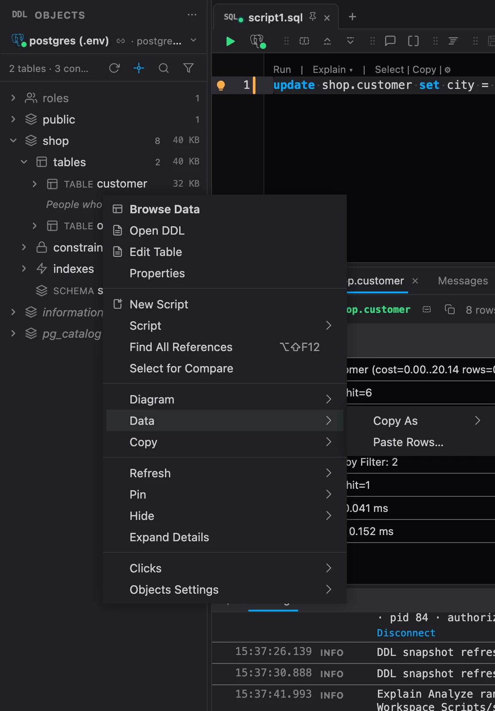

### A tab's header answers a right click

Right-click the header over a tab, a DDL view's, the Changes tab's, an extension's, a
comparison's, and you get what that header does, the same as its dots menu, instead of the
app's general menu. The strip of a function's script offers Add Call, Add Test, Compare with
Database and Open DDL the same way, and the Changes strip in a script every action of the
pending changes.

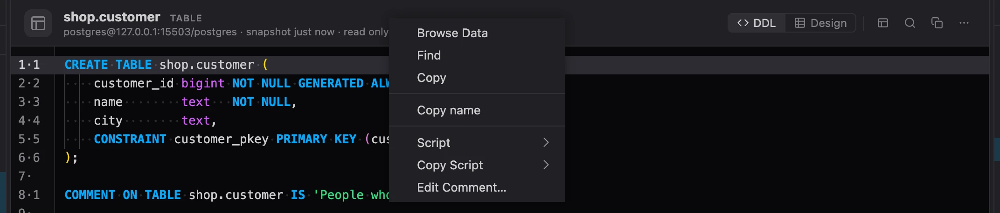

### Everything for a statement in its right click

Right-click a statement in the editor and the menu is in parts, each headed by what it acts on:

- **The statement** (`SELECT shop.orders`): Run Statement (Run Selection when text is
  selected), Explain, Select Statement, Copy Statement, Format Statement, Refactorings,
  Extensions and Add to Diagram….
- **The word under the cursor** (`Column data_point_id`, `Table orders`): Go to Definition,
  References, Peek and Rename.
- **The whole script** (`orders.sql`): **Run** (Run All, Run from Here, Run to Here) and
  **Format** (Format Document, Format Document With…).

**Run from Here** runs the script from the statement under the cursor to the end, **Run to
Here** from its start through that statement, each selected first so you see what runs. A
script that stopped at a failed statement goes on from it once you fixed it.


Then the clipboard (with Paste as Table… and Insert Annotation), and **Lens and Gutter**, the
lens's own list of what shows above and beside each statement. The statement's rows do exactly
what its lens items and gutter buttons do, so switching the lens and the gutter off costs you
nothing. The Command Palette left the menu: F1 opens it.

A statement's row in the Outline and in the Explorer has the same rows in the same words:
**Explain** is there now, and in the Outline **Add to Diagram…** too.

### Explain Analyze says what it wraps

Explain Analyze really runs the statement. An `INSERT`, `UPDATE`, `DELETE`, `MERGE` or `CREATE
TABLE AS` runs between `BEGIN` and `ROLLBACK`, so it changes nothing; a `SELECT` always runs as
written. The Explain item's tooltip says which it will be for that statement before you click,
and the Log records what ran, with its SQL.

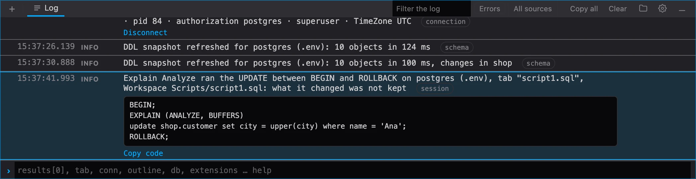

### A pane closes from its header

Properties, Objects or any pane stacked with another in a sidebar has a **×** in its header: it
leaves the group and stays a tab of the sidebar.

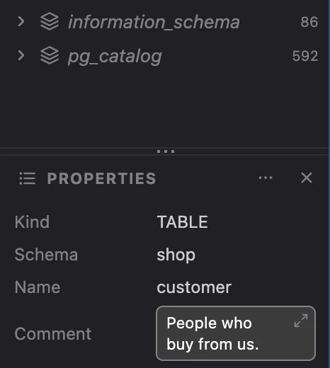

### A query for a diagram is written in a script

A query card's SQL used to be typed on the card itself, with no completion, no checks and no
formatting. A query is now written where the editor helps: a diagram's **Insert ▸ Query…**
and **Add Query Here…** open a new script on the diagram's connection. Write the query, run
it, and **Add to Diagram…** lists that diagram first, so one Enter puts the card there (where
you asked, for Add Query Here).

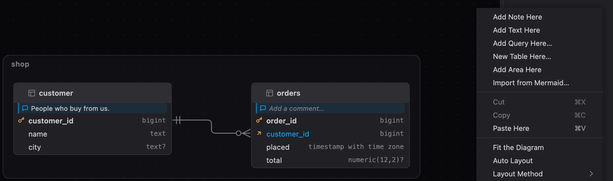

A card from a script is edited in its script, as before. A card of its own (detached, or made
on the canvas by an earlier version) keeps its SQL as it is and still runs it: a double click
or **Open as Script** opens the SQL in a new script, to be written again and added back.

### A selection on a diagram is a solid outline

A table not created yet is drawn with a dashed blue border, and a selected one was marked by a
dashed blue outline too, its dashes walking. With the motion off they looked the same. Now:

- **A selection is a solid outline** with a square handle at each corner, around a table, a
  note, an area or a schema's frame.
- **A selected line is drawn wider**, with its handles as before.
- **Dashed blue means only one thing:** a table, a column or a foreign key not in the database
  yet. A new table that is selected shows both, its dashed border and the solid outline.

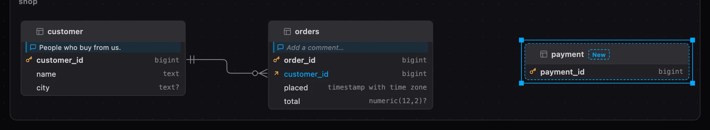

The setting that stopped the walking dashes is gone, with nothing left to move.

### A file from outside the workspace says so on its tab

A file you dropped on the window or opened with **Open File** from somewhere outside the
workspace has a small folder with an arrow out of it beside its name. Its tooltip gives the
full path and says it is saved back where it is. A file from the workspace has no mark, however
you opened it.

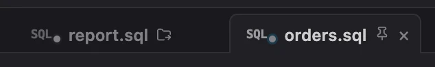

### Save As

**File ▸ Save As…** saves the tab you are in as another file, on `⇧⌘S` (`Ctrl+Shift+S`) as in
VS Code, and in the Command Palette. The save dialog opens in the file's own folder. The tab then
is the new file, saved, still on its connection with its results, and the file it held stays as
it was last saved. Save it outside the workspace and its tab gets the mark above; save it into
the workspace and it is one of the workspace's files, in the Explorer. A DDL view saves a copy
that opens in a tab of its own, and the view stays as it is. Save As is in the desktop app,
where there is a save dialog.

### Tab layout and size, beside the tabs

A **⋯** button at the end of the editor tabs (in the column's head when the tabs stand on the
left or right) opens the tabs' own menu: **Single Row**, **Multiple Rows**, **Vertical Left**
and **Vertical Right**, **Small Tabs**, **Preview Tabs**, **Close All**, and **Tab Settings**.
Each change shows at once and is kept for the workspace. A right click on the empty space beside
the tabs opens the same menu, which helps most with Multiple Rows, where that space is often
gone. The Command Palette has **Tab size** beside Tab layout.

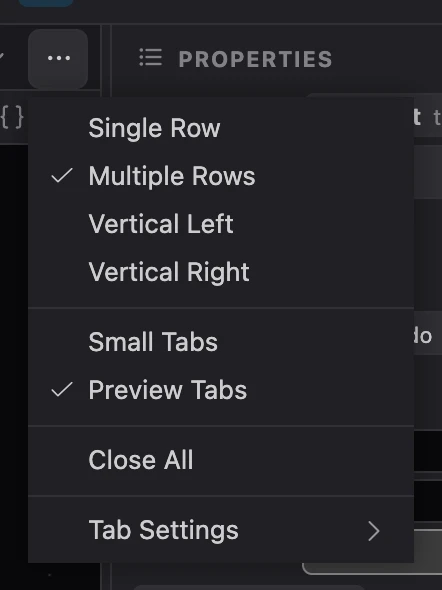

### An object's statistics say since when they count

A table's Properties beside its DDL show when it was last read (an index's last use), the rows
written into it, and **Counted since**: when the server began counting, as long ago as it was.
"Not read" means not read since then, and you can see when that was. Last read needs
PostgreSQL 16 or later.

### A double click in a Markdown preview selects text

In a Database Dictionary, a README or any Markdown file's preview, a double click selects a word
and a triple click a paragraph, as in any text, instead of jumping to the source. The Markdown
button (Source, for other files) takes you to the source.

### Shorter tooltips

Tooltips say only what you cannot already see. The ones that repeated a button's label or a
field's own words are gone, and "Click to…" sentences are cut to a short fact. What stays is the
name of an icon button, its keyboard shortcut, why something is unavailable, and a value too
long to show in full.

## Fixed

- **A double click past the last line no longer selects everything.** On a page of text, a
  double click past the end of its last line selected the whole document. It selects nothing
  there now.
- **Two people, one server: a comment is no longer overwritten unseen.** When you and a
  colleague both change objects on the same server, Run Changes reads what you change again
  before it runs, and again right after you answer its question. Tables, functions and grants
  were read again already; now the comments of views, functions, types and schemas are too. If
  someone changed one since you began, nothing runs: the Log quotes their text and yours, and
  the next Run Changes, once you have read it, runs yours.
- **A Markdown file's preview hides HTML comments and follows its own links.** A comment in a
  `.md` file showed as text in the preview, where GitHub hides it, and a link to a heading of the
  same document did nothing. Comments are hidden now, every heading has GitHub's anchor, and such
  a link scrolls to it. A table wider than the page scrolls by itself, as on GitHub, instead of
  pushing the whole document sideways.
- **A function whose body ends with a `$`.** Its DDL in the Objects tab closed the body one
  character early and would not run. It is written with a delimiter that fits such a body.
- **Go to Definition into JavaScript's standard library in an extension's editor.** F12 on
  `toUpperCase`, `map` or `JSON.parse` in a `.plumesql.js` editor did nothing (only Peek showed
  the declaration). It opens the declaration read-only now, as a CDN library's types do.
- **No error in the Log after a Backspace.** A Backspace that joined two lines, with a
  statement's commands showing at the cursor, could put "Illegal value for lineNumber" in the Log,
  with a long trace, though nothing went wrong on screen. It no longer does.
- **A connection picker opens on the connection in use.** The tab's connection picker opened
  with its first row highlighted, which read as the one selected, so picking the connection
  really in use changed nothing. It opens on the current one now, as VS Code's pickers do, and
  so does every picker that marks what is current (the Objects tab's connection, a group, a
  setting's value). Two connections found in one file (an `.env` with `PLV8_URL` and
  `PLPYTHON_URL`) are named by their entry there, as in the Connections tab, instead of both as
  "postgres (.env)".
- **No Writing Tools button in the editor on macOS 27.** Apple Intelligence's Writing Tools
  showed its button beside selected text again in the desktop app. The editor is code, with
  nothing for it to rewrite: it is switched off again.
- **Extension refactors are no longer stopped for waiting their turn.** The lightbulb, a right
  click and a selection ask an extension's refactors at the same moment, and the extension
  answers them one after another; the last ones in line were stopped with "refactor ran longer
  than 2000 ms" though each took milliseconds. Each question now waits its turn before its time
  starts, and the same question asked twice is asked once.
- **No false syntax error in a SQL function's body.** A function returning `table (type text,
  ...)` whose body wrote `... end as type` was marked with "syntax error at or near "("", although
  it ran fine: the body's check took the column alias for a reference to the result column.
  Aliases and the result's columns are left as written now.
- **Tabs in one row keep their names.** With the editor tabs on one row, many open tabs shrank
  until each showed a single letter of its name. A tab now keeps the width its name needs and
  the row scrolls with its arrows instead, as in VS Code.
- **Types offered after RETURNS.** Writing a CREATE FUNCTION, the completion after `RETURNS`
  (and after a parameter's name) offered functions. It offers types now, `void`, `trigger`,
  `record`, `setof` and `table (...)` among them.

- **Paste on a diagram after a copy elsewhere.** Once you had copied a table that was on the
  diagram already, Paste stayed disabled, even after you copied something else since. Any other
  copy now lets Paste try again.

- **Fit the Diagram takes in every table.** After the diagram changed while zoomed in (a new
  table made, say), Fit the Diagram left out the tables out of sight, and a fit that had waited
  for them could take the view back much later. Every table is fitted now, at once.

- **Pick a column's type from a list.** In the desktop app the type fields of a table's Design
  and of Properties showed no list of types, and took any word as a type. Every such field now
  shows its own list (click it, or start typing to narrow it), and a type neither PostgreSQL nor
  your database knows is marked at once.
- **No lines between a diagram card's rows.** In the desktop app, thin lines in the accent
  color could run between the rows of a card with pending changes (or with changes since the
  diagram recorded it), darker or lighter depending on the zoom. They are gone. A new table's
  rows are no longer marked one by one either: its dashed border and New flag say it is new.
- **What you type stays as you typed it.** In the desktop app on macOS, writing a note's words on
  a diagram offered the system's autocorrect and capitalized the first word. Every field now
  takes plain text, a note's words and the fields a result view draws included: no autocorrect,
  no capitals, no smart quotes or dashes, no text replacement, no spell check.
- **A new column takes its keys with it.** Removing a column that was not created yet left its
  foreign key (or another key on it) behind, and the Changes script failed on a column that was
  gone. They go with the column now.
- **A list opens while a diagram's note is being edited.** In the desktop app, choosing a
  card's connection while a note's words were open for editing showed no list and logged
  "Quick input service needs a focused editor to work." The list opens now.
- **Compact tabs sit on the strip.** With compact tabs, a thin line showed under the active
  tab. It joins the editor below now, as a large tab does.
- **No empty errors in the Log.** A harmless note of the browser ("ResizeObserver loop completed
  with undelivered notifications") showed as an error with "undefined" under it. It no longer
  shows, and no error says "undefined" for want of anything else to say.
- **The problems count in the status bar closes Problems too.** A click on "2 problems, 1
  hint" opened the Problems tab, but nothing closed it there. It is a switch now: pressed while
  Problems is open, and a second click hides it.
- **Drag a note onto any card.** A note dragged onto a table's card attached to it with its
  arrow, but not onto a query card, a script card or another note. Every card takes it now,
  the note drawn over the card rather than hidden under it, and a query or a script card
  dragged onto a table attaches as a note does.
- **Typing in a long script is fast again.** In a script of a few thousand statements (a
  migration, a dump of a few hundred KB), every key you pressed could stall the editor for
  about a second. It answers at once now.
- **Your session keeps saving with large scripts open.** With more than about 16 MB of scripts open, the session (open tabs, unsaved text, layout) could stop being saved without any message, and what you did after that was gone on the next start. It saves as it should now, and a save that fails says so in the Log.
- **The last small choice is remembered.** A result shown side by side, saving cell by cell, a table's Design face and a diagram's tool were saved only with the next other change. Each is saved when you make it now.
- **A script in the shared Scripts store shows it is unsaved.** In the Explorer its row had neither the dot of unsaved changes nor the italic of a preview. It has both now.
- **Identity options survive a change in Properties.** Changing an identity column from Always to By default in Properties dropped the sequence options you had typed. They stay now, as in the Design grid.
- **Numbers read the same everywhere.** On a machine set to another region, some counts read 1.000 and others 1,000 in the same window. All read 1,000 now.
- **A connection through SSH keeps its sessions.** Cancelling a query, or a background check that timed out, could close the SSH tunnel under every tab on that connection: open transactions, temporary tables and settings were gone. The tunnel is rebuilt only when it is really down now.
- **Sorting and filtering a large result stays quick.** In a result of a million rows or more, scrolling a sorted or filtered view and exporting it read the whole result again for every screenful. Each screenful reads only its own rows now.
- **Running a script of thousands of statements.** A long script (a migration, a dump) could freeze the window for seconds while it ran and each time its results were shown again. It runs smoothly now.
- **Typing in a long script with annotations.** A script with `-- @format` or other annotation lines above thousands of statements slowed with every key once it showed a result. It keeps up now.
- **A connection's Checks overrides show as overrides.** In a connection's or a group's editor, five switches under Checks did not show that they override the setting and had no reset. They do now.
- **Constraints and schemas whose names need quotes.** The DDL of a constraint named in mixed
  case or with a space (`"PK_Users"`, `"Check N"`) was written without its quotes, and so was a
  schema named by a reserved word (`"order"`): run again, the script renamed the constraint to
  lower case or failed. They are quoted now, as PostgreSQL itself writes them.
- **The Dynamic parser choice in a connection's settings.** A connection or a group could
  still choose among four ways the parser shows its findings, which the setting itself no longer
  has. It offers on and off, like the setting.
- **Objects of a database with thousands of tables load faster.** Reading the definitions
  slowed down with the square of the number of tables: 13 seconds for 3,000 tables, 2 seconds
  now, on every refresh after a change.
- **Typing in a script of many short statements.** A script of more than 4,000 statements (a
  dump of one-line INSERTs) had every statement read again after every key. About twice as fast
  now.
- **Typing with many results showing.** After a run of a script with thousands of statements,
  every key was slower the more results it had. About twice as fast now.
- **A right click on a diagram card where a line passes behind it.** With the card chosen, a
  right click at a spot one of its lines runs under opened the line's menu instead of the
  card's. The card answers now.
- **A script with thousands of results.** Every result was drawn at once, which slowed the
  run's end and every key typed after it. Results are drawn as you scroll to them now; typing
  with 2,000 results showing is about twice as fast.
- **Problems in a statement that has a parameter.** A statement with `:name`, `$name` or
  `{name}` in it was never marked by the dynamic parser, whatever was wrong in it: a misspelled
  table showed nothing until the run. It is marked now, like any other statement.
- **A command extension's header lines.** A prompt written in quotes (`@file dump "Dump to"`)
  showed its quotes in a command's form, and a value used only as another field's default was
  reported as never used. Both read as they do in a query extension now.
- **Run answers at once while the parser is checking a long script.** On a slow connection a
  Run pressed during a check of hundreds of statements waited for the whole check. It takes the
  connection at once now.
- **Replace All in Search on macOS.** The Replace field's Replace All is ⌥⌘Enter on macOS, as
  in VS Code, and its tooltip and the Keyboard Shortcuts list say so. It wanted the Control key
  before, and both named Ctrl+Alt+Enter.

## Tell us what you think

Questions and ideas go to
[Discussions](https://github.com/hercstack/plumesql/discussions), bugs to
[Issues](https://github.com/hercstack/plumesql/issues) or Report a Bug in
the app's menu. The video tour is on
[YouTube](https://www.youtube.com/@plumesql).
