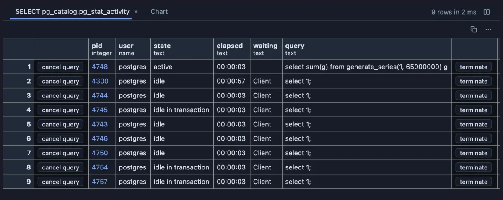

# Activity chart

Watch your database's sessions over time: how many connections are working, idle, holding a transaction open or waiting, one point every refresh.


A minute on a busy database, one point every three seconds. The dashed line is every session; under it, the green line is sessions running a query right now, spiking each time a batch of heavy queries starts and dropping to zero when they finish. The amber line is the one to watch: sessions sitting inside an open transaction, holding their locks while doing nothing. Here they come and go, as they should; a line that only ever climbs means something forgets to commit.

## What it is for

- **Is the database busy right now, or was it a moment ago?** A spike of active sessions when the nightly job starts, a slow climb when the app leaks connections, a flat line when nothing happens.
- **Who is holding the door open?** Sessions idle in a transaction keep their locks and stop vacuum from cleaning up. A line that stays up means a client opened a transaction and walked away.
- **Is anything stuck?** The red line counts working sessions that are waiting (on a lock, on disk, on another session). A red line that stays above zero is where to look for blocking.

## How to read it

Every refresh of the result adds one point to each line:

- **Total** (dashed): every session the result lists (Current activity lists every session on this database except the one asking).
- **Active** (green): running a query right now.
- **Idle** (blue): connected and doing nothing, as a connection pool keeps them.
- **In transaction** (amber): inside an open transaction but not running anything (`idle in transaction`, and the aborted kind).
- **Waiting** (red): active sessions that are waiting for something (a lock, I/O, another process).

The legend shows the newest point's numbers; hover the chart to read any earlier point. Click a name in the legend to hide or show its line. The line in the corner says how many samples it holds and from when to when.

The chart only counts. The grid a click away (the result's first tab) lists the sessions behind the newest point: who, how long, waiting on what, and the query.



The sessions behind one point: one heavy query running, five idle connections and three idle in a transaction. The `waiting` column says `Client` for the idle ones, which only means they wait for their client to send something, so the chart does not count them as waiting; only an active session that waits is. **Cancel query** and **Terminate** on a row stop that session (each asks first).

## Try it

The chart comes with the **Current activity** query extension (in Activity and Locks), which installs it and attaches it for you. Run Current activity from the Extensions side tab (or its toolbar button), then switch to its **Chart** tab: the query refreshes every three seconds, and the chart grows a point each time. Both pictures above are Current activity on a database under load.

The chart needs a query that refreshes, and `@refresh` lives in a query extension's header. This is Current activity's own file (without its buttons), the pattern to copy for a query extension of your own:

```sql
-- @description What every backend on this database is doing
-- @face result
-- @refresh 3s

-- @extension activity-chart as Chart
select pid,
       coalesce(usename, '') as "user",
       coalesce(state, '') as state,
       coalesce(date_trunc('second', clock_timestamp() - query_start)::text, '') as elapsed,
       coalesce(wait_event_type, '') as waiting,
       coalesce(query, '') as query
from pg_stat_activity
where datname = current_database()
  and pid <> pg_backend_pid()
order by state = 'active' desc, query_start;
```

Any result works if it has a column with the session state (`active`, `idle`, `idle in transaction`); name it with `-- @inputs state=<column>` when it is not called `state`. To see the whole server instead of one database, leave out the `datname` line. Above a query in a plain script the chart draws too, but a script has no refresh, so there is nothing to follow over time.

## Settings

Every setting has a default, so the chart draws with no dialog.

| Setting | `@inputs` key | Default | What it does |
|---|---|---|---|
| State column | `state` | state | The column that holds the session state (active, idle, idle in transaction) |
| Waiting column | `wait` | waiting | An active row with something in this column counts as waiting; a result without the column has no waiting line |
| Samples kept | `keep` | 200 | How many points the chart remembers; refreshing every 3 seconds, 200 is ten minutes |

## Good to know

The points live as long as the tab: close it and the history is gone, and a tab you are not looking at does not refresh, so the chart has a gap for the time nobody looked. **Reset** in the header starts it over; the copy button copies every point as CSV (time and the five counts), to paste into a spreadsheet.

It is the "Server sessions" graph of pgAdmin's dashboard, drawn by hand with no library. Attach it from a script with `-- @extension activity-chart` above a query (add `open`, `only` or `beside` to open on the view), or from a result's own menu; `-- @inputs` answers the settings in the file.

## Requirements

PostgreSQL 13 or newer. Nothing runs on the server beyond the query you refresh: the chart is drawn in the result's sandbox.
