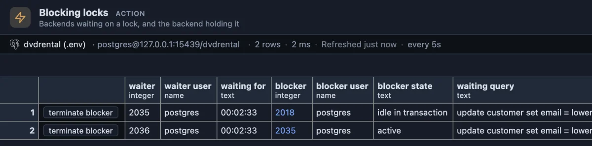
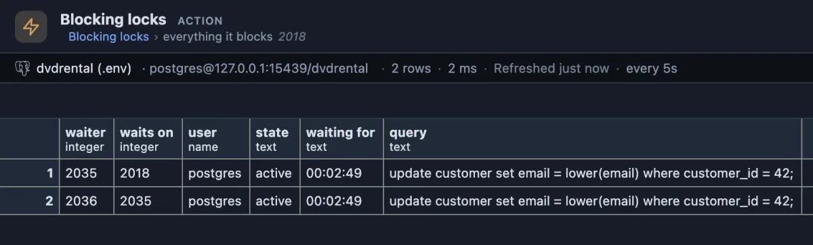

# Blocking locks

Who is waiting for whom, right now, and the session at the root of it.



Two sessions want to change the same customer row. 2035 has waited 2 minutes 33 seconds for 2018, a session that changed that row and then went quiet without committing: its state is `idle in transaction`. 2036 waits behind 2035, because the second session in line waits for the first one, not for the holder. Follow the blockers until one is not waiting itself: 2018 is the one to deal with.

## When to use it

- **The application hangs** on a save, a checkout or a job, and nothing in its own logs says why.
- **A migration or an ALTER TABLE never finishes**: it waits for a lock someone else holds, and everything behind it waits too.
- **The connection pool is full** of sessions that all "do something" but get nowhere.

## How to read it

One row per waiting session and the session it waits for, the longest waiting first. It refreshes every five seconds while its tab is showing.

| Column | Meaning |
|---|---|
| waiter | The session that waits (its process id, `pid`). |
| waiter user | Who it runs as. |
| waiting for | How long it has waited, to the second. |
| blocker | The session holding what the waiter needs. Click it to see everything it holds up. |
| blocker user, blocker state | Who holds it and what that session is doing now. |
| waiting query, blocking query | The two statements, as they were sent. |

What to look for:

- **`idle in transaction` under blocker state** is the classic culprit: the application started a transaction, changed something and stopped talking to the database without COMMIT or ROLLBACK. Fix it in the application; the server setting `idle_in_transaction_session_timeout` ends such sessions on its own as a safety net.
- **`active` under blocker state** means the holder is still working (a long update, a bulk delete). Waiting for it may be the right call.
- **The same blocker on many rows**, or a chain of them, is one problem, not many: free the root and the whole queue moves.

## One click deeper

**Everything it blocks**, on a blocker's pid, lists every session waiting behind it, directly or through another waiter, with the pid each one waits on:



The true size of the problem: both updates wait on 2018, one of them through the other.

**terminate blocker** ends the blocker's session after asking first. Its open transaction is rolled back, which is what releases the lock. Press it on the row whose blocker is the ROOT (the one that is not waiting itself): terminating a waiter in the middle of a chain only moves the next one up.

## Try it

Run it from the **Locks** button in the title bar, or from its row in the Extensions side tab (**Run**). On a quiet database it shows nothing, which is the good answer. To see it answer, on a TEST database (the dvdrental sample here), open two script tabs.

In the first, start a transaction and leave it open (the tab then reads "in transaction"):

```sql
begin;
update customer set last_update = now() where customer_id = 42;
```

In the second, change the same row; this tab keeps running, because it waits:

```sql
update customer set email = lower(email) where customer_id = 42;
```

Blocking locks now shows the second tab's session waiting for the first. Run `rollback;` in the first tab (or press **terminate blocker**) and the second one finishes at once.

## Good to know

The waits come from `pg_stat_activity` and `pg_blocking_pids()`, the server's own answer to "who blocks this pid". A session waiting for a row lock that another waiter queued for first is blocked by that waiter, not by the holder; that is how PostgreSQL queues row locks, and why chains appear. Only heavyweight locks count (rows, tables, transactions); short internal waits are in Wait events.

Ships pinned to the title bar as "Locks" (`@toolbar`) and opens on its result (`@face result`). Refreshes every 5 seconds (`@refresh 5s`), only while its tab is the active one. The main query and the drill-down only read; the one button that writes asks before it acts.

## Requirements

PostgreSQL 13 or newer. Seeing other users' queries needs the `pg_read_all_stats` role or superuser; without it the query columns show `<insufficient privilege>`. Terminating another user's session needs `pg_signal_backend` or superuser.
