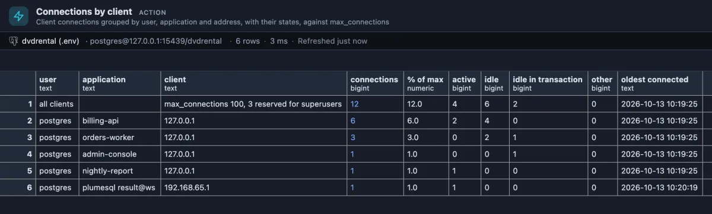

# Connections by client

Which applications hold the server's connections, how many each, and what those connections are doing.

Twelve client connections are open, 12 % of `max_connections`. billing-api holds six of them, two busy and four idle; orders-worker three, one of which sits idle inside a transaction; admin-console one, also idle in a transaction; the nightly report one, working. The last row is PlumeSQL itself, the connection that ran this query.

## When to use it

- **"Sorry, too many clients already"**: who took the slots, and how close the server is to refusing new connections.
- **A connection pool that leaks**: one application's count only ever grows, most of them idle.
- **Before raising `max_connections`**: often one application holds far more than it needs, and a pool size is the real fix.
- **After a deploy**: did the new version open more connections than the old one?

## How to read it

The first row counts all clients together, with the server's limit in the client column. Then one row per user, application and client address, the most connections first.

| Column | Meaning |
|---|---|
| user, application | The database user and the application name the client sent. Most drivers take it in the connection string, for example `application_name=billing-api`; a row with an empty name is a client that did not say who it is. |
| client | The client's address, or `local socket`. On the first row: `max_connections` and how many slots are kept for superusers. |
| connections | How many are open. Click it to see them one by one. |
| % of max | Their share of `max_connections`. |
| active, idle, idle in transaction | By state. `idle` is normal for a pool. `idle in transaction` holds locks and keeps vacuum from cleaning up: the one to watch. |
| other | Any other state, such as one hidden from your user. |
| oldest connected | When the oldest of them connected. |

What to look for: a total close to 100 % (new connections will soon be refused), one application with dozens of idle connections (its pool is too big, or it leaks), and any `idle in transaction` that stays across refreshes (see Idle in transaction).

## One click deeper

**Sessions**, on a row's connection count, opens that group's sessions one by one: pid, database, state, when it connected, how long it has been in its state, and its last statement. On the first row it opens every client connection.

## Try it

Run it from its row in the Extensions side tab (**Run**). Every server has connections, so it always answers; to see your own applications by name, give each its `application_name` in the connection settings.

## Good to know

Only client connections count: replication, autovacuum and background workers have limits of their own and are left out. The share of `max_connections` includes the slots reserved for superusers (`superuser_reserved_connections`), so ordinary users are refused a little before the total reaches 100 %. Reads `pg_stat_activity` and changes nothing. Opens on its result (`@face result`).

## Requirements

PostgreSQL 13 or newer. Seeing other users' states and statements needs the `pg_read_all_stats` role or superuser.
