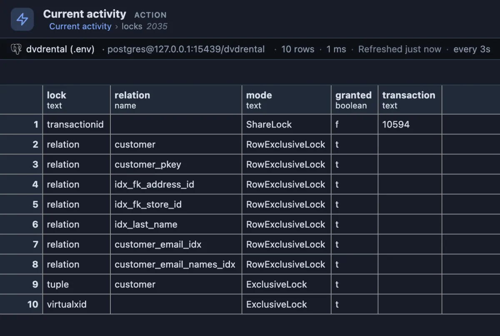

# Current activity

What every session on this database is doing right now, with Cancel and Terminate one confirmation away.

Eleven sessions on dvdrental. At the top, the busy ones: 2015 has run a big join for 1 minute 24 seconds, and two updates (2035, 2036) wait on a lock (`Lock` under waiting). Six sessions are idle, waiting for their application's next statement (`Client`). At the bottom, two transactions left open: 2021 failed and waits for a ROLLBACK, and 2018 changed customer 42 and went quiet, which is what the two updates wait for.

## When to use it

- **The database feels slow**: the first screen to open. Is something big running, is something waiting?
- **A query of yours does not come back**: find it here, see how long it has run and whether it waits, cancel it.
- **Before a maintenance window**: who is still connected and working.

## How to read it

One row per session on the current database (this query's own connection is left out), the busy ones first, then by when their statement started. It refreshes every three seconds while its tab is showing.

| Column | Meaning |
|---|---|
| pid | The session's process id. Click it to see its locks. |
| user | Who it runs as. |
| state | `active` (working), `idle` (waiting for its application), `idle in transaction` (waiting for its application INSIDE a transaction, holding what it locked), `idle in transaction (aborted)` (its transaction failed and waits for a ROLLBACK). |
| elapsed | How long the current statement has run, or for an idle session, how long ago its last one started. |
| waiting | What it waits for: `Lock` (another session), `IO` (the disk), `Client` (its application), and so on; empty while it works. |
| query | The statement, as it was sent. |

What to look for: an `active` row with a long elapsed time (a slow query), a `Lock` under waiting (something holds it up: Blocking locks says who), and an `idle in transaction` row that stays (an application that forgot to commit).

**Chart** is a second tab beside the grid, drawn by the Activity chart extension (installed with this one): sessions by state over time, one sample per refresh.

## One click deeper

**Locks**, on a pid, lists every lock that session holds or waits for:

2035, one of the waiting updates, holds its locks on the customer table and its indexes (`t` under granted) and waits for one: a `ShareLock` on transaction 10594 (`f`), the transaction of the session holding the row.

**cancel query** stops the running statement and leaves the session connected (`pg_cancel_backend`). **terminate** ends the session and rolls back its transaction (`pg_terminate_backend`). Both ask first.

## Try it

Run it from the **Activity** button in the title bar, or from its row in the Extensions side tab (**Run**). To watch something happen, run a slow statement in a script tab on a test database, `select pg_sleep(60);`, and see it appear as `active`; press **cancel query** on its row and the script tab reports the statement was cancelled.

## Good to know

Reads `pg_stat_activity` (the sessions) and `pg_locks` (the drill-down). Ships pinned to the title bar as "Activity" (`@toolbar`) and opens on its result (`@face result`). Refreshes every 3 seconds (`@refresh 3s`), only while its tab is the active one; the chart keeps one sample per refresh. The main query and the drill-down only read; the two buttons write, and each asks before it acts.

## Requirements

PostgreSQL 13 or newer. Seeing other users' statements needs the `pg_read_all_stats` role or superuser; without it the query column reads `<insufficient privilege>`. Cancelling or terminating another user's session needs `pg_signal_backend` or superuser.
