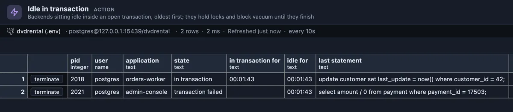

# Idle in transaction

Sessions that opened a transaction and then stopped talking to the database, the oldest first.



2018, an orders-worker session, updated customer 42 one minute 43 seconds ago and has done nothing since, still inside its transaction. Until it commits or rolls back it keeps the row locked (anyone else who wants it waits) and keeps vacuum from cleaning up behind it. 2021, an admin console, hit an error in its transaction (a division by zero): its transaction failed, it already let go of everything it held, and it only waits for someone to type ROLLBACK.

## When to use it

- **Updates or migrations wait for no visible reason**: an open transaction somewhere holds the rows they need.
- **Tables keep growing although vacuum runs**: an old open transaction stops vacuum from removing dead rows anywhere in the database.
- **After a release**: an application that forgets to commit on some code path shows up here first.

## How to read it

One row per session idle inside a transaction. It refreshes every ten seconds while its tab is showing.

| Column | Meaning |
|---|---|
| pid | The session's process id. |
| user | Who it runs as. |
| application | The application name it connected with, usually the surest clue to which service left it open. |
| state | `in transaction`: the transaction is open and holds what it locked. `transaction failed`: an error ended it; it holds nothing, but the session stays useless until a ROLLBACK. |
| in transaction for | How long the transaction has been open (empty for a failed one: PostgreSQL forgets the start of a transaction once it fails). |
| idle for | How long since the session last did anything. |
| last statement | The last statement it ran, which is rarely the one that took the lock, but tells where in the code it stopped. |

What to do: seconds are normal between two statements of a busy application; minutes are a bug. Find the code path in the application named here and make sure every transaction ends in COMMIT or ROLLBACK, also on errors. As a safety net, the server setting `idle_in_transaction_session_timeout` (for example `'5min'`) ends such sessions on its own.

**terminate** ends a session after asking first; its open transaction is rolled back, which releases its locks. The application sees its connection drop.

## Try it

Run it from the **Idle in transaction** button in the title bar, or from its row in the Extensions side tab (**Run**). To see a row, run this in a script tab on a test database and leave it (the tab then reads "in transaction"):

```sql
begin;
select count(*) from film;
```

Within ten seconds that tab's session appears here. Run `rollback;` in the tab and it is gone at the next refresh.

## Good to know

Reads `pg_stat_activity`, rows in the states `idle in transaction` and `idle in transaction (aborted)`. Ships pinned to the title bar as "Idle in transaction" (`@toolbar`) and opens on its result (`@face result`). Refreshes every 10 seconds (`@refresh 10s`) while its tab is the active one. Reads only, except for the button, which asks first.

## Requirements

PostgreSQL 13 or newer. Seeing other users' statements needs the `pg_read_all_stats` role or superuser. Terminating another user's session needs `pg_signal_backend` or superuser.
