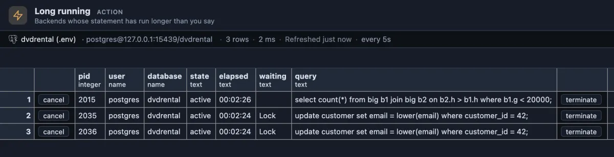

# Long running

Statements that have been running longer than you say, with Cancel and Terminate one confirmation away.



Three statements have run longer than 30 seconds. The big join (2015) has worked for 2 minutes 26 seconds: nothing under waiting means it is busy, it is simply slow. The two updates look just as old, but `Lock` under waiting says they have done nothing all that time: they are stuck behind another session, and Blocking locks tells which one.

## When to use it

- **The server is busy and you want the culprits**: everything over a minute, say, in one list.
- **A report or a batch job "is still running"**: here is how long, and whether it works or waits.
- **Before a deploy or a maintenance step** that needs the tables quiet.

## How to read it

It asks for a threshold in seconds when it runs, then lists every working (`active`) session whose statement started longer ago than that, the oldest first. It refreshes every five seconds with the same threshold.

| Column | Meaning |
|---|---|
| pid | The session's process id. |
| user, database | Who runs it, and where. |
| state | `active`. |
| elapsed | How long the statement has been running, to the second. |
| waiting | What it waits for (`Lock`, `IO`, ...); empty while it is working. |
| query | The statement, as it was sent. |

What to do: a long statement that works may just need patience or a better plan (EXPLAIN it); one that waits on `Lock` needs the session it waits for dealt with, not itself. **cancel** stops the statement and keeps the session connected (`pg_cancel_backend`); **terminate** ends the session and rolls back its transaction (`pg_terminate_backend`). Both ask first, naming the user and the database.

## Try it

Run it from the **Long running** button in the title bar, or from its row in the Extensions side tab (**Run**), and answer the threshold (30 seconds by default). To see a row, run a slow statement in a script tab on a test database:

```sql
select pg_sleep(120);
```

After 30 seconds it appears here; **cancel** stops it, and the script tab reports the cancellation.

## Settings

| Input | Default | What it does |
|---|---|---|
| seconds | 30 | List statements running longer than this many seconds. |

## Good to know

Only `active` sessions on purpose: an idle session, or one idle in a transaction, shows the start of its LAST statement, long finished, and would pass for a running one (Idle in transaction is the extension for those). Reads `pg_stat_activity`. Ships pinned to the title bar as "Long running" (`@toolbar`) and opens on its result (`@face result`). Refreshes every 5 seconds (`@refresh 5s`) while its tab is the active one. Reads only, except for the two buttons, which ask first.

## Requirements

PostgreSQL 13 or newer. Seeing other users' statements needs the `pg_read_all_stats` role or superuser. Cancelling or terminating another user's session needs `pg_signal_backend` or superuser.
