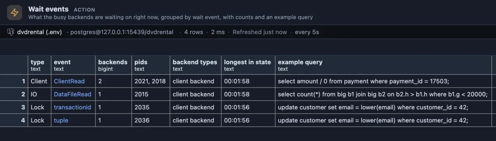
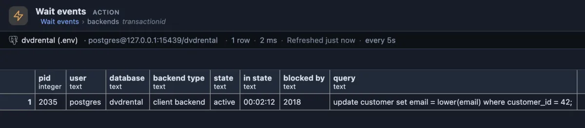

# Wait events

What the busy sessions are waiting on right now: a lock, the disk, their application, or nothing (they are working).

Right now: two sessions wait for their application inside an open transaction (`Client`, `ClientRead`), the big join waits for the disk to hand it data (`IO`, `DataFileRead`), and two updates wait on locks: 2035 on the transaction that holds their row (`Lock`, `transactionid`), and 2036 on the row itself, queued behind 2035 (`Lock`, `tuple`).

## When to use it

- **Everything is slow at once** and you want to know whether it is locks, the disk, the CPU or the clients.
- **A load test or a busy hour**: which wait grows with the load.
- **Before buying hardware**: a server that mostly waits on locks will not get faster with faster disks.

## How to read it

One row per kind of wait, the most sessions first. It refreshes every five seconds while its tab is showing.

| Column | Meaning |
|---|---|
| type | The family of wait: `Lock` (another session holds something), `LWLock` (a short internal lock, often on WAL or buffers), `IO` (reading or writing files), `IPC` (waiting for another server process), `Client` (waiting for the application), `Timeout` (a sleep), `BufferPin`, `Extension`, or `CPU` for a session that waits on nothing and is working. |
| event | The exact wait (`transactionid`, `tuple`, `DataFileRead`, `WALWrite`, ...), or `running` under `CPU`. |
| backends | How many sessions wait on it now. |
| pids | Their process ids, the longest waiting first. |
| backend types | Client sessions, autovacuum workers, WAL senders, ... |
| longest in state | The longest one of them has been in its current state. |
| example query | The statement of the longest waiting one. |

A rough reading:

- **`Lock`** rows: sessions block each other. Blocking locks shows who holds what.
- **`IO`** rows that stay: the disk cannot keep up, or queries read far more than they need (Top queries, Sequential scans).
- **`LWLock`** on WAL: many small commits fight over the write-ahead log.
- **`Client`, `ClientRead`** with sessions inside a transaction: the application keeps a transaction open while it does something else (Idle in transaction).
- **`CPU`, `running`**: plain work. Many of them at once means the server is CPU bound.

## One click deeper

**Backends**, on an event, opens every session behind that row, with the pids it is blocked by (for a lock):

## Try it

Run it from its row in the Extensions side tab (**Run**). A quiet database shows few rows or none: idle sessions waiting for their next statement, and background processes waiting for work, are left out because they wait by design. To see a `Lock` row, follow the two-tab recipe in Blocking locks on a test database.

## Good to know

It is a snapshot of one moment: a wait that lasts milliseconds shows only now and then, and a row that stays across refreshes is the one that matters. Reads `pg_stat_activity` (wait event type and name) and `pg_blocking_pids()` for the drill-down. Refreshes every 5 seconds (`@refresh 5s`), only while its tab is the active one. Reads only; Blocking locks has the button for a lock that must be broken.

## Requirements

PostgreSQL 13 or newer. Seeing other users' statements needs the `pg_read_all_stats` role or superuser; without it the query columns show `<insufficient privilege>`.
