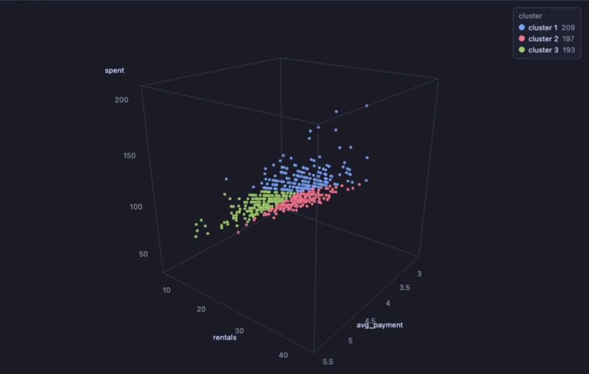
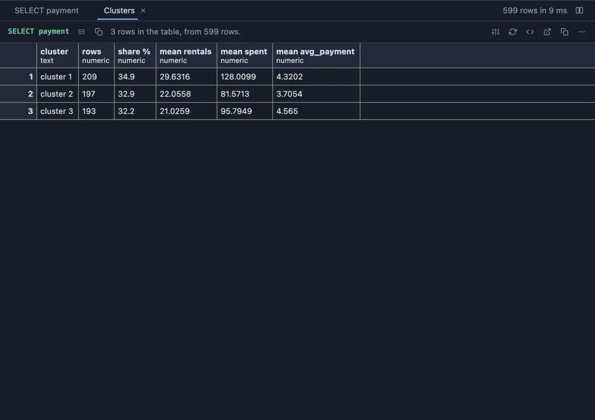

# Clusters



Groups the rows that are alike into clusters, by k-means over the numbers you pick: customers who buy alike, servers that behave alike, films that cost and run alike. Shows the result with a `cluster` column added, or one row per cluster with its size and the mean of every feature, in the grid.

## What it shows

A **Clusters** tab beside the grid, a table in the app's own grid.

- **Features** are the numbers rows are compared on. With **Scale** at `standardize`, each one weighs the same whatever its units (an amount in thousands does not drown a count of visits); `as they are` keeps the units.
- **Clusters** is how many groups to find. They are named from the largest, so `cluster 1` is the main group.
- **Show** `rows` for the result with its `cluster` column (rows missing a feature get none), or `summary` for one row per cluster: how many rows, their share, and the mean of every feature in its own units, which is how a cluster is read ("cluster 3: few visits, large baskets").
- k-means starts from points chosen at random (k-means++), so **Seed** makes it repeatable; another seed tries other starting points, which can settle on other clusters when the groups are not clear cut. The Log says how many rounds it took.

## Inputs

| Input | `@inputs` key | Default | Meaning |
|---|---|---|---|
| Features | `series` | asked | The numbers rows are compared on |
| Clusters | `k` | 4 | How many groups, 2 to 20 |
| Scale | `scale` | standardize | `standardize` or `as they are` |
| Show | `output` | rows | `rows` or `summary` |
| Seed | `seed` | 1 | The same seed finds the same clusters |
| Top rows | `top` | 200000 | How many rows the view reads |

## Examples

**Customers by how they rent**, in the [dvdrental](https://neon.com/postgresql/postgresql-getting-started/postgresql-sample-database) sample database: three groups by rentals, money spent and the average payment, summed up per cluster.

```sql
-- @extension clusters open
-- @inputs series=rentals, spent, avg_payment, k=3, output=summary
select c.first_name || ' ' || c.last_name as customer,
       count(*) as rentals,
       sum(p.amount) as spent,
       round(avg(p.amount), 2) as avg_payment
from payment p join customer c using (customer_id)
group by c.customer_id;
```



**Seen in 3D**, through a pipeline: the clusters step hands its rows with their `cluster` column to Scatter 3D, a colour per cluster.

```sql
-- @extension clusters | scatter-3d open
-- @inputs clusters: series=rentals, spent, avg_payment, k=3
-- @inputs scatter-3d: x=rentals, y=spent, z=avg_payment, color=cluster, label=customer
select c.first_name || ' ' || c.last_name as customer,
       count(*) as rentals,
       sum(p.amount) as spent,
       round(avg(p.amount), 2) as avg_payment
from payment p join customer c using (customer_id)
group by c.customer_id;
```

**Three blobs**, made up on the spot (any connection): points around three centres, which k-means finds again.

```sql
-- @extension clusters open
-- @inputs series=x, y, k=3
select round(((array[2, 8, 5])[1 + g % 3] + (random() - 0.5) * 3)::numeric, 3) as x,
       round(((array[2, 3, 8])[1 + g % 3] + (random() - 0.5) * 3)::numeric, 3) as y
from generate_series(1, 600) g;
```

## Requirements

PostgreSQL 13 or newer. Nothing on the server: k-means runs in the result's sandbox, over the whole result.

## Notes

k-means finds round groups of similar size best; long, curved or very uneven groups are split or merged in ways a picture would not suggest, so look at the summary before naming the clusters. Up to 200,000 rows by default; the work grows with rows times clusters times features.
