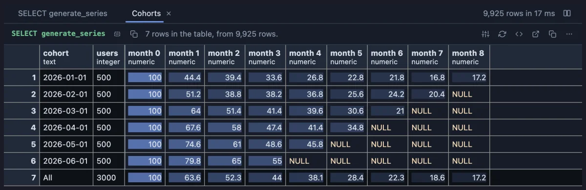
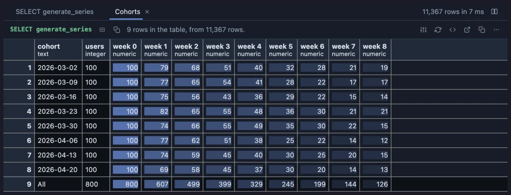

# Cohorts

See whether people come back: everyone who started in the same month is one row, and each column after it says how many of them were still around one, two, three months later.



An app's users, grouped by the month they signed up. Read across a row: of the people who joined in January, less than half came back the month after, and fewer each month. Read down a column: every later group keeps more of its people than the one before, so whatever changed in spring is working.

## What it is for

- **Do customers return?** A shop sees whether this year's first-time buyers buy again in the following months, and whether the summer sale brought loyal customers or one-off visitors.
- **Did a change help?** An app compares the groups who signed up before and after a new onboarding, a price change or a redesign.
- **When do people drop off?** A team running a course or a subscription sees the month where most of a group stops, which is where to put a reminder or an offer.

## How to read it

Each row is a **cohort**: the people whose first activity fell in that period, labelled with its first day, and how many they are (**users**). The column `month 0` is that first period, always 100%. `month 1` is the next period: the share of the cohort that did anything at all in it, and so on to the right. Darker cells are higher shares.

A cell after the last date in the data shows NULL, not 0: that month has not happened yet for that cohort. The **All** row at the bottom averages the cohorts, each weighed by its size, and only over the cohorts old enough to have that month.

## Try it

**An app's monthly users** (any connection, made up on the spot), the table above: three thousand people signing up from January to June, the later ones more likely to stay.

```sql
-- @extension cohorts open
-- @inputs user=user_id, time=active_at, period=month, value=percent, periods=8
select u.id as user_id,
       u.signed_up + make_interval(months => m.n) + random() * interval '20 days' as active_at
from (select g as id, g % 6 as cohort, date '2026-01-01' + make_interval(months => g % 6) as signed_up
      from generate_series(1, 3000) g) u
     cross join generate_series(0, 8) as m(n)
where u.signed_up + make_interval(months => m.n) < date '2026-10-01'
  and (m.n = 0 or random() < (0.45 + u.cohort * 0.07) * power(0.85, m.n - 1));
```

**Counts, week by week** (any connection, made up on the spot): eight weekly groups of a hundred people each, every person using the app every other day until they stop. How many of each group are still there one, two, three weeks on, as people rather than percent.

```sql
-- @extension cohorts open
-- @inputs user=user_id, time=active_at, period=week, value=count, periods=8
select u.id as user_id,
       u.signed_up + make_interval(days => d.n) as active_at
from (select g as id,
             date '2026-03-02' + (g % 8) * 7 as signed_up,
             -ln(1 - random()) * 30 as stays
      from generate_series(1, 800) g) u
     cross join generate_series(0, 70, 2) as d(n)
where d.n <= u.stays;
```



## Settings

| Setting | `@inputs` key | Default | What it does |
|---|---|---|---|
| User | `user` | asked | The column that tells one person (a customer, an account) from another |
| Event time | `time` | asked | When each thing happened (an order, a login); a person's first one decides their group |
| Period | `period` | month | `day`, `week` or `month`: how long a group is, and each step after it |
| Show | `value` | percent | `percent`: the share of the group still active; `count`: how many of them |
| Periods | `periods` | 12 | How many periods after the first get a column |

## Good to know

The result should be one row per event (a login, an order) with the person and the time, for example `select customer_id, ordered_at from orders`; the rows can come in any order. A person counts as active in a period if they have at least one event in it. Times are cut into periods in UTC and weeks start on Monday, as `date_trunc` does; a month steps by the calendar. Rows with no person or no readable time are left out, and the Log says how many. This kind of table is called a retention or cohort analysis. From a script: `-- @extension cohorts` above the query, with `-- @inputs user=customer_id, time=ordered_at, period=week`.

## Requirements

PostgreSQL 13 or newer. Nothing runs on the server: the table is computed in the result's sandbox from the rows already fetched. Stats core installs with it.
