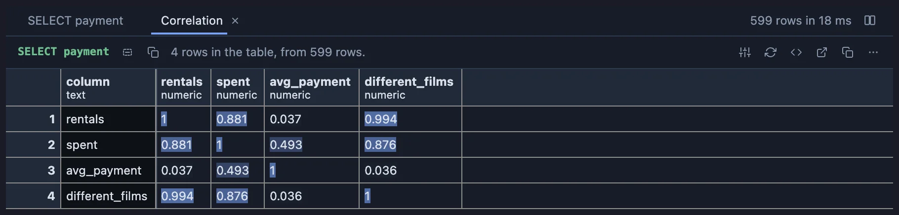
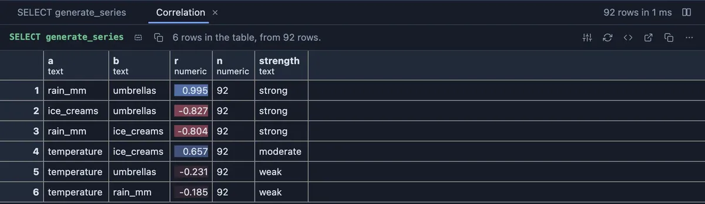

# Correlation

Find out which of your numbers go up and down together, and how strongly: every pair of number columns gets a score from -1 to 1, in a coloured table.



Four numbers about each dvdrental customer. Customers who rent more spend more (0.88, a strong link, as you would expect) and see more different films (0.99, almost the same thing). But how often someone rents says nothing about how much they pay per rental (0.04): frequent renters are not picking cheaper or dearer films.

## What it is for

- **Which things move together?** Does a longer page bring more sign-ups, does a bigger discount bring bigger baskets, do slower queries come with bigger tables?
- **Before you draw a chart**: with twenty numeric columns, it finds the few pairs worth a scatter plot.
- **Finding duplicates in disguise**: two columns that score close to 1 carry the same information (rentals and different films above), and one of them can usually go.

## How to read it

Every cell is the score of the row's column against the column's column:

- **1** means they rise together in step; **-1** means one falls as the other rises; **0** means no link at all.
- Roughly: under 0.3 (either sign) is weak, 0.3 to 0.7 moderate, above 0.7 strong. Positive scores are shaded blue and negative ones red, deeper the stronger, so the strong links stand out at a glance.
- The diagonal is always 1 (a column against itself). Hover a cell for the score and how many rows it was computed from.

A strong score says two numbers move together, not that one causes the other: ice cream sales and sunburns rise together because of the sun.

## Try it

**What goes with what among customers**, in the [dvdrental](https://neon.com/postgresql/postgresql-getting-started/postgresql-sample-database) sample database, the table above:

```sql
-- @extension correlation open
-- @inputs columns=rentals, spent, avg_payment, different_films
select c.customer_id,
       count(*) as rentals,
       sum(p.amount) as spent,
       round(avg(p.amount), 2) as avg_payment,
       count(distinct i.film_id) as different_films
from payment p
     join customer c using (customer_id)
     join rental r using (rental_id)
     join inventory i using (inventory_id)
group by c.customer_id;
```

**Columns** leaves `customer_id` out: an id is a number too, but it scores close to nothing against everything, which is right, since an id says nothing about a customer.

**A summer of a beach bar** (any connection, made up on the spot): the hotter the day, the more ice cream and the fewer umbrellas sold; rain does the opposite.

```sql
-- @extension correlation open
-- @inputs columns=temperature, rain_mm, ice_creams, umbrellas, output=pairs
select day, temperature, rain_mm,
       greatest(0, round(temperature * 9 - rain_mm * 4 + random() * 40)) as ice_creams,
       greatest(0, round(rain_mm * 3 - temperature * 0.5 + 15 + random() * 6)) as umbrellas
from (select d::date as day,
             round((22 + 8 * random())::numeric, 1) as temperature,
             round((case when random() < 0.3 then random() * 20 else 0 end)::numeric, 1) as rain_mm
      from generate_series(date '2026-06-01', date '2026-08-31', interval '1 day') d) w;
```

With **Output** at `pairs`, the same scores come as a list, the strongest first, each with a word for its strength:



## Settings

| Setting | `@inputs` key | Default | What it does |
|---|---|---|---|
| Columns | `columns` | every number column | Which number columns to compare, as a comma list (up to 30) |
| Method | `method` | pearson | `pearson` looks for a straight-line link (double one, double the other); `spearman` for any steady rise or fall, and is less thrown by a few extreme rows |
| Output | `output` | matrix | `matrix`: every column against every other; `pairs`: one row per pair, strongest first |

## Good to know

Each pair uses the rows where both values are present, so two pairs can rest on different row counts. A pair with fewer than three such rows, or with a column that never changes, stays empty. The score only sees what its method looks for: a U shape (low, high, low) scores close to 0 under both. For statisticians: `pearson` is Pearson's r, `spearman` is Spearman's rank correlation ρ.

From a script: `-- @extension correlation` above the query, with `-- @inputs method=spearman, output=pairs`. The pairs can feed a chart: `-- @extension correlation | echarts` with `-- @inputs output=pairs` and `-- @inputs echarts: kind=bar, x=b, series=r`.

**Statistics refactors** (`statistics-refactors`) writes the same analysis as a query above yours from the editor's lightbulb, computed by PostgreSQL over every row the query returns: a query you keep and share rather than a view of the grid.

## Requirements

PostgreSQL 13 or newer. Nothing runs on the server: the scores are computed in the result's sandbox from the rows already fetched. Stats core installs with it.
