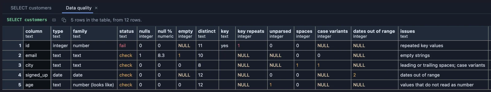
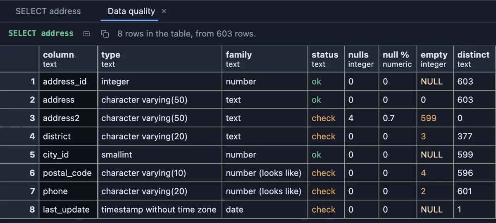

# Data quality

Check a table before you trust it: one row per column, saying what is wrong with it, if anything. Empty values, repeated ids, numbers stored as text that are not numbers, the same word spelled two ways, dates like 0001-01-01.



A small customer list, checked column by column. Four of five columns have something to look at: an id used twice, an email that is empty in one row and missing in another, a city written as both `Zagreb` and `zagreb` (and once with a space after it), sign-up dates of `0001-01-01` and `9999-12-31`, and an age of `n/a` among numbers.

## What it is for

- **Before a report**: a monthly sales report is only as good as its table. One look says whether customers repeat, whether dates are sensible, whether a "number" column holds words.
- **After an import**: a spreadsheet or another system's export loaded into a table brings blank cells, stray spaces and placeholder dates with it; this finds them in one pass.
- **Before a migration or a new constraint**: a `UNIQUE` or `NOT NULL` you are about to add fails on the rows this lists first.

## How to read it

One row per column of the result. **status** is the verdict: `ok` (green), `check` (amber, worth a look) or `fail` (red, almost certainly wrong). **issues** says in words what was found, and hovering a number shows up to three examples. The other columns are the counts behind the verdict:

- **family**: what the column holds (number, date, text...). A text column that is almost all numbers or dates reads as that, marked `(looks like)`.
- **nulls**, **null %**, **empty**: missing values, and empty strings in text.
- **distinct**: how many different values. **key** says `yes` when the column looks like an id, and **key repeats** counts the rows that reuse an id: a fail.
- **unparsed**: values that do not read as the column's family (`n/a` in a column of numbers).
- **spaces**: values with spaces before or after. **case variants**: values written in more than one case.
- **dates out of range**: dates before **Earliest date** or after **Latest date**.

A column that is always NULL, or holds one value only, is flagged too.

## Try it

**A messy customer list** (any connection, made up on the spot), the table above:

```sql
-- @extension data-quality open
-- @inputs from=2000-01-01, to=2030-12-31
select * from (values
  (1, 'ana@example.com', 'Zagreb', date '2024-03-01', '34'),
  (2, 'ivan@example.com', 'zagreb', date '2024-03-02', '41'),
  (3, '', 'Split', date '2024-03-05', 'n/a'),
  (3, 'marta@example.com', 'Split', date '0001-01-01', '29'),
  (5, null, 'Rijeka', date '9999-12-31', '52'),
  (6, 'luka@example.com', 'Zagreb ', date '2024-04-11', '38'),
  (7, 'petra@example.com', 'Osijek', date '2024-04-12', '45'),
  (8, 'josip@example.com', 'Zagreb', date '2024-04-15', '27'),
  (9, 'sara@example.com', 'Pula', date '2024-04-19', '33'),
  (10, 'tomislav@example.com', 'Zadar', date '2024-05-02', '48'),
  (11, 'iva@example.com', 'Split', date '2024-05-06', '36'),
  (12, 'marko@example.com', 'Zagreb', date '2024-05-09', '31')
) as customers(id, email, city, signed_up, age);
```

**A real table's addresses**, in the [dvdrental](https://neon.com/postgresql/postgresql-getting-started/postgresql-sample-database) sample database: almost every second address line is an empty string rather than NULL, and a few postal codes and phone numbers are empty.

```sql
-- @extension data-quality open
-- @inputs from=2000-01-01, to=2030-12-31
select * from address;
```



## Settings

| Setting | `@inputs` key | Default | What it does |
|---|---|---|---|
| Earliest date | `from` | 1900-01-01 | A date before this counts as out of range (a placeholder like 0001-01-01, a year typed wrong) |
| Latest date | `to` | 2100-12-31 | A date after this counts as out of range (9999-12-31, infinity); the day itself is included |

## Good to know

Check the whole table (`select * from the_table`): with a LIMIT it checks only the rows returned. A column counts as a key when it is named `id`, `uuid`, `guid` or `key`, or is the first column named `..._id`, or is nearly unique (99% or more over 20 rows or more); that is a guess, and an `id` in a join result may repeat by design. `unparsed` is a fail when the type declares the family, a check when it is only what the values look like. Distinct values are counted up to 200,000 per column (then `≥`), and past that key repeats and case variants are left blank. Profile answers the next question, how the values are spread. From a script: `-- @extension data-quality` above the query, with `-- @inputs from=2000-01-01, to=2030-12-31`.

## Requirements

PostgreSQL 13 or newer. Nothing runs on the server: the checks are computed in the result's sandbox from the rows already fetched. Stats core installs with it.
