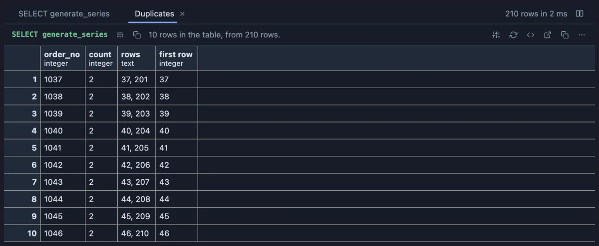
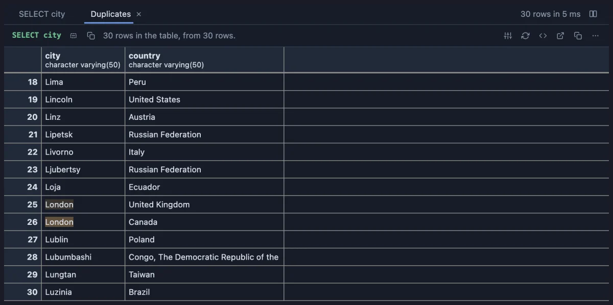

# Duplicates

Find the rows that appear more than once: orders imported twice, customers entered twice, a key that should be unique but is not. Each repeated value with how often and in which rows, or the whole result with the repeats coloured.



Two hundred orders, of which ten were imported a second time. Each of the ten order numbers is listed once, with the two rows that carry it, so the second copies can be found and removed.

## What it is for

- **After an import**: did a file get loaded twice, or half of it? Order numbers, invoice numbers or transaction ids that repeat say so at once.
- **Before a unique index or a merge**: `CREATE UNIQUE INDEX` fails on the first repeat; this lists all of them first, and a join that should match one row will not fan out unexpectedly.
- **Is this column really an identifier?** A name, an email or a city looks unique until two Londons turn up.

## How to read it

With **Output** at `groups`, one row per value that repeats, the most repeated first: the key's values, how many rows carry it (**count**), their row numbers in the result (**rows**, counted from 1) and the number of the first one (**first row**). With `marked`, the whole result in its own order, the key cells of repeated rows coloured: the first row of a key lighter, its repeats amber; hovering says which copy a row is, for example `Repeat 2 of 3 rows with this key: rows 1, 3, 5`.

The Log adds up the damage: how many keys repeat, how many rows carry them, and how many rows a clean-up that keeps the first copy would remove.

## Try it

**Orders imported twice** (any connection, made up on the spot), the table above: two hundred orders, ten of them loaded again.

```sql
-- @extension duplicates open
-- @inputs columns=order_no, output=groups
select order_no, customer, amount
from (select 1000 + g as order_no,
             (array['Ana', 'Ivan', 'Marta', 'Luka'])[1 + g % 4] as customer,
             round((20 + (g * 37) % 180)::numeric, 2) as amount
      from generate_series(1, 200) g
      union all
      select 1000 + g, (array['Ana', 'Ivan', 'Marta', 'Luka'])[1 + g % 4], round((20 + (g * 37) % 180)::numeric, 2)
      from generate_series(37, 46) g) orders;
```

**Is a city's name enough to tell cities apart?** In the [dvdrental](https://neon.com/postgresql/postgresql-getting-started/postgresql-sample-database) sample database, almost: there are two Londons, one in the United Kingdom and one in Canada. Marked, both rows light up in the result (the cities starting with L, to keep the picture short; all six hundred have the same one repeat):

```sql
-- @extension duplicates open
-- @inputs columns=city, output=marked
select ci.city, co.country
from city ci join country co using (country_id)
where ci.city like 'L%'
order by ci.city;
```



With `columns=city, country` the two are different keys, and nothing repeats.

## Settings

| Setting | `@inputs` key | Default | What it does |
|---|---|---|---|
| Key columns | `columns` | every column | The columns whose values together should be unique, as a comma list; blank compares whole rows |
| Output | `output` | groups | `groups`: one row per repeated key, the most repeated first; `marked`: the whole result with the repeats coloured |

## Good to know

Values compare exactly as the server sent them, case and spaces included, so `Zagreb` and `zagreb ` are two keys (Data quality finds those). Two NULLs count as the same key, as `GROUP BY` and `DISTINCT` treat them, though a unique index would let both in. The grid lists the first 100,000 rows or keys; the counts read every row. The marked copy is a tab of its own, not a colouring of the result itself: a colouring rule sees one row at a time, and a repeat needs the whole result. The same question in SQL: `select key, count(*) from t group by key having count(*) > 1`. From a script: `-- @extension duplicates` above the query, with `-- @inputs columns=email` or `-- @inputs columns=customer_id, order_date, output=marked`.

## Requirements

PostgreSQL 13 or newer. Nothing runs on the server: the repeats are found in the result's sandbox from the rows already fetched. Stats core installs with it.
