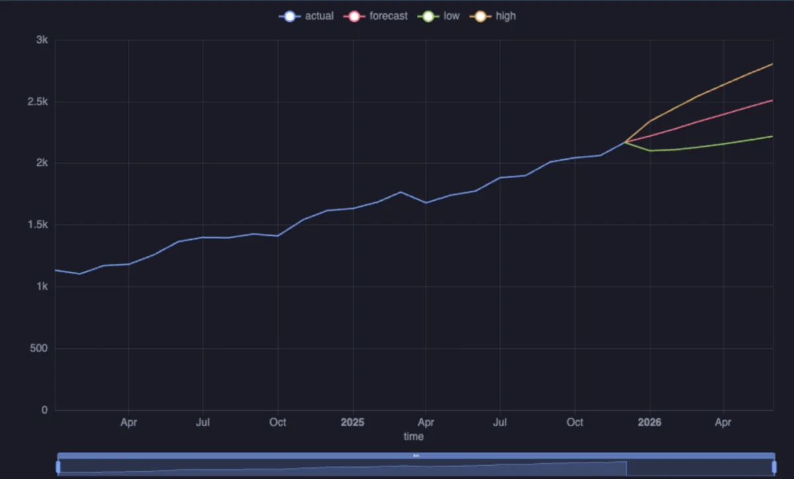
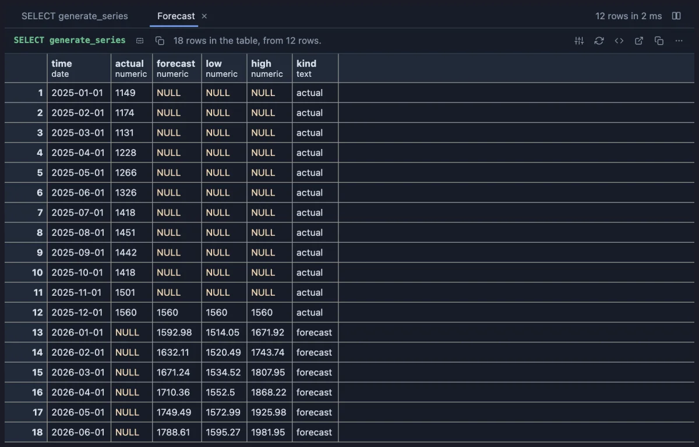
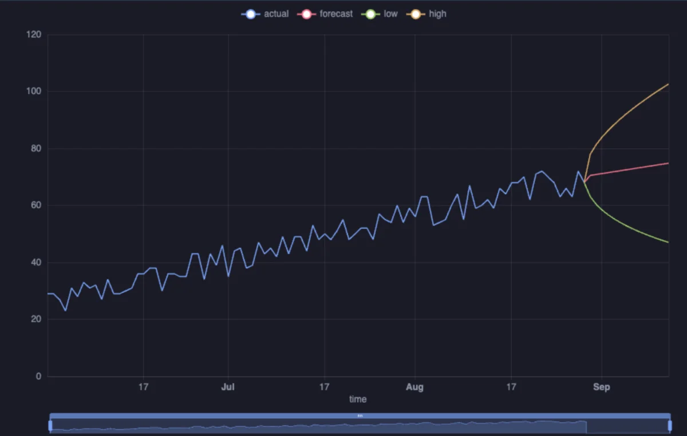

# Forecast

Where is this number heading? It continues a series over time a few steps into the future, with a band around the forecast that widens the further it looks, to say how sure it can be.



Two years of monthly sales, drawn with ECharts. The actual line rises; the forecast carries it on for six months, and the low and high lines around it fan out, because the further ahead, the less certain. If sales next spring land between the two lines, they did what the past suggested.

## What it is for

- **Planning**: a shop estimates next quarter's sales or stock, a team next month's support tickets, from how the last two years went.
- **Capacity**: a database's size or its daily traffic, continued a few months ahead, says roughly when the disk fills up.
- **A sanity check**: if this month's number lands far outside the band, something changed (a campaign, an outage, a mistake in the data) and is worth a look.

## How to read it

In the grid: the series in time order, one row per point with its **actual** value, then the future rows with the **forecast** and the band from **low** to **high**, which holds the true value about 95 times in 100 if the series keeps behaving as it did. The **kind** column says which rows are actual and which are forecast. The last actual row carries the forecast and the band too, set to its own value, so on a chart the forecast line starts where the actual one ends.

A forecast only continues what already happened. It does not know about next week's sale or a holiday; and a seasonal pattern (more sales every December) is continued as a trend, not repeated.

## Try it

**Monthly sales, charted** (any connection, made up on the spot), the picture above: the forecast step hands its table to ECharts, which draws the four lines.

```sql
-- @extension forecast | echarts open
-- @inputs forecast: time=month, value=sales, horizon=6, method=holt, unit=auto
-- @inputs echarts: kind=line, x=time, series=actual, forecast, low, high
select (date '2024-01-01' + make_interval(months => g))::date as month,
       round((1000 + g * 45 + random() * 150)::numeric) as sales
from generate_series(0, 23) g;
```

**As a table**, with a straight line: a year of monthly sales, then the six forecast months with their low and high bounds, the numbers a chart would draw.

```sql
-- @extension forecast open
-- @inputs time=month, value=sales, horizon=6, method=linear, unit=month
select (date '2025-01-01' + make_interval(months => g))::date as month,
       round((1000 + g * 45 + random() * 150)::numeric) as sales
from generate_series(0, 11) g;
```



**Sign-ups as events, counted and continued** (any connection, made up on the spot): one row per sign-up, more of them each day. Resample counts them per day, Forecast continues the daily count two weeks ahead, and ECharts draws it.

```sql
-- @extension resample | forecast | echarts open
-- @inputs resample: time=signed_up_at, unit=day
-- @inputs forecast: value=rows, horizon=14
-- @inputs echarts: kind=line, x=time, series=actual, forecast, low, high
select timestamp '2026-06-01' + make_interval(days => d) + random() * interval '1 day' as signed_up_at
from generate_series(0, 89) d,
     generate_series(1, 20 + d / 2 + (random() * 12)::int);
```



## Settings

| Setting | `@inputs` key | Default | What it does |
|---|---|---|---|
| Time | `time` | the first date column | When each value was; blank takes the first date or timestamp column, or the row order |
| Value | `value` | the first number column | The number to continue |
| Steps ahead | `horizon` | 12 | How many steps into the future (up to 1000) |
| Method | `method` | holt | `holt` follows a trend that can bend; `linear` draws one straight line through the past and continues it |
| Step | `unit` | auto | How far apart the future points are (minute to year); `auto` reads it from the gaps in the past |

## Good to know

It expects one row per moment at a regular step (a day, a month); when the rows are events (each sale, each login), count them per period first: `-- @extension resample | forecast`. At least three points are needed. `holt` is Holt's linear trend method (double exponential smoothing), its weights fitted to the series; `linear` is a least squares line. The band assumes the misses of the past are steady and independent, so read it as a rough range, not a promise. The Log gives how far the method missed the past on average (and r² for linear): a large miss means a wide band. Times come out in UTC.

## Requirements

PostgreSQL 13 or newer. Nothing runs on the server: the forecast is computed in the result's sandbox from the rows already fetched. Stats core installs with it; the chart above uses the ECharts extension.
