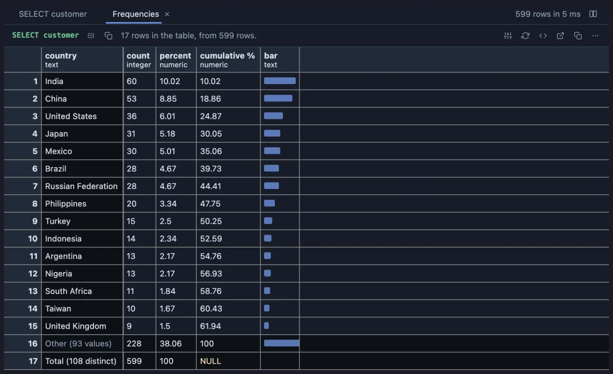
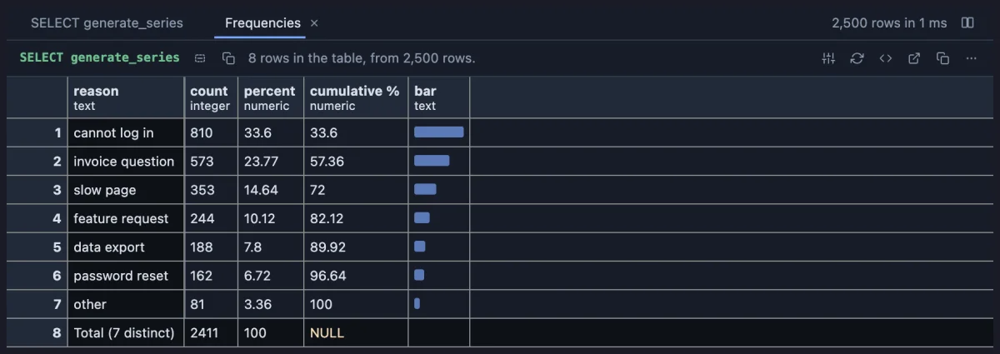

# Frequencies

What does this column mostly hold? Every value counted, the most common first, with its share and a running total, so you see at once whether a few values make up most of the rows.



Where the [dvdrental](https://neon.com/postgresql/postgresql-getting-started/postgresql-sample-database) customers live. India and China alone hold a fifth of them, the top five countries a third; the remaining hundred-odd countries share the rest, a few customers each, counted together in the **Other** line.

## What it is for

- **Where is the bulk?** Which products sell most, which countries the customers come from, which status most orders are stuck in.
- **Is it concentrated?** The running total answers "do 20% of the values cover 80% of the rows": a few big customers, or many small ones.
- **What is in this column at all?** A status column that should hold four values but holds seven (`Paid`, `paid`, `PAID ` and a NULL) shows them all, counted.

## How to read it

One row per value, the most frequent first, with its **count**, its **percent** of all counted rows, the **cumulative %** from the top (the share of the first few values together) and a **bar** as long as its share. After the top values, an **Other** line counts everything else and says how many different values it holds; a **Total** line at the bottom gives every row counted and the number of different values. Both stay in view while the list scrolls.

## Try it

**Customers by country**, in the dvdrental sample database, the table above:

```sql
-- @extension frequencies open
-- @inputs column=country, n=15, nulls=count
select co.country
from customer c
     join address a using (address_id)
     join city ci using (city_id)
     join country co using (country_id);
```

**Why people contact support** (any connection, made up on the spot): one complaint in three is about logging in, and the top three reasons cover most of the tickets.

```sql
-- @extension frequencies open
-- @inputs column=reason, n=10, nulls=skip
select case when r < 0.33 then 'cannot log in'
            when r < 0.55 then 'invoice question'
            when r < 0.70 then 'slow page'
            when r < 0.80 then 'feature request'
            when r < 0.88 then 'data export'
            when r < 0.94 then 'password reset'
            when r < 0.97 then null
            else 'other' end as reason
from (select random() as r from generate_series(1, 2500)) t;
```



## Settings

| Setting | `@inputs` key | Default | What it does |
|---|---|---|---|
| Column | `column` | asked | The column whose values are counted |
| Top values | `n` | 20 | How many of the most common values get a line of their own; the rest are counted together under Other |
| Nulls | `nulls` | count | `count`: an empty (NULL) value is counted like any other; `skip`: left out of the counts and the percentages |

## Good to know

Values are counted exactly as the server sent them: case and spaces make two values of one word. Ties are ordered by value (numbers as numbers). The value column is text, so the Other and Total lines fit in it and a chart after a pipe takes it for its categories: `-- @extension frequencies | bar-chart`. For a number column spread over many values (prices, durations), Histogram counts ranges instead. From a script: `-- @extension frequencies` above the query, with `-- @inputs column=status, n=10`.

## Requirements

PostgreSQL 13 or newer. Nothing runs on the server: the counts are computed in the result's sandbox from the rows already fetched. Stats core installs with it.
