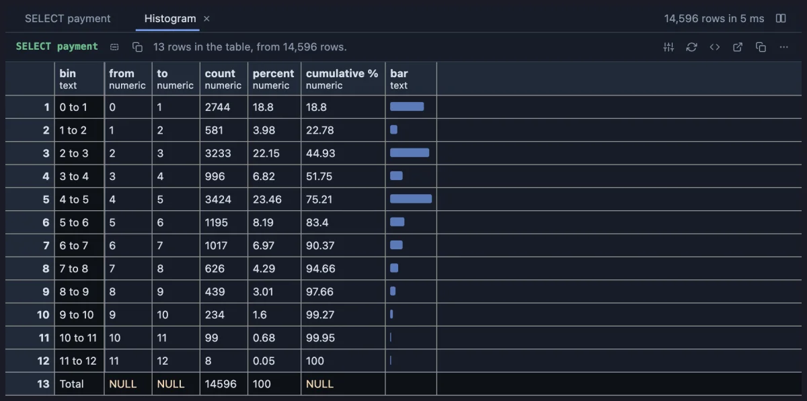
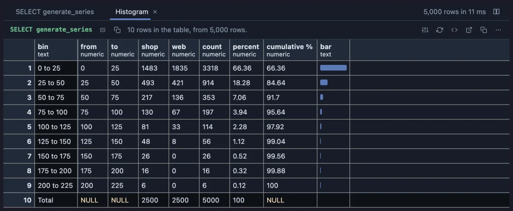
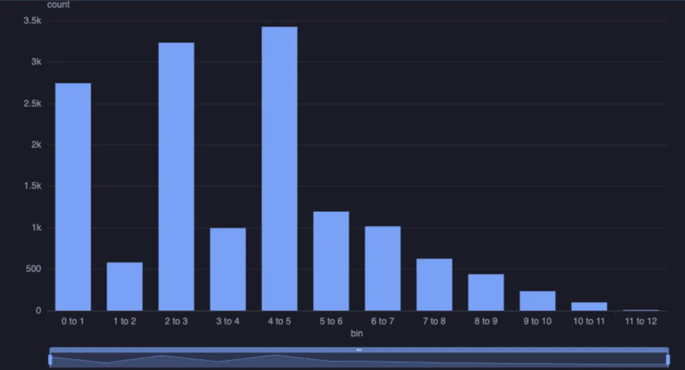

# Histogram

How are the numbers spread? It cuts a number column into equal ranges (0 to 1, 1 to 2, ...) and counts the rows in each, so you see where most values sit, how far the tail goes, and whether there are two clusters.



Every payment in the [dvdrental](https://neon.com/postgresql/postgresql-getting-started/postgresql-sample-database) sample database, counted in one-dollar ranges. The bars show the shop's price list: most payments are 0.99, 2.99 or 4.99, and the few above 8 dollars are most likely rentals that came back late and paid extra.

## What it is for

- **What is typical?** Order values, delivery days, salaries, response times: is most of it in one range, or spread out?
- **How long is the tail?** A shop's orders are mostly small with a few very large ones; a server's requests mostly fast with some very slow. The histogram shows how many and how far.
- **Two groups mixed together**: two humps mean two kinds of thing in one column (retail and wholesale orders, cached and uncached queries).

## How to read it

One row per range (**bin**), labelled like `2 to 3`, with its edges as numbers (**from**, **to**), how many values fall in it (**count**), their **percent** of all values, the **cumulative %** from the first range up to this one, and a **bar** as long as the count. A range holds values from its lower edge up to, but not including, its upper edge. With **Split by**, each of the twelve most common values of another column gets a count of its own, so two groups can be compared range by range. The Total row stays at the bottom.

## Try it

**Payment amounts**, in the dvdrental sample database, the table above:

```sql
-- @extension histogram open
-- @inputs column=amount, width=1
select amount from payment;
```

**Order values by channel** (any connection, made up on the spot): most orders are small, some are large, and the shop's orders run larger than the web's.

```sql
-- @extension histogram open
-- @inputs column=order_value, width=25, group=channel
select (array['web', 'shop'])[1 + g % 2] as channel,
       round((exp(random() * 2.5 + random() * 2.5) * (1 + g % 2 * 0.6))::numeric, 2) as order_value
from generate_series(1, 5000) g;
```



**As a chart**, through a pipeline: the ranges handed to ECharts as bars.

```sql
-- @extension histogram | echarts open
-- @inputs histogram: column=amount, width=1
-- @inputs echarts: kind=bar, x=bin, series=count
select amount from payment;
```



## Settings

| Setting | `@inputs` key | Default | What it does |
|---|---|---|---|
| Column | `column` | the first number column | The number column to count |
| Bins | `bins` | automatic | Roughly how many ranges; the width is rounded to a tidy number (1, 2, 5, 10...) so the edges read well |
| Bin width | `width` | none | An exact width for each range; when set it wins over Bins |
| Split by | `group` | none | Another column whose values each get a count of their own (the twelve most common, the rest as `other`) |

## Good to know

Empty values and text that does not read as a number are skipped, and the Log says how many. With no Bins or width, the number of ranges follows Sturges' rule from how many values there are. At most 1000 ranges: a width too small for the spread asks for a wider one. The `bin` column comes first, so a chart after a pipe takes it for its categories: `-- @extension histogram | bar-chart`, or ECharts as above. For a column of a few distinct values (statuses, countries), Frequencies counts each value instead.

**Statistics refactors** (`statistics-refactors`) writes the same histogram as a query above yours from the editor's lightbulb, counted by PostgreSQL over every row: a query you keep and share rather than a view of the grid.

## Requirements

PostgreSQL 13 or newer. Nothing runs on the server: the counts are computed in the result's sandbox from the rows already fetched. Stats core installs with it.
