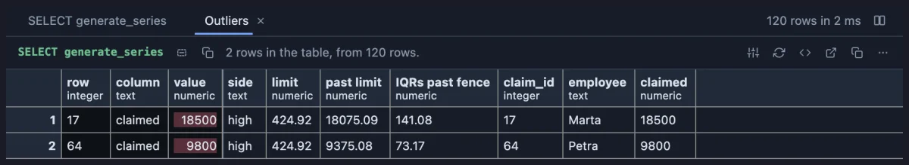
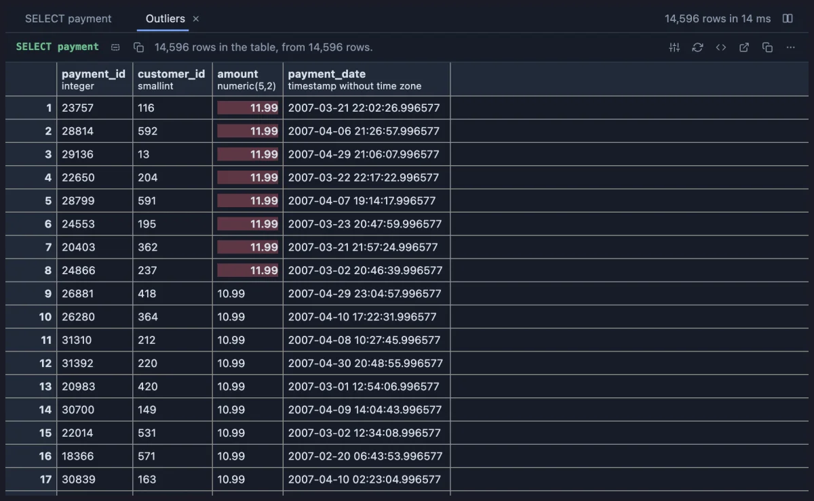

# Outliers

Find the values that are far from the rest: the expense claim with three extra zeros, the order that skews the average, the reading from a broken sensor. Each one listed with why it stands out, or the whole result with them coloured.



A month of expense claims. Most are between 50 and 300; two are 9,800 and 18,500, most likely a typo or a claim that needs a receipt. They come first, the furthest out at the top, with the limit they crossed and how far past it they are.

## What it is for

- **Typos and broken data**: a price of 1,999 instead of 19.99, an age of 340, a sensor reading of -9999 that means "no reading".
- **Before an average**: one huge order makes the mean misleading; this shows which rows to look at (or leave out) first.
- **The unusual case worth a look**: the customer who spends ten times the rest, the query that takes a minute when the others take a second, the day with five times the usual traffic.

## How to read it

With **Output** at `list`, one row per unusual value, the furthest out first: its **row** number in the result (from 1), the **column**, the **value**, its **side** (`high` or `low`), the **limit** it crossed, how far **past limit** it is, and a score of how far out it is in the method's own measure (**IQRs past fence**, or **z** under z-score; bigger means further out), then the rest of the row so you can tell which record it is. With `marked`, the whole result in its own order, the unusual cells coloured: red for high, amber for low; hovering one says why.

"Far from the rest" is measured on each column on its own, from the middle half of its values: a value more than **IQR multiplier** times that middle range beyond it is flagged. The default, 1.5, flags the clearly unusual; 3 only the extreme.

## Try it

**Expense claims with two typos** (any connection, made up on the spot), the table above:

```sql
-- @extension outliers open
-- @inputs columns=claimed, method=iqr, k=1.5, output=list
select g as claim_id,
       (array['Ana', 'Ivan', 'Marta', 'Luka', 'Petra'])[1 + g % 5] as employee,
       case g when 17 then 18500 when 64 then 9800 else round((50 + random() * 250)::numeric, 2) end as claimed
from generate_series(1, 120) g;
```

**The most unusual payments**, in the [dvdrental](https://neon.com/postgresql/postgresql-getting-started/postgresql-sample-database) sample database: with the multiplier at 3, only the eight payments of 11.99 are far enough from the usual 0.99 to 4.99. Marked, and sorted by amount, they stand out at the top of the result (the limit is computed over all fourteen thousand payments, so leave LIMIT off):

```sql
-- @extension outliers open
-- @inputs columns=amount, method=iqr, k=3, output=marked
select payment_id, customer_id, amount, payment_date
from payment
order by amount desc;
```



## Settings

| Setting | `@inputs` key | Default | What it does |
|---|---|---|---|
| Columns | `columns` | asked | The number columns to check, each on its own, as a comma list |
| Method | `method` | iqr | `iqr`: far from the middle half of the values (works for any shape of data); `z-score`: far from the average, measured in standard deviations (for bell-shaped data) |
| IQR multiplier | `k` | 1.5 | For `iqr`: how far beyond the middle half counts as unusual; 1.5 is the usual rule, 3 flags only the extreme |
| Z threshold | `z` | 3 | For `z-score`: how many standard deviations from the average count as unusual |
| Output | `output` | list | `list`: one row per unusual value, the furthest first; `marked`: the whole result with them coloured |

## Good to know

`iqr` is Tukey's fences: Q1 and Q3 are the values a quarter and three quarters of the way up, the interquartile range IQR is Q3 - Q1, and a value below Q1 - k × IQR or above Q3 + k × IQR is flagged; its score is how many IQRs past the fence it lies. It does not assume a bell curve and is not moved by the outliers themselves. `z-score` uses the mean and the sample standard deviation; its score is the value's z. One huge value inflates the standard deviation and can hide itself, which is why `iqr` is the default. Quartiles interpolate as PostgreSQL's `percentile_cont` does. Empty values are skipped; a column with fewer than three numbers, or a standard deviation of 0 under z-score, is left alone and the Log says so. With an IQR of 0 (most values the same) every other value is flagged. The marked copy is a tab of its own, since a limit needs the whole column. The grid lists the first 100,000 rows; the limits read every row.

From a script: `-- @extension outliers` above the query, with `-- @inputs columns=amount, method=z-score, z=2.5`. **Statistics refactors** (`statistics-refactors`) writes the same check as a query from the editor's lightbulb, computed by PostgreSQL over every row.

## Requirements

PostgreSQL 13 or newer. Nothing runs on the server: the limits are computed in the result's sandbox from the rows already fetched. Stats core installs with it.
