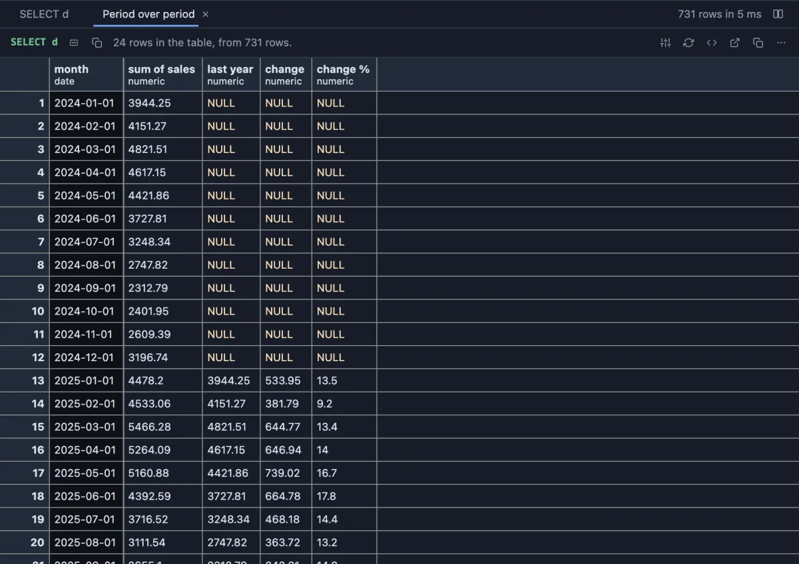
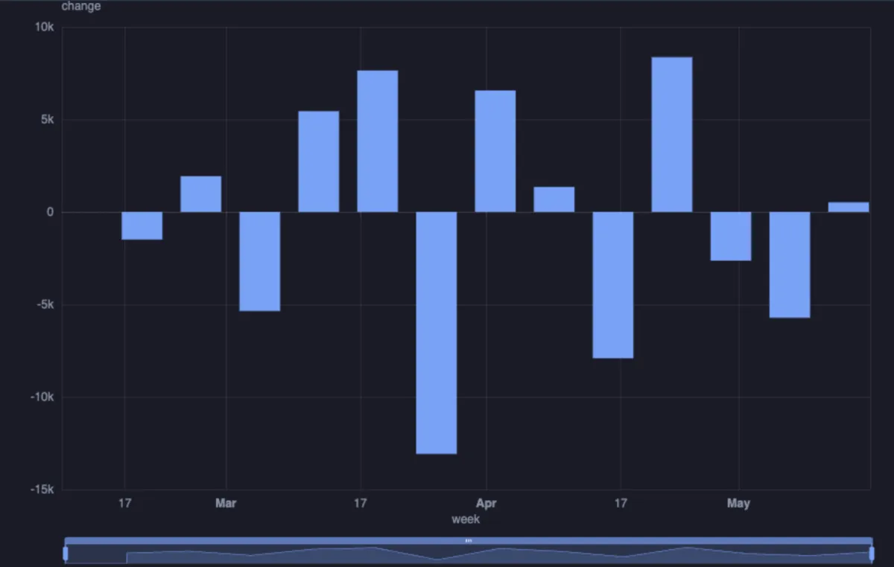

# Period over period



Each period beside the one it is compared with: the previous one (this month against last month) or the same period a year earlier (this March against last March). For every value, the period's own figure, the earlier one, the change and the change in percent, in the grid, over the whole result.

## What it shows

A **Period over period** tab beside the grid, a table in the app's own grid (sort, filter, copy and export as any result).

- **Time** is cut into periods of a day, a week (from Monday), a month, a quarter or a year. Every period from the first to the last is listed, the empty ones included, so a gap reads as a gap.
- **Values** are folded per period (sum by default; mean, median, min, max and the rest). With no value, the rows are counted.
- **Compare with** the previous period, or the same period last year (a week compares with the week 52 weeks before, so the weekdays line up).
- For each value four columns: the period's figure, the earlier one, the change, and the change in percent of the earlier figure.

An empty period counts as zero for a count or a sum and as unknown for anything else (a mean of no rows is not zero), so its change is blank rather than misleading.

## Inputs

| Input | `@inputs` key | Default | Meaning |
|---|---|---|---|
| Time | `time` | asked | The date or timestamp the periods are cut from |
| Period | `unit` | month | `day`, `week`, `month`, `quarter` or `year` |
| Values | `value` | none | Numeric columns folded per period; none counts rows |
| Fold | `agg` | sum | How the rows of one period combine |
| Compare with | `compare` | previous period | `previous period` or `same period last year` |
| Top rows | `top` | 1000000 | How many rows the view reads |

## Examples

**Revenue week over week**, in the [dvdrental](https://neon.com/postgresql/postgresql-getting-started/postgresql-sample-database) sample database: every week's payments against the week before.

```sql
-- @extension period-over-period open
-- @inputs time=payment_date, value=amount, unit=week
select payment_date, amount from payment;
```

**Sales year over year**, made up on the spot (any connection): two years of daily sales with a seasonal swing and growth, by month against the same month a year before.

```sql
-- @extension period-over-period open
-- @inputs time=day, value=sales, unit=month, compare=same period last year
select d::date as day,
       round(((100 + 40 * sin(extract(doy from d) / 58.0) + random() * 30)
              * (1 + 0.15 * (extract(year from d) - 2024)))::numeric, 2) as sales
from generate_series(date '2024-01-01', date '2025-12-31', interval '1 day') d;
```

**Charted**, through a pipeline: the monthly change as bars, the step's table handed to ECharts.

```sql
-- @extension period-over-period | echarts open
-- @inputs period-over-period: time=payment_date, value=amount, unit=week
-- @inputs echarts: kind=bar, x=week, series=change
select payment_date, amount from payment;
```



## Requirements

PostgreSQL 13 or newer. Nothing on the server: the table is computed in the result's sandbox, over the whole result, not only the rows shown.

## Notes

Times are read as written by the server, never shifted to this machine's zone. In SQL the same is `date_trunc` with `lag(...) over (order by period)`; this is for a result you already have, and for asking the question again with another period in one click.
