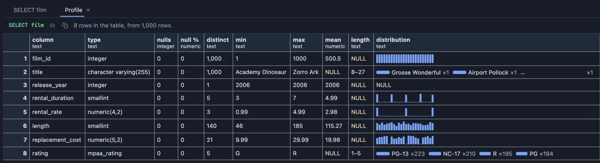
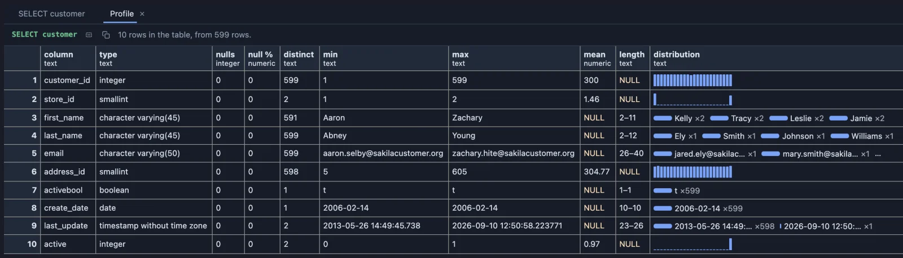

# Profile

Get to know a table in one look: for every column, how many values are missing, how many different values there are, the smallest and largest, and a little bar chart of how they spread.



The film table of the [dvdrental](https://neon.com/postgresql/postgresql-getting-started/postgresql-sample-database) sample database, one row per column. In a few seconds you learn that every film has a title and no title repeats, that there are only three rental prices and five ratings, and that lengths run from 46 to 185 minutes, spread evenly, no hump.

## What it is for

- **A table you have never seen**: a colleague's schema, a new data source, a table from an old system. Before writing any query, see what each column holds.
- **Before building a report**: are the columns you plan to group by full or half empty? Is a "price" column really between 1 and 100, or are there zeros and negatives?
- **Checking an export or a migration**: profile the old and the new table and compare the row counts, ranges and missing values side by side.

## How to read it

One row per column of the result: its **type**, how many values are missing (**nulls**, **null %**), how many different values (**distinct**), and the smallest and largest (**min**, **max**). For a number column, its **mean** (average) and a **distribution**: a small bar chart drawn in block characters, low values on the left, high on the right, each bar as tall as the share of values in that range. For a text column, the shortest and longest **length** and its most common values.

A column with as many distinct values as rows is an identifier or free text; one with two or three is a category; one with nulls everywhere may be unused.

## Try it

**The film table**, in the dvdrental sample database, the table above (its long text columns left out, so the picture fits; `select * from film` profiles them all):

```sql
-- @extension profile open
select film_id, title, release_year, rental_duration, rental_rate, length, replacement_cost, rating
from film;
```

**The customers**, in the same database: one store's customers are a little more than the other's, every email is unique, and `active` is almost all 1.

```sql
-- @extension profile open
select * from customer;
```



## Settings

None: Profile reads every column of the result.

## Good to know

Profile the whole table (`select * from the_table`): with a LIMIT it profiles only the rows returned. One pass over the whole result, up to a million rows. The grid it shows is the app's own, so it selects, copies, filters and exports like any result. Data quality answers the neighbouring question, what is wrong with each column. Attach it from a script with `-- @extension profile` above a query (add `open`, `only` or `beside` to open on the view), or from a result's own menu.

**Statistics refactors** (`statistics-refactors`) writes a description of a number column as a query from the editor's lightbulb, computed by PostgreSQL over every row: a query you keep and share rather than a view of the grid.

## Requirements

PostgreSQL 13 or newer. Nothing runs on the server: the profile is computed in the result's sandbox from the rows already fetched.
