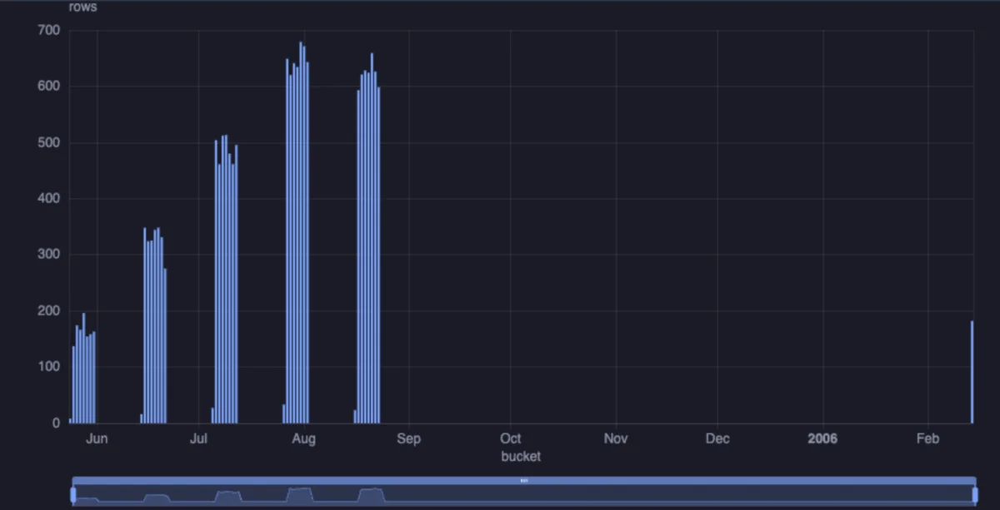
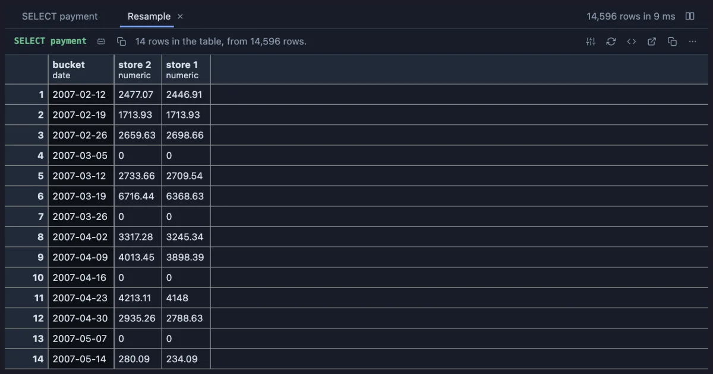

# Resample

Turn a list of events into a regular series: rentals per day, sales per week, logins per hour, with the quiet days present as zeros instead of simply missing. What a chart over time, or a forecast, needs.



Every rental in the [dvdrental](https://neon.com/postgresql/postgresql-getting-started/postgresql-sample-database) sample database, counted per day and drawn as bars. The shop was busy in bursts, with months of nothing between them. A query that groups by day would leave the quiet days out and a line chart would draw straight across them; resampled, they are zeros, and the gaps show.

## What it is for

- **A chart over time**: sales per day or per week, with the days nothing sold kept as zeros, so the chart's time axis is even.
- **Before a forecast**: a forecast needs one value per regular step; resample counts or sums the events first.
- **Comparing periods**: logins per hour, error messages per minute, orders per month, summed, averaged or counted, side by side with a column per category.

## How to read it

One row per period (**bucket**), from the first to the last, labelled with the moment it starts (a date for a day or longer, a time for a minute or an hour). Then one column per value: the rows of that period folded together, for example `sum of amount`, or `rows` for a plain count. A period with no rows shows 0, nothing, or the value before it, as **Empty buckets** says. With **Split by**, each of the twenty most common values of another column (a store, a category) gets a column of its own.

## Try it

**Rentals per day, charted**, in the dvdrental sample database, the picture above: Resample counts, ECharts draws.

```sql
-- @extension resample | echarts open
-- @inputs resample: time=rental_date, unit=day, fill=zero
-- @inputs echarts: kind=bar, x=bucket, series=rows
select rental_date from rental;
```

**Revenue per week, by store**, in the same database: a column per store, the weeks without payments as zero.

```sql
-- @extension resample open
-- @inputs time=payment_date, unit=week, value=amount, agg=sum, fill=zero, group=store
select p.payment_date, p.amount, 'store ' || s.store_id as store
from payment p join staff s using (staff_id);
```



**A thermometer read at uneven times** (any connection, made up on the spot): readings every few minutes, sometimes with an hour missing, as an hourly average that carries the last known value over a gap.

```sql
-- @extension resample open
-- @inputs time=read_at, unit=hour, value=celsius, agg=mean, fill=previous
select timestamp '2026-07-01' + make_interval(mins => g * 7) as read_at,
       round((22 + 6 * sin(g * 7 / 1440.0 * 2 * pi()) + random())::numeric, 1) as celsius
from generate_series(1, 400) g
where g % 37 not between 1 and 8;
```

## Settings

| Setting | `@inputs` key | Default | What it does |
|---|---|---|---|
| Time | `time` | the first date column | When each event happened |
| Bucket | `unit` | day | How long one period is: `minute`, `hour`, `day`, `week` (from Monday), `month`, `quarter` or `year` |
| Values | `value` | none | Number columns to fold per period, as a comma list; none counts the rows |
| Fold | `agg` | sum | How the rows of one period combine: `count`, `sum`, `mean`, `median`, `min`, `max`, `stdev`, `p90` (the value 90% stay under) or `distinct` |
| Empty buckets | `fill` | zero | What a period with no rows shows: `zero`, `blank` (nothing), or `previous` (the period before's value) |
| Split by | `group` | none | A column whose values each get a column of their own (the twenty most common), holding the first value folded |

## Good to know

Times are read as the server sent them and cut in UTC, so a `timestamptz` column is cut at UTC midnights whatever the session's time zone; for local days, convert in SQL first (`ts AT TIME ZONE 'Europe/Zagreb'`). Rows without a readable time are skipped, and the Log says how many. Up to 100,000 periods. It feeds a chart or a forecast through a pipeline: `-- @extension resample | echarts`, `-- @extension resample | forecast`. In SQL the same is `date_trunc` with `generate_series` for the empty periods; this is for a result you already have.

## Requirements

PostgreSQL 13 or newer. Nothing runs on the server: the series is computed in the result's sandbox from the rows already fetched. Stats core installs with it.
