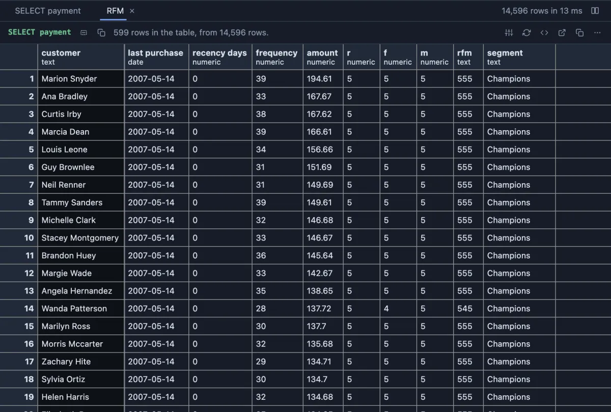
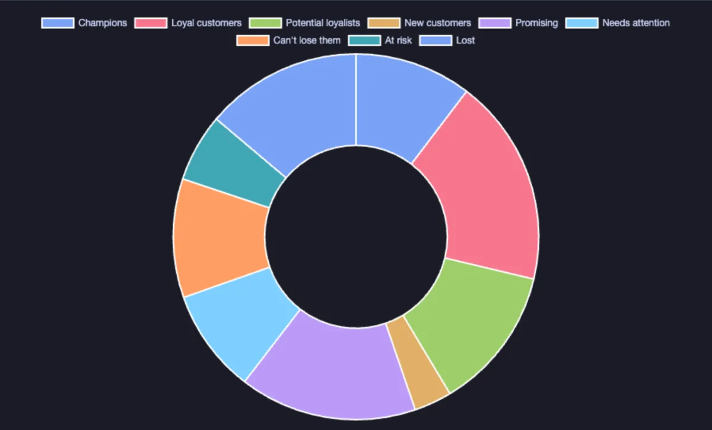

# RFM segments



Customers scored on the three questions of RFM analysis: how **R**ecently they bought, how **F**requently, and how much **M**oney they spent, each a score from 1 to 5 by quintile, and named by segment: Champions, Loyal customers, Potential loyalists, New customers, Promising, Needs attention, Can't lose them, At risk, Hibernating, Lost. From a result of purchases (a customer, a date, an amount per row), in the grid.

## What it shows

An **RFM** tab beside the grid, a table in the app's own grid.

- One row per **Customer**: the last purchase, the days since it, how many purchases, the money, the three scores, the three digits together (`545`) and the segment. Sorted by segment, best first, and by money within each.
- A score is the quintile a customer falls in among all of them: 5 for the most recent fifth, the most frequent fifth, the fifth that spent most. Ties share a score.
- The segment is read from the recency and frequency scores, the usual RFM map: recent and frequent are Champions, frequent but no longer recent are At risk, and once also infrequent, Hibernating or Lost.
- **Recency counted to** the latest purchase in the data (right for a sample or an old dataset, where every customer would look lost against today) or to today.
- **Show** `segments` for one row per segment: how many customers, their share, their mean recency and frequency, and the money they brought.

## Inputs

| Input | `@inputs` key | Default | Meaning |
|---|---|---|---|
| Customer | `customer` | asked | Who bought |
| Date | `time` | asked | When each purchase was |
| Amount | `value` | none | What each purchase was worth; none counts purchases |
| Recency counted to | `asof` | the latest purchase | `the latest purchase` or `today` |
| Show | `output` | customers | `customers` or `segments` |
| Top rows | `top` | 1000000 | How many rows the view reads |

## Examples

**Every customer scored**, in the [dvdrental](https://neon.com/postgresql/postgresql-getting-started/postgresql-sample-database) sample database: one row per payment in, one row per customer out.

```sql
-- @extension rfm open
-- @inputs customer=customer, time=payment_date, value=amount
select c.first_name || ' ' || c.last_name as customer, p.payment_date, p.amount
from payment p join customer c using (customer_id);
```

**The segments at a glance**, through a pipeline: one row per segment, drawn as a doughnut of customers.

```sql
-- @extension rfm | chartjs open
-- @inputs rfm: customer=customer, time=payment_date, value=amount, output=segments
-- @inputs chartjs: kind=doughnut, category=segment, series=customers
select c.first_name || ' ' || c.last_name as customer, p.payment_date, p.amount
from payment p join customer c using (customer_id);
```



**A year of orders**, made up on the spot (any connection): two hundred customers, some buying often and lately, some long gone.

```sql
-- @extension rfm open
-- @inputs customer=customer, time=ordered, value=amount, output=segments
select 'customer ' || (1 + (random() * 199)::int) as customer,
       timestamp '2026-01-01' + random() * random() * interval '365 days' as ordered,
       round((10 + random() * 190)::numeric, 2) as amount
from generate_series(1, 4000);
```

## Requirements

PostgreSQL 13 or newer. Nothing on the server: the scores are computed in the result's sandbox, over the whole result.

## Notes

Quintiles need numbers: at least five customers are scored, and with few customers or many ties (most customers bought once) the scores bunch up. The segment names are a common convention, not a standard; the three scores are there for any other cut.
