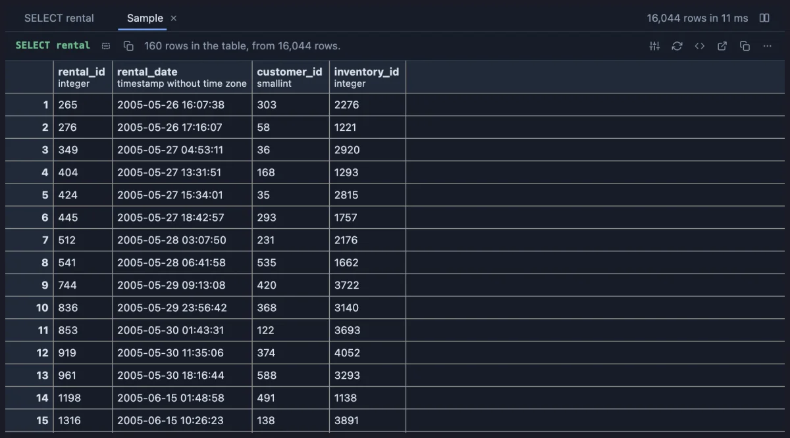
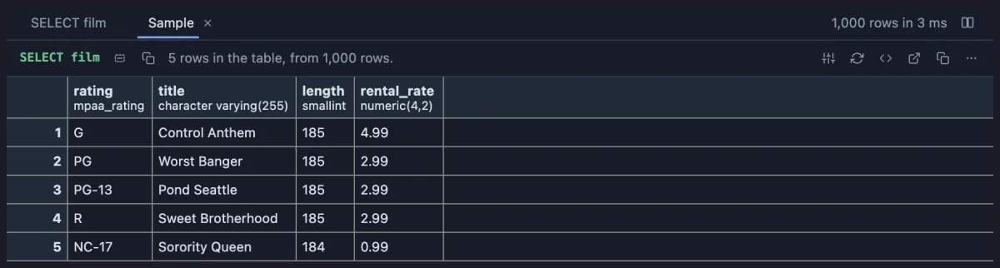

# Sample

A smaller slice of a big result that still looks like the whole: a fair random pick of rows, every tenth row, or one row per group. The same pick again tomorrow if you keep the seed.



One rental in a hundred from the [dvdrental](https://neon.com/postgresql/postgresql-getting-started/postgresql-sample-database) sample database: 160 rows out of sixteen thousand, still in their original order and still spread over the same months. Small enough to read, fair enough to trust.

## What it is for

- **Spot checks**: read 50 random orders of a million to see whether the data looks right, rather than only the first 50, which are often the oldest.
- **A lighter chart**: a scatter of a million points is a blob; a fair 1% shows the same shape and draws at once.
- **One example per kind**: the first (or, with an ORDER BY, the largest or the newest) row of each category, country or status, as `DISTINCT ON` gives in SQL.

## How to read it

The picked rows with every column of the result, of the same types, in the order they had in the result. `random` gives every row the same chance; `systematic` takes every k-th row from a random start, evenly spread; `first-per-group` keeps the first row of each value of **Group**. The Log says how many rows were kept of how many.

## Try it

**One rental in a hundred**, in the dvdrental sample database, the table above:

```sql
-- @extension sample open
-- @inputs percent=1, seed=42, method=random
select rental_id, rental_date, customer_id, inventory_id from rental;
```

**The longest film of each rating**, in the same database: the films sorted longest first, then the first one of each rating kept.

```sql
-- @extension sample open
-- @inputs n=100, method=first-per-group, group=rating
select rating, title, length, rental_rate from film order by rating, length desc;
```



## Settings

| Setting | `@inputs` key | Default | What it does |
|---|---|---|---|
| Rows | `n` | 1000 | How many rows to keep (for `first-per-group`, how many groups) |
| Percent | `percent` | none | A share of the rows instead of a count; when set it wins over Rows |
| Seed | `seed` | 42 | Any number; the same seed on the same result picks the same rows, another seed another sample |
| Method | `method` | random | `random`, `systematic` (every k-th row) or `first-per-group` |
| Group | `group` | none | For `first-per-group`: the column whose values form the groups |

## Good to know

The sample is drawn from the rows the view reads (up to a million), not from the table on the server; for a sample of a huge table, `TABLESAMPLE` in SQL is cheaper. With `first-per-group`, Rows caps the number of groups, and the Log says when groups were left out. It thins the input of a chart through a pipeline: `-- @extension sample | scatter-gl` or `-- @extension sample | echarts`. From a script: `-- @extension sample` above the query, with `-- @inputs n=500, seed=7`.

## Requirements

PostgreSQL 13 or newer. Nothing runs on the server: the sample is drawn in the result's sandbox from the rows already fetched. Stats core installs with it.
