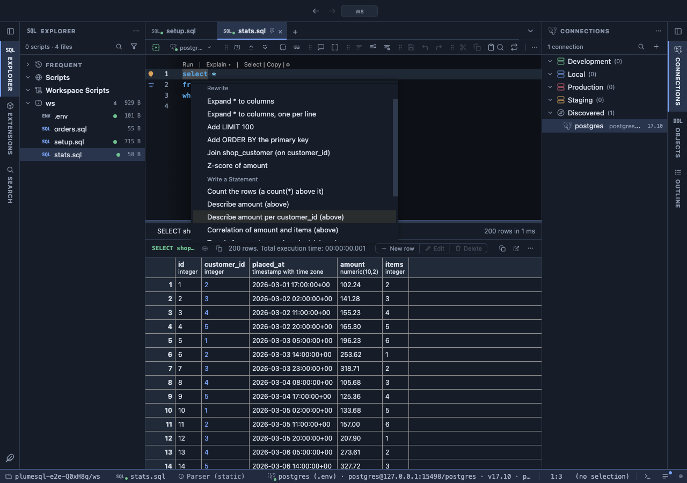
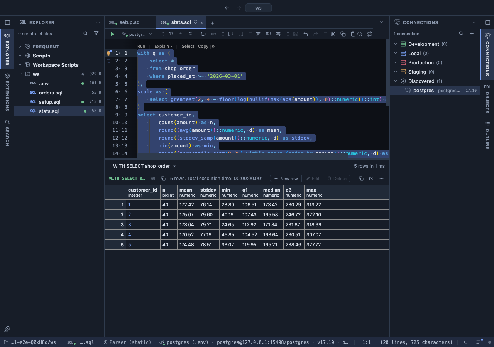

# Statistics refactors

Ask PostgreSQL the usual statistical questions about a number column without writing the SQL: the average and the spread, whether it goes with another column, its trend over time, its histogram, its unusual values. Put the caret on the column, open the lightbulb, pick a question, and the query is written for you.



A query over orders with the caret on `amount`, and the lightbulb open. Each offer writes a new query above yours that answers one question about `amount`: describe it, describe it per customer, see what it goes with, how it moves over time. Your query is left exactly as it was.

## What it is for

- **The numbers behind a column**: what is a typical order, how much do orders vary, what are the smallest and largest, overall or for each customer, in one click.
- **Does it go with something?** Do bigger orders have more items; does spend rise with the number of visits?
- **Is it growing?** How much an amount changes per day over the period the query covers, and how steady that change is.
- **Sharing the answer**: the Analysis views (Profile, Correlation, Histogram, Outliers) compute in the grid over the rows a query returned; these write a query PostgreSQL computes over every row, one you can keep in a file and send to a colleague.

## How to read it

Every offer writes a statement that reads your query as a CTE named `q` and asks one question of it, so your `WHERE`, joins and limits decide what the statistics are about:

| Offer | Answers |
|---|---|
| Describe | how many values, the average, how much they vary (standard deviation), the smallest, the quarter, middle and three-quarter marks (the middle one is the median), and the largest; overall or per group |
| Correlation | how strongly the column goes with up to two others, from -1 to 1 (Correlation's README explains the scale) |
| Trend over time | how much the number changes per day, and how well a straight line fits (r squared, from 0 to 1), overall or per group |
| Histogram | the values counted in 10 equal ranges between the smallest and the largest |
| Outliers | the rows whose value is far from the rest |
| Z-score | for every row, how far its value is from the average, in standard deviations, written into your query as a new column |

## Try it

In the [dvdrental](https://neon.com/postgresql/postgresql-getting-started/postgresql-sample-database) sample database, put the caret on `amount` and press Ctrl+. (⌘. on a Mac):

```sql
select payment_id, customer_id, amount, payment_date
from payment
where payment_date >= '2007-04-01';
```

The lightbulb offers Describe amount, Describe amount per customer_id, Correlation, Trend over time (by `payment_date`), Histogram, Outliers and Z-score. **Describe amount per customer_id**, run, answers with one row per customer: how many payments, their average, spread, smallest, quartiles and largest. The picture shows the same offer on an orders table:



From the editor's own query, **Describe amount** writes above it:

```sql
with q as (
    select payment_id, customer_id, amount, payment_date
    from payment
    where payment_date >= '2007-04-01'
),
scale as (
    select greatest(2, 4 - floor(log(nullif(max(abs(amount)), 0)::numeric))::int) as d from q
)
select count(amount) as n,
       round((avg(amount))::numeric, d) as mean,
       round((stddev_samp(amount))::numeric, d) as stddev,
       min(amount) as min,
       round((percentile_cont(0.25) within group (order by amount))::numeric, d) as q1,
       round((percentile_cont(0.5) within group (order by amount))::numeric, d) as median,
       round((percentile_cont(0.75) within group (order by amount))::numeric, d) as q3,
       max(amount) as max
from q, scale
group by d;
```

## Settings

On the extension's page and in the Refactors settings:

| Setting | Default | What it does |
|---|---|---|
| Histogram bins | 10 | How many ranges the Histogram offer counts in |
| Outliers method | IQR fences | `IQR fences`: far from the middle half of the values; `z-score`: far from the average in standard deviations |
| IQR factor | 1.5 | How far beyond the middle half counts as unusual; 3 flags only the extreme |
| Z-score threshold | 3 | How many standard deviations from the average count as unusual |

## Good to know

How it chooses: **the number column** is the one under the caret, else the query's first number column that is not an id (any column the query returns counts, an aggregate's too). **The group** ("per customer_id") is a foreign key column the query returns or, once it has run, a column whose values repeat in its first rows. **The time** for a trend is the first date or timestamp column.

The `scale` CTE rounds each statistic to about four significant digits of the column's largest value (two decimals at least): amounts in the hundreds keep two, ratios in the thousandths keep seven, and no float noise like `112.91499999999999` reaches the grid. For statisticians: Correlation writes `corr()` (Pearson), Spearman's (Pearson's of the ranks, ties given their average rank) and the r² of a straight line; Trend over time writes `regr_slope(amount, extract(epoch from payment_date)) * 86400` with its r² and span; Histogram uses `width_bucket` (the maximum in the last bin); Outliers uses Tukey's fences (1.5 times the interquartile range beyond the quartiles) or a z-score of 3.

What it reads: the statement's shape and its tables' columns from PlumeSQL's dictionary of the connection; for the group, also the first rows of the query's last run in this tab. Nothing is asked of the server until you run the query. It applies in the SQL editor wherever the extension is attached (everywhere from the install on; change it on its page).

## Requirements

PostgreSQL 13 or newer, and PlumeSQL 0.24.0 or newer.
