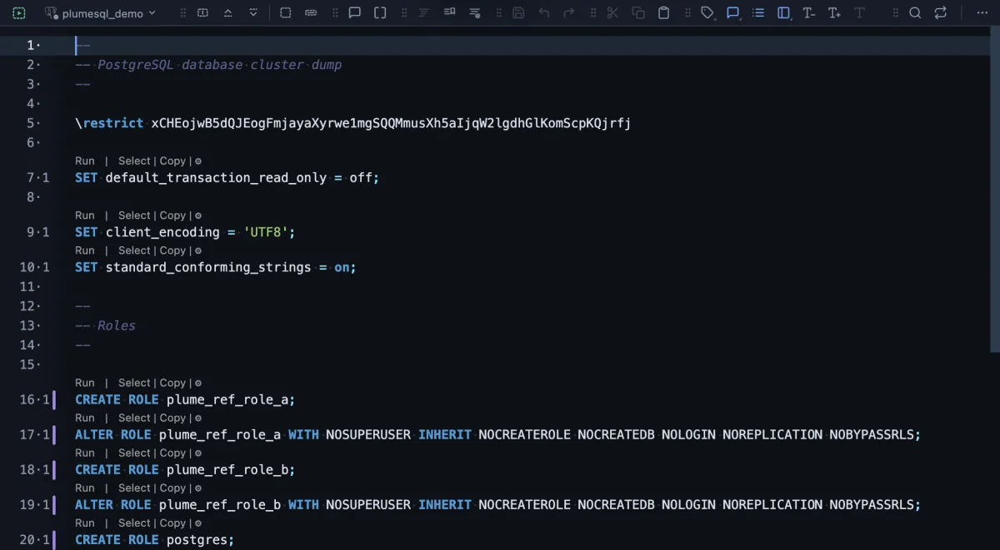

# Backup globals

The server's users, roles and tablespaces written to a SQL file, the part of a server no database backup carries.

Run on a test server, the file opens the moment it is written: one `CREATE ROLE` per role and an `ALTER ROLE` with what that role may do (log in, create databases, bypass row security). Further down come each role's memberships, its per-database settings and the tablespaces. A superuser's file also carries each role's password, hashed.

## When to use it

- **Beside every full backup.** A database backup (**Backup**) holds tables, data and grants, but not the roles those grants name: restore it on a new server without the roles and every `GRANT` fails.
- **Moving to a new server**: run the file there first, then restore the databases.
- **Reviewing who exists** on a server and what each role may do, in plain SQL.

## What it does

1. Runs `pg_dumpall --globals-only` on the tab's connection, in a terminal of its own.
2. Writes `globals-<date>_<time>.sql` into the workspace folder and opens it in a tab.

It asks nothing first: it only reads. A second run writes a new file, the name carries the moment it was taken.

pg_dumpall connects through the connection's own database (`--database`), not the `postgres` database it would try by default, which a hosted service's role may not reach.

## Settings

| Setting | Default | What it does |
|---|---|---|
| file | `globals-{timestamp}.sql` | The file's name in the workspace, declared once so the command and the tab that opens agree. |

## Good to know

- **Who may run it.** Reading the role passwords needs a superuser, or a role granted `pg_read_all_data`. Any other role gets `permission denied for table pg_authid`. On a hosted service that gives you no such role, a copy of the extension (**Copy to My Extensions** in its file's header) with `--no-role-passwords` added reads everything but the passwords.
- **The password stays secret.** It reaches pg_dumpall through the environment (`PGPASSWORD`), never the command line.
- **No setup.** PlumeSQL finds the PostgreSQL client tools on this machine and runs a `pg_dumpall` new enough for the server, or, for a server in Docker here, the server's own image (System, Client tools).
- The file holds password hashes when a superuser wrote it: keep it where you keep backups, not in a public repository.

## Requirements

PostgreSQL 13 or newer and a PostgreSQL client installation (or Docker) on this machine.
