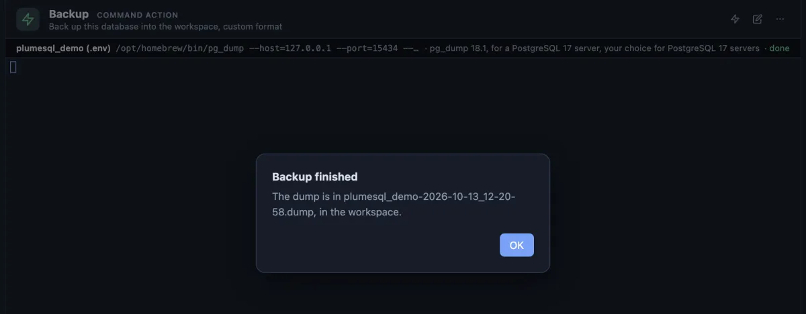

# Backup

A copy of the whole database in one file, made with one click before you change anything.

**Backup** pressed in the title bar on the `plumesql_demo` database: a moment later the alert names the file it wrote, `plumesql_demo-2026-10-13_12-20-58.dump`, in the workspace folder. The line above the terminal says which `pg_dump` ran and that it is done. The terminal stays empty because pg_dump says nothing when all goes well.

## When to use it

- **Before you change something risky**: a migration, a big `UPDATE`, dropping a column. If it goes wrong, **Restore** puts the database back from this file.
- **Before an upgrade** of the server or of the application that uses it.
- **To carry a database to another machine**: copy the file, then restore it there.

## What it does

1. Asks first: "Back up plumesql_demo?", naming the file it will write.
2. Runs `pg_dump` on the database of the tab's connection, in a terminal of its own.
3. Writes `<database>-<date>_<time>.dump` into the workspace folder, so every run makes a new file and never overwrites an older one.
4. Says how it ended: **Backup finished** with the file's name, or **Backup failed**, the terminal holding pg_dump's own reason.

The file is pg_dump's custom format: compressed, and read by `pg_restore`, which can restore all of it or only the parts you pick. It is not a SQL script you open and read; **Dump schema** and **Dump table** write those.

## Settings

| Setting | Default | What it does |
|---|---|---|
| dump | `{db}-{timestamp}.dump` | The file's name in the workspace. It is declared once in the extension, so the question, the alert and the command always name the same file. |

To name it differently, open the extension's file, use **Copy to My Extensions** in its header, and edit the `@var dump=` line of your copy.

## Good to know

- **The password stays secret.** It reaches pg_dump through the environment (`PGPASSWORD`), never the command line, so no other program on the machine can read it from the process list.
- **No setup.** PlumeSQL finds the PostgreSQL client tools on this machine and runs a `pg_dump` new enough for the server; for a server that runs in Docker here it can run the server's own image instead (System, Client tools, where you can also choose).
- **Roles are not in it.** Users and their passwords belong to the server, not to one database: **Backup globals** writes them.
- The file lands in the workspace, beside your files. In a git repository, move it out or ignore `*.dump`.
- Pinned to the title bar's right end as **Backup** (`@toolbar end`); it also runs from its row in the Extensions side tab.

## Requirements

PostgreSQL 13 or newer, a connection whose user may read every object in the database, and a PostgreSQL client installation (or Docker) on this machine.
