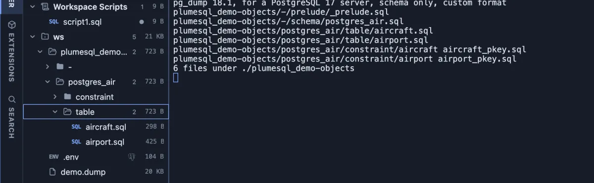

# Dump objects

Every table, view, function and index of the database as its own SQL file, in folders by schema and type.

Run on a small database with two tables: the terminal lists the six files it wrote, and the Explorer shows them as a tree, `postgres_air/table/aircraft.sql`, `postgres_air/table/airport.sql`, the two primary keys under `constraint`, and the schema itself under `-`.

## When to use it

- **Keep the database's structure in git.** Commit the tree, run it again after a change, and the diff shows exactly which objects changed, file by file.
- **Review a change** someone made on a server: dump before and after, and compare the folders.
- **Read one object** quickly, without scrolling through one long schema file.

## What it does

1. Asks where the tree goes: pick a folder of the workspace.
2. Asks first, saying that an earlier tree at the same place is overwritten.
3. Runs PlumeSQL's own `plumesql dump-tree`, which has `pg_dump` and `pg_restore` write the schema and cuts it into one file per object: `<schema>/<type>/<name>.sql`.
4. Says how it ended: **Object tree finished** with the folder, or **Object tree failed** with the reason in the terminal.

Nothing is reformatted or left out: each file is exactly what pg_restore prints for that object. Objects that belong to no schema (the schemas themselves, extensions) go under `-`.

## Settings

| Setting | Default | What it does |
|---|---|---|
| out | asked | The folder the tree goes under. |
| tree | `{out}/{db}-objects` | The tree's own folder, named after the database. |

## Good to know

- **Structure only.** No row of data is written; **Backup** and **Dump table** are the ones for data.
- **The password stays secret.** The connection reaches the tools through the standard `PG*` environment variables, the password among them, never the command line.
- PlumeSQL's **Objects** side tab shows the same objects rendered by PlumeSQL itself; this tree is pg_dump's own text, for when that is what a repository should hold.

## Requirements

PostgreSQL 13 or newer. Nothing to install beyond a PostgreSQL client installation on this machine (System, Client tools): the command is PlumeSQL itself, and it runs pg_dump and pg_restore internally. A connection whose user may read every object.
