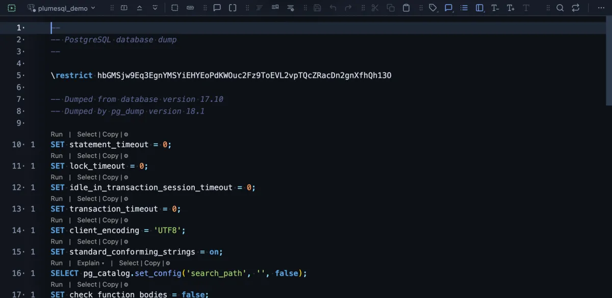

# Dump schema

The whole database's structure (tables, views, functions, indexes, grants) as one SQL file, without a row of data.

The file opens the moment it is written. After the settings every dump starts with, it holds a `CREATE` statement for each object of the database, in the order they can be created again, with comments naming each one.

## When to use it

- **Read the structure** of a database you did not build, top to bottom, with the editor's search and the Outline.
- **Compare two databases**: dump both and diff the files.
- **Create an empty copy** elsewhere: run the file on a new database.

## What it does

1. Runs `pg_dump --schema-only` on the tab's connection, in a terminal of its own.
2. Writes `<database>-ddl-<date>_<time>.sql` into the workspace folder and opens it in a tab.

It only reads, so it asks nothing first. Every run writes a new file.

## Settings

| Setting | Default | What it does |
|---|---|---|
| file | `{db}-ddl-{timestamp}.sql` | The file's name in the workspace, declared once so the command and the tab that opens agree. |

## Good to know

- **The password stays secret.** It reaches pg_dump through the environment (`PGPASSWORD`), never the command line.
- **No setup.** PlumeSQL finds the PostgreSQL client tools on this machine and runs a `pg_dump` new enough for the server, or, for a server in Docker here, the server's own image (System, Client tools).
- One file per object, for a repository, is **Dump objects**. The data is **Backup** or, for one table, **Dump table**.

## Requirements

PostgreSQL 13 or newer, a connection whose user may read every object, and a PostgreSQL client installation (or Docker) on this machine.
