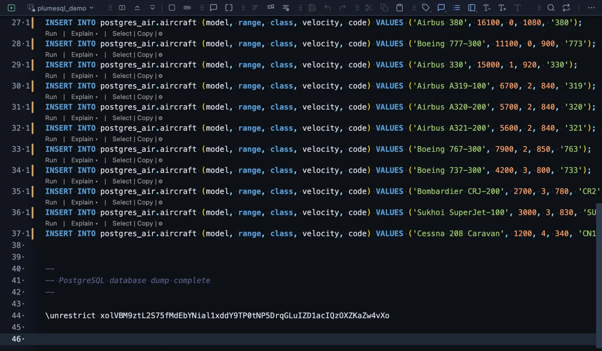

# Dump table

One table saved to a SQL file named after it: its definition, its rows, or both, the rows as `COPY` or as `INSERT` statements.

The `aircraft` table dumped as rows only, as `INSERT` statements: one statement per row, each naming its columns, so the file runs on another database even when its columns are in a different order. The file opens as soon as it is written.

## When to use it

- **A safety copy of one table** before an `UPDATE` or `DELETE` you are not sure about.
- **Seed data** for a test database or a repository: the rows of a lookup table as `INSERT` statements.
- **Move one table** to another database, with or without its rows.

## What it does

1. From the table's row menu in the Objects tree, or the dots menu of an open table: **Run Dump table**. While a table's tab is the active one, the title bar shows it as a pin too.
2. A form asks what to dump and how to write the rows (below), then asks first, naming the table, the database and the host.
3. Runs `pg_dump --table=<the table>` with your choices on the tab's connection, in a terminal of its own.
4. Writes `<table>-<date>.sql` into the workspace folder and opens it.

## Settings

| Setting | Default | What it does |
|---|---|---|
| What to dump | definition and rows (`--format=plain`) | `--schema-only` writes the `CREATE TABLE` with its indexes and constraints alone; `--data-only` the rows alone. |
| Rows as | COPY (`--format=plain`) | `COPY` is the fastest to load back with psql; `--column-inserts` writes one `INSERT` per row with the column names, which every tool and other databases read too. |
| dump | `{name}-{date}.sql` | The file's name in the workspace. |

Each choice in the form is the pg_dump flag itself, shown beside what it means, so the command you see is the command that runs.

## Good to know

- A second dump of the same table on the same day writes over the first (the name carries the date, not the time).
- **The password stays secret.** It reaches pg_dump through the environment (`PGPASSWORD`), never the command line.
- **No setup.** PlumeSQL finds the PostgreSQL client tools on this machine and runs a `pg_dump` new enough for the server, or, for a server in Docker here, the server's own image (System, Client tools).
- For a whole database, **Backup**; for the rows as a spreadsheet, **Export to CSV**.

## Requirements

PostgreSQL 13 or newer, a connection whose user may read the table, and a PostgreSQL client installation (or Docker) on this machine.
