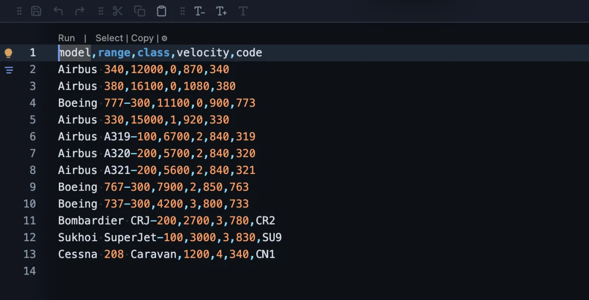

# Export to CSV

A whole table or view saved as a CSV file that a spreadsheet opens, however many rows it has.

The `aircraft` table exported: a first line with the column names, then one line per row, commas between the values. Excel, Numbers, LibreOffice and any data tool open it as it is.

## When to use it

- **Hand data to someone** who works in a spreadsheet.
- **Load it elsewhere**: another database, a notebook, a BI tool.
- **A table too big for the grid**: the rows go straight from the server into the file through psql, never through PlumeSQL's grid, so fifty million rows export the same way as fifty.

## What it does

1. From the row menu of a table, view, materialized view or foreign table in the Objects tree, or the dots menu of an open one: **Run Export to CSV**. While the table's tab is active, the title bar shows it as a pin too.
2. Asks where to write (by default `<table>-<date>.csv` in the workspace), then asks first.
3. Runs psql's `\copy (select * from <the table>) to stdout with (format csv, header)`, its output sent to the file.
4. Says **Export finished**, naming the file, or **Export failed** with the reason in the terminal.

The CSV is PostgreSQL's own: an empty field for NULL, and a value that holds a comma, a quote or a line break is quoted.

## Settings

| Setting | Default | What it does |
|---|---|---|
| Write to | `{name}-{date}.csv` | The file to write: in the workspace, or anywhere when you give a full path. A file of the same name is overwritten. |

## Good to know

- **Where is the file?** The alert names it. The Explorer lists CSV files only while it shows other files (its filter window, or the pane menu's File Kinds); the file is there either way.
- `\copy` runs on your machine, so it needs no right to write files on the server, unlike `COPY ... TO`.
- The path is passed to psql as an argument of its own, never inside the `\copy` text, so a space or a quote in it is simply part of the name.
- **The password stays secret.** It reaches psql through the environment (`PGPASSWORD`), never the command line.
- The result of a query rather than a whole table: **Query to CSV**, or Save As in a result's menu for rows already in the grid.

## Requirements

PostgreSQL 13 or newer, a connection whose user may read the table or view, and a PostgreSQL client installation (or Docker) on this machine.
