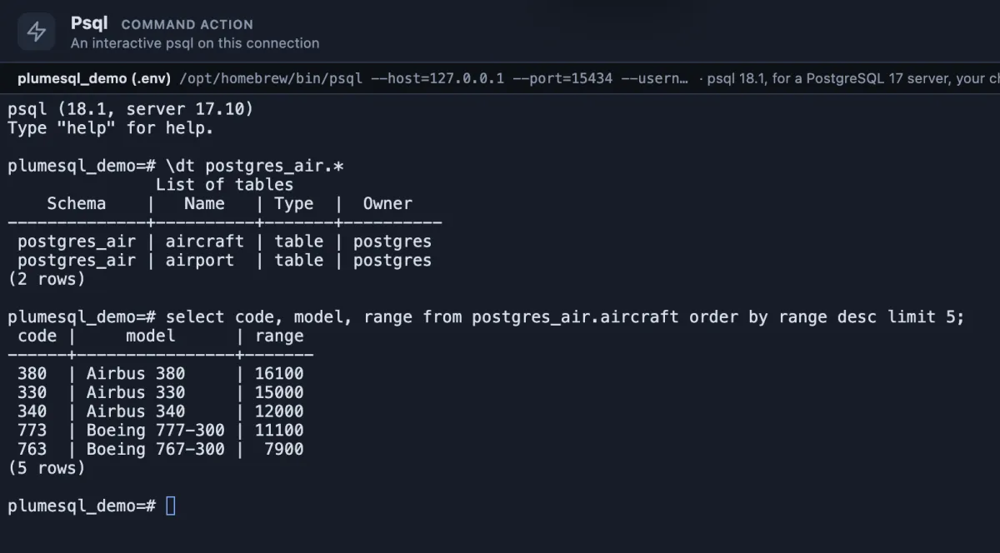

# psql

PostgreSQL's own command line, already connected to the tab's database, one click from the title bar.

A session on `plumesql_demo`: `\dt postgres_air.*` lists the schema's tables, and a plain `select` prints its rows the way psql always does.

## When to use it

- **psql's backslash commands**: `\d`, `\df+`, `\timing`, `\watch`, `\x`, and the rest.
- **`\copy`** to or from a file on your machine.
- **A script or a habit** that already lives in psql.

## What it does

Runs `psql` with the tab's connection (host, port, user, database) in a terminal of its own. Type as you would in any terminal; `\q` ends the session and the tab keeps what was printed.

## Good to know

- **The password stays secret.** It reaches psql through the environment (`PGPASSWORD`), so it is never on the command line, in the terminal or in a shell history. psql is told not to prompt for one (`--no-password`): with no password to hand it says so instead of waiting.
- **No setup.** PlumeSQL finds the PostgreSQL client tools on this machine and runs a psql new enough for the server, or, for a server in Docker here, the server's own image (System, Client tools).
- Pinned to the title bar's right end as **psql** (`@toolbar end`); it also runs from its row in the Extensions side tab.
- PlumeSQL's own editor understands the common ones too: `\d`, `\dt`, `\df`, `\sf`, `\conninfo` answer in the editor without a terminal.

## Requirements

PostgreSQL 13 or newer and a PostgreSQL client installation (or Docker) on this machine.
