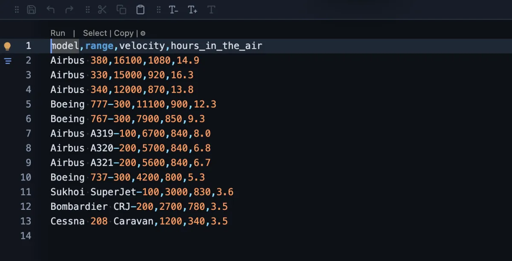

# Query to CSV

The rows of a query written straight into a CSV file, never loaded into the grid: for extracts of any size.



The statement below, run into a file from the editor's right-click menu. The CSV has the query's own column names on its first line, `hours_in_the_air` included, and one line per row:

```sql
select model, range, velocity,
       round(range::numeric / velocity, 1) as hours_in_the_air
from postgres_air.aircraft
order by range desc;
```

## When to use it

- **A big extract**: millions of rows for another team or tool. psql streams them from the server into the file, so nothing waits for a grid and nothing is held twice.
- **A report you rerun**: keep the query in a script and send it to a file whenever it is needed.
- **Exactly the columns you want**: joins, filters and computed columns, which a whole-table export (**Export to CSV**) cannot give.

## What it does

1. Right-click a statement in the editor (or its row in the Outline, or a result's dots menu for the statement it came from): **Run Query to CSV**.
2. Asks where to write (by default `query-<date>_<time>.csv` in the workspace), then asks first, warning that the statement runs again.
3. Runs psql with `COPY (<the statement>) TO STDOUT WITH (FORMAT csv, HEADER)`, its output sent to the file.
4. Says **Export finished**, naming the file, or **Export failed** with the reason in the terminal.

The statement may span as many lines as you like. NULL is an empty field, and a value that holds a comma, a quote or a line break is quoted.

## Settings

| Setting | Default | What it does |
|---|---|---|
| Write to | `query-{timestamp}.csv` | The file to write: in the workspace, or anywhere when you give a full path. A file of the same name is overwritten. |

## Good to know

- **The statement must return rows**: a `SELECT`, `VALUES`, `TABLE`, or an `INSERT`, `UPDATE` or `DELETE` with `RETURNING`. One that changes data changes it again here, which the question says before anything runs.
- A statement with parameters (`$1`, `:name`) cannot run this way: psql has no values for them and says so in the terminal.
- **Where is the file?** The alert names it. The Explorer lists CSV files only while it shows other files (its filter window, or the pane menu's File Kinds).
- **The password stays secret.** It reaches psql through the environment (`PGPASSWORD`), and the path is an argument of its own, never inside the SQL.
- Rows already in the grid: Save As in the result's menu writes them without running the query again.

## Requirements

PostgreSQL 13 or newer and a PostgreSQL client installation (or Docker) on this machine.
