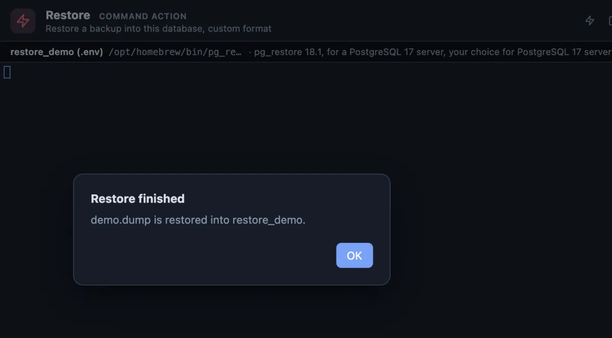

# Restore

A backup file put back into the tab's database: the way back from **Backup**.

`demo.dump` restored into an empty test database, `restore_demo`: the alert says it is done, and the database now holds the dump's schema, both tables with all their rows and their primary keys. pg_restore prints nothing when everything goes well, so the terminal stays empty.

## When to use it

- **Undo a change that went wrong**, from the backup taken before it.
- **Copy a database** to another server or another database: back it up there, restore it here.
- **Refresh a test database** from a production backup.

## What it does

1. Asks which backup to restore: the workspace's files, newest first.
2. Asks first, naming the file, the database and the host, because this one writes.
3. Runs `pg_restore --clean --if-exists --no-owner` on the tab's connection, in a terminal of its own.
4. Says **Restore finished**, or **Restore failed**: pg_restore names each object it could not restore and ends with how many, and the database keeps what did restore.

`--clean --if-exists` first drops the objects it is about to recreate (those that exist), so a second restore of the same file lands cleanly. `--no-owner` gives the restored objects to the user who restores them, so a backup from another server does not need that server's roles.

## Settings

| Setting | Default | What it does |
|---|---|---|
| dump | asked | The backup file to restore, picked from the workspace. |

## Good to know

- **Check the tab's connection before you run it**: the restore goes into the database the tab is connected to, and objects with the same names there are replaced. Restore into a new, empty database when in doubt (`create database restored;`, connect to it, then run).
- **Check the file first** with **List backup**.
- Roles are not in a database backup: run the file **Backup globals** wrote first on a new server.
- **The password stays secret.** It reaches pg_restore through the environment (`PGPASSWORD`), never the command line.
- It reads custom format archives, the kind **Backup** writes. A plain SQL dump runs with **Run SQL file** instead.

## Requirements

PostgreSQL 13 or newer, a connection whose user may create the objects the backup holds, and a PostgreSQL client installation (or Docker) on this machine, not older than the pg_dump that wrote the file.
